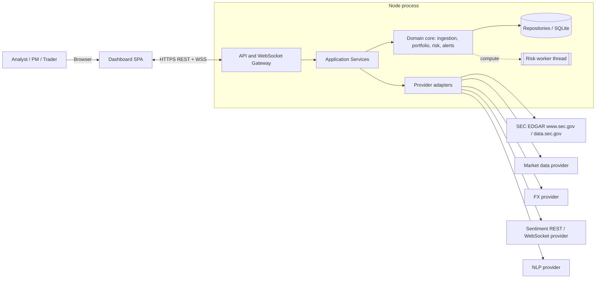
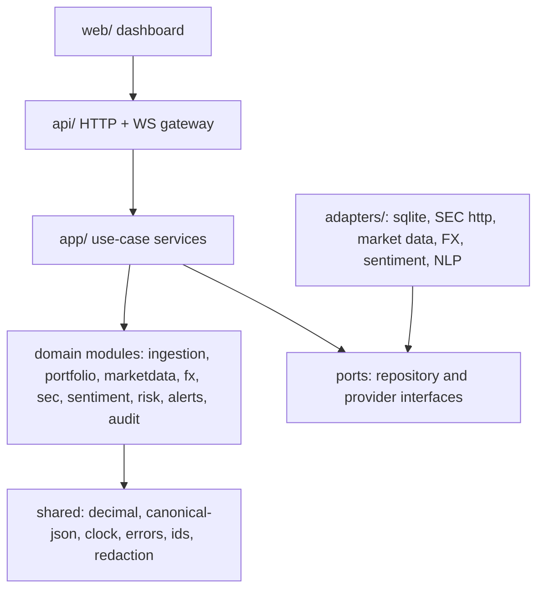
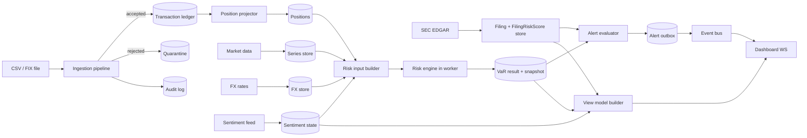
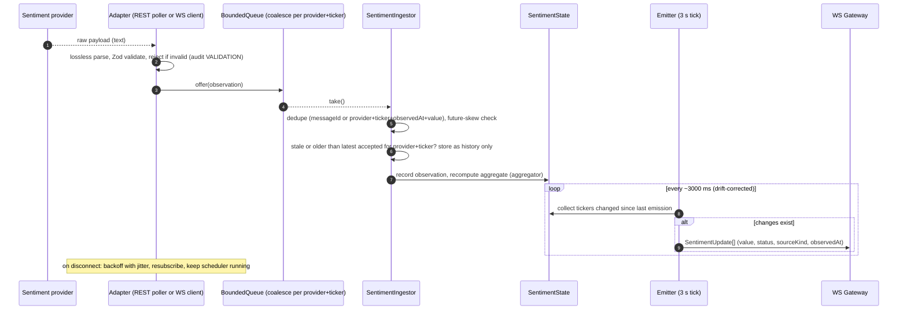
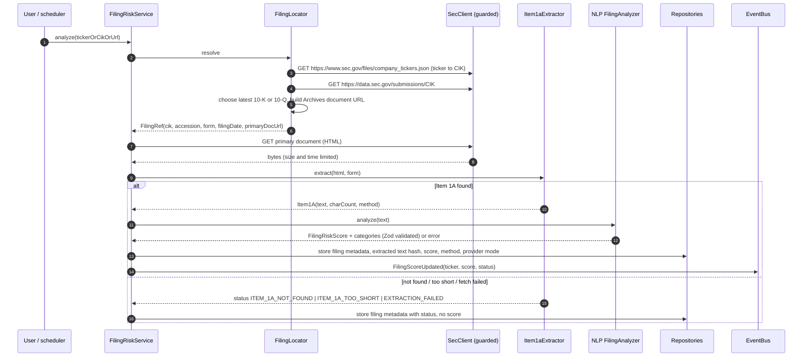
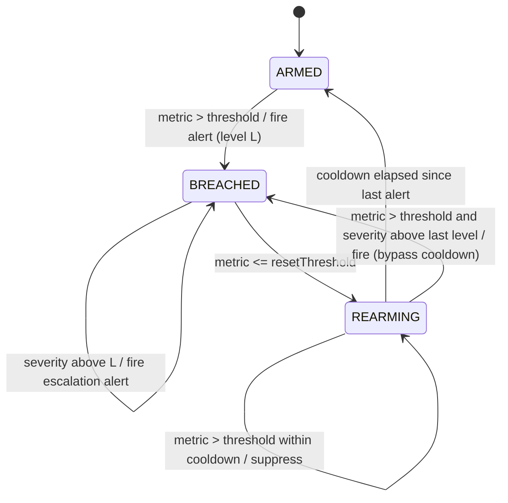
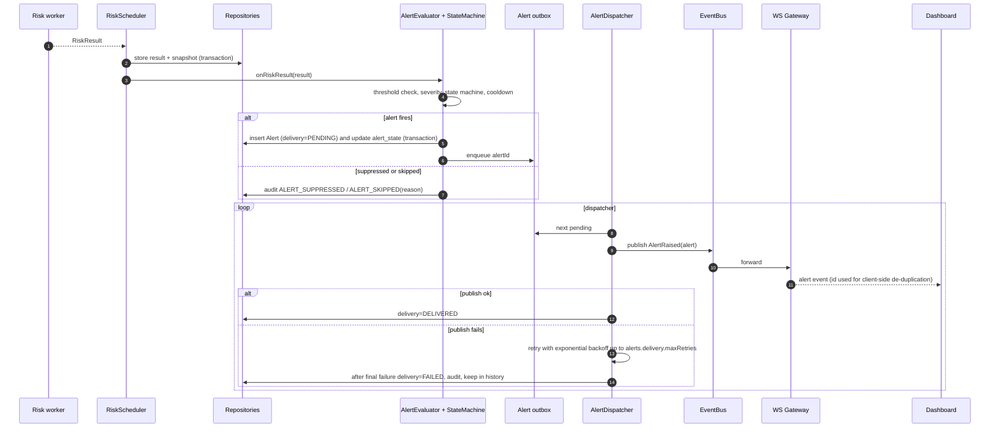
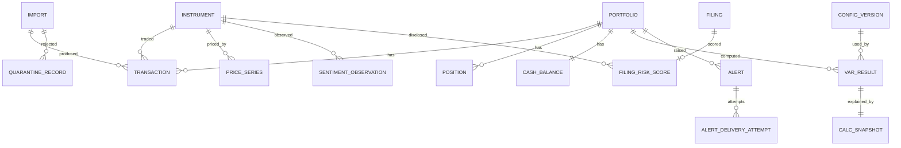

# Design Document

## Overview

Spectral Risk Chimera is a portfolio risk monitoring application. It ingests transactions (CSV and FIX), builds netted positions, retrieves market prices and FX rates, analyses SEC 10-K and 10-Q Item 1A risk factors, ingests market sentiment, and computes Historical Simulation Value-at-Risk (VaR) in two forms: `baseVaR` and `sentimentAdjustedVaR`. It raises risk alerts and shows everything in a dashboard. It does not trade.

This document designs the system specified in `.kiro/specs/requirements.md` (R1 to R35, FR-1 to FR-14, NFR-PERF-1, OD-1 to OD-18). Requirement IDs in this document refer to that file. The requirements' Open Decisions table is the single register of decisions; this design does not decide anything listed there as Open.

### Design goals

1. **A modular monolith.** One Node.js process (plus one worker thread for VaR) with strict module boundaries. No microservices. Every external system sits behind an interface so it can be replaced or faked in tests (R26).
2. **TypeScript and ES modules, compiled with `tsc`.** Strict TypeScript, `"type": "module"`, `module` and `moduleResolution` set to `NodeNext`, and `verbatimModuleSyntax: true` (R26.4). Application code is compiled into `dist/` and runs as JavaScript on Node.js 24.22.1, with Node.js 26 checked in CI (R26.7, R26.8, R27.12). The repository's current `"type": "commonjs"` changes in phase 1.
3. **Zod at every external boundary.** HTTP bodies, uploaded rows, FIX fields, provider payloads, NLP output, environment, and configuration are validated with Zod before they reach domain code (R24.6, R29.5).
4. **Decimal.js for all financial arithmetic.** Decimal values are decimal strings at API, persistence, snapshot, and log boundaries. Native numbers appear only in the dashboard's chart adapter (R4).
5. **Two independent signals.** `FilingRiskScore` and `SentimentIndex` live in separate modules, tables, types, and view-model fields. Only sentiment feeds the VaR adjustment, and `FilingRiskScore` is not an input to the risk engine's types at all (R11, R15.14, R35).
6. **Pure risk core.** The risk engine is a pure, deterministic function of an explicit input object. This makes results reproducible and testable (R32).
7. **Incremental delivery.** The build order in [Incremental Delivery Plan](#incremental-delivery-plan) yields a working, tested system after each phase (R26.6).

### Design decisions

Status values: **Approved** (decided), **Provisional** (approved for now, to be confirmed), **Proposed** (a recommendation for an open decision; the design is built so it can change). Only Approved and Provisional entries may be relied on as final.

| ID | Status | Decision | Rationale | Requirements |
|---|---|---|---|---|
| D-1 | Approved | Single process modular monolith, risk engine in a `worker_threads` worker started from the compiled entry `dist/risk/riskWorker.js` | Keeps deployment simple while keeping VaR off the event loop and UI path | R23.4, R26, R26.8, R33.9 |
| D-2 | Approved | TypeScript `strict: true`; ES modules (`"type": "module"`, `NodeNext`, `verbatimModuleSyntax`); `tsc` builds to `dist/`; ESLint rules ban `parseFloat`, `Number()`, and unary `+` in financial modules | Enforces R4.2 statically and matches the approved stack (OD-11) | R4.2, R26.4, R26.8 |
| D-3 | Approved | Zod 4 schemas are the single source of truth for external shapes; TypeScript types are inferred from them (`z.infer`) | Prevents drift between validation and types | R24.6, R29.5 |
| D-4 | Approved | `DecimalString` Zod type accepts decimal text only (never a JSON number) and converts to `Decimal` in domain code through one helper | Enforces R4.3 and R4.6 | R4 |
| D-5 | Approved (library Open, OD-16) | Provider JSON is parsed with a lossless JSON parser (numeric tokens kept as text), then validated by Zod | `JSON.parse` turns `0.1` into a binary float, which would violate R4.2 for provider prices | R4.2, R12 |
| D-6 | Approved (OD-12 resolved) | Repository interfaces in the domain; SQLite through the built-in `node:sqlite` behind an internal driver interface (`persistence/sqlite/`) | Synchronous transactions give simple atomic imports (R28.15) | R28, R22 |
| D-7 | Approved | In-process typed event bus and an alert outbox table | At-least-once alert delivery without a message broker | R19, R34 |
| D-8 | Approved | React with Vite for the dashboard; Fastify 5 (exact pin 5.12.8) for the HTTP API and WebSocket gateway (OD-17 Resolved, with its conditions) | Mainstream, small, testable | R17, R23, R26.9, R35 |
| D-9 | Approved | Positions are a projection of the transaction ledger, rebuilt deterministically | Position updates happen only after commit and are idempotent | R28.17, R5 |
| D-10 | Approved | Market series are stored content-addressed (SHA-256 of the canonical series), and snapshots reference hashes | Allows exact recomputation from a snapshot without copying large series | R32, R22.5 |
| D-11 | Approved interface; formula Proposed (OD-1) | Sentiment aggregation is a pluggable, versioned function. The `windowed-mean-v1` formula is only a proposal | Lets the formula be approved or replaced without touching callers | R10.1 |
| D-12 | Approved | Virtual clock (`Clock` interface) and monotonic timer used everywhere time matters | Deterministic tests for cadence, staleness, cooldown | R10.5, R34, R31 |
| D-13 | Approved | Node.js 24.22.1 for development (`engines` and `.nvmrc`); CI matrix of Node.js 24.22.1 and Node.js 26 | Pins the initial environment and checks the next LTS | R26.7, R27.12 |
| D-14 | Approved | Toolchain: Zod 4, Decimal.js, Vitest, fast-check, ESLint with typescript-eslint (flat config), Prettier, dependency-cruiser, Playwright; exact versions and a committed lockfile | Single, pinned toolchain | R26.5, R26.7, R27.5, R27.13 |
| D-15 | Approved | Configuration policy: financially significant settings have no code defaults and must be supplied; a committed template supplies approved baselines and leaves open values as placeholders | Prevents silent financial defaults | Configuration, R14.2, R15.1 |
| D-16 | Approved | `portfolio/` is pure (ordering, FR-13 replay, views, event types). The `app/` layer coordinates domain logic, persistence ports, and event publication, and publishes `PositionsChanged` only after a successful commit and only when positions changed. A rebuild reconciles all persisted positions of a portfolio against the complete replay (insert, update, delete orphans) in one unit of work. The composition root is deferred to a later bootstrap task | Keeps domain logic testable without I/O and makes it impossible to publish an uncommitted projection | R5.3–R5.7, R28.17, R28.18 |

### Decision register

Each design-level identifier maps to one requirements decision. The requirements table is authoritative for status and recommendation; this table records only design-specific detail.

| ID | Requirements ID | Status | Design-specific detail |
|---|---|---|---|
| U-1 | OD-12 | Resolved | Persistence sits behind `UnitOfWork` and repository ports. The in-memory unit of work (tests) and the SQLite unit of work (task 5.3) share the write rules (`persistence/constraints.ts`) and pass the same contract tests. See [SQLite adapter](#sqlite-adapter-task-53-od-12). |
| U-2 | OD-1 | Open | `SentimentAggregator` interface with a version string. `windowed-mean-v1` is the proposed implementation, using `sentiment.windowSeconds`. |
| U-3 | OD-11 | Resolved | React with Vite, Vitest with fast-check, Playwright for end-to-end tests. |
| U-4 | OD-9 | Open | The FIX parser is written against a mapping table, so the supported version and tags can be set once OD-9 is decided. The table in [FIX Parser](#fix-parser) is a proposal. |
| U-5 | OD-15 | Open | `FilingAnalyzer` chunks at `nlp.maxInputChars` and records the combination method version. The maximum-severity combination is a proposal. |
| U-6 | OD-7 | Open | `AuthGuard` interface. Local single-user mode binds to `127.0.0.1` only (A-15). |
| U-7 | OD-5, OD-13 | Open | Provider interfaces plus recorded-fixture providers for tests; no vendor chosen. For FX, the ECB adapter (task 10.2) is proposed for a EUR base only. Its financial configuration (`fx.baseCurrency` EUR, `fx.provider` ECB) is conditionally approved in DR-FX-1 (requirements, Configuration policy 2); OD-5 stays open until live verification of the query shape and the legal reuse question are resolved. Risk results and snapshots are compared or reused across a base-currency change only after a configuration-version compatibility check. |
| U-8 | OD-10 | Open | Not calculated; view model field `riskContribution` is `null`. |
| U-9 | OD-3 | Open | Weekends only behind a `TradingCalendar` interface. |
| U-10 | OD-2 | Open | Benchmarks record the environment; budgets are not enforced in CI until set. |
| U-11 | OD-16 | Open | The lossless parser is wrapped in `shared/losslessJson.ts`, so the library choice affects one module. The contract is fixed (see [Shared utilities](#shared-utilities-shared)): numbers as `LosslessJsonNumber`, duplicate keys and a leading BOM rejected, depth 64. The chosen library, or the wrapper around it, must meet all of it. |
| U-12 | R6.5 | Resolved | `ITEM_1A_TOO_SHORT` is a requirement status. The `sec.item1a.minChars` value (500) is a provisional operational default (OD-6). |
| U-13 | OD-17 | Resolved | Fastify 5 (5.12.8) for HTTP and WebSocket. Built-in logger disabled; Zod validation through a project validator compiler; generic error bodies with correlation ids; 1 MiB body limit. See [API, WebSocket Gateway, and View Models](#api-websocket-gateway-and-view-models). |
| U-14 | OD-6 | Open | Every financially significant value listed in OD-6 is a required key in `ConfigSchema` with no default. Provisional operational defaults are flagged in the start-up configuration summary. |
| U-15 | OD-18 | Resolved | Exponent notation is rejected by the fixed `DecimalText` grammar (R4.6). There is no exponent-limit setting. |
| U-16 | OD-19 | Open | No production mode exists. Every result that used a `DEMO` FX rate or `DEMO` price history carries `DEMO_DATA` and is labelled DEMO; the production-mode refusal (`FX_DEMO_NOT_ALLOWED`, R30.11) waits for OD-19. |

## Architecture

### System context



### Layers and dependency rule

Dependencies point inward only. Domain modules never import adapters, the API, or the UI.

`app/` holds the use-case services. They coordinate pure domain logic, persistence ports (`UnitOfWork`, repositories), and outbound ports such as `PositionEventPublisher`, and they own post-commit event publication. `app/` may import `shared/`, `config/`, domain modules through their `index.ts`, `persistence/ports.ts`, and its own files. It never imports persistence implementations, `adapters/`, `api/`, or `web/`; concrete implementations are injected. `portfolio/` stays pure: it imports neither persistence nor the event bus.

Composition root (deferred): the concrete wiring that constructs the persistence adapter, the event bus adapter behind `PositionEventPublisher`, the logger, the clock, and the app services, and hands them to `api/`, is deferred to a later application bootstrap task. Its location and its dependency-cruiser rule are decided in that task. Until then, `app/` services receive their ports through constructor or factory parameters, and tests wire them with fakes (for example the in-memory unit of work and a recording publisher). No task in the current plan delivers the composition root yet (see the task list notes).



### Source layout

```
src/
  shared/        decimal.ts, canonical.ts, clock.ts, errors.ts, result.ts, redact.ts, ids.ts, boundedQueue.ts, sleeper.ts, retryAfter.ts, resilience.ts, dataStatus.ts
  config/        schema.ts (Zod), loader.ts, configVersion.ts
  ingestion/     csv/, fix/, normalize.ts, dedupe.ts, quarantine.ts, importService.ts
  portfolio/     ledger.ts (LedgerEntry, compareLedgerOrder), positionProjector.ts (pure replay), positionView.ts, events.ts (PositionsChanged type), allocation.ts, exposure.ts
  marketdata/    ports.ts, normalize.ts, fixtureProvider.ts, calendar.ts, seriesCleaner.ts, returns.ts, alignment.ts (the series store is in app/, task 9.4)
  fx/            ports.ts, normalize.ts, fixtureProvider.ts, fxService.ts (task 10.1)
  sec/           ports.ts (SecDnsResolver, SecurityEventSink), addressPolicy.ts, urlGuard.ts, secClient.ts, filingLocator.ts, item1aExtractor.ts, filingRiskService.ts
  nlp/           ports.ts (FilingNlpProvider, FilingAnalysisSchema), fallbackProvider.ts, filingAnalyzer.ts
  sentiment/     ports.ts (SentimentTextProvider, SentimentTextAnalysisSchema), ingestor.ts, aggregator.ts, emitter.ts, sentimentState.ts
  risk/          riskEngine.ts, quantile.ts, scenarios.ts, adjustment.ts, snapshot.ts, riskWorker.ts, riskScheduler.ts
  alerts/        evaluator.ts, stateMachine.ts, dispatcher.ts, eventBus.ts
  audit/         auditLog.ts
  app/           ports.ts (PositionEventPublisher), positionService.ts, importUseCase.ts, seriesStore.ts (task 9.4), fxRateRecorder.ts (task 10.3); later use cases
  persistence/   ports.ts (repositories, including SeriesRepo), memory/ (in-memory unit of work), sqlite/ (adapter), migrations/
  adapters/      providers (market data, FX, sentiment REST/WS, NLP), http/ (TLS-verified HTTPS transport, task 8.2), fx/ (ECB FX adapter and its fixed-format CSV parser, task 10.2, proposed under OD-5)
  api/           server.ts, routes/, auth/, wsGateway.ts, viewModels.ts
  web/           dashboard SPA
test/            unit/, property/, integration/, e2e/ (Playwright), fixtures/, bench/
config/          config.template.jsonc (approved baselines; empty placeholders for OD-6 values)
dist/            tsc output (not committed; already ignored by .gitignore)
```

Test fixtures live in `test/fixtures/`, which is not excluded by `.gitignore` or `.kiroignore` (R27.11). `src/shared/losslessJson.ts` wraps the provider JSON parser (OD-16). `src/web/` is a separate Vite build with its own `tsconfig`; it imports only the shared API contract types and `toChartNumber`.

### Runtime topology

- **Main thread:** HTTP API, WebSocket gateway, importers, provider adapters, schedulers, alert evaluation, persistence.
- **Risk worker (one `worker_threads` thread):** executes `RiskEngine.compute`. The worker is started from the compiled ES module `dist/risk/riskWorker.js`, resolved with `new URL('./riskWorker.js', import.meta.url)` from the compiled scheduler, so no TypeScript loader is needed at runtime (R26.8). Unit tests call `RiskEngine.compute` in-process; an integration test starts the compiled worker (AT-ARC-03). Input and output cross the thread boundary as plain JSON with decimal strings (no `Decimal` instances, no native numbers for money). A slow VaR run therefore cannot block I/O or the dashboard feed (R23.4, R33.9).
- **Schedulers (main thread):** sentiment emission tick (3,000 ms target), risk recalculation scheduler, market data and FX refresh, SEC refresh, alert dispatcher retry loop.

### Data-flow overview



The edge from the filing store goes to the alert evaluator and the view model only. There is no edge from the filing store to the risk input builder. This is the structural enforcement of R11.5.

### Incremental Delivery Plan

Each phase ends with passing tests and a runnable application. A requirement is listed in the first phase that needs it; cross-cutting requirements are also listed in the table after this one. Nothing is removed because it is scheduled later.

| Phase | Scope | Requirements first delivered | Acceptance tests | Blocked by |
|---|---|---|---|---|
| 1 | **Foundations.** ESM and strict `tsconfig` (`NodeNext`, `verbatimModuleSyntax`), `tsc` to `dist/`, Node.js 24.22.1 pin, exact dependency pins and lockfile; ESLint (financial rules), Prettier, dependency-cruiser boundaries, Vitest, fast-check; CI on Node.js 24.22.1 and 26; `shared/` utilities (Decimal helper, canonical JSON, `Clock`, `Result`, `BoundedQueue`, `redact`); Zod primitives and score schemas; config loader with the configuration policy and template; `EnvSchema` and `.env.example` | R4, R21.1–R21.3, R24.1–R24.4, R24.7, R26.4–R26.8, R26.10, R27.10–R27.13, R29.12, R32.3, Configuration | AT-DEC-01–07, AT-CFG-01–07, AT-ARC-01–07, AT-SEC-19, AT-SEC-24, AT-REP-05, AT-SEN-16, AT-SEN-26 | None |
| 2 | **HTTP API gateway and transaction import.** Fastify gateway bound to 127.0.0.1 with Zod-validated routes, generic error bodies, rate limiting, upload limits, and filename sanitization; persistence ports with an in-memory unit of work; CSV import, quarantine, audit, ledger, and position projection (quantities and average price) | R1, R3, R5.1, R5.3–R5.5, R22.1, R22.6, R24.5, R24.6, R26.9, R28, R29.4–R29.6, R29.13 | AT-CSV-01–20, AT-CSV-22–24, AT-POS-01–09, AT-AUD-01, AT-AUD-05, AT-SEC-21, AT-SEC-25–27 | OD-12 (SQLite adapter and AT-CSV-12); OD-17 Resolved (Fastify 5) |
| 3 | **Market data, FX, valuation, and Base VaR.** Provider resilience layer (timeouts, retries, status, stale labelling) and lossless JSON; market data and FX services; position valuation; allocation and exposure; quantile and Base VaR; compiled risk worker; risk scheduler for position and price triggers; snapshots and `LAST_VALID` results | R5.2, R12, R13, R14, R16.1–R16.3, R16.6, R16.7, R20, R22.3–R22.5, R24.8, R25, R30, R32, R33.3, R33.9, R33.10 | AT-VAR-01–18, AT-MD-01–14, AT-MD-16–18, AT-FX-01–20 (AT-FX-11 blocked by OD-19; AT-FX-13–19 blocked by OD-5), AT-ALC-01–10, AT-REP-01–04, AT-REP-06–08, AT-REP-10, AT-PRV-01–03, AT-PRV-08, AT-PRV-10, AT-PRV-11, AT-AUD-03, AT-AUD-04, AT-DSH-07, AT-DSH-08, AT-SEC-23, AT-BEN-01 (record) | OD-16 (parser library); OD-6 values before real use; OD-5 (fixtures suffice); OD-19 (production mode, AT-FX-11) |
| 4 | **Sentiment, adjustment, and WebSocket gateway.** REST and WSS sentiment clients with reconnect, deduplication, bounded queue, and freshness; aggregator interface and emitter; adjustment and Adjusted VaR; WebSocket gateway streaming sentiment and risk updates; filing-independence checks using the phase 1 filing type | R9, R10, R11.1–R11.5, R15, R16.4, R33.4, R33.5 | AT-SEN-01–15, AT-SEN-17–25, AT-SEN-27–29, AT-CAD-01–06, AT-PRV-04–07, AT-FIL-01–03, AT-REP-09, AT-VAL-01, AT-BEN-02 (record) | OD-1 (formula; AT-SEN-21); OD-13 (fixtures suffice) |
| 5 | **Dashboard and VaR alerts.** React and Vite dashboard; view models with signal separation; VaR alert evaluation, state machine, outbox, and dispatcher; Playwright end-to-end test | R11.6, R11.7, R17.1–R17.4, R17.6–R17.9, R18, R19, R23, R27.5, R34.1, R34.2, R34.5–R34.8, R35 | AT-DSH-01–03, AT-DSH-05, AT-DSH-09–15, AT-ALR-01–05, AT-ALR-07–15, AT-ALR-17–18, AT-FIL-04, AT-ALC-11 | OD-2 (AT-DSH-04 enforcement only) |
| 6 | **FIX import** | R2, R28 (FIX parts), R33.2 | AT-FIX-01–06 | OD-9 |
| 7 | **SEC filing risk.** SEC URL guard and client (User-Agent, rate limit, timeouts, size limits, redirects); filing locator; Item 1A extraction; NLP port and fallback; filing scores and freshness; filing-risk alerts; filing panel in the dashboard | R6, R7, R8, R16.5, R17.5, R22.2, R29.8–R29.11, R29.14, R31, R33.6, R33.7, R34.3, R34.4, R34.6 (filing reset) | AT-FIL-05–20, AT-SEC-01–18, AT-SEC-28–31, AT-PRV-09, AT-DSH-06, AT-AUD-02, AT-ALR-06, AT-ALR-16 | OD-15 (chunking); `sec.userAgent` supplied by the operator |
| 8 | **Hardening.** Authentication and authorization; CSV export with formula neutralization (when an export is added); performance budget enforcement on the reference environment; soak tests | R29.1–R29.3, R29.7, R33.1, R23.1 (enforcement), NFR-PERF-1 (enforcement) | AT-SEC-20, AT-SEC-22, AT-CSV-21, AT-FIX-07, AT-DSH-04, AT-CAD-07 | OD-7; OD-2 |

All 35 requirements appear in at least one phase. Every acceptance test in the requirements matrix is assigned to exactly one phase above, except AT-MD-15, which is blocked by OD-3 and not scheduled in version 1.

#### Cross-cutting requirements

| Requirement | First phase | Also applies in |
|---|---|---|
| R4 Financial precision | 1 | Every phase |
| R11 Signal separation | 1 (boundary rule) | 4 (risk side), 5 (display), 7 (filing pipeline) |
| R16 Recalculation | 3 | 4 (sentiment triggers), 7 (filing updates do not recalculate) |
| R17 and R34 Dashboard and alerts | 5 | 7 (filing values and filing alerts) |
| R21 Score validation | 1 (schemas) | 4 (sentiment), 7 (filing) |
| R22 Provenance and audit | 2 | 3, 4, 7 |
| R24 Credentials and security | 1 (secrets, redaction) | 2 (API responses), 3 and 4 (TLS to providers), 7 (SEC) |
| R25 Provider reliability | 3 | 4, 7 |
| R26 Architecture | 1 | Every phase |
| R27 Testing | 1 (`npm test`, CI) | Every phase; R27.5 in phase 5 |
| R29 Access control and input safety | 2 (input, uploads, errors) | 7 (SSRF), 8 (authentication, export) |
| R33 Performance and resilience | 2 (CSV timing recorded) | 3 (VaR, isolation), 4 (queue, sentiment), 6 (FIX), 7 (SEC, NLP), 8 (enforcement) |
| Configuration policy | 1 | Every phase that adds settings |

#### Correctness properties by phase

The technique column replaces the earlier blanket "property-based unless noted" statement. "fast-check" tests compare against an independent rational-arithmetic or model reference where noted in [Testing Strategy](#testing-strategy).

| Property | Phase | Technique |
|---|---|---|
| Property 1: Decimal exactness | 1 | fast-check with rational reference |
| Property 2: Canonical decimal round trip | 1 | fast-check |
| Property 3: Quantile correctness and bounds | 3 | fast-check with rational reference |
| Property 4: VaR is a quantile of losses | 3 | fast-check |
| Property 5: Portfolio P&L is the sum of position P&L | 3 | fast-check with rational reference |
| Property 6: Adjustment locality and monotonicity | 4 | fast-check |
| Property 7: Strict trigger threshold | 4 | fast-check plus boundary examples |
| Property 8: Direction awareness | 4 | fast-check |
| Property 9: Ineligible sentiment never adjusts | 4 | fast-check with fake clock |
| Property 10: Base VaR is independent of sentiment | 4 | fast-check |
| Property 11: Filing independence | 4 (risk side), 7 (full pipeline) | Static type and dependency-cruiser checks plus fast-check |
| Property 12: No combined score | 5 | Static type check plus example tests |
| Property 13: Data sufficiency and status | 3 | fast-check |
| Property 14: No fabricated market data | 3 | fast-check |
| Property 15: Allocation sums to exactly 100.00 and is deterministic | 3 | fast-check |
| Property 16: Ineligible allocation is not forced | 3 | fast-check |
| Property 17: Score range validation | 1 (schemas), applied in 4 and 7 | fast-check |
| Property 18: Import idempotency | 2 (CSV), 6 (FIX) | fast-check over generated files |
| Property 19: Import classification completeness | 2, 6 | fast-check over generated files |
| Property 20: Valid rows survive invalid rows | 2, 6 | fast-check over generated files |
| Property 21: Import atomicity | 2 (in-memory unit of work); SQLite memory and file adapters (5.3) | Fault injection, not fast-check |
| Property 22: No silent short positions | 2 | fast-check over transaction sequences |
| Property 23: Position replay determinism | 2 | fast-check |
| Property 24: Reproducibility | 3 (base), 4 (adjusted) | fast-check plus stored-snapshot examples |
| Property 25: Stale, demo, and unavailable data are never treated as current | 3 (FX), 4 (sentiment), 7 (filing) | fast-check with fake clock |
| Property 26: FX conversion | 3 | fast-check with rational reference |
| Property 27: SSRF safety | 7 | fast-check with a stubbed DNS resolver and local servers |
| Property 28: No fabricated filing content | 7 | fast-check over generated HTML plus recorded filings |
| Property 29: Bounded memory under load | 4 | fast-check over arrival patterns |
| Property 30: Sentiment ingestion robustness | 4 | fast-check |
| Property 31: Emission cadence | 4 | Fake-clock simulation, fast-check for arrival jitter |
| Property 32: Alert fires once per episode | 5 | Model-based fast-check over metric sequences |
| Property 33: Alert delivery isolation | 5 | Fault injection with fake clock |
| Property 34: Alert preconditions | 5 | fast-check plus examples |
| Property 35: Secret and PII redaction | 1 | fast-check over generated payloads |
| Property 36: Provider failure keeps last valid data | 3 | Fault injection with fake providers |

## Components and Interfaces

### Component to requirement map

| Component | Module | Implements |
|---|---|---|
| Config Service and template | `config/`, `config/config.template.jsonc` | R15.1, R14.2–R14.4, R18.2, R24.2, R32.7, Configuration policy and table |
| Decimal and Canonical Utilities | `shared/` | R4, R32.3, R32.4 |
| CSV Parser | `ingestion/csv` | R1, R3, R28.1–R28.8 |
| FIX Parser | `ingestion/fix` | R2, R3, R28.10 |
| Normalizer and Deduper | `ingestion/normalize`, `dedupe` | R28.11–R28.14, R28.22, R30.2 |
| Quarantine and Audit Log | `ingestion/quarantine`, `audit/` | R3.3, R22.6, R28.9, R28.10 |
| Import Service | `ingestion/importService` | R1.4, R3, R28.9, R28.15–R28.17 |
| Ledger and Position Projector (pure) | `portfolio/ledger`, `positionProjector`, `positionView`, `events` | R5.1–R5.3, R5.6, R5.7, R28.18–R28.21, FR-13 |
| Position Service and Import Use Case | `app/positionService`, `app/importUseCase` | R5.4, R5.5, R28.17 |
| Allocation and Exposure Calculator | `portfolio/allocation`, `exposure` | R20, FR-10 to FR-13 |
| Market Data Service | `marketdata/` | R12, R13, FR-2, FR-3 |
| FX Service | `fx/` | R30 |
| SEC URL Guard and Client | `sec/urlGuard`, `addressPolicy`, `ports`, `secClient` | R6.6, R6.7, R6.8, R29.8–R29.11, R29.14, R33.6 |
| Filing Locator and Item 1A Extractor | `sec/` | R6.1–R6.5 |
| NLP Port and Filing Analyzer | `nlp/` | R7, R8, R21.1, R33.7 |
| FilingRisk Service | `sec/filingRiskService` | R7, R31 |
| Sentiment Ingestor | `sentiment/ingestor` | R9, R21.2, R33.5 |
| Sentiment Aggregator and Emitter | `sentiment/aggregator`, `emitter` | R10 |
| Risk Engine | `risk/riskEngine` | R14, R15, FR-4 to FR-7, FR-9 |
| Risk Scheduler, Input Builder, and compiled worker | `risk/riskScheduler`, `risk/riskWorker` | R16, R13.5, R26.8, R33.3 |
| Snapshot Service | `risk/snapshot` | R22.4, R22.5, R32 |
| Alert Evaluator, State Machine, Dispatcher | `alerts/` | R18, R19, R34 |
| API and WebSocket Gateway (Fastify 5) | `api/` | R17, R23, R24.5, R24.6, R26.9, R29.1–R29.7, R29.13 |
| View Model Builder | `api/viewModels` | R11.4, R17, R35 |
| Dashboard | `web/` | R17, R23, R35 |
| Provider Resilience Layer | `shared/resilience`, `shared/sleeper`, `shared/dataStatus`; TLS-verified transports in `adapters/http` | R24.8, R25, R33.9, R33.10 |
| Repositories | `persistence/` | R22, R28.15, R32 |
| Redaction and Logging | `shared/redact` | R24.7, R29.12, R29.13 |

Coverage by requirement: R1 (CSV Parser, Import Service), R2 (FIX Parser), R3 (Quarantine, Import Service), R4 (Decimal Utilities), R5 (Projector, Position Service), R6 (SEC components), R7 (Filing Analyzer), R8 (NLP Port), R9 (Sentiment Ingestor), R10 (Aggregator and Emitter), R11 (Risk Engine input types and View Model Builder), R12 and R13 (Market Data Service), R14 and R15 (Risk Engine), R16 (Risk Scheduler), R17 and R35 (View Model and Dashboard), R18, R19, R34 (Alerts), R20 (Allocation), R21 (validation schemas), R22 (Audit, Repositories), R23 (Dashboard, Worker), R24 and R29 (API, Config, Redaction, URL Guard), R25 (Resilience Layer), R26 (module layout), R27 (Testing Strategy), R28 (Ingestion), R30 (FX), R31 (FilingRisk Service), R32 (Snapshot), R33 (Resilience Layer, BoundedQueue, benchmarks).

### Shared utilities (`shared/`)

```ts
// decimal.ts - the only module that constructs Decimal
export type DecimalString = string & { readonly __brand: 'DecimalString' };
export const DEC: typeof Decimal;                 // Decimal.clone({ precision: 40, rounding: Decimal.ROUND_HALF_UP })
export function d(value: string | Decimal): Decimal;      // rejects non-finite, rejects JS numbers (type-level and runtime)
export function toCanonical(x: Decimal): DecimalString;   // no exponent, no trailing zeros, no "-0"
export function roundMoney(x: Decimal, minorUnits: number): Decimal;   // ROUND_HALF_UP, display only
export function toChartNumber(x: DecimalString): number;  // sole native-number conversion, used by web/ chart adapter

// canonical.ts
export function canonicalJson(value: unknown): string;     // sorted keys, no whitespace, decimals already strings
export function sha256Hex(bytes: string | Uint8Array): string;

// clock.ts
export interface Clock { nowUtc(): Date; monotonicMs(): number; }

// result.ts
export type Result<T, E extends AppError> = { ok: true; value: T } | { ok: false; error: E };

// boundedQueue.ts
export class BoundedQueue<K, V> {   // see Sentiment Ingestor, R33.5
  constructor(maxSize: number, keyOf: (v: V) => K);
  offer(v: V): 'ACCEPTED' | 'COALESCED' | 'DROPPED_OLDEST';
  take(): V | undefined;
  readonly droppedCount: number;
}

// csvCell.ts - per-cell CSV formula-injection neutralization (R29.7, task 24.1)
export function neutralizeCsvCell(cell: string): string;
  // '=' '+' '-' '@' TAB CR as the first character -> "'" + cell
  // decimal exception: a cell starting with '-' that fully matches DecimalStringSchema is unchanged
  // a cell already starting with "'" is unchanged (idempotent); no trimming, quoting, escaping, or look-alike mapping

// losslessJson.ts - interface and contract only; the parser library is OD-16 (task 8.4)
export const LOSSLESS_JSON_MAX_DEPTH = 64;                 // top-level container is depth 1
export class LosslessJsonNumber { readonly text: string; } // exact RFC 8259 token text; frozen; never a native number
export function isLosslessJsonNumber(v: unknown): v is LosslessJsonNumber;
export type LosslessJsonValue = null | boolean | string | LosslessJsonNumber
  | readonly LosslessJsonValue[] | { readonly [key: string]: LosslessJsonValue };
export interface LosslessJsonParser {
  parse(text: string): Result<LosslessJsonValue, AppError<'JSON_PARSE_ERROR'>>;   // never throws
}
```

Lossless JSON contract (D-5, U-11). Every implementation passes the reusable suite `test/contracts/losslessJson.contract.ts` (task 8.1 against a test double; task 8.4 against the wrapped OD-16 library on Node.js 24.22.1 and 26):

- **Numbers.** Every numeric token becomes a `LosslessJsonNumber` with its exact source text (`1.50` stays `"1.50"`, `-0` stays `"-0"`, integers of any size digit for digit). JSON strings stay plain strings, so `0.1` and `"0.1"` are always distinguishable. Provider schemas validate `LosslessJsonNumber.text` with `DecimalStringSchema`.
- **Exponents.** Exponent tokens are `LosslessJsonNumber` values with unchanged text; the fixed decimal grammar then rejects them as `MALFORMED_NUMBER` (R4.6).
- **Objects.** Plain objects (prototype `Object.prototype` or `null`). Every key, including `__proto__`, `constructor`, and `prototype`, is an own data property; no prototype is ever changed. Duplicate keys, compared after unescaping, are `JSON_PARSE_ERROR` at every depth.
- **Byte-order mark.** A leading U+FEFF is `JSON_PARSE_ERROR`; U+FEFF inside a string is content.
- **Nesting.** Up to `LOSSLESS_JSON_MAX_DEPTH` (64) levels; deeper input is `JSON_PARSE_ERROR` and can never overflow the call stack.
- **Strictness and safety.** Anything that is not strict RFC 8259 JSON is `JSON_PARSE_ERROR`. `parse` never throws, and error messages never contain input text.
- Native `JSON.parse` is not used for provider payloads (financial-rules rule 3). The library choice remains open under OD-16.

`d()` accepts only strings. The ESLint config forbids `new Decimal(` and `Decimal.clone` outside `decimal.ts`, and forbids `parseFloat`, `Number(`, unary `+`, and `Math.*` in `risk/`, `portfolio/`, `fx/`, and `ingestion/` (R4.2).

### Config Service (`config/`)

```ts
// Zod 4. Financially significant keys (class F) have no .default(); operational keys (class O) may.
export const ConfigSchema = z.strictObject({ /* every parameter in the Configuration table */ });
export type AppConfig = z.infer<typeof ConfigSchema>;

export interface ConfigService {
  current(): { config: AppConfig; version: ConfigVersion };
  update(patch: unknown, actor: ActorId): Result<ConfigVersion, ConfigError>;
}
export interface ConfigVersion { seq: number; hash: string /* SHA-256 of canonicalJson(config) */; }
```

- Secrets and personal data (API keys, the SEC contact in `SEC_USER_AGENT`) come from environment variables validated by a separate `EnvSchema` and are never part of `AppConfig` or the committed template, so they never appear in snapshots (R6.6, R24.2, R32).
- The requirements' configuration policy is applied as follows. Financially significant settings (class F) are declared without `.default()`. The loader parses feature by feature: a missing or invalid F key is reported by name, no value is substituted, and only the dependent feature is disabled with a specific status (for example `ALERT_CONFIG_MISSING`, R18.2). Operational settings (class O) declare their documented defaults; provisional defaults are listed in the configuration summary logged at start (AT-CFG-06).
- **Template and runtime file.** `config/config.template.jsonc` (created in phase 1) is documentation for operators, never a runtime source. The loader reads only the runtime file named by the `SRC_CONFIG_FILE` environment variable and never merges template values. It refuses a `SRC_CONFIG_FILE` path that resolves to the template: the template path itself is refused before anything is opened; otherwise the candidate is opened once, the identity of the opened file is compared with the template's, and the content is read from that same handle, so a symbolic or hard link to the template is refused without its content being read. Where a file system reports no file identity, the comparison falls back to real paths.
- **When no runtime configuration is loaded.** The file status records why: `NOT_CONFIGURED` (`SRC_CONFIG_FILE` unset), `NOT_FOUND`, `TEMPLATE_REFUSED`, `UNREADABLE`, or `PARSE_ERROR` (including nesting deeper than the parser limit). In every case no value is read from any file and none is substituted: every class F key counts as missing, class O keys take their documented defaults, and the loader returns and logs the status instead of throwing. Each feature is then available only if none of its own class F dependencies is missing (Configuration policy 1 and 6, AT-CFG-05, AT-CFG-07):
  - Features without missing class F dependencies, such as the API gateway and position display, remain available.
  - Import is disabled while `import.oversellPolicy` is missing, because transactions are not imported without an explicit oversell policy (R28.20).
  - A missing `import.defaultTimezone` does not disable import. It restricts it: date-only CSV timestamps are rejected with `INVALID_DATE`, while timestamps with an explicit offset are still accepted (R28.1). An invalid value disables import.
- **Accepted `import.defaultTimezone` values.** Exactly `UTC` or one of the 312 primary identifiers in the TZ column of IANA tzdb release 2026e `zone1970.tab`, embedded in `src/config/timeZones.ts` and checked against an unmodified fixture copy by SHA-256. Validation does not consult the runtime's ICU data, so Node.js 24.22.1 and Node.js 26 accept the same values. The identifiers follow IANA's `zone1970.tab` naming convention: places whose clocks have agreed since 1970 share one primary identifier, and operators must use that shared identifier rather than a city's former alias (for example `Europe/Berlin` for Oslo and Stockholm, `Europe/Brussels` for Amsterdam, `Asia/Riyadh` for Kuwait). Every other `backward` link (such as `Europe/Oslo`, `Asia/Calcutta`, `US/Eastern`, `Etc/UTC`, `GMT`), numeric offsets, and incorrectly capitalised names are rejected. `UTC` is the sole explicit exception: in tzdb it is a link to `Etc/UTC`, but it is the identifier ECMA-402 treats as canonical for Coordinated Universal Time. Changing the tzdb release is a deliberate change to the fixture, the embedded list, and the recorded hashes.
- **Template layout.** The template uses the same nested layout as `ConfigSchema`: one object per group (`var`, `adjustment`, `sentiment`, `marketData`, `fx`, `filing`, `alerts`, `import`, `recalc`), with dotted names in this document mapping to nesting (`alerts.var.thresholdPct` is `alerts` → `var` → `thresholdPct`). Decimal values are JSON strings; counts are JSON integers (R4.7).
- **Template contents.** The template holds exactly these approved values: `var.confidence` `"0.95"`, `var.horizonDays` `1`, `var.lookbackReturns` `250`, `var.minObservations` `200`, `adjustment.bearishThreshold` `"-0.60"`, `adjustment.multiplier` `"1.15"`, `alerts.var.metric` `"ADJUSTED"`. There is no `adjustment.enabled` key; the adjustment cannot be switched off (R15.1). Every other class F key is an empty placeholder (`null`) with the OD-6 or OD-1 proposal in a comment (for example `"maxAgeSeconds": null, // proposed 900, OD-6` inside `sentiment`). Keys with no proposal (`alerts.var.thresholdPct`, `alerts.filing.threshold`, `fx.baseCurrency`, `fx.supportedCurrencies`, `import.defaultTimezone`) are `null` placeholders too, and the optional `alerts.filing.criticalThreshold` is `null`, which disables the critical level. The loader treats `null` exactly like an absent key. Class O keys are omitted because their documented defaults apply; the class O keys that have no default (`sentiment.rest.pollSeconds`, `nlp.maxInputChars`) are listed only in comments. `sec.userAgent` is not in the template; it comes from `SEC_USER_AGENT`.
- Calculation-relevant changes create a new `ConfigVersion` (R32.7). Unknown fields are rejected by `z.strictObject` (R29.5).
- `var.horizonDays` is `z.literal(1)` (R14.3).

### Ingestion

#### Import pipeline

```mermaid
sequenceDiagram
    autonumber
    participant U as User / API
    participant UC as ImportUseCase (app/)
    participant IS as ImportService
    participant P as Parser (CSV or FIX)
    participant N as Normalizer + Deduper
    participant Q as Quarantine + Audit
    participant R as Repositories (one DB transaction)
    participant PS as PositionService (app/)
    participant B as PositionEventPublisher (port)
    U->>UC: import(bytes, portfolioId, source, mapping)
    UC->>IS: importFile(bytes, portfolioId, source, mapping)
    IS->>IS: size check, SHA-256 of file, UTF-8 + BOM check
    alt file-level failure (encoding, size, header)
        IS->>Q: audit FILE_REJECTED(reason)
        IS-->>U: ImportSummary(status=FAILED, reason)
    else
        IS->>P: stream records
        loop each record
            P->>N: RawRecord(rowNo, fields)
            N->>N: Zod row schema, field validation, FX/currency check
            alt invalid
                N->>Q: quarantine(record, reasonCode, message)
            else valid
                N->>N: transactionKey, dedupe lookup, chronological oversell check
                N-->>IS: accepted | duplicate | rejected
            end
        end
        IS->>R: BEGIN; insert transactions, import summary, quarantine rows, audit rows; COMMIT
        alt commit fails
            R-->>IS: error (rolled back)
            IS->>Q: audit IMPORT_FAILED (separate write)
            IS-->>UC: ImportSummary(status=FAILED)
            UC-->>U: ImportSummary(status=FAILED)
        else commit ok
            IS-->>UC: ImportSummary(COMMITTED or COMMITTED_WITH_REJECTIONS)
            UC->>PS: rebuild(portfolioId)
            PS->>R: BEGIN; read complete ledger and positions; replay (portfolio/ projector, pure); upsert changed, delete orphaned positions; COMMIT
            opt commit ok and at least one position changed
                PS->>B: publish PositionsChanged(portfolioId, sorted tickers)
            end
            UC-->>U: ImportSummary(COMMITTED or COMMITTED_WITH_REJECTIONS)
        end
    end
```

Rules that follow from the sequence:

- Rows are classified exactly once: `accepted`, `rejected`, `duplicate`, or `skipped` (empty row). The counts always sum to `totalRows` (R3.5, R28.9).
- Accepted rows, the import summary, quarantine rows, and audit entries for that import are written in one repository transaction (R28.15). If the commit fails, nothing from the import persists and the status is `FAILED` (R28.16). The failure itself is recorded afterwards in a separate audit write.
- Positions are projected only after the commit succeeds (R28.17). The import transaction and the position rebuild are two separate units of work, coordinated by the app-layer `ImportUseCase`; `ingestion/` never calls persistence for positions and never publishes events. The import summary reports the import's own outcome. A failure of the subsequent position rebuild does not change the committed import; it is reported by `PositionService` (see [Portfolio](#portfolio)) and a later rebuild of the same portfolio repairs the projection, because rebuild is a full replay.
- The streaming parser keeps memory proportional to a batch, not to the file (R28.4, R33).

#### CSV Parser

```ts
// Zod 4: an enum-keyed z.record requires every key, so optional mappings use z.partialRecord.
// Records have no .strict(); keys outside CanonicalField are rejected by the enum key schema.
// Presence of the required canonical fields is checked against the header (INVALID_HEADER, R28.5).
export const CsvColumnMappingSchema = z.partialRecord(CanonicalField, z.string().min(1));  // canonical field -> source header
export type CsvColumnMapping = z.infer<typeof CsvColumnMappingSchema>;

export interface CsvParser {
  parse(input: Uint8Array, mapping: CsvColumnMapping, opts: CsvOptions): AsyncIterable<RawRecord | FileError>;
}
export interface RawRecord { sourceKind: 'CSV' | 'FIX'; sequence: number; fields: Record<string, string>; rawExcerpt: string; }
```

- Pre-checks before streaming: byte length <= `import.maxFileBytes`; UTF-8 validation with a fatal `TextDecoder` (invalid input gives `INVALID_ENCODING`); BOM stripped; header row must have unique names and contain every mapped required column (`INVALID_HEADER`); data rows <= `import.maxRows` (`TOO_MANY_ROWS`) (R28.3–R28.5).
- Implementation (task 7.1, `ingestion/csv/`). `parse` yields events: `RECORD`, `SKIPPED`, `ROW_REJECTED` (`FIELD_TOO_LONG` with its column), or one `FILE_REJECTED`. The checks run in this order, and nothing is emitted unless the whole file passes:
  1. **Size.** `FILE_TOO_LARGE`; nothing is decoded.
  2. **Encoding.** The whole input is checked for UTF-8 by a fatal streaming decoder over 64 KiB `subarray` views, with no byte copy (`INVALID_ENCODING`).
  3. **Validation pass.** The file is parsed once without emitting anything:
     - `MALFORMED_CSV` (new file-level reason) for an unclosed or misplaced quote, or for a data row whose field count differs from the header. A short or long row would misalign columns, so it is never repaired.
     - `INVALID_HEADER` for an empty file or header, an empty or duplicate name, or a missing mapped required column. Each offending column is named, with `(empty)` for a blank one.
     - `TOO_MANY_ROWS` for more than `maxRows` data rows. Empty rows count.
  4. **Emission.** A second incremental parse emits records in data-row order (`sequence` 1, 2, ...):
     - A row with no characters, or only separators, is `SKIPPED`.
     - A row with any field longer than `maxFieldLength` code points is `ROW_REJECTED` (`FIELD_TOO_LONG`).
     - Otherwise `RECORD` holds only the mapped canonical fields (unmapped columns are dropped, R28.1) and a `rawExcerpt` of at most 512 characters (64 per field).
  - **Mapping.** An unmapped canonical field uses the header of the same name. Two fields may not map to the same column.
  - **Errors.** Content never makes `parse` throw (R1.5). Only programmer errors (invalid options or mapping, input that is not bytes) throw `TypeError`.
- Parsing uses the streaming CSV library `csv-parse` 7.0.3 (MIT; approved 2026-11-08; exact pin; task 7.1) with `relax_quotes` disabled. Every field is text; a field longer than `import.maxFieldLength` rejects the row (R28.8). No field is ever evaluated or interpreted as a formula.
- Entirely empty rows become `skipped` (R28.6).
- Row validation (task 7.2, `ingestion/csv/rowValidation.ts`, `timestamps.ts`). Each canonical field of a `RawRecord` is checked on its own, with the shared validators, so every invalid field gives exactly one row error (row number, source column after mapping, reason code). A single `z.object` row schema was not used, because it reports the first failure per field inconsistently and cannot name the source column. Unknown columns never reach this step (7.1 keeps mapped canonical fields only, R28.1).

| Field | Rule (exact text: no trimming, no case folding) | Reason |
|---|---|---|
| required field empty or absent | non-empty | `MISSING_REQUIRED_FIELD` |
| `trade_timestamp` | `YYYY-MM-DDTHH:mm[:ss[.f{1,3}]]` with `Z` or `±HH:MM`, real calendar and clock values; or `YYYY-MM-DD` as local midnight in `import.defaultTimezone` | `INVALID_DATE` |
| `ticker` | shared `TickerSchema`, fixed pattern `^[A-Z0-9][A-Z0-9.-]{0,14}$` (R28.7) | `INVALID_TICKER` |
| `type` | exactly `BUY` or `SELL` | `UNSUPPORTED_TRANSACTION_TYPE` |
| `quantity`, `price` | fixed decimal grammar (R4.6) and `> 0`, then Canonical Decimal String | `MALFORMED_NUMBER` |
| `currency` | three upper-case letters and a known ISO 4217 code | `UNSUPPORTED_CURRENCY` |
| `portfolio_id` | empty, absent, or equal to the import's portfolio | `PORTFOLIO_MISMATCH` (new reason, task 7.2) |

  - A date-only value without `import.defaultTimezone` is `INVALID_DATE`; nothing is assumed (R28.1). A local midnight that does not exist (daylight-saving gap) is `INVALID_DATE`; an ambiguous midnight takes the earlier instant. More than three fractional digits are rejected, never rounded. The output is the fixed UTC form `YYYY-MM-DDTHH:mm:ss.sssZ`, so ordinal order is time order (R28.18).
  - An empty `external_id` counts as absent. Messages name the column and never echo the value.
- Performance (NFR-PERF-1): decoding, parsing, mapping, validation, Decimal construction, normalization, and the chronological decisions are all inside the timed scope (`prepareImport`). Per-row work uses anchored regular expressions without backtracking. Task 7.7 benchmark: `npm run bench:csv` (3 warm-up and 20 measured runs, p95 by nearest rank), with an environment record in the gitignored `bench-results/`; reported against 500 ms, not enforced until task 25.1 (OD-2).

#### FIX Parser

```ts
export interface FixParser {
  parse(input: Uint8Array, opts: FixOptions): AsyncIterable<RawRecord | FileError>;
}
```

- Messages are split on SOH (`\x01`) and also tolerate `|` as a delimiter in logs when `fix.delimiter` is configured. Each message is parsed into `tag -> value`.
- Structural checks per message: `8` (BeginString), `9` (BodyLength), `35` (MsgType), `10` (CheckSum). BodyLength and CheckSum failures are `FIX_MALFORMED` rejections.
- Proposed supported set (U-4, OD-9 still open): MsgType `8` (ExecutionReport) only. The trade-signalling `ExecType` (150) values differ between FIX 4.2 and FIX 4.4, so the accepted BeginString and `ExecType` values are taken from a mapping table that is filled in once OD-9 is decided from real sample logs. Any other MsgType is rejected as `FIX_UNSUPPORTED_MSG_TYPE` and audited (R2.3).
- Field mapping to the canonical Transaction (proposed, documented in `docs/fix-mapping.md` per R2.5):

| FIX tag | Canonical field | Validation |
|---|---|---|
| 17 ExecID | `external_id` | required, non-empty |
| 55 Symbol | `ticker` | `TickerSchema` (fixed pattern, R28.7) |
| 54 Side | `type` | `1` to `BUY`, `2` to `SELL`; others rejected |
| 32 LastQty | `quantity` | positive decimal |
| 31 LastPx | `price` | positive decimal |
| 15 Currency | `currency` | ISO 4217 |
| 60 TransactTime | `trade_timestamp` | FIX UTC timestamp |
| 1 Account | not stored; redacted in logs | R29.12 |

- Missing required tags give `FIX_MISSING_TAG(tag)`. Invalid values give `FIX_INVALID_VALUE(tag)`. A repeated `ExecID` is a duplicate by `transactionKey` (R28.11).
- A rejected message never stops the file (R2.4).
- Implementation (task 18.1, structural only; OD-9 open): `tokenizeFix` in `src/ingestion/fix/tokenizer.ts` works on bytes and returns ordered `tag -> value` fields per message. Checks:
  - 8, 9, and 35 are the first three fields, and none of them repeats.
  - Tags are 1 to 9 digits without a leading zero.
  - Values are non-empty printable ASCII, at most `import.maxFieldLength`.
  - A message has at most 512 fields.
  - BodyLength counts the bytes from after `9=` up to and including the delimiter before `10=`.
  - CheckSum is three digits: the byte sum before `10=`, modulo 256. With the `|` delimiter each `|` counts as SOH, because logs replace SOH after the checksum was computed.
  - A line break inside a message truncates it.
  - Every failure is `FIX_MALFORMED` with a fixed detail code. The tokenizer then resumes at the next `8=` that starts a line or follows a delimiter.
  - `import.maxFileBytes` and `import.maxRows` bound the file.
  - Excerpts are bounded and never show the tag 1 (Account) value.
  - `fixQuarantineRecords` turns rejections into `FIX` quarantine rows. `FIX_MAPPING_TABLE` is empty and unused until OD-9.
  - The `FixParser` port, the mapping, and the import wiring are task 18.2.

#### Normalizer and Deduper

```ts
export interface Transaction {
  id: string; portfolioId: string; transactionKey: string; externalId?: string;
  source: string;              // source label passed to importFile (as used in R28.11); never an ordering key
  sourceId: string;            // R28.18: `${sourceKind}:${fileSha256}`, stable for the same file content
  sourceSequence: number;      // R28.18: RawRecord.sequence (CSV data row number or FIX message sequence), positive integer
  tradeTimestamp: IsoUtc; ticker: string; type: 'BUY' | 'SELL';
  quantity: DecimalString; price: DecimalString; currency: string; importId: string; createdAt: IsoUtc;
}

export interface Deduper {
  keyFor(t: NormalizedFields, occurrence: number): string;   // R28.11, SHA-256
  isKnown(portfolioId: string, key: string): boolean;        // lookup in the ledger and in the current batch
}
```

- `transactionKey` follows R28.11 exactly. `occurrence` is counted per identical canonical-field group within the file, so two identical rows in one file are both kept (R28.14).
- Re-importing a file hashes to the same keys, so every non-rejected row is a duplicate (R28.13).
- The normalizer sets `sourceId` from the file's kind and SHA-256 (computed in the pre-checks) and `sourceSequence` from `RawRecord.sequence`. Both are stored and never change (R28.18).
- The oversell check replays the portfolio's ledger for the affected instrument merged with the batch in `(tradeTimestamp, sourceId, sourceSequence, transactionKey)` order (R28.18), using the pure ordering and replay functions of `portfolio/` (see [Portfolio](#portfolio)). Under `REJECT`, a SELL that would make the net quantity negative at its point in time is rejected as `OVERSELL`. Under `ALLOW_SHORT`, it is accepted and the resulting position is marked short (R28.20, R28.21).
- Currency checks: `UNSUPPORTED_CURRENCY` (R30.2) and `CURRENCY_MISMATCH` against the instrument's established currency (R28.22).
- Implementation (tasks 7.3 and 7.4, `ingestion/normalize.ts`, `chronology.ts`, `prepareImport.ts`):
  - Key text, hashed as lowercase hex SHA-256 of UTF-8: `EXT|portfolioId|source|externalId`, or `CNT|portfolioId|tradeTimestamp|ticker|type|quantity|price|currency|occurrence` (UTC timestamp, Canonical Decimal Strings). None of these values can contain `|`. `occurrence` counts rows without `external_id` that passed row validation, in file order.
  - A row is `duplicate` when its key belongs to a ledger transaction or to a row of the same file that is accepted. A row rejected by the chronological checks creates no transaction, so it never makes a later row with the same `external_id` a duplicate (R28.12). When that happens, the 7.3 and 7.4 decisions are repeated without the rejected row's key; the set of such rows only grows, so this ends, and usually one pass suffices. On a re-import, a row rejected the first time can become a duplicate because its key now exists; R28.13 still holds (no new transactions, every non-rejected row a duplicate).
  - `UNSUPPORTED_CURRENCY` is checked against `fx.supportedCurrencies`.
  - Per ticker, candidates and ledger entries are merged in `compareLedgerOrder` order and decided one by one. The established currency is the ledger's currency, otherwise that of the first accepted candidate in this order; another currency is `CURRENCY_MISMATCH`. A rejected candidate changes neither the running quantity nor the established currency.
  - Under `REJECT`, a SELL is accepted only if the net quantity stays non-negative at its point in time and at every later committed ledger entry (a back-dated SELL may not make a later committed SELL oversold). This check is conservative: a later BUY in the same file is not counted toward covering a later committed SELL, so such a back-dated SELL is rejected rather than accepted. The invariant (no negative quantity at any point) holds by induction (Property 22). Under `ALLOW_SHORT` every SELL is accepted.
  - User documentation of the cross-file limitation for trades without `external_id`: `docs/import-deduplication.md` (R28.14, OD-8 interim position).

#### Quarantine and Audit Log

```ts
export interface QuarantineRecord {
  id: string; importId: string; sourceKind: 'CSV' | 'FIX'; sequence: number;
  reasonCode: RejectReason; message: string; column?: string;
  rawExcerpt: string;          // truncated to 512 chars, secrets and account tags redacted
  createdAt: IsoUtc;
}

export interface AuditLog {
  append(event: AuditEvent): void;     // append-only; no update or delete API exists
}
export interface AuditEvent {
  id: string; at: IsoUtc; category: 'IMPORT' | 'VALIDATION' | 'PROVIDER' | 'CALCULATION' | 'ALERT' | 'CONFIG' | 'SECURITY';
  type: string; subject?: string; actor?: string; details: Record<string, string | boolean>;  // no native-number money
}
```

- The audit log is append-only at the interface level and in SQLite (triggers block `UPDATE` and `DELETE`).
- `AuditEventSchema` validates `at` with the shared `IsoUtcMillis` schema, so an audit event accepts exactly the timestamp form that persistence stores (see the timestamp contract under [Persistence](#persistence-persistence)); for example, a five-digit year or a timestamp without milliseconds is rejected before anything is written.
- Audited events include rejected records (R3.3), import summaries, validation failures, provider failures, calculation errors, configuration changes, and alert lifecycle events (R22.6).
- Quarantined rows are readable through the API (`GET /imports/:id/rejections`) so an analyst can correct and re-import. A corrected file is a new file with new hash, and its unchanged valid rows are duplicates, which makes correction safe and idempotent.

#### Import summary

```ts
export interface ImportSummary {
  importId: string; fileName: string; fileSha256: string; importedAt: IsoUtc;
  totalRows: number; accepted: number; rejected: number; duplicates: number; skipped: number;
  status: 'COMMITTED' | 'COMMITTED_WITH_REJECTIONS' | 'FAILED'; failureReason?: string;
  persisted: boolean;          // service result only (task 7.5): false exactly for COMMIT_FAILED; not stored, not in the API
}
```

Implementation (task 7.5, `ingestion/importService.ts`, `app/importUseCase.ts`, `api/routes/imports.ts`):

- One unit of work stores the accepted transactions, the `ImportRecord`, one quarantine record per rejected row (primary reason and column; all messages of the row joined; excerpt redacted and at most 512 characters), one `VALIDATION`/`ROW_REJECTED` audit entry per rejected row (details: sequence, primary reason, all reasons), and one `IMPORT`/`IMPORT_COMMITTED` entry.
- A file-level rejection stores a `FAILED` summary with the file reason and one `IMPORT`/`FILE_REJECTED` entry. Without `import.oversellPolicy` the import is refused before any row is read: `FAILED`, `CONFIG_MISSING: import.oversellPolicy`, and `IMPORT`/`IMPORT_REFUSED` (R28.20).
- A commit failure (`PersistenceError`) returns `FAILED`, `COMMIT_FAILED`, `persisted: false`, and records `IMPORT_FAILED` in its own unit of work (R28.16). Other exceptions propagate.
- Imports of one portfolio run one at a time in the process (a promise queue), so the ledger read for duplicate and oversell decisions cannot change before the commit. A multi-process deployment needs a database-level guard (OD-12).
- `ImportUseCase.run` returns `PORTFOLIO_NOT_FOUND`, `MAPPING_INVALID`, or `DONE` with the summary and, only after a committed import, the `PositionService.rebuild` status.
- `POST /portfolios/:id/imports`: one multipart file (task 4.4 limits; uploads keep `fields: 0`). The query holds an optional `source` label (`^[A-Za-z0-9][A-Za-z0-9._-]{0,63}$`, default `CSV`) and one optional field per canonical field naming its source column; unknown query fields are 400. Responses: 201 with the stored summary plus `positions` (rebuild status) when it committed, also for a stored `FAILED` summary; 404 for an unknown portfolio; 400 for an invalid mapping; a commit failure is a generic 500 (nothing stored). `GET /imports/:id` returns the summary and `GET /imports/:id/rejections` the quarantine records in row order; both are 404 for an unknown import. Contracts: `src/shared/apiContracts/imports.ts`.

### Portfolio

`portfolio/` is pure domain code: it imports only `shared/` and `config/`, never persistence (ports or implementations), the event bus, or the clock. Reading the ledger, writing positions, and publishing `PositionsChanged` are done by the app-layer `PositionService`.

```ts
// ---- portfolio/ (pure) ----
/** The transaction fields replay needs. A persisted Transaction satisfies it structurally. */
export interface LedgerEntry {
  transactionKey: string; sourceId: string; sourceSequence: number; source: string;
  tradeTimestamp: IsoUtc; ticker: string; type: 'BUY' | 'SELL';
  quantity: DecimalString; price: DecimalString; currency: string;
}
/** R28.18 total order: (tradeTimestamp, sourceId, sourceSequence, transactionKey); ordinal string comparison. */
export function compareLedgerOrder(a: LedgerEntry, b: LedgerEntry): number;

export interface Position {
  id: string;                        // positionId(portfolioId, ticker)
  portfolioId: string; ticker: string; currency: string;
  signedQuantity: DecimalString;     // "0" for a flat position
  averagePrice: DecimalString | null; // null if and only if signedQuantity is "0" (FR-13 rule 4)
  isShort: boolean;                  // true if and only if signedQuantity < 0
  updatedAt: IsoUtc;                 // tradeTimestamp of the last applied transaction
  source: string;                    // source of the last applied transaction
}
/** Deterministic: lowercase hex SHA-256 of canonicalJson(["POS", portfolioId, ticker]). */
export function positionId(portfolioId: string, ticker: string): string;

/** R5.7. One entry per conflicting ticker, sorted by ticker; currencies sorted. */
export type CurrencyConflictError = AppError<'POSITION_CURRENCY_CONFLICT'> & {
  conflicts: { ticker: string; currencies: string[] }[];
};
/** Fields whose ledger invariant is checked before replay (financial-rules 9). */
export type LedgerField = 'type' | 'sourceSequence' | 'tradeTimestamp' | 'quantity' | 'price';
/** Invalid ledger data. One entry per violation, sorted by transactionKey then field; never values. */
export type LedgerDataError = AppError<'LEDGER_DATA_INVALID'> & {
  violations: { transactionKey: string; field: LedgerField }[];
};
export type ProjectionError = CurrencyConflictError | LedgerDataError;

export interface PositionProjector {
  /** Pure replay (D-9, FR-13, R28.18, R28.19). Positions sorted by ticker (ordinal). */
  replay(portfolioId: string, entries: readonly LedgerEntry[]): Result<Position[], ProjectionError>;
}

/** One position whose stored and replayed values differ. */
export interface PositionChange {
  ticker: string;
  before: Position | null;   // null: no stored position before this rebuild
  after: Position | null;    // null: the stored position had no ledger transaction and was removed
}

/** Published after a successful position commit, only when changes is non-empty (R5.5). */
export interface PositionsChanged {
  type: 'PositionsChanged';
  portfolioId: string;
  tickers: string[];         // tickers of the changes: unique, non-empty, ascending ordinal order
}

/** Task 11.1. NOT_VALUED is the 6.2 status of a view that has not been valued. */
export type ValuationStatus =
  | 'NOT_VALUED' | 'VALUED' | 'PRICE_UNAVAILABLE' | 'PRICE_CURRENCY_MISMATCH' | 'FX_UNAVAILABLE' | 'FX_STALE';
/** View only; not persisted. Built from a Position; the valuation fields are filled by tasks 11.1 and 11.3. Shape unchanged since 6.2. */
export interface PositionView extends Position {
  marketPrice: DecimalString | null;
  marketValueInstrument: DecimalString | null;
  marketValueBase: DecimalString | null;
  allocationPct: DecimalString | null;
  valuationStatus: ValuationStatus;
}

/** Task 11.1: inputs already resolved and validated by app/positionValuation.ts (Valuation rules). */
export type ValuationInput =
  | { status: 'VALUED'; price: DecimalString; rate: DecimalString }
  | { status: 'FX_UNAVAILABLE' | 'FX_STALE'; price: DecimalString }
  | { status: 'PRICE_UNAVAILABLE' | 'PRICE_CURRENCY_MISMATCH' };
/** Pure (portfolio/positionView.ts). allocationPct stays null (task 11.3). */
export function toValuedPositionView(position: Position, input: ValuationInput): PositionView;

export interface AllocationCalculator {
  allocate(input: AllocationInput): AllocationResult;     // FR-10, FR-11
}

// ---- app/ ----
/** Port. Implemented by an adapter over the in-process event bus (D-7); a test fake records events. */
export interface PositionEventPublisher {
  publish(event: PositionsChanged): void;
}

export type PositionRebuildResult =
  | { status: 'REBUILT'; changes: PositionChange[]; published: boolean }    // published is false when changes is empty
  | { status: 'REBUILT_PUBLISH_FAILED'; changes: PositionChange[] }         // positions committed; event not delivered
  | { status: 'PROJECTION_FAILED'; error: ProjectionError }                 // nothing written, nothing published
  | { status: 'COMMIT_FAILED'; code: PersistenceErrorCode };                // nothing written, nothing published

export interface PositionService {
  /** Synchronous: one UnitOfWork.run with a synchronous callback, then publication. */
  /** Always replays the complete ledger of the portfolio and reconciles all its persisted positions. */
  rebuild(portfolioId: string): PositionRebuildResult;
}

// app/positionValuation.ts (task 11.1)
export const MARKET_DATA_PRICE_OPERATION = 'getLatestPrice';
/** Circuit and status key of a market data provider in ResilientCall (Valuation rule 4). */
export const marketDataCircuitKey = (providerName: string): string => `marketdata:${providerName}`;

export type PriceUnavailableCause = 'PROVIDER_ERROR' | 'INVALID_RESPONSE' | 'FUTURE_DATED';

/** One position. `status` always equals `view.valuationStatus`. */
export type PositionValuation =
  | { status: 'VALUED'; view: PositionView; priceAsOf: IsoDate; price: ProviderQuote; fx: FxRateUsed }
  | { status: 'FX_UNAVAILABLE' | 'FX_STALE'; view: PositionView; priceAsOf: IsoDate; price: ProviderQuote;
      fx: null; fxError: FxError }                         // display only; never used in valuation
  | { status: 'PRICE_CURRENCY_MISMATCH'; view: PositionView; priceAsOf: IsoDate; price: ProviderQuote; fx: null }
  | { status: 'PRICE_UNAVAILABLE'; view: PositionView; priceAsOf: null; price: null; fx: null;
      cause: PriceUnavailableCause; providerCode?: ProviderErrorCode;
      lastValid?: StalePriceDisplay };                     // task 11.5 only; display only (Last valid price rules)

export interface PortfolioValuation {
  portfolioId: string;
  at: IsoUtc;                                              // read once from the Clock per value() call
  positions: readonly PositionValuation[];                 // ascending ticker (ordinal)
}
export interface PositionValuationService {
  /** Resolves for every expected provider or FX failure; rejects only for programmer errors. */
  value(portfolioId: string, positions: readonly Position[]): Promise<PortfolioValuation>;
}
export interface PositionValuationDependencies {
  marketData: MarketDataProvider;                          // 9.1 port, unchanged
  resilientCall: ResilientCall;                            // 8.2, unchanged
  fx: FxService;                                           // 10.1 service or the 10.3 recording service
  clock: Clock;
}
export function createPositionValuationService(deps: PositionValuationDependencies): PositionValuationService;
```

Projection rules (`portfolio/positionProjector.ts`):

- Validation before replay: `replay` first checks every entry's ledger invariants (financial-rules 9): `type` is `BUY` or `SELL`; `sourceSequence` is a positive safe integer; `tradeTimestamp` passes `isIsoUtcMillis`; `quantity` and `price` are decimal text greater than zero. Every violating entry is reported, not only the first, as `LEDGER_DATA_INVALID` with its `transactionKey` and `field`; the error never contains a field value. Only the known data-integrity failures are mapped: `LedgerInvariantError`, and `DecimalInputError` from parsing `quantity` or `price` (recorded as a violation of that field). Any other exception is a programmer error and propagates. When any violation exists, no position is computed and nothing else is checked.
- Error precedence: `LEDGER_DATA_INVALID` is reported before `POSITION_CURRENCY_CONFLICT`; currencies are compared only on valid entries.
- `replay` sorts the valid entries with `compareLedgerOrder` and folds them per ticker with FR-13. `BUY` adds `q` and `SELL` subtracts `q` from the signed quantity (R28.19). Arithmetic uses `d()` and Decimal methods only; outputs are Canonical Decimal Strings.
- Short positions and reversals follow FR-13 rules 3 and 5. Example: long `10` at `100`, then `SELL 15 @ 120` gives signed quantity `-5`, average price `120`, `isShort: true`.
- A position that reaches zero is kept: `signedQuantity: "0"`, `averagePrice: null`, `isShort: false` (FR-13 rule 4).
- The projector computes signed quantity, average price, and `isShort` only. It does not apply `import.oversellPolicy`; the import pipeline rejects disallowed SELLs before they enter the ledger (task 7.4, R28.20).
- All entries of one ticker must have the same currency, which becomes the position currency. Otherwise `replay` returns the error `POSITION_CURRENCY_CONFLICT`, listing each conflicting ticker and its currencies, and no positions. It never picks one (R5.7).
- `replay` reads no clock and generates no random identifier: `id`, `updatedAt`, and `source` are derived from its inputs (R5.6). It is a pure function of the ledger entries, so the result does not depend on input order, import order, or how often it runs (Property 23).
- `toPositionView(position)` returns the view with all four valuation fields `null` and `valuationStatus: 'NOT_VALUED'` (unchanged since 6.2). Task 11.1 fills the market fields through `toValuedPositionView` (see Valuation rules), and task 11.3 fills `allocationPct`. A `null` valuation field is never shown or sent as `"0"` (R5.2).

Rebuild and publication rules (`app/positionService.ts`):

- `rebuild` runs exactly one `UnitOfWork.run` with a synchronous callback (never `async`, never returning a promise). Inside it reads the portfolio's complete ledger (`TransactionRepo.listByPortfolio`) and all its persisted positions (`PositionRepo.listByPortfolio`), calls `replay` on the complete ledger, and reconciles (R5.6):
  - a replayed position with no persisted counterpart is inserted (`upsert`; change with `before: null`);
  - a replayed position that differs from its persisted counterpart is replaced (`upsert`);
  - a persisted position whose ticker has no transaction in the ledger is removed (`PositionRepo.delete`; change with `after: null`);
  - a zero-quantity position produced by the ledger history is a replayed position like any other and is kept;
  - an unchanged position is not written.
- Reconciliation is atomic: all reads, upserts, and deletes of one rebuild happen inside the same unit of work, so they commit together or not at all. A commit failure at any write leaves every persisted position exactly as before.
- There is no partial (per-ticker) rebuild. Reconciling against the complete replay is what makes removal of orphaned positions correct; a ticker subset could not tell an orphan from a ticker outside the subset.
- A position is changed when any persisted field of the stored and replayed position differs (compared as Canonical Decimal Strings and exact strings), when no stored position exists, or when a stored position is removed as an orphan. Unchanged positions are not written. `changes` is sorted by ticker.
- If `replay` returns an error (`LEDGER_DATA_INVALID` or `POSITION_CURRENCY_CONFLICT`), the callback writes nothing, the unit of work commits an empty write set, nothing is published, and the result is `PROJECTION_FAILED` with that error. Because replay (including validation) runs before any write, the whole rebuild is rejected, including tickers without errors, so a rebuild never commits a partial projection.
- Any other exception inside the callback (a programmer error) is not mapped to a result: the unit of work rolls back with no writes, nothing is published, and the exception propagates from `rebuild`.
- If the commit fails, `UnitOfWork.run` throws `PersistenceError`; nothing persists and the result is `COMMIT_FAILED`.
- `PositionsChanged` is published only after `UnitOfWork.run` has returned successfully, and only when at least one position changed. It is never published from inside the callback, so a rolled-back or failed projection can never be observed. One rebuild publishes at most one event.
- Post-commit publication failure: if `publish` throws, or returns a promise or other thenable in breach of its synchronous contract, the committed positions stay committed (they cannot be and are not rolled back), the result is `REBUILT_PUBLISH_FAILED` with the changes, and the failure is logged through the shared logger with `redact()` (code `POSITIONS_CHANGED_PUBLISH_FAILED`). A returned thenable gets a rejection handler, so it can never become an unhandled rejection, and it is never reported as published even if it would resolve. A logger that throws is ignored, so `rebuild` still returns `REBUILT_PUBLISH_FAILED` after the commit. The service does not retry. Delivery of `PositionsChanged` is therefore at most once per rebuild; consumers that need the current positions read them from the repositories, which are always the source of truth.
- `after: null` occurs only for a removed orphan. Because the ledger is append-only and zero-quantity positions are kept, a ticker that has ledger transactions always has a position after a rebuild. Removed tickers are included in `PositionsChanged.tickers`.
- Rebuild is idempotent: running it again on an unchanged ledger finds no changes, writes nothing, and publishes nothing.

Valuation rules (task 11.1; `portfolio/positionView.ts` and `app/positionValuation.ts`; FR-4, R5.2, R30.6–R30.9, R33.9, R25.7, R25.8):

1. **Placement (D-16).** `portfolio/` stays pure and does the arithmetic only, in `toValuedPositionView(position, input)`. It imports nothing from `marketdata/` or `fx/`. The `app/` service `createPositionValuationService` fetches prices and rates, maps outcomes to statuses, and builds `PositionValuation` values. It imports `portfolio`, `marketdata`, and `fx` only through their `index.ts`.
2. **Run timestamp (V4).** `value()` reads `at = clock.nowUtc().toISOString()` exactly once. `at` must pass `isIsoUtcMillis`, otherwise `TypeError`. `runDate` is the UTC calendar date of `at` (its first 10 characters). Every position in the call uses the same `at`.
3. **Arguments.** `portfolioId` is a non-empty string. Every position has that `portfolioId`, and tickers are unique. Otherwise `TypeError` is thrown before any provider call. An empty list gives `positions: []` and makes no provider call. Positions are expected to satisfy the 6.2 projector invariants. An invalid `signedQuantity` or `currency` is a programmer error and propagates.
4. **Price call (V12).** One `ResilientCall.run(marketDataCircuitKey(marketData.name), 'getLatestPrice', fn)` per position, where `fn` calls `marketData.getLatestPrice(ticker)`. The 9.1 port and fixture provider are unchanged: no `AbortSignal` is passed, and the fixture still does not use `ResilientCall` itself. The provider's `ProviderError` is mapped to one attempt outcome exactly as in FX rule 4 (`NETWORK_ERROR` → `NETWORK`, `TIMEOUT` → `TIMEOUT`, `TLS_ERROR` → `TLS`, `INVALID_RESPONSE` → `INVALID_RESPONSE`, `RATE_LIMITED` → HTTP 429, `HTTP_CLIENT_ERROR` and `HTTP_SERVER_ERROR` → HTTP with their status, or 400/500 when the status is missing or outside its class; a provider-returned `CIRCUIT_OPEN`, `CANCELLED`, or `UNEXPECTED_ERROR`, or a non-`Result`, → `UNEXPECTED_ERROR`). Retry, timeout, and circuit policies are the `ResilientCall` instance's (`provider.*`); there are no new settings. A final `ProviderError` gives `PRICE_UNAVAILABLE` (`PROVIDER_ERROR`, with `providerCode`); a 404 means no data for the ticker. Exceptions thrown inside `fn` are classified by 8.2 as `UNEXPECTED_ERROR` and logged redacted, as for every provider; 8.2 is unchanged.
   4a. **Circuit accounting.** Rules 6 and 7 are checked inside the same operation. A quote that fails either reports the non-retryable attempt outcome `INVALID_RESPONSE`, which counts toward the circuit breaker (R25.8), as in FX rule 4a. The result is `PRICE_UNAVAILABLE` with cause `INVALID_RESPONSE` (rule 6) or `FUTURE_DATED` (rule 7), and no `providerCode`. The rejection is attributed only to the last attempt.
5. **Timeout and late results (V12).** The attempt timeout (and the optional deadline) bounds how long `value()` waits for a price. `getLatestPrice` takes no `AbortSignal`, so a timeout cannot abort the provider's own work, which may continue in the background until the port gains a signal (a separate, approved interface change). `ResilientCall` consumes and ignores a late result or rejection of an abandoned attempt. The valuation uses only the `Result` returned by `run`, the returned values are frozen, and nothing is cached from attempts. A late result can therefore never change a valuation, its status, its cause, or a later lookup in the same call.
6. **Quote validation.** The port is an interface, so the returned quote is validated again with strict Zod even though 9.1 already normalizes it. The ticker must exactly equal the requested ticker. `currency` must pass `Iso4217Code`, `price` must use the fixed decimal grammar and be > 0, `asOf` must be an `IsoDate`, and `retrievedAt` must pass `IsoUtcMillis`. `source` must equal `marketData.name` and `sourceKind` must equal `marketData.kind`. Unknown fields are rejected. Failure gives `PRICE_UNAVAILABLE` (`INVALID_RESPONSE`, rule 4a).
7. **Future-dated quote (V5).** A quote with `asOf > runDate` (`IsoDate` strings compare chronologically) gives `PRICE_UNAVAILABLE` (`FUTURE_DATED`, rule 4a). `asOf = runDate` is accepted.
8. **No price staleness rule (V6).** Task 11.1 has no price-age rule and no `PRICE_STALE` status. It exposes `priceAsOf` (the quote's `asOf`) and the full quote, including `retrievedAt`, so the age is visible. `marketData.maxStalenessDays` is not used by valuation; it stays the VaR as-of rule (R13.4, 12.3). A price-staleness rule would need a new approved requirement.
9. **Currency match (V7).** If the quote's `currency` differs from the position currency, the result is `PRICE_CURRENCY_MISMATCH`: all three market fields are `null` and no FX call is made. The quote is kept for diagnosis. A price is never converted into the position currency.
10. **FX (V3, R30.7).** `fx.rateToBase(position.currency, quote.asOf, at)`. Because of rule 7, `quote.asOf <= runDate`, so the FX bound is `observedAt <= min(quote.asOf + "T23:59:59.999Z", at)`. The outcomes are:
    - **Success:** `VALUED`, with the `FxRateUsed` kept unchanged. That is the `OBSERVED` variant (pair, `Rate(X/B)`, `observedAt`, `observedAtBasis`, `conventionId`, `source`, `sourceKind`, `status`) or the `IDENTITY` variant for the base currency.
    - **`FX_UNAVAILABLE`:** status `FX_UNAVAILABLE`, with the `FxError` kept (`cause`, `providerCode`, `lastValid`).
    - **`FX_STALE`:** status `FX_STALE`, with the `FxError` kept.
    In both error cases `marketValueBase` is `null`. A `displayRate` or `lastValid` is display only and never enters a valuation (R30.8, R30.12). No other rate is requested, substituted, or triangulated.
11. **Arithmetic (V8, V9; R4).**
    - `marketPrice = toCanonical(d(price))`. The exact provider text stays in `price.price`.
    - `marketValueInstrument = toCanonical(d(signedQuantity).times(d(price)))`.
    - `marketValueBase = toCanonical(d(signedQuantity).times(d(price)).times(d(rate)))`.
    Values are signed, so a short is negative. The only rounding is the project configuration's 40 significant digits per operation (ROUND_HALF_UP). An `IDENTITY` rate gives `marketValueBase` equal to `marketValueInstrument`. A zero-quantity position is valued normally and gives `"0"` with `VALUED`; this is a real value, not a placeholder (financial-rules 10). `toValuedPositionView` throws `TypeError` for a `price` or `rate` that is not a positive decimal; app has already validated both.
12. **Fields per status (V2).**

    | Status | `marketPrice` | `marketValueInstrument` | `marketValueBase` | `price` | `fx` |
    |---|---|---|---|---|---|
    | `VALUED` | value | value | value | quote | `FxRateUsed` |
    | `FX_UNAVAILABLE`, `FX_STALE` | value | value | `null` | quote | `null` (+ `fxError`) |
    | `PRICE_CURRENCY_MISMATCH` | `null` | `null` | `null` | quote | `null` |
    | `PRICE_UNAVAILABLE` | `null` | `null` | `null` | `null` | `null` (+ `cause`) |

    `allocationPct` is always `null` in 11.1 (task 11.3). No field is ever `"0"` in place of a missing value.
13. **Lookup reuse (V13).** Reuse happens only within one `value()` call, and only when the complete lookup key matches. For prices the key is (provider name, ticker, `at`). For FX it is (`currency`, `asOf`, `at`); the FX service is fixed per service instance. Tickers are unique per call, so each price is fetched once. Identical FX keys share one in-flight call and its final `Result`. The same currency with a different `asOf` is a separate lookup. Nothing is cached across calls, and attempt results are never cached.
14. **Isolation and errors (V14).** Each position gets its own status, so one position's failure never changes another's. Positions may be looked up concurrently; the result is sorted by ticker and does not depend on completion order. Expected provider and FX failures become position statuses, and `value()` resolves. Programmer errors propagate and `value()` rejects:
    - `TypeError` from rules 2, 3, and 11;
    - an invalid position field;
    - any exception thrown by `FxService.rateToBase`, including its argument `TypeError` and the non-`PersistenceError` exceptions of 10.3 rule 6.
15. **FX service choice.** The service accepts any `FxService`. With the 10.3 recording service, its recording and last-valid behaviour applies unchanged; for example, an `FX_STALE` display rate is still recorded by 10.3 but never used here.
16. **Provenance and DEMO.** The complete quote (`source`, `sourceKind`, `asOf`, `retrievedAt`) and the complete `FxRateUsed` or `FxError` (including `observedAtBasis` and `conventionId`) are kept unchanged. Valuation never relabels a source kind. DEMO prices and rates are valued and stay identifiable by their `sourceKind`. Labelling is done by the view model, and result validity by 12.3 (R30.11, OD-19).
17. **Scope.** Results are frozen and not persisted (R5.2). They publish no event and write no audit record. There is no last valid price in 11.1, so 11.1 does not fulfil R33.10 or R25.3 for prices; the stored series (9.4) is not a price fallback. A display-only last valid price is deferred to task 11.5, which adds it additively and never lets it enter valuation or VaR.

**Last valid price for display (task 11.5; `app/priceLastValid.ts`; R25.3, R25.4, R25.5, R33.10).** A wrapper that implements `PositionValuationService` around the 11.1 service, in the same way as the 10.3 recording FX service wraps `FxService`. The 11.1 factory and Valuation rules 1–17 are unchanged, and there is no on/off setting.

```ts
/** Display only. Its kind and status make it unassignable to ProviderQuote and to ValuationInput. */
export interface StalePriceDisplay {
  kind: 'LAST_VALID_DISPLAY'; status: 'STALE'; label: 'LAST_VALID';
  ticker: string; currency: string;            // currency = the key's position currency
  price: DecimalString;                        // Canonical Decimal String (toCanonical of the stored quote price)
  asOf: IsoDate; source: string; sourceKind: 'REAL' | 'DEMO'; retrievedAt: IsoUtc;
}
/** Shared API contract (with 11.4): z.strictObject, every field required. */
// StalePriceDisplaySchema = z.strictObject({
//   kind: z.literal('LAST_VALID_DISPLAY'), status: z.literal('STALE'), label: z.literal('LAST_VALID'),
//   ticker: z.string().min(1), currency: Iso4217Code,
//   price: PositiveDecimalString (and equal to its toCanonical form),
//   asOf: IsoDate, source: z.string().min(1), sourceKind: z.enum(['REAL', 'DEMO']), retrievedAt: IsoUtcMillis,
// })
export type PriceOfferOutcome = 'STORED' | 'IGNORED_OLDER' | 'UNCHANGED' | 'CONFLICTED';
export interface PriceLastValidStore {
  /** Applies rule 3. TypeError if quote.currency !== currency or quote.sourceKind !== kind. */
  offer(quote: ProviderQuote, currency: string, kind: 'REAL' | 'DEMO'): PriceOfferOutcome;
  /** undefined when nothing was stored for the key or the entry is conflicted. */
  get(ticker: string, currency: string, kind: 'REAL' | 'DEMO'): StalePriceDisplay | undefined;
}
export function createPriceLastValidStore(): PriceLastValidStore;
export function createLastValidPriceValuationService(deps: {
  valuation: PositionValuationDependencies;    // builds the 11.1 service internally
  store: PriceLastValidStore;                  // injected; shared across calls for the process lifetime
}): PositionValuationService;
```

Last valid price rules:

1. **Key and isolation.** The key is `ticker + ":" + position currency + ":" + marketData.kind`, using the configured kind and never a kind inferred from a result. `offer` throws `TypeError` when the quote's `currency` differs from the key currency or its `sourceKind` differs from the key kind. A stored value whose `sourceKind` differs from its key kind on read is also a `TypeError`. Only currency-matched quotes are therefore stored, and `DEMO` and `REAL` data never mix. A lookup has no fallback to another kind, currency, or ticker. The provider name is not part of the key (as in 10.3); the stored `source` shows which provider supplied the value. This store is separate from the 8.2 `LastValidStore`, which is unchanged and not used: its single `IsoUtcMillis` ordering cannot express (`asOf`, `retrievedAt`), and its equal-timestamp overwrite would bypass rule 3.
2. **Writes.** The wrapper awaits the inner 11.1 `value()`. Only when it has resolved for the whole call does one synchronous loop, in ascending ticker order, offer the `price` of each result whose **status** is `VALUED`, `FX_UNAVAILABLE`, or `FX_STALE`, with the position currency and `marketData.kind`. Writes are never selected by `price !== null`, so `PRICE_CURRENCY_MISMATCH` (which carries its quote) never writes. If the inner `value()` rejects, nothing is written. The wrapper sees only the final, frozen results, so attempt outcomes and late or timed-out provider results can never write (Valuation rule 5).
3. **Ordering (deterministic).** Quotes compare by `asOf` (as `IsoDate` text), then `retrievedAt` (as `IsoUtcMillis` instants). Content means the canonical `price`, `currency`, `source`, and `sourceKind`.
   - A strictly greater key replaces the entry and clears any conflict (`STORED`). This covers a same-`asOf` intraday price change, because a trading date's latest price may change, and a newer `asOf` that was retrieved earlier.
   - A smaller key never overwrites newer or conflicted state (`IGNORED_OLDER`).
   - An equal key with identical content leaves the entry unchanged (`UNCHANGED`).
   - An equal key with different content marks the entry conflicted (`CONFLICTED`): `get` returns `undefined`, and only a strictly greater key clears it.

   The state is the maximum key with its content, or "conflicted" when that maximum key has more than one distinct content. The final state for any set of offers is therefore independent of their arrival order (a join-semilattice). Different `value()` calls interleave only between their synchronous write loops.
4. **Attachment.** In the same synchronous step as rule 2, a `PRICE_UNAVAILABLE` result gets `lastValid = store.get(ticker, position currency, marketData.kind)` when it exists and its failure is eligible. Eligible failures are:
   - cause `PROVIDER_ERROR` with `providerCode` `NETWORK_ERROR`, `TIMEOUT`, `HTTP_SERVER_ERROR`, `RATE_LIMITED`, `CIRCUIT_OPEN`, `TLS_ERROR`, or `INVALID_RESPONSE` (outage, timeout, or invalid response);
   - cause `INVALID_RESPONSE`;
   - cause `FUTURE_DATED`.

   Never eligible:
   - `PROVIDER_ERROR` with `HTTP_CLIENT_ERROR`. This includes 404 (no data for the ticker) and other non-outage 4xx responses, which 11.1 does not distinguish by status.
   - `PROVIDER_ERROR` with `UNEXPECTED_ERROR` or `CANCELLED`.
   - `PRICE_CURRENCY_MISMATCH`, a currency-integrity failure rather than an outage.
   - `VALUED`, `FX_UNAVAILABLE`, `FX_STALE`, and `NOT_VALUED`.

   In one call a ticker either writes (rule 2) or may receive `lastValid`, never both.
5. **Display only.** `lastValid` changes no other field: the status stays `PRICE_UNAVAILABLE` and the market fields stay `null`. It is never passed to `toValuedPositionView` and never enters valuation, exposure, NAV, allocation, `RiskInput`, VaR, snapshots, or alert evaluation, so it never makes any of them available (R33.10). `STALE` means "not current because retrieval failed", not a price-age rule (Valuation rule 8). The displayed timestamps are the stored quote's `asOf` and `retrievedAt`; none is fabricated. A `DEMO` value keeps `sourceKind: 'DEMO'`, so it is labelled both DEMO and LAST VALID (R25.4).
6. **Outage and recovery.** During an outage, every eligible failure returns the same stored value unchanged. When retrieval recovers, the current quote is used (`VALUED`), no `lastValid` is attached, and the store advances only under rule 3.
7. **API.** `lastValid` is an optional, additive field of the 11.4 positions response, validated by `StalePriceDisplaySchema`. Existing response fields are unchanged and it contains no JSON numbers.
8. **Storage scope.** The store is in process memory, deep-copied on write and read, and frozen. It is empty after a restart; durable storage is task 5.3 (OD-12). It is not rebuilt from the series store (9.4). The 9.1 provider interface is unchanged.

Exposure, allocation, and cash (`portfolio/exposure.ts` task 11.2, `portfolio/allocation.ts` task 11.3; pure):

```ts
export interface ExposureLine { ticker: string; valueBase: DecimalString }        // signed base value of one non-flat position
export interface ExposureMeasures {
  long: DecimalString; short: DecimalString; gross: DecimalString; net: DecimalString;
  cash: DecimalString; nav: DecimalString; allocationDenominator: DecimalString;  // FR-10, FR-12
}
export type ExposureResult =
  | ({ status: 'OK'; navStatus: 'NAV_POSITIVE' | 'NAV_NOT_POSITIVE'; lines: ExposureLine[] } & ExposureMeasures)
  | { status: 'EXPOSURE_UNAVAILABLE'; reason: 'VALUATION_INCOMPLETE';
      unvalued: { ticker: string; valuationStatus: ValuationStatus }[]; cash: DecimalString };
export function computeExposure(views: readonly PositionView[], cash: DecimalString): ExposureResult;

export interface AllocationInput { positions: readonly ExposureLine[]; cash: DecimalString }
export type AllocationLine =
  | { kind: 'POSITION'; ticker: string; valueBase: DecimalString; pct: DecimalString }
  | { kind: 'CASH'; valueBase: DecimalString; pct: DecimalString };
export type IneligibleReason = 'SHORT_POSITIONS' | 'NEGATIVE_CASH' | 'LEVERAGE';
export type AllocationResult =
  | { status: 'ELIGIBLE'; measures: ExposureMeasures; lines: AllocationLine[]; total: DecimalString }   // total "100"
  | { status: 'INELIGIBLE'; reasons: IneligibleReason[]; measures: ExposureMeasures;
      lines: AllocationLine[]; shortPositions: ExposureLine[] }
  | { status: 'ALLOCATION_UNAVAILABLE'; reason: 'DENOMINATOR_NOT_POSITIVE'; measures: ExposureMeasures };
export function withAllocation(views: readonly PositionView[], result: AllocationResult): PositionView[];
```

Exposure rules (task 11.2):
1. **Cash.** Cash is supplied by the caller as decimal text in base currency; `"0"` and negative values are valid. Missing or invalid cash is a `TypeError`; it is never defaulted (A-7).
2. **Flat positions.** A position with signed quantity zero has no exposure (FR-9). It contributes nothing and never blocks the result, whatever its valuation status.
3. **Missing valuations.** If any non-flat position is not `VALUED`, no measure is computed: the result is `EXPOSURE_UNAVAILABLE` (`VALUATION_INCOMPLETE`), listing each such ticker and its valuation status in ticker order. A missing value is never treated as zero (financial-rules 10).
4. **Measures.** FR-10 and FR-12 in Decimal.js, with no rounding beyond the project configuration, as Canonical Decimal Strings. Long is the sum of `E > 0`; short is the sum of `|E|` for `E < 0`; `allocationDenominator = long + max(cash, 0)`; `NAV = sum(E) + cash`.
5. **NAV status.** `navStatus` is `NAV_NOT_POSITIVE` when `NAV <= 0`. NAV is still reported; no percentage is derived (FR-12).
6. **Errors and order.** Duplicate tickers, mixed portfolios, and invalid quantities are `TypeError`. The result does not depend on input order.

Allocation rules (task 11.3), in order of precedence:
1. **`ALLOCATION_UNAVAILABLE`.** When `allocationDenominator <= 0` (R20.2). The measures are returned, with no lines.
2. **`INELIGIBLE`.** When there are short positions, negative cash, or leverage (`gross > NAV`) (R20.6). Every applicable reason is listed. Lines are the long positions plus `CASH` when cash > 0, each `Value / Denominator * 100` rounded ROUND_HALF_UP to two decimals (FR-14). The total is never forced to 100. Short positions are listed with their signed values and no percentage.
3. **`ELIGIBLE`.** FR-11: ROUND_DOWN floors, with the remaining 0.01 units going to the largest remainders, ties by ascending ticker (ordinal) with `CASH` last. A total other than exactly 100 is a programmer error.
4. **The `CASH` line.** It is `kind: 'CASH'`, so a position ticker named `CASH` never collides with it.
5. **Percentage format.** Percentages are Canonical Decimal Strings in calculations and API responses (`"33.3"` is 33.30). The dashboard (task 17.3) formats them for display with two decimal places and a percent sign (`"33.30%"`). That is padding only, never re-rounding (R20.7, AT-ALC-11). Raw values are reported separately (R20.8).
6. **`withAllocation`.** It sets `allocationPct` from the position's line. It stays `null`, never `"0"`, for short and flat positions and for `ALLOCATION_UNAVAILABLE`.
7. **Errors and order.** Invalid lines or cash, and duplicate tickers, are `TypeError`. The result does not depend on input order (Property 15).

- Cash is a required portfolio attribute (A-7, FR-10), stored as a decimal string in base currency. The portfolio creation schema requires it (`PortfolioCreateSchema` has `cash: DecimalStringSchema` with no default and no `.optional()`); `"0"` and negative values are valid, and a request without cash is rejected with `VALIDATION_FAILED` (AT-ALC-10). No code path substitutes zero for missing cash.
- Portfolio creation (task 6.1, `app/portfolioService.ts` and `POST /portfolios`):
  - **Base currency equality (R30.1).** The portfolio base currency is the configured `fx.baseCurrency`, which `createPortfolioService` receives as a dependency and never defaults. A request whose `base_currency` differs returns status `BASE_CURRENCY_NOT_SUPPORTED` (HTTP 422, code `BASE_CURRENCY_NOT_SUPPORTED`), and nothing is written. Valuation converts only into the configured base (Valuation rule 10), so a portfolio in another base could never be valued correctly.
  - **Cash.** Cash is canonicalized before storage (`"-250.50"` becomes `"-250.5"`, and `"-0"` becomes `"0"`).
  - **Existing id.** An existing id returns `PORTFOLIO_EXISTS` (HTTP 409), and the stored record is unchanged.
  - **Commit failure.** Only a `PersistenceError` becomes `COMMIT_FAILED`, sent as a generic HTTP 500 `INTERNAL_ERROR`. Any other exception propagates.
  - **Contracts.** The request and response shapes are `PortfolioCreateSchema` and `PortfolioSchema` in `src/shared/apiContracts/portfolio.ts`.

### Market Data and FX

```ts
export interface MarketDataProvider {
  readonly name: string; readonly kind: 'REAL' | 'DEMO';   // task 9.1
  getDailySeries(ticker: string, range: DateRange): Promise<Result<ProviderSeries, ProviderError>>;
  getLatestPrice(ticker: string): Promise<Result<ProviderQuote, ProviderError>>;
}
export interface FxProvider {                // task 10.1; `signal` added by task 10.2. DataSourceKind = 'REAL' | 'DEMO' (shared/dataStatus.ts)
  readonly name: string; readonly kind: DataSourceKind;
  // The latest rate for (from, to) or its inverse with observedAt <= min(asOf + "T23:59:59.999Z", at);
  // `at` is the calculation timestamp (IsoUtcMillis). FxService validates the bound again (FX rule 6).
  // `signal` is the ResilientCall attempt signal; a provider stops its work when it aborts.
  getRate(from: string, to: string, asOf: IsoDate, at: IsoUtc, signal: AbortSignal):
    Promise<Result<ProviderFxRate, ProviderError>>;
}
export interface TradingCalendar { isTradingDay(date: IsoDate): boolean; }   // weekends only for now (U-9)
```

Provider payloads are parsed with the lossless JSON parser and validated with Zod (D-5). The adapters then convert them to internal series types with decimal strings.

**Port and normalization (task 9.1).** The port also carries `readonly name: string` (the `source` of every result) and `readonly kind: 'REAL' | 'DEMO'`. A payload is an already-parsed, unvalidated value: an in-code object for the fixture provider, or the lossless parser's output for a real adapter (9.6). `normalizeSeries` and `normalizeQuote` in `marketdata/normalize.ts` validate it with strict Zod schemas. Task 9.1 checks structure and lexical form only; observation-level defects are kept, unchanged, for task 9.2.

```ts
// marketdata/ports.ts (task 9.1)
export interface DateRange { readonly from: IsoDate; readonly to: IsoDate }   // inclusive; from <= to
export type ProviderObservation =
  | { readonly date: IsoDate; readonly adjustedClose: DecimalString }        // any valid decimal, including 0 and negatives
  | { readonly date: IsoDate; readonly adjustedClose: null; readonly defect: 'MISSING' }
  | { readonly date: IsoDate; readonly adjustedClose: null; readonly defect: 'NOT_FINITE';
      readonly nonFinite: 'NaN' | 'Infinity' | '-Infinity' };                 // the marker text; never a native number
export interface ProviderSeries {             // getDailySeries result: normalized, NOT cleaned
  readonly ticker: string; readonly currency: string;
  readonly source: string; readonly sourceKind: 'REAL' | 'DEMO'; readonly retrievedAt: IsoUtc;
  readonly observations: readonly ProviderObservation[];   // received order; in range; duplicates and weekends kept
  readonly contentHash: string;               // sha256Hex(canonicalJson({ ticker, currency, observations }))
}
export interface ProviderQuote {              // getLatestPrice result
  readonly ticker: string; readonly currency: string; readonly price: DecimalString;   // > 0
  readonly asOf: IsoDate;                     // the exchange date of the quote
  readonly source: string; readonly sourceKind: 'REAL' | 'DEMO'; readonly retrievedAt: IsoUtc;
}
```

Series payload `{ ticker, currency, observations: [{ date, adjustedClose? }] }`, validated per observation:

| Input | Result |
|---|---|
| Decimal string or `LosslessJsonNumber` whose text matches the decimal grammar, of any sign (`"101.25"`, `"0"`, `"-3.5"`) | Kept exactly as text (no canonicalization); 9.2 discards non-positive values |
| `adjustedClose` absent or `null` | `{ adjustedClose: null, defect: 'MISSING' }` |
| The strings `"NaN"`, `"Infinity"`, `"-Infinity"` | `{ adjustedClose: null, defect: 'NOT_FINITE', nonFinite }` |
| Exponent notation (string or `LosslessJsonNumber`), a JavaScript number, any other text or type | The whole payload is `INVALID_RESPONSE` (R4.2, R4.6) |
| A date that is not a real `YYYY-MM-DD` date (including timestamps) | `INVALID_RESPONSE` |
| A ticker that is not a non-empty string exactly equal to the requested ticker (no trimming or case folding) | `INVALID_RESPONSE` |
| A currency that fails `Iso4217Code` | `INVALID_RESPONSE`; supported-currency and FX checks belong to 10.1 |
| An unknown field at any level | `INVALID_RESPONSE` |

The whole payload is validated, then only observations with `from <= date <= to` are returned, in received order; duplicates and weekend dates are kept. No observations in range is a success with an empty list. The content hash covers `{ ticker, currency, observations }` as returned (received order, defects included) and excludes `source` and `retrievedAt`.

Quotes are strict: `{ ticker, currency, asOf, price }` with `price` a positive decimal (string or `LosslessJsonNumber` text); anything else, including zero, a defect marker, or exponent notation, is `INVALID_RESPONSE`. `getLatestPrice` selects the quote with the latest `asOf`. Two or more quotes sharing the latest `asOf`, or a ticker's quotes that disagree on currency, are ambiguous: `INVALID_RESPONSE`, never an arbitrary choice.

Errors keep the 8.2 `ProviderError` type and the port signature: malformed, ambiguous, invalid, or mismatched payloads are `INVALID_RESPONSE`; no data for a ticker is `HTTP_CLIENT_ERROR` with `httpStatus: 404`. Both are non-retryable. A requested ticker that is not a non-empty string, or an invalid `DateRange` (an invalid date, or `from > to`), throws `TypeError` before any lookup. Messages name the provider and operation only.

The fixture provider (`marketdata/fixtureProvider.ts`) holds its payloads in code (no JSON files and no parser), has `kind: 'DEMO'` so its results are always `sourceKind: 'DEMO'`, uses its name as `source`, and takes `retrievedAt` from the injected `Clock`. It does not use `ResilientCall` itself. Task 11.1's valuation service wraps `getLatestPrice` with `ResilientCall` from the caller side, under circuit key `marketdata:<provider name>` (Valuation rules 4 and 5), without changing this port. Fetch-through of `getDailySeries` with `ResilientCall` is still later work (with 9.6) and is expected to use the same per-provider circuit key. The explicit part exists: `SeriesRetrievalService.retrieve(ticker, range)` (`app/seriesRetrieval.ts`) uses that key with operation `getDailySeries`. It re-validates the series inside the attempt, as quotes are re-validated (strict shape, ticker, dates in range, provenance equal to the provider, recomputed hash), then cleans and stores it. The trigger and the range of a retrieval, refresh, expiry, and concurrent-request de-duplication remain undecided.

Task 9.2's `SeriesCleaner` turns a `ProviderSeries` into the sorted, cleaned `PriceSeries` below: it discards and counts `MISSING`, `NOT_FINITE`, non-positive, and non-trading-date observations (FR-3.1, FR-3.2, AT-MD-03, AT-MD-04) and handles duplicates (FR-3.3).

```ts
export interface PriceSeries {             // task 9.2: no freshness status; freshness is assessed later
  ticker: string; currency: string;
  source: string; sourceKind: 'REAL' | 'DEMO'; retrievedAt: IsoUtc;   // copied from the ProviderSeries
  observations: ReadonlyArray<{ date: IsoDate; adjustedClose: DecimalString }>;   // sorted ascending, unique dates
  contentHash: string;      // sha256Hex(canonicalJson({ ticker, currency, observations }))
}                           // produced by the 9.2 SeriesCleaner from a ProviderSeries (cleaned, sorted)
export interface DiscardCounts {
  missing: number; nonFinite: number; nonPositive: number; nonTradingDate: number;
  duplicateCollapsed: number; conflicting: number;
}
export interface CleanResult {
  series: PriceSeries; discarded: DiscardCounts;
  conflict: boolean;                        // true: the WHOLE series is invalid (DATA_CONFLICT)
  conflictDates: readonly IsoDate[];        // sorted, unique; empty when conflict is false
}
```

**Cleaning rules (task 9.2).** `createSeriesCleaner(calendar: TradingCalendar)`; the weekends-only calendar computes the weekday of a `YYYY-MM-DD` date in UTC and has no holiday logic (A-14, U-9, OD-3).

1. **Classify each observation exactly once**, in this priority order: `MISSING` (a `MISSING` defect), `NOT_FINITE` (a `NOT_FINITE` defect), `NON_POSITIVE` (a decimal that is not strictly greater than 0 by Decimal comparison, including `"0"`, `"-0"`, and `"0.000"`), `NON_TRADING_DATE` (the calendar says the date is not a trading day). An observation matching several rules counts only under the first (for example a missing value on a Saturday is `missing`). Classified observations are discarded and never filled.
2. **Duplicates after discards.** Only the remaining valid observations (positive, finite, on trading dates) take part in duplicate handling, so a date with one valid and one invalid observation is not a duplicate.
3. **Identical duplicates.** Valid observations of one date whose prices are all `Decimal.equals()` collapse to the first-received one, whose decimal text is kept unchanged (no canonicalization; `"100"` then `"100.0"` keeps `"100"`). Each additional observation counts as `duplicateCollapsed`.
4. **Conflicting duplicates.** If any two valid prices of one date differ, the date is conflicting: every observation of that date is excluded (none is chosen), `conflicting` increases by that number, and the date is listed in `conflictDates`. `conflict` is then `true`, which invalidates the entire series (FR-3.3): the non-conflicting dates stay in `series.observations` for identification only, and task 9.3 must propagate `DATA_CONFLICT(ticker)` rather than calculate returns from it. `PriceSeries` itself does not carry the conflict; 9.3's `ReturnsBuilder` therefore takes `CleanResult[]`.
5. **Ordering.** The kept observations are sorted ascending by date; dates are unique.
6. **Balance.** `received = kept + missing + nonFinite + nonPositive + nonTradingDate + duplicateCollapsed + conflicting`.
7. **Provenance and hash.** `source`, `sourceKind`, and `retrievedAt` are copied unchanged. No freshness status is assigned (later stages assess freshness). `contentHash = sha256Hex(canonicalJson({ ticker, currency, observations }))` over the cleaned, sorted observations; it excludes provenance, discard counts, and conflict metadata.
8. **Purity.** The input `ProviderSeries` is never modified; the result is frozen.

Services:

```ts
export interface SeriesCleaner {   // FR-3.1 to FR-3.3 (task 9.2)
  clean(raw: ProviderSeries): CleanResult;   // { series, discarded, conflict, conflictDates }
}
export interface ReturnsBuilder {  // FR-2, FR-3.4 to FR-3.8 (task 9.3)
  build(inputs: readonly CleanResult[],   // CleanResult, so a conflict is seen before any return is calculated
        opts: { lookbackReturns: number; minObservations: number; maxReturnGapDays: number }):
    Result<ReturnMatrix, MarketDataError>;
}
export type MarketDataError =
  | AppError<'DATA_CONFLICT'> & { tickers: readonly string[] }      // sorted; every conflicting asset
  | AppError<'INSUFFICIENT_DATA'> & { observations: number; required: number; limitingTicker: string };
export interface ReturnMatrix {
  asOfDate: IsoDate; dates: IsoDate[];                           // ascending, length n
  returns: Record<string, DecimalString[]>;                       // ticker -> n simple returns
  n: number; status: 'COMPLETE' | 'REDUCED_LOOKBACK';
  limitingTicker: string; multiDayReturnCount: number; seriesHashes: Record<string, string>;
}
```

`ReturnsBuilder.build` algorithm:

0. **Inputs (task 9.3).** One `CleanResult` per asset that the caller (the risk input builder) has already selected: the assets with non-zero net quantity; `NO_POSITIONS` is reported by the caller, not here. A programmer error throws `TypeError`: an empty input list, a ticker that appears more than once, or options outside the configuration rules (`lookbackReturns` and `minObservations` integers >= 2 with `minObservations <= lookbackReturns`; `maxReturnGapDays` an integer >= 1). The builder is pure, never modifies its inputs, and returns a frozen result.
1. **Conflicts first.** If any input has `conflict = true`, the build returns `DATA_CONFLICT` with the sorted tickers of every conflicting input, before any alignment or return calculation; no returns are exposed, even for the other assets (FR-3.3).
2. Compute the intersection of observation dates across all assets (FR-3.4). No fill is performed.
3. Walk consecutive common dates. Where the calendar gap between them (whole calendar days, so Friday to Monday is 3) exceeds `marketData.maxReturnGapDays`, discard that return; discarded returns do not count towards sufficiency (FR-3.5).
4. For each remaining pair compute `Adj[t] / Adj[t-1] - 1` with the project Decimal configuration (40 significant digits, ROUND_HALF_UP) and serialize it with `toCanonical()` (FR-2). A non-terminating quotient is rounded once, to 40 significant digits, by that configuration; there is no other rounding.
5. With `count` the number of returns after step 3: `count < minObservations` returns `INSUFFICIENT_DATA` with `observations: count`, `required: minObservations`, and the limiting ticker (R13.1, R13.2); `minObservations <= count < lookbackReturns` gives `REDUCED_LOOKBACK`; `count >= lookbackReturns` gives `COMPLETE` and keeps only the newest `lookbackReturns` returns (R13.6, R14.4). With the approved baseline this is `< 200`, `200..249`, and `>= 250`. Zero or one common date means zero returns.
6. **`multiDayReturnCount`** is the number of returns in the kept lookback window for which at least one asset has a valid cleaned observation strictly between the two common dates (its own return spans more than one of its trading days because another asset is missing a date). Gap-discarded returns are not counted.
7. **`asOfDate`** is the latest Common Trading Date (FR-3.6), even when its own return was discarded by the gap rule. `dates[i]` is the end date of return `i`, so the last retained return date can be earlier than `asOfDate`. `MARKET_DATA_STALE` is set later by the risk input builder when the as-of date is older than `marketData.maxStalenessDays` (R13.4).
8. **Limiting ticker** (the deterministic interpretation of "the asset with the shortest valid history", FR-3.8, and "the asset that limits the common history", R13.2): the asset whose cleaned series has the latest first observation date; ties go to the asset with fewer cleaned observations, then to the lexicographically smaller ticker. An asset with no cleaned observations has no history and is treated as starting latest. The same rule applies to `ReturnMatrix.limitingTicker` and to `INSUFFICIENT_DATA`, including when there are zero or one common dates.
9. `seriesHashes` maps each ticker to its cleaned `PriceSeries.contentHash`; `ReturnMatrix` keeps its designed shape, so `RiskInput` and the snapshot are unaffected.

`SeriesStore` persists series immutably, keyed by `contentHash`, so a snapshot can point at the exact data it used (D-10).

**Series store and caching (task 9.4).** `SeriesStore` is an `app/` service (`app/seriesStore.ts`), because `marketdata/` may not import the persistence ports; it reaches storage only through `UnitOfWork.run` and `Repositories.series` (`SeriesRepo`, `persistence/ports.ts`). Scope is the store and the labelling of stored data. A provider fetch-through service with `ResilientCall`, de-duplication of concurrent fetches, and refresh scheduling are later work (with 9.6, OD-13).

```ts
// app/seriesStore.ts
export type CachedLabel = 'CACHED' | 'DEMO';            // per retrieval; never CURRENT
export interface CachedRetrieval {
  seq: number; source: string; sourceKind: 'REAL' | 'DEMO'; retrievedAt: IsoUtc;
  label: CachedLabel;                                    // REAL -> CACHED, DEMO -> DEMO
}
export interface StoredSeries {                          // content only, no provenance
  contentHash: string; ticker: string; currency: string;
  observations: ReadonlyArray<{ date: IsoDate; adjustedClose: DecimalString }>;   // exact stored text
}
export type SeriesStoreError =
  | AppError<'SERIES_CONFLICT'> & { ticker: string; conflictDates: readonly IsoDate[] }
  | AppError<'NOT_FOUND'>
  | AppError<'SERIES_INTEGRITY_ERROR'>
  | AppError<'STORE_FAILED'> & { persistenceCode: PersistenceErrorCode };
export interface SeriesStore {
  put(result: CleanResult): Result<{ contentHash: string; retrieval: CachedRetrieval; contentInserted: boolean; retrievalAppended: boolean }, SeriesStoreError>;
  getByHash(contentHash: string): Result<{ series: StoredSeries; retrievals: readonly CachedRetrieval[] }, SeriesStoreError>;
  latestFor(ticker: string, sourceKind: 'REAL' | 'DEMO'): Result<{ series: StoredSeries; retrieval: CachedRetrieval }, SeriesStoreError>;
}
```

Rules:

1. **Key and value.** The key is the cleaned `PriceSeries.contentHash` (task 9.2), unchanged, so `seriesHashes`, `ReturnMatrix`, `RiskInput`, and snapshots are unaffected. The content is `{ ticker, currency, observations }` exactly as cleaned. `put` recomputes `sha256Hex(canonicalJson({ ticker, currency, observations }))`; a mismatch with `contentHash` is a programmer error (`TypeError`), and nothing is written.
2. **Content and provenance are separate (C3).** The content row is immutable and written at most once per hash. Provenance is an append-only retrieval record (`seq`, `contentHash`, `ticker`, `source`, `sourceKind`, `retrievedAt`), one per successful `put`. The same content may therefore carry several retrievals, including both `REAL` and `DEMO` ones; no single label is ever assigned to content.
3. **Labels are per retrieval (C4).** A `REAL` retrieval is `CACHED`; a `DEMO` retrieval is `DEMO`. Data read from the store is never `CURRENT` (R12.7, R25.4, AT-MD-18). There is no expiry, no time-to-live, no eviction, and no age-based `STALE`: no freshness setting exists for stored series, and `MARKET_DATA_STALE` is set by the risk input builder from the as-of date (12.3, R13.4). `retrievedAt` is always returned with the label, so the age can be shown.
4. **Conflicting series are not stored (C5).** `put` takes a `CleanResult`; `conflict = true` returns `SERIES_CONFLICT` (with the ticker and conflict dates) and writes nothing, so a stored series can never be reloaded as clean data.
5. **Idempotence.** Re-putting identical content leaves the content row untouched (`contentInserted: false`). A retrieval identical to an existing one (same hash, source, source kind, and `retrievedAt`) is not appended again (`retrievalAppended: false`); the existing record is returned.
6. **One unit of work per `put`.** The content insert and the retrieval append commit together or not at all. A `PersistenceError` (constraint or failed commit) returns `STORE_FAILED` with its code; committed state is as before. Only successful puts write, so a failed fetch never changes stored data (Property 36).
7. **Reads.** `getByHash` returns the content and all its retrievals in `seq` order, each with its own label. `latestFor(ticker, sourceKind)` requires the source kind, so `DEMO` data never hides `REAL` data or the reverse; it selects the retrieval with the latest `retrievedAt`, ties broken by the higher `seq`, and an older `retrievedAt` never displaces it. A missing hash, or no retrieval of that kind for the ticker, is `NOT_FOUND`; nothing is fabricated and there is no fallback to another kind or ticker.
8. **Integrity on read.** Every record read back is validated with strict Zod schemas (`IsoDate`, the fixed decimal grammar, `IsoUtcMillis`, `Iso4217Code`, `REAL`/`DEMO`, positive integer `seq`), the content hash is recomputed, and every retrieval must name the same hash and ticker as its content. Any failure is `SERIES_INTEGRITY_ERROR` and no data is returned. Results are frozen copies.
9. **Concurrency.** `UnitOfWork.run` is synchronous and Node.js is single-threaded, so puts are serialized; there is no partial state to observe.
10. **Provenance (R12.6, R22.3, AT-AUD-03).** Source, source kind (`REAL` or `DEMO`), and retrieval timestamp are kept per retrieval; the observation timestamp of a daily series is the trading date of each observation, kept in the content. Discard counts and conflict dates describe one cleaning run and are not stored.
11. **Exact decimal text (C2).** Stored observation prices keep the received decimal text byte for byte (for example `"100.0"`), as task 9.2 produces it, because `contentHash` is computed over that text and must verify on reload (D-10, R32). They must match the fixed decimal grammar (R4.6). This is the only exception to the Canonical Decimal String rule for persisted financial values (financial-rules §6); every other financial column stays canonical.

`FxService` (task 10.1):

```ts
// fx/ports.ts
export type FxSourceKind = DataSourceKind | 'IDENTITY';   // local to fx/; shared DataSourceKind stays 'REAL' | 'DEMO'
// Task 10.4 (R30.13): how `observedAt` was obtained. PUBLICATION_CONVENTION requires a conventionId
// matching ^[A-Za-z0-9][A-Za-z0-9._-]{0,63}$; PROVIDER has none.
export type ObservedAtBasis = 'PROVIDER' | 'PUBLICATION_CONVENTION';
export interface ProviderFxRate {          // rate = units of `to` per one `from`; strict Zod, decimal text, rate > 0
  from: string; to: string; rate: DecimalString; observedAt: IsoUtc;   // IsoUtc: IsoUtcMillis form
  observedAtBasis: ObservedAtBasis; conventionId?: string;             // task 10.4
  source: string; sourceKind: DataSourceKind;                          // must equal the provider's name and kind
}
// fx/fxService.ts
export type FxRateUsed =                    // the only FX type a calculation accepts; never stale
  | { kind: 'OBSERVED'; pair: string; rate: DecimalString; observedAt: IsoUtc;
      observedAtBasis: ObservedAtBasis; conventionId?: string; source: string;
      sourceKind: DataSourceKind; status: 'CURRENT' | 'DEMO' }
  | { kind: 'IDENTITY'; pair: string; rate: '1'; observedAt: null; source: 'BASE_CURRENCY';
      sourceKind: 'IDENTITY'; status: 'CURRENT' };          // no observedAtBasis: nothing is observed
export interface StaleFxRate {              // display only; its `kind` and `status` make it unassignable to FxRateUsed
  kind: 'STALE_DISPLAY'; pair: string; rate: DecimalString; observedAt: IsoUtc;
  observedAtBasis: ObservedAtBasis; conventionId?: string; source: string;
  sourceKind: DataSourceKind; status: 'STALE';
}
export type FxUnavailableCause =
  | 'PROVIDER_ERROR' | 'INVALID_RESPONSE' | 'UNSUPPORTED_CURRENCY'   // task 10.1
  | 'RATE_CONFLICT' | 'RECORD_FAILED';                               // set only by task 10.3
export type FxError =
  | AppError<'FX_UNAVAILABLE'> & { currency: string; cause: FxUnavailableCause;
      providerCode?: ProviderErrorCode; lastValid?: StaleFxRate }   // lastValid: task 10.3 only, display only
  | AppError<'FX_STALE'> & { currency: string; displayRate: StaleFxRate };
export interface FxService {
  rateToBase(currency: string, asOf: IsoDate, at: IsoUtc): Promise<Result<FxRateUsed, FxError>>;
}
export function createFxService(deps: { provider: FxProvider; resilientCall: ResilientCall;
  baseCurrency: string; supportedCurrencies: readonly string[]; maxRateAgeSeconds: number }): FxService;
```

FX rules (task 10.1):

1. **Direction and pair.** `Rate(X/B)` = base units per one unit of X (R30.4). `pair` is always the requested pair `X + B` (for example `EURUSD`) and `rate` is always `Rate(X/B)`; for an inverse quote these are the requested pair and the inverted rate, never the provider's quote orientation (R30.5).
2. **Identity.** For `X = B` the result is the `IDENTITY` variant: rate exactly `"1"`, source `BASE_CURRENCY`, source kind `IDENTITY`, `observedAt: null`, status `CURRENT` assigned directly (it does not go through `dataStatus`). No provider call is made and no timestamp is fabricated. The identity rate is never stored as an FX observation.
3. **Arguments.** `currency` must be a three-letter code, `asOf` an `IsoDate`, and `at` an `IsoUtcMillis` value (`YYYY-MM-DDTHH:mm:ss.sssZ`); otherwise `TypeError`. The options are checked when the service is created (`TypeError`); class F values are never defaulted. A currency outside `fx.supportedCurrencies` gives `FX_UNAVAILABLE` (`UNSUPPORTED_CURRENCY`) without a provider call.
4. **Provider call.** `getRate(X, B, asOf, at, signal)` through `ResilientCall` (circuit key `fx:<provider name>`), with the attempt signal (U9, delivered with task 10.2) and, when configured, a provider-specific attempt timeout (`FxServiceDependencies.attemptTimeoutMs`; for the ECB adapter `fx.ecb.timeoutMs`, R25.7); the provider returns its latest rate with `observedAt <= min(asOf + "T23:59:59.999Z", at)`. Rules 5 and 6 are checked inside the same `ResilientCall` operation (see rule 4a). A provider `ProviderError` is mapped to one attempt outcome, preserving its classification: `NETWORK_ERROR` → `NETWORK`, `TIMEOUT` → `TIMEOUT`, `TLS_ERROR` → `TLS`, `INVALID_RESPONSE` → `INVALID_RESPONSE`, `RATE_LIMITED` → HTTP 429, `HTTP_CLIENT_ERROR` and `HTTP_SERVER_ERROR` → HTTP with their status (400 or 500 when the status is missing or outside its class). A provider-returned `CIRCUIT_OPEN`, `CANCELLED`, or `UNEXPECTED_ERROR`, or a return value that is not a `Result`, is an unexpected provider outcome (`UNEXPECTED_ERROR`, not retried). `ProviderError` is not extended for `Retry-After`. Attempt timeouts and caller cancellation are classified by `ResilientCall` from the attempt signal (`TIMEOUT`, `CANCELLED`), never by this mapping. From task 10.2 the attempt `AbortSignal` is passed to `getRate` as its fifth argument, so a timeout or cancellation aborts the provider's work as well; the fixture provider ignores it. A final `ProviderError` gives `FX_UNAVAILABLE` (`PROVIDER_ERROR`, with `providerCode`), except for rule 4a.
   4a. **Circuit accounting (R25.8, task 8.2).** When the provider returned a rate that fails rule 5 or rule 6, the operation reports the non-retryable attempt outcome `INVALID_RESPONSE`, which counts toward the circuit breaker; the result is `FX_UNAVAILABLE` (`INVALID_RESPONSE`, no `providerCode`). The rejection is attributed only to the last attempt, so a late result of an abandoned attempt cannot change the cause.
5. **Validation.** Strict Zod: the fixed decimal grammar, rate > 0, `IsoUtcMillis` for `observedAt`, ISO 4217 codes, no unknown fields. The pair must be `(X, B)` (direct) or `(B, X)` (inverse). Provenance is enforced: `source` must equal `provider.name` and `sourceKind` must equal `provider.kind`. From task 10.4 (R30.13), `observedAtBasis` must be `PROVIDER` (no `conventionId`) or `PUBLICATION_CONVENTION` with a `conventionId` matching `^[A-Za-z0-9][A-Za-z0-9._-]{0,63}$`; a missing or unknown basis is rejected; both fields are copied unchanged into `FxRateUsed` (`OBSERVED`) and `StaleFxRate`. Anything else is `FX_UNAVAILABLE` (`INVALID_RESPONSE`, rule 4a). The source and source kind in every result are therefore those of the configured provider.
6. **Selection bound (R30.7).** The rate must satisfy `observedAt <= min(asOf + "T23:59:59.999Z", at)`, compared as `IsoUtcMillis` instants, even though the provider applies the same bound; otherwise `FX_UNAVAILABLE` (`INVALID_RESPONSE`, rule 4a). No other rate is requested or substituted.
7. **Staleness (R30.8).** Age is `at - observedAt` in milliseconds, computed directly for every source kind (not read from `dataStatus`, which returns `DEMO` before checking age). Stale when age > `fx.maxRateAgeSeconds × 1000`. A stale rate gives `FX_STALE` with `displayRate` (`StaleFxRate`, display only).
8. **Status of a fresh rate.** `dataStatus({ sourceKind, observedAt, now, maxAgeMs, fromCache: false })`, with `now` the `at` instant as a `Date` (the shared signature takes `now: Date`; no clock is read) and `maxAgeMs = fx.maxRateAgeSeconds × 1000`: `CURRENT` for REAL, `DEMO` for DEMO (R25.4). Any other status (not expected after rules 5 to 7) gives `FX_UNAVAILABLE` (`INVALID_RESPONSE`); `rateToBase` never throws for it, so the `Result` contract holds. Validity of results that use DEMO rates follows R30.11 (task 12.3).
9. **Arithmetic (R4, R30.4).** Direct rate: `toCanonical(d(text))`. Inverse: `toCanonical(d('1').dividedBy(d(text)))`, one division in the project Decimal configuration (40 significant digits, ROUND_HALF_UP). No other rounding.
10. **No triangulation, substitution, or fallback (R30.8).** Only the single provider rate for the exact pair, direct or inverse, is ever used.
11. **Determinism.** The same provider data, `currency`, `asOf`, and `at` always give the same result. Selection and staleness read no clock; `at` is the calculation's `evaluatedAt`. Results are frozen.
12. **Scope.** Task 10.1 performs no persistence and keeps no last valid value; it never sets `lastValid`, `RATE_CONFLICT`, or `RECORD_FAILED`. Rates are constant across scenarios (A-9, OD-4). Task 10.4 adds the timestamp-basis fields to the accepted 10.1 types; the fixture provider emits `PROVIDER`, and no other 10.1 behaviour (selection, staleness, arithmetic, error mapping, circuit accounting) changes.

**FX rate recording and last valid rate (task 10.3).** `fx/` may not import persistence, so recording happens in `app/fxRateRecorder.ts`. `createRecordingFxService({ fx, unitOfWork, lastValid, clock, ids })`, with `fx: FxServiceDependencies`, creates the 10.1 service itself with `createFxService(fx)` and implements the same `FxService` interface around it. The provider used for rates and the provider kind used for last valid keys are therefore the same object (`fx.provider`); no separate provider or service is passed, so they cannot disagree. It reuses the shared `LastValidStore<string, FxRateUsed & { kind: 'OBSERVED' }>` and `Repositories.fxRates: FxRepo`.

1. **What is recorded (R22.3, R30.5).** Exactly two results are recorded, before they are returned: the rate of a successful `OBSERVED` result, and the `displayRate` of an `FX_STALE` result. Each record holds the requested pair `X + B` and `Rate(X/B)` (the inverted rate for inverse quotes, never the provider's orientation), the provider's `observedAt` with its `observedAtBasis` and `conventionId` (task 10.4, R30.13), `source`, and `sourceKind`, and `recordedAt` from the `Clock`. All timestamps are `IsoUtcMillis`. Not recorded: identity rates and every `FX_UNAVAILABLE` result, including invalid or out-of-bound responses, unsupported currencies, provider errors, and `INVALID_RESPONSE` from the FX rule 8 status guard (whose rate passed rules 5 and 6 but is not returned by the service).
2. **Append-only and idempotent.** The unique key is `(pair, source, source_kind, observed_at)`. An identical re-receipt under an existing key writes nothing; identical means the stored record matches all observation facts: `rate`, `observedAtBasis`, and `conventionId` (both absent, or equal). A record under an existing key whose `rate`, `observedAtBasis`, or `conventionId` differs gives `FX_UNAVAILABLE` (`RATE_CONFLICT`): the new rate is not used and nothing is written. There is no update or delete.
3. **Stale results.** For `FX_STALE` the `displayRate` is recorded first; only after the record commits is `FX_STALE` returned. If recording fails, the result is `FX_UNAVAILABLE` (`RECORD_FAILED`) and the rate is not used (a conflict gives `RATE_CONFLICT`). A stale rate is never used in a calculation in any case.
4. **Last valid (R30.12, R25.3, R33.10).** Only a successful `OBSERVED` result updates the store, after its record has committed, under the key `pair + ":" + fx.provider.kind` (the configured kind; never inferred from a result). Stale, invalid, future-dated, conflicting, and unrecorded rates never update it. `LastValidStore` already refuses to replace a newer value with an older one.
5. **On provider failure.** For `PROVIDER_ERROR` or `INVALID_RESPONSE`, the error carries `lastValid` (the stored rate for `pair + ":" + fx.provider.kind`, returned as `StaleFxRate`) when one exists. It is display only and never makes VaR available.
6. **Recording failure.** Only a `PersistenceError` while recording gives `FX_UNAVAILABLE` (`RECORD_FAILED`); the rate is not used, so no unrecorded rate reaches a calculation. Any other exception during recording or the last valid update propagates unchanged (a programmer error), and no result is returned.
7. **Storage.** `FxRepo` is implemented by the in-memory unit of work only, which is not durable. Durable storage is task 5.3 (OD-12). The last valid store is in process memory, so it is empty after a restart; rebuilding it from `fx_rates` is not delivered by any task.
8. **Record ids.** `ids: IdGenerator` (shared) is injected: `randomIds` in production, `sequentialIds` in tests, so records are deterministic in tests. `recordedAt` comes from the injected `Clock`; neither appears in `FxRateUsed` or snapshots.

**ECB FX adapter (task 10.2; proposed under OD-5, applies only when `fx.provider` is `ECB` and `fx.baseCurrency` is `EUR`).** Lives in `src/adapters/fx/`, implements `FxProvider` through `src/fx/index.ts`, and uses the 8.2 `httpsGet` (verified TLS). It is not part of `fx/`. FX rules 1 to 12 and 4a apply unchanged on top of it. **Implemented within the hackathon scope (requirements DR-KW-1, H2):** approved for the Kiroween demo only; real use still waits for OD-5. The composition root uses it only in the demo mode (`--demo-fixtures`) when `fx.provider` is `ECB`, and an invalid `fx.ecb.*` setting then refuses start-up (`FX_PROVIDER_CONFIG_INVALID`) instead of substituting DEMO rates.

```ts
// adapters/fx/ecbFxProvider.ts
export function createEcbFxProvider(deps: {
  transport: EcbTransport;                          // the httpsGet shape; receives the shared request signal
  supportedCurrencies: readonly string[];           // fx.supportedCurrencies without EUR
  maxResponseBytes: number;                         // fx.ecb.maxResponseBytes
  cacheMaxEntries: number;                          // fx.ecb.cacheMaxEntries
}): FxProvider;                                     // name ECB_SOURCE_NAME 'ECB-EXR' (fx/attribution.ts), kind 'REAL'
export function ecbQueryUrl(currencies: readonly string[], asOf: IsoDate): string;  // rule 1
// adapters/fx/ecbConvention.ts
export const ECB_CONVENTION_ID = 'ECB-PUB-1600-FRANKFURT-v1';
export function ecbPublicationInstant(date: IsoDate): IsoUtc;   // the convention, rule 2
// adapters/fx/ecbCsv.ts
export function parseEcbCsv(body: Uint8Array, options: {
  contentType: string | undefined; requested: readonly string[]; asOf: IsoDate; maxBytes: number;
}): { ok: true; value: readonly EcbRow[] } | { ok: false; error: 'INVALID_RESPONSE' };
// fx/attribution.ts (rule 8)
export function fxAttribution(rate: { pair; source; sourceKind }): FxAttribution | undefined;
```

ECB adapter rules:

1. **Fixed endpoint and query.** The endpoint is the constant `https://data-api.ecb.europa.eu/service/data/EXR/`; it is not configurable. The series key is `D.<C1+C2+...>.EUR.SP00.A` with every supported non-EUR currency, codes sorted ascending, in one request; parameters `endPeriod=<asOf>`, `lastNObservations=2`, `detail=dataonly`, `format=csvdata`; header `Accept: text/csv`; no credentials. **Query shape verified (U4, 2026-11-09):** the ECB accepts `endPeriod` together with `lastNObservations=2` and answers HTTP 200 with `Content-Type: text/csv`, the fixed header, CRLF line endings, and one trailing newline (recorded under `test/fixtures/fx/ecb/`). A weekend `endPeriod` returns the two previous publication days. The API answered HTTP 504 intermittently during recording; that is an ordinary `HTTP_SERVER_ERROR` (retried, counted by the circuit).
2. **Publication convention `ECB-PUB-1600-FRANKFURT-v1` (R30.13).** The rate for reference date D gets `observedAt` = D at 16:00 Europe/Frankfurt local time: 15:00:00.000Z under CET, 14:00:00.000Z under CEST. CEST runs from the last Sunday of March 01:00 UTC to the last Sunday of October 01:00 UTC (EU summer-time rule), computed with integer calendar arithmetic and no time-zone database. `observedAtBasis` is `PUBLICATION_CONVENTION` and `conventionId` is `ECB_CONVENTION_ID`. The ECB fixes rates at about 14:10 to 14:15 CET and publishes at about 16:00 CET; the convention is a conservative availability time and is never presented as the fixing time or a measured observation. A rate published early is still not used before 16:00; one published late is absent from the response. A change to the convention (for example a change of the EU summer-time rule) gets a new `conventionId`.
3. **Selection.** For each requested currency, the latest row whose convention instant is `<= min(asOf + "T23:59:59.999Z", at)`; with `lastNObservations=2`, D-1 is available when D is not yet. The result is the inverse quote `{ from: 'EUR', to: X, rate: OBS_VALUE }` (OBS_VALUE is units of X per one EUR), which FxService inverts (FX rules 1 and 9). No row: `HTTP_CLIENT_ERROR` 404. FX rule 6 still checks the bound independently.
4. **Fixed-format CSV parser (dedicated, no dependency).** Only for this format; it is not the general CSV library of task 7.1. The whole response is `INVALID_RESPONSE` (counted by the circuit, FX rule 4a) when: the body is not valid UTF-8, starts with a byte-order mark, or exceeds `fx.ecb.maxResponseBytes`; `Content-Type` is not `text/csv` (optionally with `charset=utf-8`); the header is not exactly `KEY,FREQ,CURRENCY,CURRENCY_DENOM,EXR_TYPE,EXR_SUFFIX,TIME_PERIOD,OBS_VALUE`; any quote character appears; a row does not have exactly 8 fields; `KEY` differs from `EXR.D.<CURRENCY>.EUR.SP00.A`; `FREQ` is not `D`, `CURRENCY_DENOM` not `EUR`, `EXR_TYPE` not `SP00`, `EXR_SUFFIX` not `A`; `CURRENCY` was not requested; `TIME_PERIOD` is not a valid `IsoDate` or is after `asOf`; `OBS_VALUE` is not a positive fixed-grammar decimal (R4.6: empty, exponent, `NaN` rejected); or a (currency, date) repeats. LF or CRLF line endings and one trailing newline are accepted. The value text is kept exactly (FX rule 9 canonicalizes).
5. **Shared request and cache (R30.3, R30.8, R25.7).**
   - The cache key is the exact (`asOf`, `at`) pair. One calculation uses one `at`, so all its currencies share one HTTP request; a different `at` is always a new request, so no rate is reused across calculation times or substituted.
   - Only completed, fully parsed, valid responses are cached. Each entry is frozen and never modified. Failed, aborted, timed-out, and partial responses are never cached; the circuit breaker (8.2) handles failures.
   - At most `fx.ecb.cacheMaxEntries` entries; the least recently used is evicted.
   - Concurrent callers for the same key share one in-flight request. Each caller waits under its own signal: when a caller's signal aborts, only that caller stops waiting (its `ResilientCall` reports `CANCELLED` or `TIMEOUT`), and the others continue. The shared HTTP request is aborted only when every caller waiting on it has abandoned it. An aborted shared request is discarded and not cached; a later call for the same key starts a new request.
6. **Quota.** No extra client-side limiter initially (U10): at most one request per key, plus the existing 8.2 handling of HTTP 429 and `Retry-After`. The ECB publishes no rate limit (not verified). Known limitation: the `FxProvider` port reports a `ProviderError`, which has no `Retry-After` field, so an ECB `Retry-After` value does not reach `ResilientCall`; the 429 is still `RATE_LIMITED` and retried with the normal backoff.
7. **Errors.** Transport outcomes become a `ProviderError` with their classification kept (the reverse of FX rule 4; `TLS` stays `TLS_ERROR`). Messages name the provider and operation only, never the URL or body.
8. **Attribution (R30.14).** View models for ECB-derived rates carry `Source: ECB statistics.`, the note that inverted values are derived from, not identical to, the published reference rate, and the note that the reference rates are published for information purposes. Displaying them is task 17.x. Legal compatibility of derived values and risk-monitoring use with the ECB reuse policy is open (OD-5) for real use; the hackathon demo is approved (DR-KW-1, H2). Implemented as `fxAttribution` in `fx/attribution.ts`: the ECB publishes only `EUR -> X`, so with the EUR base every non-euro rate (pair `X + EUR`) is `DERIVED_INVERSE` of the published pair `EUR + X`, and a pair `EUR + X` would be `PUBLISHED`. The attribution is computed from the rate's provenance (source `ECB-EXR`, kind `REAL`, pair), so `FxRateUsed`, `fx_rates`, and the snapshot schema are unchanged; the positions response carries it as the optional `fxRate.attribution`. The published `OBS_VALUE` text itself is not persisted (only the inverted `Rate(X/EUR)` is); the recorded fixtures keep it.
9. **Recorded fixtures (U11).** Recorded ECB responses are stored byte for byte under `test/fixtures/fx/ecb/` and never edited; each file is described in `test/fixtures/fx/ecb/README.md` with the query URL, retrieval date, `Source: ECB statistics.`, the ECB reuse-policy reference, and a statement that the files are unmodified. They contain no credentials or personal data. Tests never use the network; an optional live check runs only through `test:live`, never in CI. Fixtures are refreshed only by a documented manual command, and every refresh is a reviewed diff.

### Risk Engine

The risk engine has no I/O. Its input type has no field for `FilingRiskScore`.

```ts
export interface RiskInput {
  portfolioId: string;
  baseCurrency: string;
  positions: ReadonlyArray<RiskPosition>;      // sorted by ticker
  cash: DecimalString;
  returns: ReturnMatrix | null;                 // sorted keys; null only without positions
  sentiment: ReadonlyArray<SentimentForRisk>;   // per ticker: value, status, source kind, observedAt
  params: RiskParams;                           // confidence, lookbackReturns, minObservations; adjustment: { threshold, multiplier } | null
  adjustmentConfigMissing: string[];            // keys from R15.1 that are missing or invalid; non-empty means Adjusted VaR is not calculated
  marketDataStale: boolean;                     // decided by the input builder (FR-8), so recomputation never reads the clock
  evaluatedAt: IsoUtc;                          // not part of the snapshot hash (R32.4)
}
export interface RiskPosition {
  ticker: string; signedQuantity: DecimalString; marketPrice: DecimalString; currency: string;
  fx: FxRateUsed;                                // OBSERVED (CURRENT or DEMO) or IDENTITY; never a StaleFxRate; a missing rate means the engine is never called
  historySourceKind: 'REAL' | 'DEMO';            // source kind of the price history behind the returns; DEMO sets DEMO_DATA
}
export interface SentimentForRisk {
  ticker: string; value: DecimalString | null; status: 'CURRENT' | 'STALE' | 'UNAVAILABLE'; sourceKind: 'REAL' | 'DEMO'; observedAt?: IsoUtc;
}

export interface RiskResult {
  algorithmVersion: 'hs-var-2'; portfolioId: string;           // hs-var-1: Base VaR only (earlier snapshots)
  status: CalcStatus;                                         // engine statuses only: OK | INSUFFICIENT_DATA | NO_POSITIONS | INVALID_INPUT
  invalidReason?: string;                                     // fixed code for INVALID_INPUT, never input text
  flags: CalcFlag[];                                          // REDUCED_LOOKBACK, MARKET_DATA_STALE, NO_LOSS_AT_CONFIDENCE, NAV_NOT_POSITIVE, DEMO_DATA (fixed order)
  nav: DecimalString | null; currency: string; asOfDate: IsoDate | null; observations: number;
  lookbackReturns: number; completeness: 'COMPLETE' | 'REDUCED_LOOKBACK' | null;
  confidence: DecimalString | null; horizonDays: 1; quantileMethod: 'HYNDMAN_FAN_TYPE_7'; evaluatedAt: IsoUtc;
  seriesHashes: Record<string, string>; returnsHash: string | null;
  baseVaR: VarFigure | null;                                  // null unless status is OK
  sentimentAdjustedVaR: VarFigure | null;                     // null unless adjustmentOutcome.status is APPLIED or NONE_TRIGGERED; never a copy of baseVaR
  triggeredAssets: TriggeredAsset[];
  adjustmentOutcome: AdjustmentOutcome;                       // named to avoid confusion with the adjustment.* config group
}
// The stored result (append-only risk_results, task 12.3) adds calculatedAt, the configuration version,
// and snapshotHash/snapshotId (null when a precondition failed and no calculation ran).
export type AdjustedStatus =
  | 'APPLIED'                       // calculated; at least one position triggered
  | 'NONE_TRIGGERED'                // calculated; every position had eligible sentiment and none triggered
  | 'ADJUSTMENT_CONFIG_MISSING'     // a setting in R15.1 is missing or invalid
  | 'SENTIMENT_NOT_CURRENT'         // a position's sentiment is stale, unavailable, invalid, demo, or absent
  | 'BASE_UNAVAILABLE';             // Base VaR is not available, so Adjusted VaR cannot be
export interface AdjustmentOutcome {
  status: AdjustedStatus;
  missingConfigKeys: string[];                                // for ADJUSTMENT_CONFIG_MISSING
  ineligible: { ticker: string; sentimentStatus: 'STALE' | 'UNAVAILABLE' | 'INVALID' | 'DEMO' | 'ABSENT' }[];   // for SENTIMENT_NOT_CURRENT
}
export interface VarFigure {
  absolute: DecimalString;            // reported, floored at zero
  rawQuantile: DecimalString;         // may be negative
  percentOfNav: DecimalString | null; // null when NAV <= 0
}
export interface TriggeredAsset {
  ticker: string; direction: 'LONG' | 'SHORT'; rawSentiment: DecimalString; effectiveSentiment: DecimalString; multiplier: DecimalString;
}
export interface RiskEngine { compute(input: RiskInput): RiskResult; }
```

Computation steps (all Decimal.js; pseudocode):

```
validate input (confidence in (0,1), n >= 2, params valid)          // R14.2, INVALID_INPUT
for each position k:
    E[k] = signedQuantity * marketPrice * fx.rate                      // FR-1, FR-4
    PnL[k][i] = E[k] * returns[k][i]                                   // FR-5
baseLoss[i] = -( sum_k PnL[k][i] )                                     // FR-5
baseVaR = reportedVar( Type7Quantile( sortAscending(baseLoss), confidence ) )

// Adjusted VaR gate (R15.8). There is no enable/disable switch (R15.1).
if adjustmentConfigMissing is non-empty:
    sentimentAdjustedVaR = null; adjustmentOutcome = { status: ADJUSTMENT_CONFIG_MISSING, missingConfigKeys }
    stop
for each position k:
    eligible[k] = sentiment exists for k and status == CURRENT and sourceKind == REAL
                  and value is a finite decimal in [-1, 1]             // R15.2
if any eligible[k] is false:
    sentimentAdjustedVaR = null; adjustmentOutcome = { status: SENTIMENT_NOT_CURRENT, ineligible: [tickers and statuses] }
    stop                                                               // Base VaR is kept as calculated
for each position k:
    eff = (signedQuantity > 0) ? value : -value                        // FR-9
    triggered[k] = eff < params.adjustment.threshold                   // strict, R15.4; m = params.adjustment.multiplier
    adjPnL[k][i] = triggered[k] and PnL[k][i] < 0 ? PnL[k][i] * m : PnL[k][i]     // FR-6
adjLoss[i] = -( sum_k adjPnL[k][i] )
sentimentAdjustedVaR = reportedVar( Type7Quantile( sortAscending(adjLoss), confidence ) )
adjustmentOutcome.status = any triggered ? APPLIED : NONE_TRIGGERED
```

If the Base VaR preconditions fail (the scheduler never calls the engine), the stored result has `baseVaR = null`, `sentimentAdjustedVaR = null`, and `adjustmentOutcome.status = BASE_UNAVAILABLE`.

- `Type7Quantile(sortedAsc, p)` implements FR-7: `h = 1 + (n-1)p`, `j = floor(h)`, `gamma = h - j`. If `gamma = 0` it returns `x[j]`. Otherwise `(1-gamma)*x[j] + gamma*x[j+1]`. A guard returns `x[n]` if `j >= n`. `j` is an integer derived from `h.floor().toNumber()` as an index only (R4.7). Sorting uses `Decimal.cmp`.
- `reportedVar` floors a negative quantile at zero and sets `NO_LOSS_AT_CONFIDENCE`, keeping `rawQuantile` (R14.8).
- `percentOfNav = absolute / NAV * 100` when `NAV > 0`, otherwise `null` with flag `NAV_NOT_POSITIVE` (R14.9).
- Because every adjusted loss is greater than or equal to the base loss at the same index, `sentimentAdjustedVaR >= baseVaR` whenever Adjusted VaR is available (see Correctness Properties).
- When Adjusted VaR is calculated and no position triggers, the adjusted losses equal the base losses, both figures are numerically equal, and the status is `NONE_TRIGGERED` (R15.8). This is a real adjusted result: every position's sentiment was eligible and none was below the threshold.
- Base VaR is computed whenever its own preconditions hold, independently of sentiment. Adjusted VaR is either computed by the steps above or is `null` with a reason; the engine never assigns `baseVaR` to `sentimentAdjustedVaR` (R15.8, R15.9). A sentiment change can only produce a new `RiskResult`; it cannot overwrite the stored base figure of an earlier result.
- Net positions (R5.3) mean each ticker appears once with one signed quantity, so long and short exposure of one instrument are never mixed (R15.12). Zero net quantity positions are excluded from the input.
- Implementation (task 12.2, `risk/engine.ts`, `risk/types.ts`, algorithmVersion `hs-var-1`):
  - `RiskInput` additionally carries `marketDataStale` (decided by the input builder from `marketData.maxStalenessDays`, FR-8, so a recomputation never depends on the clock) and, per position, `historySourceKind` (`REAL` or `DEMO`). `returns` is `null` only without positions.
  - `RiskResult` additionally carries `algorithmVersion`, `evaluatedAt`, `lookbackReturns`, `completeness`, `seriesHashes`, `returnsHash` (SHA-256 of the canonical dates and returns), and, for `INVALID_INPUT`, a fixed `invalidReason` code (for example `HORIZON_NOT_ONE`, `CONFIDENCE_OUT_OF_RANGE`, `FX_RATE_INVALID`; never input text). `snapshotHash` and the configuration version are not engine output: they are added to the stored result (task 12.3/12.5).
  - `DEMO_DATA` is set when any FX rate or any history series is DEMO (R30.11, R25.4).
  - `percentOfNav` is unrounded (40 significant digits); display rounding happens at the output boundary.
  - Tasks 14.1 and 14.2 (`risk/adjustment.ts`) implement the gate and FR-6 as specified above. The eligibility order per position is `ABSENT`, `INVALID`, `DEMO`, `UNAVAILABLE`, `STALE`; two sentiment entries for one ticker are `INVALID_INPUT`; triggered assets are sorted by ticker. Base VaR is unchanged, and an input without eligible sentiment gives exactly the earlier result.
  - Algorithm version (approved after task 14.5): `hs-var-2` names the complete calculation, Base VaR plus the R15 adjustment; `hs-var-1` meant Base VaR only, with Adjusted VaR always `null`. Recomputation requires an exact version match and otherwise returns `ALGORITHM_VERSION_MISMATCH`; no figure is produced. No calculation changed with the version.

#### Risk Worker and Scheduler

```ts
export interface RiskScheduler {
  requestRecalculation(portfolioId: string, reason: RecalcReason): void;   // coalesced: one running + one queued per portfolio (R16.6)
}
export interface RiskInputBuilder {
  build(portfolioId: string): Promise<Result<RiskInput, RiskPreconditionError>>;
}
```

`RiskInputBuilder` collects positions, latest prices, `ReturnMatrix`, resolved FX rates, and the current sentiment states with statuses computed by `FreshnessPolicy` (FR-8). It returns a precondition error and the engine is not called when:
- A Base VaR class F setting is missing or invalid (`CONFIG_MISSING`, with the keys listed; R14.14). This is checked first, before any data is loaded. Missing adjustment or sentiment settings (R15.1) are not a precondition: the builder passes them in `adjustmentConfigMissing`, Base VaR is still computed, and only Adjusted VaR is `null` (`ADJUSTMENT_CONFIG_MISSING`).
- FX is unavailable or stale (`FX_UNAVAILABLE`, `FX_STALE`).
- In production mode (OD-19), any required FX rate has source kind `DEMO` (`FX_DEMO_NOT_ALLOWED`, affected currencies listed; R30.11).
- Market data is `INSUFFICIENT_DATA` or `DATA_CONFLICT`.
- There are no positions (`NO_POSITIONS`).

Any result calculated with at least one `DEMO` FX rate or `DEMO` price history carries `DEMO_DATA` in `flags`, is labelled DEMO in view models, and is never evaluated for VaR alerts (R30.11, R25.4). Only `FxRateUsed` values enter `RiskInput`; a `StaleFxRate` (including `FX_UNAVAILABLE.lastValid`) never does.

In those cases the scheduler stores a result row with that status and no figures, and retains the previous valid result marked `LAST_VALID` (R13.5). A `ResultValidityPolicy` derives two validities per result (R13.7), never one combined value:
- `baseValidity`: `CURRENT` only for status `OK` from current inputs without `MARKET_DATA_STALE`; `STALE` when that flag is set; `LAST_VALID` for a retained earlier result; `UNAVAILABLE` for every other status.
- `adjustedValidity`: `UNAVAILABLE` when `adjustmentOutcome.status` is `ADJUSTMENT_CONFIG_MISSING`, `SENTIMENT_NOT_CURRENT`, or `BASE_UNAVAILABLE`; otherwise equal to `baseValidity`.

The view model builder and the alert evaluator both use this one policy.

Recalculation triggers (R16):

| Event | Action |
|---|---|
| `PositionsChanged` | Full recalculation |
| `PriceUpdated` with cumulative change `sum_k abs(currentValueBase[k] - valueBase[k]) / abs(baselineNAV) * 100 >= recalc.minValueChangePct` against the last successfully stored snapshot (inclusive; baseline NAV <= 0: every valid price update of a non-flat position) | Recalculation (coalesced); the baseline advances only after a successful calculation. Smaller changes update valuation only. Event and event-bus integration blocked (task 12.4) |
| New historical series | Recalculation at next scheduled run |
| `SentimentEligibilityChanged` (a ticker's triggered state flips, or becomes stale/current) | Recalculate adjusted VaR (the worker recomputes both, base is unchanged if inputs are unchanged) |
| `FilingScoreUpdated` | No recalculation. View model and filing alert evaluation only (R16.5) |

The worker is created once. Requests carry `RiskInput` as JSON; responses carry `RiskResult`. A worker crash is caught, audited (`CALCULATION_ERROR`), and the worker is restarted.

Implementation (tasks 12.3 and 12.4):
- `RiskInputBuilder` lives in `app/riskInputBuilder.ts` (it reads persistence and providers, so it cannot be in `risk/`). Order of checks: `CONFIG_MISSING` (keys of the `baseVaR` feature, before any data is loaded), portfolio exists, `NO_POSITIONS`, `FX_UNAVAILABLE`, `FX_STALE` (affected currencies), missing prices and prices in another currency as one `INSUFFICIENT_DATA` result whose `priceIssues` lists every category that occurred (`PRICE_UNAVAILABLE`, then `PRICE_CURRENCY_MISMATCH`) with its own sorted tickers; `tickers` is the sorted union and `reason` the first entry's reason, and the API exposes the list as `precondition.priceIssues` (R13.2; the price is never converted), missing history as `INSUFFICIENT_DATA` (`HISTORY_UNAVAILABLE`), then `DATA_CONFLICT` or `INSUFFICIENT_DATA` (`OBSERVATIONS`, with count, required, and limiting ticker) from the returns builder. History comes through the `RiskHistorySource` port; `seriesStoreHistory(store, kind)` reads the latest stored series of an explicitly chosen source kind, with no fallback between kinds.
- `RiskService` (`app/riskService.ts`) stores every outcome in the append-only `risk_results` table (canonical JSON body, configuration version, snapshot hash and id or `null`), and a calculated result together with its snapshot in one unit of work. `view` derives the two validities with `deriveValidity` (`risk/validity.ts`) and attaches the most recent earlier figure as `lastValid` only when the current figure is unavailable. Stored rows are validated with Zod on every read.
- The worker (`risk/riskWorker.ts`, URL `RISK_WORKER_URL`) receives and returns canonical JSON text; the client (`app/riskWorkerClient.ts`) validates every result with Zod, rejects pending requests on a crash, audits `CALCULATION`/`CALCULATION_ERROR` without input text, and starts a new worker on the next request.
- `RiskScheduler` (`app/riskScheduler.ts`) coalesces per portfolio (one running, one queued) and reacts to `PositionsChanged`. The price-update rule is specified in the trigger table and task 12.4 but not implemented: the `PriceUpdated` event contract and the event-bus adapter (deferred composition root) do not exist yet, and no event or adapter is created ahead of them.
- The production-mode refusal `FX_DEMO_NOT_ALLOWED` waits for OD-19.

#### Snapshot Service

```ts
export interface CalculationSnapshot {
  schemaVersion: 2; algorithmVersion: string;     // version 1 snapshots remain readable (see below)
  portfolioId: string; asOfDate: IsoDate; configVersion: ConfigVersion;
  baseCurrency: string; cash: DecimalString;      // task 12.5: needed to reproduce NAV and VaR%
  params: { confidence: DecimalString; lookbackReturns: number; minObservations: number; maxReturnGapDays: number;
            observations: number; horizonDays: 1; quantileMethod: 'HYNDMAN_FAN_TYPE_7';
            adjustment: { threshold: DecimalString; multiplier: DecimalString } | null };   // null when ADJUSTMENT_CONFIG_MISSING
  adjustmentConfigMissing: string[];              // sorted
  marketDataStale: boolean;                       // as decided by the input builder; recomputation never reads the clock
  adjustmentOutcome: AdjustmentOutcome;           // adjusted status, missing keys, ineligible tickers
  positions: { ticker: string; signedQuantity: DecimalString; marketPrice: DecimalString; currency: string;
               valueBase: DecimalString; fxPair: string; historySourceKind: 'REAL' | 'DEMO' }[];   // sorted by ticker; fxPair keys into fxRates
  seriesHashes: Record<string, string>;           // ticker -> series contentHash
  returnsHash: string;
  fxRates: FxRateUsed[];                          // sorted by pair; includes IDENTITY entries (observedAt null, source kind IDENTITY)
  sentiment: SentimentForRisk[];                  // sorted by ticker: value, status, source kind, source, aggregatorVersion?, observedAt?
  triggeredAssets: TriggeredAsset[];              // sorted by ticker
  displayOnly: { filingScores: FilingScoreView[] };   // flagged as not used in calculation (R32.1)
}
export interface SnapshotService {
  create(input: RiskInput, result: RiskResult, display: DisplayOnly): {
    snapshot: CalculationSnapshot;      // full snapshot, persisted unchanged
    inputsCanonical: string;            // canonical JSON of the snapshot without displayOnly
    hash: string;                       // SHA-256(inputsCanonical)
  };
  recompute(snapshotId: string): Result<RiskResult, RecomputeError>;   // validate, reload series by hash, require the same returnsHash, run RiskEngine again
}
```

`schemaVersion` stays `1`: the `FxRateUsed` union (task 10.1), its `observedAtBasis` and `conventionId` fields (task 10.4), and the `DEMO_DATA` flag were defined before any snapshot was produced (task 12.5). The recomputation fields added in task 12.5 (base currency, cash, `minObservations`, `maxReturnGapDays`, `adjustmentConfigMissing`, `marketDataStale`, and per-position `valueBase`, `fxPair`, `historySourceKind`) are part of that first shape for the same reason. Any later change to the body increments the version (R32.1).

`schemaVersion` 2 (approved after task 14.5): each sentiment entry adds its `source` (the provider behind the value or status, required, R32.1) and, when an index was used, its `aggregatorVersion`. New snapshots are written as version 2. The version 1 reader is kept unchanged (sentiment entries without `source`), so version 1 snapshots still validate and their hash still verifies. Recomputation checks, in order: the hash (any version), the exact algorithm version (`ALGORITHM_VERSION_MISMATCH`, which every version 1 snapshot gets because it was produced by `hs-var-1`), and the schema version (`SCHEMA_VERSION_UNSUPPORTED` for anything but 2).

- `inputsCanonical = canonicalJson(snapshot without displayOnly)`: sorted keys, ordered arrays, decimal strings, UTC ISO timestamps with milliseconds, no whitespace (R32.3).
- `hash = SHA-256(inputsCanonical)` (R32.4). The calculation timestamp and generated IDs are not part of the snapshot body, and `displayOnly` is removed before hashing.
- `displayOnly.filingScores` is never part of `RiskInput`. The snapshot service adds it to the stored snapshot only for display traceability. Because it is excluded from the hash, a change in filing data cannot change the hash, which keeps "filing does not affect results" checkable (R11.5, Property 11, AT-REP-09). The full snapshot, including `displayOnly`, is persisted in `calc_snapshots` (R32.1).
- Byte-identical claims apply to `inputsCanonical` only (R32.6).
- Implementation (task 12.5, `app/snapshotService.ts`): to make recomputation possible from the snapshot alone, the body also holds `baseCurrency`, `cash`, `params.minObservations`, `params.maxReturnGapDays`, `adjustmentConfigMissing`, and `marketDataStale`; each position holds `valueBase` (FR-4), `fxPair` (into `fxRates`), and `historySourceKind`. `calc_snapshots` rows hold the full snapshot and `inputsCanonical` as canonical JSON text plus `evaluatedAt` (not hashed); the hash index is not unique. `recompute` validates the stored snapshot with Zod and against its hash, reloads every series by content hash, rebuilds the return matrix with the stored options, requires the same `returnsHash`, and runs the engine; it never substitutes data.

### Sentiment

```ts
export interface SentimentProvider {
  readonly name: string; readonly kind: 'REAL' | 'DEMO';
  fetchLatest?(tickers: string[]): Promise<Result<RawSentimentMessage[], ProviderError>>;     // REST
  subscribe?(tickers: string[], handler: (m: RawSentimentMessage) => void, signal: AbortSignal): Promise<void>;  // WebSocket
}
export const SentimentObservationSchema = z.strictObject({
  messageId: z.string().optional(),
  ticker: TickerSchema,                            // shared fixed ticker pattern (R28.7)
  value: SignedUnitDecimalString,                  // decimal text in [-1, 1]; out of range is a validation error, never clamped
  observedAt: IsoTimestamp,
});
```

#### REST and WebSocket ingestion flow



- **REST poller:** polls `sentiment.rest.pollSeconds`, uses the resilience layer (timeout, retries on 429/5xx with `Retry-After`, no retry on other 4xx) (R25.2).
- **WebSocket client:** `wss://` only with certificate validation (R24.8). Reconnect follows `sentiment.reconnect` (exponential backoff with jitter, max delay, max attempts). During disconnection, the emission scheduler keeps running and states age toward `STALE`. After reconnect, duplicates are filtered by the dedupe key (R9.4, R10.8).
- **Backpressure (R33.5):** the queue is bounded by `ws.maxQueueSize`. When full, it first coalesces by keeping only the newest observation per `(provider, ticker)`. If still full it drops the oldest, increments `droppedCount`, and logs at most once per minute.
- **Source kind:** adapters tag every observation `REAL` or `DEMO`. A demo provider can never emit `REAL` (R9.7).
- **Aggregator (U-2):**

```ts
export interface SentimentAggregator {
  readonly version: string;     // "windowed-mean-v1"
  aggregate(observations: ReadonlyArray<Obs>, now: IsoUtc): DecimalString | null;
}
```

Proposed formula, pending approval of OD-1 (AT-SEN-21 stays blocked until then). `windowed-mean-v1`: the mean of `REAL` observations with `observedAt` within `sentiment.windowSeconds` of `now`, computed in Decimal.js. A mean of values in `[-1, 1]` is always in `[-1, 1]`, so no clamping is needed. No observation in the window gives `null` and the previous value is retained and aged. The aggregate is validated again with `SentimentIndexSchema` before storage (R21.2).

- **Emitter:** a drift-corrected scheduler targets 3,000 ms between emissions using the monotonic clock: `next = start + k * 3000`. It emits only tickers that changed. Cadence is measured on emission timestamps and excludes provider arrival jitter (R10.5).
- **Freshness (FR-8):** `FreshnessPolicy.status(observedAt, now)` returns `CURRENT` when `now - observedAt <= sentiment.maxAgeSeconds`, otherwise `STALE`. Never-received or invalid returns `UNAVAILABLE`. The last valid value is retained for display with its timestamp (R10.6) and is never used for the adjustment unless `CURRENT` and `REAL`.
- **Implementation (tasks 13.1, 13.3, 13.4, 13.6):** `sentiment/observation.ts`, `provider.ts`, `poller.ts`, `freshness.ts`, `aggregator.ts`, `state.ts`, `emitter.ts`. The ingestion rules (dedupe key, history for older observations, future skew) live in `SentimentState.record`, so REST and the later WebSocket client share them. `SentimentState` keeps a bounded history per ticker; history observations never enter the aggregation. The index comes only from an injected `SentimentAggregator`. None is approved (OD-1), so in production every position's sentiment is `UNAVAILABLE` or `ABSENT` and Adjusted VaR stays unavailable. The index timestamp is the newest `REAL` observation in the window (interim basis pending OD-1), the index is refreshed on every accepted observation, and the last valid index ages to `STALE`. Rejected messages are audited by `app/sentimentAudit.ts`. The `wss://` client and queue wiring (task 13.2) are not implemented: they need a decision on the WebSocket client and test server.

### SEC EDGAR

#### URL Guard and Client

```ts
// sec/urlGuard.ts and sec/ports.ts. sec/ imports only shared/ and config/ (never audit/ or persistence).
export type SecAllowedHost = 'www.sec.gov' | 'data.sec.gov';

/** Fixed set; validation order is the order listed for the validate stage (task 19.1). */
export type SecUrlRejectionReason =
  | 'MALFORMED_URL' | 'NOT_HTTPS' | 'CREDENTIALS_PRESENT' | 'IP_LITERAL'
  | 'HOST_NOT_ALLOWED' | 'PORT_NOT_ALLOWED' | 'FRAGMENT_PRESENT'           // validate stage
  | 'DNS_EMPTY' | 'DNS_FAILED' | 'ADDRESS_PROHIBITED';                       // resolve stage

/** Delivery outcome of the security event; separate from the rejection reason. */
export type SecurityEventDelivery = 'RECORDED' | 'DELIVERY_FAILED';

export type SecUrlRejected = AppError<'SEC_URL_REJECTED'> & {
  reason: SecUrlRejectionReason;
  stage: 'VALIDATE' | 'RESOLVE';
  securityEvent: SecurityEventDelivery;   // never 'RECORDED' unless the sink confirmed it
};                                        // message is generic and contains no part of the input URL

export type ValidatedSecUrl = { readonly href: string; readonly hostname: SecAllowedHost } & { readonly __brand: 'ValidatedSecUrl' };
export interface ValidatedAddress { readonly address: string; readonly family: 4 | 6 }   // canonical text
export interface ResolvedSecHost {
  readonly hostname: SecAllowedHost;                     // used for TLS verification, SNI, and the Host header
  readonly addresses: readonly [ValidatedAddress, ...ValidatedAddress[]];   // every A and AAAA record, all validated
  readonly policyVersion: 'iana-special-purpose-2025-10-09';
}

/** Port: one DNS family. The production adapter (task 19.2) maps resolver codes to these statuses. */
export type DnsFamilyAnswer =
  | { status: 'RECORDS'; addresses: readonly string[] }   // non-empty; an empty list is a malformed answer
  | { status: 'NO_DATA' } | { status: 'NOT_FOUND' }
  | { status: 'TIMEOUT' }                                  // task 19.2: not finished in time; never DNS_FAILED
  | { status: 'ERROR' };                                   // any other failure; a thrown error counts as ERROR
export interface SecDnsResolver {
  resolve(hostname: SecAllowedHost, family: 4 | 6, context?: DnsQueryContext): Promise<DnsFamilyAnswer>;
}
/** Task 19.2: the caller's deadline. The signal aborts at the deadline; timeoutMs is the remaining budget. */
export interface DnsQueryContext { readonly signal: AbortSignal; readonly timeoutMs: number }

/** Port: implemented by the app layer, which records it with recordAuditEvent (category SECURITY). */
export interface SecurityEvent {
  type: 'SEC_URL_REJECTED'; reason: SecUrlRejectionReason; stage: 'VALIDATE' | 'RESOLVE';
  at: IsoUtc;                                   // from the injected Clock
  hostname?: SecAllowedHost;                    // resolve stage only
  prohibitedAddresses?: readonly string[];      // ADDRESS_PROHIBITED only; sorted, canonical text
}
export interface SecurityEventSink {
  record(event: SecurityEvent): Result<void, AppError<'SECURITY_EVENT_NOT_RECORDED'>>;   // synchronous
}

export interface SecUrlGuard {   // constructed with SecDnsResolver, SecurityEventSink, and Clock
  validate(url: string): Result<ValidatedSecUrl, SecUrlRejected>;                          // syntactic checks
  resolveAndCheck(url: ValidatedSecUrl, context?: DnsQueryContext)
    : Promise<Result<ResolvedSecHost, SecUrlRejected | SecDnsTimeout>>;                      // DNS + address policy
}
/** Task 19.2: DNS did not finish within the deadline. Not a rejection: no security event. */
export type SecDnsTimeout = AppError<'SEC_DNS_TIMEOUT'> & { reason: 'DNS_TIMEOUT'; stage: 'RESOLVE' };
export interface SecClient {
  getText(url: string, opts?: { maxBytes?: number; timeoutMs?: number }): Promise<Result<SecResponse, SecError>>;
  getJson<T>(url: string, schema: z.ZodType<T>): Promise<Result<T, SecError>>;   // task 19.3 (blocked, OD-16); Zod 4 ZodType<Output, Input>; body parsed losslessly first
}
```

**`validate` (R29.8).** The input is parsed with the WHATWG URL parser (Node.js `URL`). Checks run on the parsed URL, in this fixed order; the first failure is the reason:

1. `MALFORMED_URL`: the string does not parse as a URL.
2. `NOT_HTTPS`: the scheme is not `https`.
3. `CREDENTIALS_PRESENT`: `username` or `password` is non-empty, or the authority of the input contains `@` (so empty userinfo such as `https://@www.sec.gov` is rejected). The authority is the text after the first `//` up to the first `/`, `\`, `?`, or `#`, with ASCII tab and newline removed as the URL parser does.
4. `IP_LITERAL`: the parsed host is an IPv4 address (including forms the parser normalizes, such as `127.1` or `0x7f.0.0.1`) or a bracketed IPv6 address.
5. `HOST_NOT_ALLOWED`: the parsed hostname, which the parser has lowercased and converted to ASCII with IDNA (UTS #46, as implemented by Node.js `URL`, including percent-decoding and full-width dot mapping), is not exactly `www.sec.gov` or `data.sec.gov`. Only exact string equality is used; no suffix, prefix, or substring match. A trailing dot (`www.sec.gov.`) is kept by the parser and therefore fails. Look-alike Unicode hosts become `xn--` names and fail.
6. `PORT_NOT_ALLOWED`: the parsed port is not empty. The parser empties the default port, so an explicit `:443` is accepted and any other port is rejected.
7. `FRAGMENT_PRESENT`: the input contains `#` (this includes an empty fragment, which the parser would drop).

On success the result carries the normalized `href` (the parser's serialization), which is the only URL a request may use, and the allowlisted hostname.

**`resolveAndCheck` (R29.9).** It accepts only a `ValidatedSecUrl`, so only the two allowlisted hostnames can ever be resolved. It queries both families through `SecDnsResolver` and combines them:

| Family 4 | Family 6 | Result |
|---|---|---|
| `RECORDS` | `RECORDS`, `NO_DATA`, or `NOT_FOUND` | Validate the union of the records |
| `NO_DATA` or `NOT_FOUND` | `RECORDS` | Validate the family 6 records |
| `NO_DATA` or `NOT_FOUND` | `NO_DATA` or `NOT_FOUND` | `DNS_EMPTY` |
| `ERROR` (or thrown) in either family | any | `DNS_FAILED`, even if the other family returned records |
| `TIMEOUT` in either family, no `ERROR`, no malformed or prohibited record | any | `SEC_DNS_TIMEOUT` (task 19.2): not a rejection, no security event |

Precedence (task 19.2): any `ERROR`, an empty `RECORDS` list, or an invalid record gives `DNS_FAILED`; then any prohibited record gives `ADDRESS_PROHIBITED`; then any `TIMEOUT` gives `SEC_DNS_TIMEOUT` (not every record is known, so nothing may be connected to); then no records gives `DNS_EMPTY`. With a `DnsQueryContext`, both lookups receive it; an already aborted signal gives `SEC_DNS_TIMEOUT` with no lookup; if the signal aborts before both answers arrive, `resolveAndCheck` returns `SEC_DNS_TIMEOUT` at once, and answers that arrive later are evaluated only for a genuine address-policy rejection: if they give `ADDRESS_PROHIBITED`, that rejection's security event is recorded (the request has already ended with `SEC_TIMEOUT`); every other late outcome (`DNS_FAILED`, `DNS_EMPTY`, a timeout, or success) is dropped without an event.

A `RECORDS` answer with an empty list, or any record that is not a valid IP address of its family (including an IPv6 text with a zone index `%`), is a malformed answer and gives `DNS_FAILED`. Duplicate records are reported once. If any record is prohibited by the address policy below, the result is `ADDRESS_PROHIBITED` and no address is returned. Otherwise every validated address is returned. The guard sets no timeout of its own; DNS resolution is bounded by the client's overall `sec.timeoutMs` deadline, passed as a `DnsQueryContext` (task 19.2).

**Address policy `iana-special-purpose-2025-10-09` (R29.9).** Only globally reachable unicast addresses are allowed. The policy is pinned to the IANA *IPv4 Special-Purpose Address Space* and *IPv6 Special-Purpose Address Space* registries, both **Last Updated 2025-10-09**, plus RFC 5771 (IPv4 multicast) and RFC 4291 section 2.4 (IPv6 global unicast `2000::/3`). The implementation holds these blocks as one fixed, committed list; the unit tests check the implementation's list against this table and test the first and last address of every block and a public unicast address just outside it. A registry update never changes behaviour silently: it needs a new policy version and a reviewed change.

IPv4: an address is prohibited if it lies in any of these blocks. Every block of the registry is prohibited, whatever its *Globally Reachable* value.

| Block | Registry name | Note |
|---|---|---|
| `0.0.0.0/8` | "This network" (includes `0.0.0.0/32`) | |
| `10.0.0.0/8` | Private-Use (RFC 1918) | |
| `100.64.0.0/10` | Shared Address Space (CGNAT) | |
| `127.0.0.0/8` | Loopback | |
| `169.254.0.0/16` | Link Local (includes the cloud metadata address `169.254.169.254`) | |
| `172.16.0.0/12` | Private-Use (RFC 1918) | |
| `192.0.0.0/24` | IETF Protocol Assignments (includes `192.0.0.0/29`, `192.0.0.8/32`, `192.0.0.9/32`, `192.0.0.10/32`, `192.0.0.170/32`, `192.0.0.171/32`) | Exception: `192.0.0.9/32` (PCP anycast) and `192.0.0.10/32` (TURN anycast) are globally reachable but prohibited |
| `192.0.2.0/24` | Documentation (TEST-NET-1) | |
| `192.31.196.0/24` | AS112-v4 | Exception: globally reachable, prohibited |
| `192.52.193.0/24` | AMT | Exception: globally reachable, prohibited |
| `192.88.99.0/24` | Deprecated (6to4 Relay Anycast), includes `192.88.99.2/32` (6a44 relay) | |
| `192.168.0.0/16` | Private-Use (RFC 1918) | |
| `192.175.48.0/24` | Direct Delegation AS112 Service | Exception: globally reachable, prohibited |
| `198.18.0.0/15` | Benchmarking | |
| `198.51.100.0/24` | Documentation (TEST-NET-2) | |
| `203.0.113.0/24` | Documentation (TEST-NET-3) | |
| `224.0.0.0/4` | Multicast (RFC 5771; not in the special-purpose registry) | |
| `240.0.0.0/4` | Reserved (includes `255.255.255.255/32`, Limited Broadcast) | |

IPv6: an address is allowed only if it lies in `2000::/3` and in none of these blocks. Everything outside `2000::/3` is prohibited, which covers `::/128` (unspecified), `::1/128` (loopback), `::ffff:0:0/96` (IPv4-mapped, whatever the embedded address), `::/96` (deprecated IPv4-compatible), `64:ff9b::/96` and `64:ff9b:1::/48` (IPv4-IPv6 translation), `100::/64` and `100:0:0:1::/64` (discard and dummy), `5f00::/16` (SRv6 SIDs), `fc00::/7` (unique-local), `fe80::/10` (link-local), `fec0::/10` (deprecated site-local), and `ff00::/8` (multicast). Embedded-IPv4 forms are rejected outright, which is stricter than "IPv4-mapped forms of those" in R29.9.

| Block inside `2000::/3` | Registry name | Note |
|---|---|---|
| `2001::/23` | IETF Protocol Assignments (includes `2001::/32` Teredo, `2001:1::1/128`, `2001:1::2/128`, `2001:1::3/128`, `2001:2::/48`, `2001:3::/32`, `2001:4:112::/48`, `2001:10::/28`, `2001:20::/28`, `2001:30::/28`) | Exception: the anycast, AMT, AS112-v6, ORCHIDv2, and DET entries are globally reachable but prohibited |
| `2001:db8::/32` | Documentation | |
| `2002::/16` | 6to4 | |
| `2620:4f:8000::/48` | Direct Delegation AS112 Service | Exception: globally reachable, prohibited |
| `3fff::/20` | Documentation | |

Explicit exceptions outside `2000::/3` that the registry marks globally reachable and the policy still prohibits: `64:ff9b::/96`.

**Security events (R29.14).** Every rejection, at either stage, calls `SecurityEventSink.record` exactly once with the reason, the stage, the time from the injected `Clock`, and, at the resolve stage only, the allowlisted hostname and (for `ADDRESS_PROHIBITED`) the sorted prohibited addresses. The event never contains any part of the input URL. The sink is synchronous and returns a `Result`; an error result or a thrown exception is a delivery failure. The rejection is returned in every case, with `securityEvent: 'RECORDED'` only when the sink returned success and `'DELIVERY_FAILED'` otherwise; delivery failure never weakens or replaces the rejection. `sec/` defines the port and never imports `audit/` or persistence; the app layer implements it by calling `recordAuditEvent` with category `SECURITY` and type `SEC_URL_REJECTED`, wired by the deferred composition root.

**Layering (task 19.2).** `SecClient` lives in `sec/` and depends only on ports: `SecUrlGuard` (with `SecDnsResolver` and `SecurityEventSink`), a `SecTransport` port that performs one pinned HTTPS request, a shared `SecRateLimiter`, `ResilientCall`, `Clock`, and `Sleeper`. The production Node.js HTTPS `SecTransport` and the production `SecDnsResolver` live in `adapters/sec/` and are injected by the (deferred) composition root; `sec/` never imports `adapters/`. `getJson` is task 19.3 (blocked by OD-16 through 8.4).

```ts
// sec/client.ts, sec/transport.ts, sec/rateLimiter.ts (task 19.2)
export interface SecResponse {
  readonly status: number;            // 2xx of the final hop
  readonly contentType?: string;      // first Content-Type value, as received
  readonly body: Uint8Array;          // raw bytes; charset decoding is task 20.2
  readonly finalUrl: string;          // validated href of the final hop; success results only
}
export type SecErrorCode =
  | 'SEC_CONFIG_MISSING' | 'SEC_URL_REJECTED' | 'SEC_TIMEOUT' | 'SEC_RESPONSE_TOO_LARGE'
  | 'SEC_RATE_LIMITED' | 'SEC_TOO_MANY_REDIRECTS' | 'SEC_HTTP_ERROR' | 'SEC_UNAVAILABLE';
export type SecError = AppError<SecErrorCode> & {
  readonly attempts: number;                         // requests sent, all hops
  readonly httpStatus?: number;
  readonly reason?: SecUrlRejectionReason | 'REDIRECT_LIMIT' | 'REDIRECT_LOOP';
  readonly securityEvent?: SecurityEventDelivery;    // SEC_URL_REJECTED only
  readonly cause?: ProviderErrorCode;                // final ResilientCall code, when one exists
};                                                   // message is generic: never a URL, Location, header, or socket detail

export interface SecTransportRequest {
  readonly host: ResolvedSecHost;     // pinned: hostname for SNI, verification, Host; validated addresses only
  readonly path: string;              // pathname + search of the validated href
  readonly headers: Readonly<Record<string, string>>;   // exactly Host, User-Agent, Accept-Encoding, Connection
  readonly maxBytes: number;
  readonly signal: AbortSignal;       // aborted by the attempt timeout or the overall deadline
}
export type SecTransportOutcome =
  | { readonly ok: true; readonly status: number; readonly locations: readonly string[];
      readonly retryAfter?: string; readonly contentType?: string; readonly body: Uint8Array }  // body empty unless 2xx
  | { readonly ok: false; readonly failure: 'NETWORK' | 'TIMEOUT' | 'TLS' | 'TOO_LARGE' | 'INVALID_RESPONSE' };
export interface SecTransport { request(req: SecTransportRequest): Promise<SecTransportOutcome> }   // never rejects

export type SecRateLimitOutcome = 'GRANTED' | 'DEADLINE' | 'ABORTED';
export interface SecRateLimiter {   // one instance shared by every SecClient call
  acquire(deadlineMonotonicMs: number, signal: AbortSignal): Promise<SecRateLimitOutcome>;
}

// adapters/sec (task 19.2)
/** TEST-ONLY seam. Production never passes it; the default is verified TLS to port 443. */
export type SecSocketFactory = (target: {
  readonly hostname: SecAllowedHost; readonly addresses: ResolvedSecHost['addresses']; readonly port: 443;
  readonly lookup: LookupFunction;    // the pinned lookup
}) => Duplex;
export function createNodeSecTransport(options?: {
  readonly socketFactory?: SecSocketFactory;              // TEST-ONLY
  readonly onAgent?: (agent: NoReuseAgent) => void;       // TEST-ONLY observer of the per-request agent
}): SecTransport;
export function createNodeSecDnsResolver(options: { readonly timeoutMs: number; readonly servers?: readonly string[] }): SecDnsResolver;
```

**Options and configuration (decision 12).** `getText(url, opts?)` takes only `maxBytes` and `timeoutMs`. Each must be a safe positive integer no greater than the configured `sec.maxResponseBytes` or `sec.timeoutMs`; a per-call value may only lower a limit. An unknown key, a wrong type, zero, a negative or fractional value, or a value above the configured limit throws `TypeError` before any side effect: no DNS query, no security event, no limiter reservation, no request. The client is constructed with `sec.timeoutMs`, `sec.maxResponseBytes`, and `sec.maxRedirects`, the `SEC_USER_AGENT` value (or `undefined`), and its ports. `ResilientCall` is constructed by the composition root with the `provider.*` retry, Retry-After, and circuit settings. A `User-Agent` is usable only when it passes the `EnvSchema` `SEC_USER_AGENT` rule and consists of printable ASCII (`U+0020` to `U+007E`); otherwise every call returns `SEC_CONFIG_MISSING` with `attempts: 0` and no side effect.

`SecClient.getText` request pipeline (each hop repeats steps 1 to 6):

0. Refuse to start, with `SEC_CONFIG_MISSING` and without any DNS query or request, when `SEC_USER_AGENT` is unset or invalid (R6.6). Start one overall deadline of `sec.timeoutMs` on the monotonic clock. It covers every hop, DNS resolution, rate-limit waits, retries and their backoff or `Retry-After` waits, and body streaming; when it is reached the call ends with `SEC_TIMEOUT` (R33.6).
1. `validate(url)`.
2. `resolveAndCheck(validated)`: all A and AAAA records, the family rules above, and the address policy.
3. Connect only to the returned validated addresses. The connection's lookup is replaced by one that returns only those addresses, so the transport never resolves the hostname itself; the TLS connection uses the normalized allowlisted hostname as the server name (SNI) and for certificate verification (verification is never disabled, R24.8), and the `Host` header is that hostname. Connection reuse is disabled (an explicit, non-reusing agent created for each request and destroyed afterwards, never `https.globalAgent`; a new socket per request; `Connection: close`), so no connection opened for one hop or attempt is used for another. Re-resolution happens only through step 2 on a new hop or a new request, never inside a connection attempt, so a second lookup cannot rebind to another address.
4. Wait for the rate limiter at `sec.maxRequestsPerSecond` (default 5, maximum 10), shared by all SEC calls, before every request sent, including retries and redirect hops (R6.7).
5. Send a `GET` with exactly these headers: `Host`, `User-Agent` from `SEC_USER_AGENT` (SEC fair access), `Accept-Encoding: identity`, and `Connection: close`. No `Cookie` or `Authorization` header is ever sent; `Set-Cookie` in a response is ignored, and nothing from a response is forwarded to the next hop.
6. Retries go through `ResilientCall` (8.2) with the R25.2 classification, including its 429 (`RATE_LIMITED`) and 5xx (`HTTP_SERVER_ERROR`) handling and the `provider.retryAfter.maxMs` limit; other `4xx` responses are not retried.
7. Redirects are handled manually: a `3xx` response's `Location` is resolved against the current URL and re-enters at step 1, so every hop is validated and resolved again. A rejected destination aborts with `SEC_URL_REJECTED`. Redirect count above `sec.maxRedirects` aborts (R29.10).
8. No compression is requested. The response body is streamed with a byte counter. Exceeding `sec.maxResponseBytes` aborts with `SEC_RESPONSE_TOO_LARGE` (R33.6).

No error, log entry, or security event contains a requested URL, a redirect `Location`, or any part of them.

**Hops, retries, and the deadline (decisions 5, 6, 8).** The deadline is `start + timeoutMs` on `clock.monotonicMs()`, where `start` is read once after option and `User-Agent` checks. Each hop runs `validate` (the first hop) or redirect handling (later hops), then `resolveAndCheck` once with the deadline context, then the first limiter slot (below), then one `ResilientCall.run('sec-edgar', 'getText', attempt, { attemptTimeoutMs: remaining, deadlineMs: remaining, signal: hopSignal })`, where `remaining` is the whole milliseconds left (`floor(deadline - now)`, an integer index, not a financial value). Retries of one hop reuse that hop's pinned addresses; DNS is never queried inside an attempt. Guard rejections are never retried and never reach `ResilientCall`, so they never count toward the circuit. Before each stage (DNS, `run`) a `remaining` of 0 or less ends the call with `SEC_TIMEOUT`. Because the attempt timeout equals the remaining budget, an attempt that hangs uses the whole budget and is not retried; network errors, 429, and 5xx are retried within the budget per R25.2 and the 8.2 rules (including the `provider.retryAfter.maxMs` limit: 429 stays `RATE_LIMITED`, 5xx stays `HTTP_SERVER_ERROR`). When `ResilientCall` stops because a wait would reach the deadline, it returns the last failure, which is mapped by the table below (it is not turned into `SEC_TIMEOUT`). One provider name, `sec-edgar`, covers both hosts, so they share one circuit. `attempts` counts every request actually started across all hops.

**Limiter expiry is outside provider accounting.** A request that never reaches the provider because the limiter cannot grant a slot before the deadline must not be retried by `ResilientCall` or counted toward its circuit, and the caller gets `SEC_TIMEOUT`. (a) The slot for a hop's first attempt is taken before `ResilientCall.run`, with the overall deadline and the hop's own `AbortController` signal. `DEADLINE` (or `ABORTED`) ends the call with `SEC_TIMEOUT` and `ResilientCall` is never called, so its retries, circuit (including a half-open probe), and status are untouched. (b) A retry waits for its slot inside the attempt. `DEADLINE` or `ABORTED` there sends nothing, marks the hop as limiter-expired, and aborts the hop signal passed to `run`, so `ResilientCall` ends the call as `CANCELLED`. 8.2 never retries a `CANCELLED` call, never counts it toward the circuit, and excludes it from `lastErrorCode`. The client returns `SEC_TIMEOUT` with `attempts` equal to the requests actually sent. A consequence of (b), from the 8.2 rules: the earlier, real failed attempt of that call is not counted either, because circuit accounting is per complete call; and if that call was the half-open probe, the 8.2 probe rule reopens the circuit (the probe did reach the provider and did not succeed). The overall deadline is unchanged: limiter waits run on the same monotonic deadline, and `remaining` for `run` is computed after the first slot is granted.

**One attempt.** (1) For a retry only, wait for the limiter as in (b) above (the first attempt uses the slot taken before `run`). (2) Call `SecTransport.request`. (3) Map its outcome: `NETWORK`, `TIMEOUT`, `TLS`, and `INVALID_RESPONSE` pass through; `TOO_LARGE` becomes `INVALID_RESPONSE` (not retried, counts toward the circuit; decision 8) and marks the call as oversized; a 2xx is a success with its body; 301, 302, 303, 307, or 308 with exactly one `Location` is a success carrying the redirect; any other 3xx, or a followed 3xx with no or several `Location` values, is `INVALID_RESPONSE`; any other status is `HTTP` with its `Retry-After`, classified by `ResilientCall`.

**DNS deadline classification (R29.9, R33.6).** Overall deadline expiry and resolver timeouts are distinct from genuine DNS failures. The client passes `resolveAndCheck` a `DnsQueryContext`: a signal aborted by an injected-`Sleeper` timer when the remaining budget ends, and that budget as `timeoutMs`. The guard passes the context to both lookups and applies the precedence above. A `TIMEOUT` answer, or the signal aborting before both answers arrive, gives `SEC_DNS_TIMEOUT`, which the client returns as `SEC_TIMEOUT` (`cause` absent, `attempts` as sent) with no security event, then or later. A genuine DNS failure within the deadline (`ERROR`, malformed or empty records) stays `DNS_FAILED` with its security event, even beside a `TIMEOUT` in the other family. A prohibited address stays `ADDRESS_PROHIBITED` with its event, whether it arrives within the deadline or after it (the late case is recorded by the guard after the client has already returned `SEC_TIMEOUT`); this is the only late rejection that is recorded. Late `DNS_FAILED` and `DNS_EMPTY` are never recorded. Without a context (19.1 callers), the same answer rules apply and a `TIMEOUT` answer still gives `SEC_DNS_TIMEOUT`.

**Redirects (decisions 3, 4, and loop detection).** On a followed 3xx: (1) if `sec.maxRedirects` redirects have already been followed, the call ends with `SEC_TOO_MANY_REDIRECTS`, `reason: 'REDIRECT_LIMIT'`, and the `Location` is not processed (with the default 3, three redirects are followed and the fourth aborts); (2) the `Location` becomes the candidate URL: an absolute URL is used as received; a scheme-relative reference (after the parser's tab and newline removal and C0-and-space trimming, it starts with two of `/` or `\`) is prefixed with `https:`, so its authority is checked as written; any other reference is resolved against the current validated `href` with the URL parser; (3) the candidate goes through `validate`, so a rejected destination (including `FRAGMENT_PRESENT`, `NOT_HTTPS`, `HOST_NOT_ALLOWED`, `CREDENTIALS_PRESENT`) ends the call with `SEC_URL_REJECTED` and the guard's security event; (4) if the validated `href` equals the `href` of any earlier hop of this call, the call ends with `SEC_TOO_MANY_REDIRECTS`, `reason: 'REDIRECT_LOOP'`, before any DNS query or request; (5) otherwise the next hop starts with `resolveAndCheck`. Nothing from a response (cookies, headers) is carried to the next hop. The redirect limit and loop abort are limits on the redirect chain, not rejections of a URL or address, so they emit no security event (R29.14 covers URL and address rejections under R29.8 to R29.10; R29.10's count limit is enforced with its own code).

**Rate limiter (decision 7, concurrent enforcement).** `createSecRateLimiter({ clock, sleeper, maxPerWindow: sec.maxRequestsPerSecond, windowMs: 1000 })` guarantees at most `maxPerWindow` request starts in any half-open window `[s, s + 1000)` of monotonic time, across all concurrent callers of the shared instance. `acquire` reserves its start time synchronously, before any `await`, so two concurrent callers can never take the same slot: the slot is `max(now, latestReservation, reservation[n - maxPerWindow] + 1000)` over the reservations in order, or `now` when fewer than `maxPerWindow` exist. If the slot is at or after the deadline, `acquire` returns `DEADLINE` without reserving. Otherwise it waits with the `Sleeper` and returns `GRANTED`, or `ABORTED` if the signal aborts first; an abandoned reservation is kept, which can only delay later callers and never lets the window be exceeded. Only the newest `maxPerWindow` reservations are retained.

**Error mapping.**

| Condition | `SecError.code` | Notes |
|---|---|---|
| `SEC_USER_AGENT` unset or unusable | `SEC_CONFIG_MISSING` | `attempts: 0`, no side effect |
| Guard rejection at any hop | `SEC_URL_REJECTED` | `reason`, `securityEvent` from the guard |
| `SEC_DNS_TIMEOUT` from the guard, limiter expiry (first attempt or retry), `remaining <= 0` before a stage, or final `TIMEOUT` | `SEC_TIMEOUT` | `cause: 'TIMEOUT'` only when it is `ResilientCall`'s final code; no security event |
| Final `INVALID_RESPONSE` after an oversized body | `SEC_RESPONSE_TOO_LARGE` | `cause: 'INVALID_RESPONSE'` |
| Final `RATE_LIMITED` | `SEC_RATE_LIMITED` | `httpStatus: 429` |
| Final `HTTP_CLIENT_ERROR` | `SEC_HTTP_ERROR` | `httpStatus` |
| Redirect limit or loop | `SEC_TOO_MANY_REDIRECTS` | `reason: 'REDIRECT_LIMIT'` or `'REDIRECT_LOOP'`, no security event |
| Final `NETWORK_ERROR`, `HTTP_SERVER_ERROR`, `TLS_ERROR`, `CIRCUIT_OPEN`, other `INVALID_RESPONSE`, `CANCELLED`, `UNEXPECTED_ERROR` | `SEC_UNAVAILABLE` | `cause`, and `httpStatus` when present |

**Production adapters (decisions 9, 10, 11; `adapters/sec/`).**
- `createNodeSecTransport` sends one `GET` through `node:https` `request` with `host` (the allowlisted hostname), `port: 443`, `setHost: false`, the given path and headers, the attempt signal, and an explicit `agent`: a new `NoReuseAgent` for that request only. `NoReuseAgent` extends `https.Agent` with `NO_REUSE_AGENT_OPTIONS` = `{ keepAlive: false, maxSockets: 1, maxFreeSockets: 1, maxCachedSessions: 0 }` (Node treats `maxFreeSockets: 0` as unset, 256; with keep-alive off Node destroys a freed socket, so the free pool stays empty), overrides `createConnection` to return the socket from the factory (so Node's own `tls.connect`, DNS lookup, and TLS session cache are never used), refuses a second connection, and is destroyed when the request ends. `https.globalAgent` is never used, and no socket can be reused across requests, retries, or redirect hops (verified on Node.js 24.22.1). An optional `onAgent` observer is a test-only seam like `socketFactory`. The default factory is `tls.connect({ host: hostname, port: 443, servername: hostname, lookup: pinnedLookup, autoSelectFamily: true, ALPNProtocols: ['http/1.1'], rejectUnauthorized: true })`. Certificate and hostname verification use the allowlisted hostname; no CA, `checkServerIdentity`, or verification option exists in production code.
- The pinned lookup answers only for the pinned hostname, returning every validated address (all of them when `options.all` is set, filtered by a requested family) and refusing any other name with an error. Node's family auto-selection may try each validated address; nothing else is ever resolved or connected to.
- Response handling: `Location` values come from the raw headers (Node drops duplicates in `headers`); the first `Retry-After` and `Content-Type` are kept. For a 2xx: a `Content-Encoding` other than absent or `identity` is `INVALID_RESPONSE`; a `Content-Length` above `maxBytes` is `TOO_LARGE` before reading; the streamed byte count above `maxBytes` destroys the response and is `TOO_LARGE`. For every other status the response is destroyed unread. An abort is `TIMEOUT`; a certificate or TLS verification error is `TLS` (same code test as the 8.2 transport, no detail passed on); any other error is `NETWORK`. `request` never rejects.
- No proxy support: `HTTP_PROXY`, `HTTPS_PROXY`, and `NO_PROXY` are not read. No compression, no cookie jar, no `Authorization`.
- `createNodeSecDnsResolver({ timeoutMs, servers? })` uses a new `dns.promises.Resolver({ timeout, tries: 1 })` per lookup with `resolve4` or `resolve6` (DNS servers, not the hosts file or `getaddrinfo`; `servers` sets them, the system servers otherwise). `timeout` is the context's remaining budget capped by `timeoutMs`; an aborted context signal cancels the lookup with `Resolver.cancel()`, and an already aborted signal returns `TIMEOUT` without a query. `ENODATA` maps to `NO_DATA`, `ENOTFOUND` to `NOT_FOUND`, `ETIMEOUT` and `ECANCELLED` to `TIMEOUT`, any other error to `ERROR`; records are passed as `RECORDS` unchanged (the guard rejects an empty or malformed list).

**Testing seam (decision 9).** `SecSocketFactory` is a test-only port: tests inject a factory that records the target (hostname, pinned addresses, port 443) and connects to a local plain-HTTP server, while fake DNS returns public unicast addresses so the guard and the production address policy run unchanged. The default factory's connection options are exported as `defaultTlsOptions(target)` for inspection; a separate test asserts their exact shape (port 443, `rejectUnauthorized: true`, `servername` and `host` equal to the allowlisted hostname, the pinned lookup) and connects with exactly those options, only the port replaced by the test's, to the local untrusted TLS server to show that certificate and hostname verification fail the connection. A static test checks that `socketFactory` and `onAgent` appear in no source file except the adapter. The production address policy has no test switch, allowlist extension, or loopback exception, and production code never passes a factory.

The user's input never becomes a request destination directly. A user may supply a ticker, CIK, or an SEC URL. A URL is validated by the guard; a ticker or CIK is resolved to URLs the application constructs itself (R29.11).

#### Filing location and extraction flow



- Ticker to CIK uses the SEC company ticker file. The submissions JSON on `data.sec.gov` lists recent filings with `accessionNumber`, `form`, `filingDate`, `primaryDocument`. The document URL is built as `https://www.sec.gov/Archives/edgar/data/{cik}/{accession-without-dashes}/{primaryDocument}` (R6.1, R6.2). Both JSON payloads are validated with Zod.
- Stored metadata: CIK, ticker, form type, filing date, accession number, source URL, retrieval timestamp (R6.2).

#### Item 1A extraction

```ts
export interface Item1aExtractor {
  extract(html: string, form: '10-K' | '10-Q'): Item1aResult;
}
export type Item1aResult =
  | { status: 'OK'; text: string; charCount: number; startOffset: number; endOffset: number }
  | { status: 'ITEM_1A_NOT_FOUND' | 'ITEM_1A_TOO_SHORT' | 'EXTRACTION_FAILED'; detail: string };
```

Algorithm:

1. **Normalize HTML to text.** Parse with an HTML parser (not regular expressions on markup). Drop `script`, `style`, and hidden elements. Convert `<br>`, `<p>`, `<div>`, `<tr>` boundaries to newlines, decode entities, replace non-breaking spaces, collapse whitespace, and keep an offset map. This is the "clean text" required by R6.4.
2. **Find start candidates.** Case-insensitive pattern for a heading: `item` + optional whitespace + `1a` + optional punctuation + `risk factors`, anchored at a line start. For the 10-Q the heading appears in Part II.
3. **Find end candidates.** For 10-K: `item 1b` (Unresolved Staff Comments), falling back to `item 1c` (Cybersecurity), or `item 2` (Properties). For 10-Q: `item 2` (Unregistered Sales of Equity Securities) or `item 3`/`item 4`.
4. **Select the section.** For each start candidate take the nearest following end candidate. The table of contents produces very short spans; choose the candidate with the longest span. This distinguishes the real section from the table of contents and from in-text cross-references such as "see Item 1A".
5. **Validate.** The span must be at least `sec.item1a.minChars` (operational; provisional default 500, OD-6). Shorter spans return `ITEM_1A_TOO_SHORT` and produce no score (R6.5). No start candidate returns `ITEM_1A_NOT_FOUND`. A parse exception returns `EXTRACTION_FAILED`.
6. **Output.** The extracted text is a substring of the normalized document. The extractor never synthesizes or completes text (R6.5). The service stores the SHA-256 of the extracted text and the offsets so the extraction can be audited.

The extractor is pure and is tested on recorded filing fixtures.

#### NLP port and FilingRiskScore

Task 21.1 resolves the port shape (C1), the error codes (C2), and the module separation (C3) as follows. The filing port lives in `nlp/`; the sentiment-text port lives in `sentiment/`; the two modules never import each other, and a real provider adapter in `adapters/` may implement both.

```ts
// shared/analysisText.ts: runtime-distinguishable text kinds (R8.6). Private fields make them
// nominal (not assignable to each other) and `instanceof`-checkable at run time.
export class FilingText    { static of(text: string): FilingText;    get text(): string }   // SEC filing text only
export class SentimentText { static of(text: string): SentimentText; get text(): string }   // market sentiment text only

// shared/schemas.ts: analysis method identifiers (shared by both schemas; never normalized)
export const AnalysisMethodName;      // printable ASCII U+0020..U+007E, 1..64 chars, first and last not a space
export const AnalysisMethodVersion;   // same rule, 1..32 chars

// nlp/ports.ts (task 21.1)
export const RISK_CATEGORIES = ['MARKET','LIQUIDITY','CREDIT','OPERATIONAL','REGULATORY','LEGAL','CYBERSECURITY','BUSINESS'] as const;
export const FilingAnalysisSchema = z.strictObject({
  score: FilingRiskScoreSchema,                          // branded FilingRiskScore, [0, 1] inclusive, unchanged text
  categories: z.array(z.enum(RISK_CATEGORIES)).max(8),   // unique; may be empty (R7.4 "when ... can be identified")
  method: AnalysisMethodName, methodVersion: AnalysisMethodVersion,
});
export type FilingAnalysis = z.infer<typeof FilingAnalysisSchema>;
export interface FilingNlpProvider {
  readonly name: string;                                 // lowercase identifier [a-z0-9][a-z0-9._-]{0,63}
  analyzeFiling(text: FilingText, signal: AbortSignal): Promise<AttemptOutcome<unknown>>;   // unvalidated output
}

// nlp/filingAnalyzer.ts (task 21.1)
export type NlpFailureCause = 'NLP_TIMEOUT' | 'NLP_INVALID_OUTPUT' | Exclude<ProviderErrorCode, 'TIMEOUT'>;
export type NlpError = AppError<'NLP_FAILED'> & {
  readonly cause: NlpFailureCause; readonly provider: string; readonly mode: 'REAL' | 'FALLBACK';
  readonly attempts: number; readonly httpStatus?: number;
};
export interface FilingAnalysisResult {                  // metadata is set by the analyzer, never by a provider
  readonly analysis: FilingAnalysis; readonly provider: string;
  readonly mode: 'REAL' | 'FALLBACK'; readonly sourceKind: 'REAL' | 'DEMO'; readonly analyzedAt: IsoUtc;
}
export interface FilingAnalyzer { analyze(text: FilingText): Promise<Result<FilingAnalysisResult, NlpError>> }
export function createFilingAnalyzer(deps: {
  provider?: FilingNlpProvider;                          // absent: the fallback provider is used
  resilience: ResilientCall; clock: Clock;
  settings: { timeoutMs: number; maxRetries: number };   // nlp.timeoutMs, nlp.maxRetries
}): FilingAnalyzer;

// nlp/fallbackProvider.ts (task 21.1)
export class FallbackNlpProvider implements FilingNlpProvider { readonly name = 'fallback-placeholder' }

// sentiment/ports.ts (task 21.1 declares; implementation and wiring are tasks 13.x)
export const SentimentTextAnalysisSchema = z.strictObject({
  value: SentimentIndexSchema,                           // branded SentimentIndex, [-1, +1] inclusive
  method: AnalysisMethodName, methodVersion: AnalysisMethodVersion,
});
export interface SentimentTextProvider {
  readonly name: string;
  analyzeSentimentText(text: SentimentText, signal: AbortSignal): Promise<AttemptOutcome<unknown>>;
}

// Stored filing score record (task 21.3). Renamed from "FilingRiskScore", which remains the branded decimal type.
export interface FilingScoreRecord {
  ticker: string; cik: string; accession: string; form: '10-K' | '10-Q'; filingDate: IsoDate;
  score: FilingRiskScore; categories: RiskCategory[]; scoringMethod: string; scoringMethodVersion: string;
  provider: string; mode: 'REAL' | 'FALLBACK'; analyzedAt: IsoUtc; sourceUrl: string;
  status: 'CURRENT' | 'STALE' | 'SUPERSEDED'; sourceKind: 'REAL' | 'DEMO';
}
```

- **Attempt wrapper and validation (C1).** `analyze` runs one `ResilientCall.run` per call. Each attempt calls the provider with the same `FilingText` and the attempt's `AbortSignal`, then validates inside the attempt: a provider success whose value fails `FilingAnalysisSchema` becomes the attempt outcome `INVALID_RESPONSE` (not retried, 8.2) and the call's cause is `NLP_INVALID_OUTPUT`. Invalid output is never retried, clamped, coerced, trimmed, or defaulted; a valid value is returned exactly as received (the score text is unchanged). Provider failure outcomes pass through to `ResilientCall` unchanged, so its R25.2 classification applies; a malformed outcome, a throw, or a rejection is `UNEXPECTED_ERROR` (8.2).
- **Settings and identities.** Each run uses `attemptTimeoutMs = nlp.timeoutMs` and `maxRetries = nlp.maxRetries`; backoff, the Retry-After limit, and the circuit come from the `ResilientCall` configured with `provider.*` (8.2). The primary (real) provider runs under the identity `nlp-filing:real:<name>` and the fallback under `nlp-filing:fallback`, so they never share circuit state. A primary failure is reported as `NLP_FAILED`; the analyzer never substitutes the fallback for a failed primary (R7.7).
- **Errors (C2).** The public code is always `NLP_FAILED` and no score is produced (R7.7, R33.7). `cause` is `NLP_TIMEOUT` when the final `ResilientCall` code is `TIMEOUT`, `NLP_INVALID_OUTPUT` when the output failed validation, and otherwise the final `ResilientCall` code. The message is generic and contains no filing text. `attempts` is the number of provider calls.
- **Metadata (item 4).** The analyzer sets `mode`, `sourceKind`, and `analyzedAt`; providers cannot override them (the strict schema rejects extra fields such as `mode` in the output). `mode` is `FALLBACK` when the analyzer holds a `FallbackNlpProvider` (or no provider) and `REAL` otherwise; `sourceKind` is `DEMO` for `FALLBACK` and `REAL` for `REAL`; `analyzedAt` is `clock.nowUtc()` when the analysis completes, in the `IsoUtc` millisecond form. The result is frozen.
- **Fallback (item 2).** `FallbackNlpProvider` returns the fixed demo placeholder `{ score: "0", categories: [], method: "fallback-placeholder", methodVersion: "1" }` for any `FilingText`. `"0"` is inside the approved `FilingRiskScore` range [0, 1]. The placeholder is not an analysis of the text: results are always `FALLBACK` / `DEMO`, displayed as demo, and are not eligible for filing-risk alerts (R8.3 to R8.5).
- **Reserved fallback method.** The method name `fallback-placeholder` (exact string) is reserved for `FallbackNlpProvider`. A `REAL` provider output with that method is `INVALID_RESPONSE` inside the attempt (`cause: NLP_INVALID_OUTPUT`, not retried), so real analysis can never claim the fallback method. Other method names, including variants such as `fallback-placeholder-v2`, are unaffected.
- **Logging privacy.** Provider exceptions and outputs may contain filing text, which the shared secret redactor does not remove. (1) The attempt wrapper replaces any provider exception or rejection with a contentless `NlpProviderException` (fixed message, no `cause`) before it reaches `ResilientCall`. (2) Every analyzer run passes `exceptionLogging: 'METADATA_ONLY'`, so `ResilientCall` logs only `code`, `provider` (identity), `operation`, `failure` (`EXCEPTION`, `MALFORMED_OUTCOME`, or `INTERNAL`), and `attempt` (the attempt number), never the exception, its message, cause, properties, stack, or a returned value. Validation failures and expected provider failures are not logged; a late rejection of an abandoned attempt is consumed silently (8.2).
- **Separation (C3, R8.6).** `FilingAnalyzer.analyze` and `FallbackNlpProvider.analyzeFiling` accept only a `FilingText` and throw `TypeError` for anything else (including a `SentimentText`) before any provider call. The sentiment port accepts only `SentimentText`. dependency-cruiser forbids `nlp/` and `sec/` importing `sentiment/`, and `sentiment/` importing `nlp/` or `sec/` (`filing-text-not-to-sentiment`, `sentiment-text-not-to-filing`).
- **Not in 21.1.** Chunking and any `nlp.maxInputChars` behaviour (21.2, OD-15; "too long, not scored" is reported by 21.3); the audit entry for `NLP_FAILED` (written by 21.3 or the app layer; `nlp/` cannot import `audit/`); any sentiment-text implementation or wiring (13.x); any JSON parsing of provider payloads (real adapters, OD-16).
- `FilingAnalyzer` (task 21.2, blocked by OD-15) will split text longer than `nlp.maxInputChars` into chunks. How chunk scores combine is open (OD-15, U-5); the proposal is maximum severity. The chosen method name and version are recorded with every score.
- Provider failure: `NLP_FAILED`, no score; the audit entry is written by the FilingRisk service (21.3) or the app layer (R7.7, R33.7).
- Freshness: `FilingFreshnessPolicy` marks a score `STALE` when `now - filingDate > filing.maxAgeDays`. A newer filing marks the previous score `SUPERSEDED` and retains it (R31).

### Alerts

```ts
export type AlertType = 'VAR' | 'FILING_RISK';
export interface Alert {
  id: string; type: AlertType; source: string; portfolioId: string; ticker?: string;
  severity: 'WARNING' | 'HIGH' | 'CRITICAL'; metric: string;
  observed: DecimalString; threshold: DecimalString; triggeredAssets?: string[];
  createdAt: IsoUtc; description: string;
  state: 'OPEN' | 'DISMISSED' | 'RESOLVED'; delivery: 'PENDING' | 'DELIVERED' | 'FAILED'; deliveryAttempts: number;
}
export interface AlertEvaluator {
  onRiskResult(r: RiskResult, cfg: AlertConfig): Alert[];                  // VAR alerts
  onFilingScore(s: FilingRiskScore, cfg: AlertConfig): Alert[];            // FILING_RISK alerts
}
```

Evaluation rules:

- **VAR alert:** the evaluator first selects the figure named by `alerts.var.metric` (`ADJUSTED` → `sentimentAdjustedVaR` with `adjustedValidity`; `BASE` → `baseVaR` with `baseValidity`). It evaluates only when that figure's validity is `CURRENT`. For a `STALE`, `LAST_VALID`, or `UNAVAILABLE` figure (including `CONFIG_MISSING`, `ADJUSTMENT_CONFIG_MISSING`, `SENTIMENT_NOT_CURRENT`, and `BASE_UNAVAILABLE`) the evaluation is skipped, the alert state machine is not advanced (no fire, escalation, or re-arm), and the reason is audited (R18.7). With `ADJUSTED`, an unavailable Adjusted VaR is never replaced by Base VaR (AT-ALR-18). If `NAV <= 0`, the status `NAV_NOT_POSITIVE` is recorded and no alert is produced (R18.5). The condition is `figure.percentOfNav > alerts.var.thresholdPct` (strict), with `figure` selected by the explicitly configured `alerts.var.metric` (`ADJUSTED` selects `sentimentAdjustedVaR`, `BASE` selects `baseVaR`; no code default) (R18.1). If the threshold or metric is unset, the status is `ALERT_CONFIG_MISSING` (R18.2).
- **Severity:** `ratio = percentOfNav / thresholdPct`. `WARNING` for `1 < ratio < highRatio`, `HIGH` for `highRatio <= ratio < criticalRatio`, `CRITICAL` for `ratio >= criticalRatio` (R34.2).
- **FILING_RISK alert:** only for a `CURRENT`, `REAL` (not fallback) score with `score >= alerts.filing.threshold` (R34.3, R31.7). It reads filing state only and has no code path into the risk engine (R34.4).
- Each alert type keeps its own state, cooldown, and history (R34.1).

#### Alert state machine

Key: `(type, portfolioId, ticker?)`.



- While `BREACHED` and the severity does not increase, no further alert fires (R34.5).
- A reset requires `metric <= alerts.resetPct` for VaR alerts, or `score <= alerts.filing.resetThreshold` for filing alerts. Both are explicitly configured with no default (OD-6). Re-arming additionally requires `alerts.cooldownSeconds` (operational, provisional default 900) to have passed since the last fired alert (R34.6).
- State is persisted (`alert_state`) so restarts do not re-fire open breaches.

#### Risk alert event flow



- The alert is persisted before it is published (R19.5). Publication failures are isolated in the dispatcher and never propagate into the scheduler or the risk engine (R19.5, R34.7).
- Retries reuse the same `alert.id`, and the gateway and dashboard de-duplicate by id (R34.8).
- Dismissal and resolution change `state` but never delete the alert (R19.4).

Implementation (tasks 16.1 to 16.3):
- `src/alerts/` is pure: `parseVarAlertSettings` and `evaluateVarAlert` (16.1), `transitionAlertState` (16.2), `buildVarAlert` (alert content). Settings are explicit per-portfolio inputs with no defaults in the module: threshold, metric, reset level, both severity ratios, and cooldown. A missing or invalid one is `ALERT_CONFIG_MISSING` with its key. Production thresholds stay open (OD-6).
- Evaluation order: settings, no `DEMO_DATA` flag (a DEMO-data result is never evaluated; skip reason `DEMO_DATA`), selected figure `CURRENT`, then `NAV > 0`. Skip reasons are `ALERT_CONFIG_MISSING`, `DEMO_DATA`, `FIGURE_NOT_CURRENT` (with the entry's validity and status), `NAV_NOT_POSITIVE`, and `FIGURE_INVALID` (a `CURRENT` figure without `percentOfNav` although `NAV > 0`). Severity bands are compared exactly as `percentOfNav >= ratio * thresholdPct`. The quotient `ratio` is reported for audit only.
- State machine details: a value between the reset level and the threshold leaves `BREACHED` unchanged. In `REARMING`, a breach within the cooldown is suppressed (`COOLDOWN`) unless its severity is above the last alert's; after the cooldown it fires a new alert. A non-breach after the cooldown returns to `ARMED`.
- `src/app/alertService.ts` does all of this in one unit of work: evaluation, the `alert_state` row, the alert with `delivery = PENDING`, and the audit entry (`ALERT_SKIPPED`, `ALERT_RAISED`, or `ALERT_SUPPRESSED`). It notifies the dispatcher only after the commit. A persistence failure returns `COMMIT_FAILED` and never reaches the calculation.
- The `alerts` table is the outbox. `src/app/alertDispatcher.ts` publishes the shared `AlertRaised` event to injected `AlertPublisher`s only; the `/stream` hub adapter is `streamAlertPublisher`. The event-bus adapter belongs to the composition root (deferred). Each attempt is persisted before publishing. A retry publishes only to publishers that have not accepted the alert. Backoff is `min(maxBackoffMs, initialBackoffMs * 2^(retry - 1))`, and each attempt has a timeout. After `1 + alerts.delivery.maxRetries` attempts the alert is `FAILED`, logged with its id and attempt count, and audited as `ALERT_DELIVERY_FAILED`. Alert content never changes after insertion, and status fields never move backwards.
- `GET /alerts?portfolioId=` (required; newest first) and `POST /alerts/:id/dismiss` (empty JSON body; 404 for an unknown id, 409 `ALERT_NOT_OPEN`). Contract `src/shared/apiContracts/alerts.ts`.
- Filing-risk alerts (`FILING_RISK`) wait for phase 7. The ports and the record already carry the alert type and an optional ticker.

### API, WebSocket Gateway, and View Models

| Route | Purpose | Requirements |
|---|---|---|
| `POST /portfolios` | Create a portfolio with explicit cash (task 6.1) | R20.1, R30.1, A-7 |
| `POST /portfolios/:id/imports` (multipart) | CSV upload (task 7.5; FIX after OD-9); mapping and source label in the query, see [Import summary](#import-summary) | R1, R2, R28, R29.4 |
| `GET /imports/:id`, `GET /imports/:id/rejections` | Summary and quarantine | R3, R28.9 |
| `GET /portfolios/:id/positions`, `/allocation` | Positions and allocation | R5, R20 |
| `GET /portfolios/:id/risk` | Latest `RiskView` (task 12.6): Base and Adjusted VaR as separate `VarEntry` objects (validity, value or `null`, status, reason, missing keys, last valid); 404 without a result. Contract `src/shared/apiContracts/risk.ts` | R14, R17, R35 |
| `GET /portfolios/:id/snapshots/:hash` | Calculation snapshot (task 12.6): the latest stored full snapshot with that hash for the portfolio, including `displayOnly`; 404 otherwise | R22.5, R32 |
| `POST /filings/analyze` | Analyze by ticker, CIK, or SEC URL | R6, R7, R29.8 |
| `GET/PUT /config` | Configuration (admin) | R15.1, R29.2 |
| `GET /alerts`, `POST /alerts/:id/dismiss` | Alert history | R19 |
| `GET /providers/status` | Provider status | R25.1 |
| `WS /stream` | Pushes `SentimentUpdate`, `RiskUpdate`, `AlertRaised`, `FilingScoreUpdate`, `ProviderStatus` | R10, R16, R19, R23 |

- Every request body, query, and parameter is validated with Zod; unknown fields are rejected on configuration updates. Responses contain decimal strings. Internal errors return a generic message and a correlation id; stack traces stay in redacted logs (R29.13).
- The gateway is built on Fastify 5 (exact pin 5.12.8; OD-17 Resolved) and serves both HTTP routes and the `/stream` WebSocket. The HTTP routes are delivered in phase 2 and the WebSocket stream in phase 4.
- `AuthGuard` is a pre-handler hook (U-6, OD-7 still open). In local single-user mode the server binds to `127.0.0.1` and the guard permits all requests; the mode is logged at start. A network-accessible mode refuses to start without a configured `AuthGuard` implementation (R29.1). Until OD-7 is resolved, task 4.2 permits only `127.0.0.1` (rule 2 below).

Gateway rules (task 4.2; `src/api/`; OD-17 conditions):
1. **Factory.** `createApiServer({ logger, clock, rateLimits, uploads, routes, authGuard? })` builds the Fastify instance; `clock`, `rateLimits`, and `uploads` were added by tasks 4.3 and 4.4 and are required. Host and port are supplied by the caller (`listenApiServer(server, { host, port })`); there is no configuration key for them. Wiring them from a runtime source belongs to the deferred composition root.
2. **Binding.** The only permitted listening host is exactly `127.0.0.1`, even when the caller supplies the listen options. Any other host (`localhost`, `::1`, `0.0.0.0`, a LAN address) is refused before listening. That includes a host supplied together with an `AuthGuard`, because no implementation exists while OD-7 is open. No unauthenticated network interface is ever exposed.
3. **`AuthGuard`.** A minimal type-only interface (a pre-handler hook). There is no implementation and no authentication; OD-7 stays open.
4. **Validation.** Zod is the validation authority. Every route declares `z.strictObject` schemas for its parameters and query, and for its body where it accepts one. A project validator compiler applies them, with no type-provider dependency. Unknown fields return 400 `VALIDATION_FAILED`, and the message never echoes input values. Financial fields are decimal strings; a JSON number is rejected by the schema.
5. **Body handling.** The body limit is 1 MiB (1,048,576 bytes). Fastify's prototype- and constructor-poisoning protection stays at `error`.
6. **Errors.** Every error and not-found response has the body `{ error: { code, message, correlationId } }`, with a generic message and no stack trace, path, or input. The codes are:
   - `VALIDATION_FAILED` (400, including malformed JSON);
   - `NOT_FOUND` (404);
   - `PAYLOAD_TOO_LARGE` (413);
   - `UNSUPPORTED_MEDIA_TYPE` (415);
   - `INTERNAL_ERROR` (500 and any unexpected status).
   The correlation id comes from `newCorrelationId()` per request and is also sent as `x-correlation-id`. Routes add their own domain codes in the same shape (for example `PORTFOLIO_EXISTS`).
7. **Logging.** Fastify's built-in logger is disabled. Unexpected errors are logged through the shared redacting logger with the correlation id.
8. **Contracts.** Request, response, and error schemas live in `src/shared/apiContracts/` (Zod schemas with `z.infer` types). They are re-exported from `src/shared/index.ts`, because `web/` may import only `shared/`.
9. **Request guard** (pre-merge hardening of PR #2; `api/requestGuard.ts`). Not authentication: OD-7 stays open and the server stays loopback-only (rule 2). The composition root always installs it, as the first `onRequest` check after the correlation id and before rate limiting and body parsing:
   - **Host (DNS rebinding).** The `Host` header must be exactly `127.0.0.1:<port>` or `localhost:<port>` (name case-insensitive), where `<port>` is the port of the bound socket (ephemeral ports included). A missing, malformed, bracketed IPv6, other-name, or other-port value, and any request before the server listens, is 421 `HOST_NOT_ALLOWED`. `X-Forwarded-Host` and `X-Forwarded-For` are never read.
   - **Origin (CSRF).** `POST`, `PUT`, `PATCH`, and `DELETE` require an `Origin` equal to one of the `--allowed-origin` values (the same list as `/stream`), by exact string comparison against canonical http(s) origins. A missing Origin, `null`, a malformed value, or any other origin is 403 `ORIGIN_FORBIDDEN`. No wildcard, prefix, or suffix matching; no CORS headers are sent. `GET`, `HEAD`, and `OPTIONS` need no Origin.
   - Error bodies use rule 6 and never echo the received header. The Vite development proxy uses `changeOrigin: true` so the backend receives its own Host.
   - **Mandatory for listening.** `createApiServer` records each instance whose guard was installed with a valid origin list. `listenApiServer` checks the host (rule 2), then the port, then the guard, and refuses an instance without one with `ListenRefusedError` reason `REQUEST_GUARD_MISSING` before anything is bound. Unguarded instances exist only for isolated `inject()` tests, which never listen.
   - **One origin rule.** The `--allowed-origin` list is validated by `api/origin.ts` for both this guard and `/stream`: an entry must be its own canonical http(s) origin (`new URL(v).origin === v`), which rejects paths, trailing slashes, credentials, queries, fragments, written-out default ports, `null`, and other schemes. Matching is exact string equality only.
   - **Known limitation: cross-origin GET side effects.** GET needs no Origin, so a hostile web page in the user's browser can still send cross-origin GETs to the loopback API (with a valid Host, because the browser addresses `127.0.0.1:<port>` directly). It cannot read the responses (no CORS headers), and no GET route changes a portfolio, the ledger, or an alert. But the valuation reads (`GET /portfolios/:id/positions`, `/portfolios/:id/allocation`, `/dashboard/portfolios/:id`) run position valuation. Valuation always queries the configured market-data provider; in demo mode that provider is the in-process DEMO fixture provider, so no outbound market-data request is made (no market-data vendor exists yet, OD-13). It can make outbound FX provider calls (the live ECB in the local live mode; the recorded fixtures in the replay export make none), append FX observation records through the recording FX service (`fx_rates`, append-only and de-duplicated by key), and consume rate-limit tokens shared by every client on the loopback address. Removing provider and persistence side effects from valuation reads (or requiring an allowed Origin on them) is a separate future hardening task with no task ID yet; it is not part of this guard. None of this is authentication (OD-7).
Rate limiting rules (task 4.3; `api/rateLimit.ts`; R29.4, AT-SEC-21):

1. **Buckets.** Each client has a general token bucket (`api.rateLimitPerMinute`). Routes defined with `upload: true` also use an upload bucket (`api.uploadRateLimitPerMinute`). Both values are supplied by the caller through `rateLimits`.
2. **Atomic two-bucket admission.** An upload is also a request, so an upload route needs one token from each bucket. It is admitted only when both buckets have a token, and then takes one from each. If either is empty, nothing is taken from either.
3. **Client identity.** The client key is the socket address (`request.ip`). `trustProxy` is off, so a forwarded header such as `X-Forwarded-For` can never choose the key.
4. **Refill.** A bucket holds `limit` tokens and refills continuously at `limit` tokens per minute, on the injected Clock's monotonic time. Arithmetic is in integers (one token is 60,000 units; refill is `limit` units per millisecond), and a bucket never exceeds `limit`.
5. **Placement and response.** The check runs in `onRequest`, before the body is read or parsed, and also covers unknown routes. A denied request gets 429 with the gateway body, code `RATE_LIMITED`, and `Retry-After` in whole seconds (at least 1): the time until every exhausted bucket has a token again.
6. **Bounded memory.** When more than `MAX_TRACKED_CLIENTS` (10,000) buckets exist, full buckets are dropped. A full bucket behaves exactly like a new one.

Upload rules (task 4.4; `api/uploads.ts`; R28.4, R29.6, AT-SEC-25):

1. **Multipart parsing.** `@fastify/multipart` 10.1.8, pinned exactly per the OD-17 conditions. An upload route is defined with `upload: true` (a POST with no JSON body schema; parameters and query are still validated) and reads its file with `receiveUpload(request, ids)`.
2. **Size cap.** The file is read into memory and capped at `import.maxFileBytes` by the multipart parser (`throwFileSizeLimit`). A larger file is rejected as soon as the limit is crossed, before any content is returned: HTTP 413 `FILE_TOO_LARGE`. The 1 MiB JSON body limit does not apply to multipart uploads.
3. **Shape.** Exactly one file part and no other parts. The parser limits are `files: 1`, `fields: 0`, `parts: 1`, `fieldNameSize: 100`, `headerPairs: 100`, and `receiveUpload` checks the same rule itself. Any other shape (two files, a form field, no file) is HTTP 400 `UPLOAD_INVALID`. A request that is not multipart is HTTP 415 `UNSUPPORTED_MEDIA_TYPE`. If CSV import (7.5) needs form fields, these limits change in that task.
4. **Filenames (R29.6).** The client filename is never used to build a path, and the module performs no file system access.
   - `originalName` is display-only. `sanitizeFilename` takes the last `/` or `\` segment, removes control characters, replaces every character outside `[A-Za-z0-9._ -]` with `_`, removes leading dots and spaces, and truncates to 128 characters. An empty result, `.`, or `..` becomes `upload`.
   - `storedName` comes from the injected `IdGenerator`. It is the only name under which an upload is kept.
5. **Errors.** Rejections use the gateway error shape, with the reason as the code.

- CSV exports prefix cells starting with `=`, `+`, `-`, or `@` with a single quote (R29.7).

Provider status (task 8.3; `app/providerStatusService.ts`, `GET /providers/status`; R25.1, R25.6):

1. **Content.** The response is `ProviderStatusResponseSchema` (`src/shared/apiContracts/providers.ts`). For each configured circuit key, in ascending key order, it gives the `ResilientCall` (8.2) `state`, `circuit`, `since`, and `lastErrorCode` when there is one.
2. **Keys.** Keys must match `ProviderKeySchema` (`^[a-z]+:[A-Za-z0-9][A-Za-z0-9._-]{0,63}$`, for example `marketdata:<name>` or `fx:<name>`). Other keys are refused with `TypeError` at creation, so no URL or other text can enter a response.
3. **Never included.** Messages, payloads, URLs, and credentials are never part of the contract. The status is in-memory and per process (8.2). The route accepts no query fields.
- The API never returns secrets; provider credentials exist only in the server environment (R24.5).

#### Positions and allocation responses (task 11.4)

`GET /portfolios/:id/positions` and `GET /portfolios/:id/allocation` (`app/portfolioQuery.ts`, `api/routes/portfolios.ts`). The exact shapes are the Zod contracts in `src/shared/apiContracts/portfolio.ts` (`PositionsResponseSchema`, `PositionItemSchema`, `AllocationResponseSchema`, `ExposureSchema`, `AllocationSchema`, `StalePriceDisplaySchema`), which are the single source of truth and are not restated here.

Rules:

1. **Pipeline.** One query reads the portfolio, with its 6.1 cash, and its persisted positions in one unit of work. It values them with the injected `PositionValuationService` (11.1, or the 11.5 wrapper), computes exposure (11.2), and allocates only when exposure is `OK` (11.3), which fills `allocationPct`. Nothing is recomputed in `api/`.
2. **Serialization.** Every response is validated against its contract before it is sent. Financial values are Canonical Decimal Strings; a response never contains a JSON number for a financial value (R4.3). A contract failure is a programmer error (500 `INTERNAL_ERROR`).
3. **Common fields.** `portfolioId`, `baseCurrency` (the portfolio's), and `at`, the valuation run's calculation timestamp (Valuation rule 2).
4. **Position items** (`PositionItemSchema`). Each item carries the `PositionView` fields (6.2, 11.1, with `allocationPct` from 11.3), `priceAsOf`, and four detail fields. Each detail field is always present and is `null` unless the condition holds:

   | Field | Non-null exactly when | Content |
   |---|---|---|
   | `priceProvenance` | `valuationStatus` is `VALUED`, `FX_UNAVAILABLE`, or `FX_STALE` (a price was used) | The quote's `asOf`, `source`, `sourceKind` (`REAL` or `DEMO`), and `retrievedAt`. `null` for `PRICE_CURRENCY_MISMATCH`, whose quote was not used, and for `PRICE_UNAVAILABLE` |
   | `fxRate` | `VALUED` | The `FxRateUsed` unchanged: `pair`, `rate`, `observedAt` (`null` for `IDENTITY`), `observedAtBasis` and `conventionId` (`OBSERVED` only, `conventionId` only for `PUBLICATION_CONVENTION`), `source`, `sourceKind` (`REAL`, `DEMO`, or `IDENTITY`), and `status` (`CURRENT` or `DEMO`) |
   | `priceUnavailable` | `PRICE_UNAVAILABLE` | `cause` (`PROVIDER_ERROR`, `INVALID_RESPONSE`, or `FUTURE_DATED`). `providerCode` is present only for `PROVIDER_ERROR` |
   | `fxUnavailable` | `FX_UNAVAILABLE` or `FX_STALE` | `code` (`FX_UNAVAILABLE` or `FX_STALE`) and `currency`. For `FX_UNAVAILABLE`, also `cause` and, when present, `providerCode`. No rate is included: a stale display rate is never shown here or used (Valuation rule 10) |

   `lastValid` is optional and appears only as described in Last valid price rule 7. All four detail fields are `null` for `NOT_VALUED`.
5. **Allocation response** (`AllocationResponseSchema`). The response has two parts:
   - `exposure` is either `{ status: 'OK', navStatus, measures }`, where `measures` holds the raw FR-10 and FR-12 values including `allocationDenominator` (the denominator used, R20.6), or `{ status: 'EXPOSURE_UNAVAILABLE', reason, unvalued, cash }` (Exposure rule 3).
   - `allocation` is the `AllocationResult` (Allocation rules 1–7) when exposure is `OK`, and `null` otherwise. No allocation is ever derived from incomplete data.

   Raw values (`measures`, `valueBase`) are reported separately from percentages (`pct`, R20.8).
6. **Errors.** An unknown portfolio returns 404 `NOT_FOUND`; invalid parameters or any query field return 400 `VALIDATION_FAILED` (Gateway rules 4 and 6).

#### WebSocket gateway (task 15.1)

`WS /stream` is server-to-client only (`src/api/routes/stream.ts`, `@fastify/websocket` 11.3.7 in its own encapsulated plugin; hub `src/api/streamHub.ts`; contract `src/shared/apiContracts/stream.ts`).

1. **Before the upgrade.** The gateway hooks run first: correlation id, rate limiting (each connection attempt takes one general token; 429 before upgrade), and the `AuthGuard` pre-handler when one is supplied. The listening host stays `127.0.0.1` (Gateway rule 2). The `Origin` header must exactly equal one of the caller-supplied `allowedOrigins`; a missing or other origin is 403 `ORIGIN_FORBIDDEN`, which blocks cross-site WebSocket hijacking and DNS rebinding. Query and path parameters are strict empty objects (400). Beyond `maxClients` connections the upgrade is 503 `STREAM_CAPACITY`. An upgrade request that ends with an HTTP response has its socket destroyed.
2. **Inbound.** Clients send nothing: any message closes the connection with 1008; frames above 1,024 bytes are refused by `ws` (1009). Per-message compression is off.
3. **Outbound.** Every event is validated with `StreamEventSchema` (`SentimentUpdate`, `RiskUpdate`, `ProviderStatus`, `AlertRaised`) before it is sent; financial and sentiment values are decimal strings. A client whose unsent bytes plus the next event exceed `maxBufferedBytes` is terminated; nothing is queued for it in the hub, so a slow client cannot grow memory. An event larger than the limit is refused (`EVENT_TOO_LARGE`) instead of dropping every client. Publishing never throws for a client failure.
4. **Not yet.** `FilingScoreUpdate` joins the contract with the filing pipeline (phase 7). Connecting the 13.6 emitter, the risk scheduler, and provider status to the hub is the composition root's job (deferred). `allowedOrigins`, `maxClients`, and `maxBufferedBytes` are caller options without configuration keys, like the host and port.

#### View models (signal separation)

```ts
export interface AssetRiskRow {
  ticker: string;
  currency: string;                             // position (instrument) currency of marketPrice
  marketPrice: DecimalString | null;            // task 11.1; null with valuationStatus when no price was used
  priceProvenance: { asOf: IsoDate; source: string; sourceKind: 'REAL' | 'DEMO'; retrievedAt: IsoUtc } | null;
                                                // the quote used (VALUED, FX_UNAVAILABLE, FX_STALE); otherwise null
  lastValidPrice: StalePriceDisplay | null;     // task 11.5; display only; non-null only with PRICE_UNAVAILABLE (Last valid price rule 4)
  marketValueBase: DecimalString | null;        // null with valuationStatus when not available (R5.2, R30.8); never "0"
  valuationStatus: ValuationStatus;             // task 11.1; shown as text beside the value
  allocationPct: DecimalString | null;
  sentiment: { value: DecimalString | null; status: DataStatus; sourceKind: 'REAL' | 'DEMO'; observedAt?: IsoUtc } ;
  filing:    { score: DecimalString | null; status: FilingStatus; filingDate?: IsoDate; sourceKind: 'REAL' | 'DEMO' };
  adjustment: { triggered: boolean; effectiveSentiment?: DecimalString; direction?: 'LONG' | 'SHORT' };
  riskContribution: null;                       // U-8
}
export interface PortfolioRiskView {
  nav: DecimalString; long: DecimalString; short: DecimalString; gross: DecimalString; net: DecimalString; cash: DecimalString;
  baseVaR: VarEntry;                            // separate entries, separate validity (R13.7, R17.10)
  sentimentAdjustedVaR: VarEntry;               // value is null when unavailable; never the Base figure
  varDifference: DecimalString | null;          // adjusted - base; null unless both values are present
  adjustmentExplanation: string;                // R35.6: APPLIED / NONE_TRIGGERED, or why Adjusted VaR is unavailable
  assets: AssetRiskRow[];
  calculation: {
    status: CalcStatus; flags: CalcFlag[];
    missingConfigKeys: string[];                // non-empty for CONFIG_MISSING (R14.14)
    asOfDate: IsoDate | null; calculatedAt: IsoUtc | null;
  };
}
export type Validity = 'CURRENT' | 'STALE' | 'LAST_VALID' | 'UNAVAILABLE';
export interface VarEntry {
  validity: Validity;
  value: VarView | null;                        // null whenever validity is UNAVAILABLE
  status: CalcStatus | AdjustedStatus;          // CalcStatus for Base VaR, AdjustedStatus for Adjusted VaR
  reason: { missingConfigKeys: string[]; ineligibleTickers: { ticker: string; sentimentStatus: string }[] };
  lastValid: { value: VarView; calculatedAt: IsoUtc } | null;   // shown only labelled LAST_VALID
}
```

There is intentionally no field combining `sentiment` and `filing`, and the type has no "overall" or "composite" member (R11.6, R35.2). Each data point carries status text, never color alone.

Implementation (task 17.1): `buildPortfolioRiskView` in `src/app/riskViewBuilder.ts` is pure. The contract is `PortfolioRiskViewSchema` in `src/shared/apiContracts/views.ts`, and the builder validates its output against it. It differs from the sketch above in these ways:
- Exposure figures sit under `exposure` with a `status`. They are `null` when exposure is unavailable; only `cash` is always present.
- `VarView.reason` also carries the fixed reason `code`.
- `sentiment` carries its display `basis`: the REAL index, or else the latest observation with its source kind, so DEMO stays labelled. `sourceKind` and `observedAt` are `null` when no observation exists.
- Rows carry `signedQuantity`, and `adjustment` carries the multiplier. `varDifference` is Adjusted minus Base absolute VaR, and only when both figures are present.
- `filing` is `UNAVAILABLE` with a `null` score, date, and source kind for every asset. The builder has no filing input until the filing pipeline (phase 7) exists.
- The adjustment details come from `RiskService.adjustmentDetail` (the triggered assets and ineligible tickers of the latest stored result).

### Dashboard (`web/`)

- A single-page app with four visually separate panels: Sentiment, SEC Filing Risk, Base VaR, Sentiment-Adjusted VaR, plus a positions/allocation table and an alert list (R35.1).
- The Base VaR and Adjusted VaR panels each render their own `VarEntry`. When Adjusted VaR is `UNAVAILABLE`, its panel shows "Unavailable" and the reason (missing keys, or tickers whose sentiment is not current). It never shows the Base figure, a number, or zero, and shows a last valid figure only when labelled `LAST_VALID` with its timestamp (R17.10, R35.6, AT-DSH-15).
- Status badges with text labels (`Current`, `Stale`, `Unavailable`, `Demo`) (R35.4). Scale captions: filing 0 (low) to 1 (high risk); sentiment -1 (bearish) to +1 (bullish) (R35.7).
- The WebSocket client coalesces messages and renders at most once per animation frame. Components subscribe to per-ticker slices so a single-asset update does not re-render the dashboard (R23.2, R23.3).
- Native numbers appear only inside `chartAdapter.ts`, which calls `toChartNumber` for plotting. Displayed monetary text is produced from decimal strings with `roundMoney` (R4.4).

**Implementation (tasks 17.1 to 17.3, hackathon scope DR-KW-1).** Differences from the sketch above are listed here.
- **Panel order.** The panels follow the order of R35.1, `ui-guidelines.md`, and task 17.3: Base VaR, Sentiment-Adjusted VaR, Market Sentiment, SEC Filing Risk. The first bullet's order is superseded.
- **Read-only route.** `GET /dashboard` (`DashboardIndexResponseSchema`) and `GET /dashboard/portfolios/:id` (`DashboardViewResponseSchema`), in `api/routes/dashboard.ts` and `app/dashboardService.ts`, are GET only and write nothing. A dashboard view contains:
  - the unchanged 17.1 `PortfolioRiskView` from `buildPortfolioRiskView`;
  - `fx`: per instrument currency, the rate the positions response used (with its ECB `attribution`) or why none was used;
  - `currencyExposure`: the Decimal sum of the positions' `marketValueBase` per currency; any missing value makes that currency `UNAVAILABLE` with `null`;
  - `display`: FR-14 money text, `formatMoneyDisplay` (`roundMoney` to the base currency's ISO 4217 minor units, written with that many decimals), computed in the backend, so `web/` never rounds money;
  - `adjustedVaRAvailability` (H7: `AGGREGATION_NOT_APPROVED`, `OD-1`, the explanation);
  - `filing: NOT_CONFIGURED` (H8);
  - `lossDistribution` (Kiroween decision A2, approved 2026-11-10; `LossDistributionSchema`): a histogram of the Base VaR scenario losses. Display support only; it adds no VaR method and does not change Base VaR, its confidence, lookback, or precision:
    - **Source.** `RiskService.scenarioLosses` recomputes the latest result's stored snapshot (hash and returns hash verified, R32.4) and returns `scenarioLosses(input)` (FR-5). The risk result, snapshot, and their hashes are unchanged.
    - **Bucketing** (`lossHistogram`, `src/risk/histogram.ts`, all Decimal). Production uses exactly `LOSS_HISTOGRAM_BUCKETS` = 20 equal-width buckets; tests may pass another count. The width is the smallest multiple of the base currency's minor unit (`currencyMinorUnits`, ISO 4217 via ICU) with `K * width >= max - min`. It is computed with Decimal `ceil` and corrected with exact multiplication; when every loss is equal, the width is one minor unit and all K buckets are kept. Edges are `min + i * width`, exact and unrounded. Buckets are lower-inclusive and upper-exclusive, except the last, which also includes its upper edge (>= max). Counts sum to the number of scenarios.
    - **Marker.** The raw, unrounded Type 7 quantile of the same losses at the stored confidence. It must equal the stored Base VaR `rawQuantile`, otherwise the distribution is `QUANTILE_MISMATCH`. The response also carries the marker's bucket, the number of losses strictly greater than it, and a 6-decimal plotting position in bucket-width units.
    - **Unavailable** (a reason and an explanation, never zero bars), checked in this order:
      - `BASE_VAR_UNAVAILABLE`: also when only a LAST_VALID figure is shown, or when the recomputed result has no Base VaR.
      - `NO_SNAPSHOT`.
      - `SNAPSHOT_RECOMPUTE_FAILED`.
      - `SNAPSHOT_MISMATCH`: the scenarios' snapshot hash differs from the displayed result's `snapshotHash`, or the result has none. The risk view and the scenarios are read separately, so a calculation stored in between yields another snapshot; it is never substituted, even with an equal raw quantile.
      - `SCENARIO_COUNT_MISMATCH`.
      - `INSUFFICIENT_SCENARIOS`.
      - `QUANTILE_MISMATCH`.
    - **Text.** Exact values are canonical strings; `*Display` strings are FR-14 money text for axis labels.
  - `dataMode` (`DEMO` when any input is DEMO), `runMode`, and a backend `freshness.summary`.

  The composition root names the listed portfolios, which in demo mode are the seeded demo portfolios. There is no repository listing.
- **Adjusted VaR reason (H7).** `RiskViewParts.sentimentAggregation` is `NOT_APPROVED` when no aggregator is assembled. Every unavailable Adjusted VaR explanation then starts with `AGGREGATION_NOT_APPROVED_EXPLANATION`. The `VarView` status codes are unchanged.
- **Frontend.** `src/web/` is a separate Vite build (`vite.web.config.ts`, output `dist/web/`, relative `base`) with its own strict tsconfig. From `src/`, it imports only the browser-safe contract index `src/shared/apiContracts/index.ts`, enforced by dependency-cruiser's `web-not-to-domain`. There is one narrow exception: `web/chartAdapter.ts` may also import `src/shared/decimal.ts`, for `toChartNumber` only (`web-chart-adapter-boundary`, below). ESLint forbids `Number()`, unary `+`, `Math.*`, `parseFloat`, `parseInt`, and `decimal.js` in `web/`.
  - The page renders backend text only. Its two text helpers do no arithmetic: allocation padding (`"33.3"` becomes `"33.30%"`) and UTC timestamp slicing.
  - VaR share of NAV and FX rates are shown exactly as received, because FR-14 defines no display rounding for them.
  - **Contract version.** `DASHBOARD_SCHEMA_VERSION` versions the view, the index, and the replay manifest together. Every schema in the family is strict and requires the literal version, so a change to the required shape is incompatible in both directions and increments the version. A reader refuses any other version with `INVALID_RESPONSE`. Version 2 (2026-11-10) adds the required `lossDistribution` (A2).
  - **DEMO sentiment (DR-KW-1 H9, Kiroween A1).** In demo mode `start.ts` records the four `demo-sentiment-fixture` observations (`src/main/demoSentiment.ts`, `sourceKind` `DEMO`, observed and received at 2026-11-06T15:55:00.000Z) through the ordinary `record` path, before the portfolios are seeded. They are `CURRENT` at the replay clock under the demo-only `sentiment.maxAgeSeconds` 900. With the demo sentiment settings present, the configuration check passes, and the engine receives `value: null`, `sourceKind: 'DEMO'` for every position. Adjusted VaR is therefore `null` with the legitimate status `SENTIMENT_NOT_CURRENT` (every ticker `DEMO`), explained with the OD-1 reason first. The provider is never polled or registered, and no aggregator exists.
  - **Chart adapter (A2).** `web/chartAdapter.ts` turns the loss distribution into SVG pixels and is the only `web/` file that may import `src/shared/decimal.ts` (dependency-cruiser `web-chart-adapter-boundary`). ESLint restricts `toChartNumber` to this file. Its single call converts the backend's marker position. Bars are placed by integer bucket index (every bucket has the same width) and sized by integer counts, so no monetary value becomes a native number. Labels, tooltips, and the screen-reader table use the backend strings.
- **Data sources.** `web/data/source.ts` defines one `DashboardDataSource` with two implementations, chosen at build time with `VITE_DASHBOARD_SOURCE`:
  - `createLiveSource`: the read-only routes, through the Vite proxy in development; the backend stays on loopback.
  - `createReplaySource`: recorded responses.

  Both issue GET only and validate every body with the shared contracts. The proposed replay format is `DashboardReplayManifestSchema`: a `manifest.json` holding the recorded index plus one plain file name per portfolio, each file holding the recorded view body verbatim. The exporter and the publication workflow are open (OD-21).
- **No background activity.** Reload is manual; there is no polling and no stream subscription yet. A dashboard request values positions on demand, like the positions route.
- **URL state.** `?portfolio=<id>` selects a portfolio. It supports deep links, back and forward, and refresh on the current path; an unknown id falls back to the first listed portfolio.

**Static replay and GitHub Pages (OD-21, resolved 2026-11-09).**
- **Exporter.** `src/main/replayExport.ts`, run with `npm run export:replay` after `npm run build`. It starts the real application in-process in demo mode (`startApplication`) with:
  - the committed demo configuration and a temporary SQLite file;
  - the DEMO market-data fixtures;
  - the ECB adapter over a transport that serves only the recorded response `exr-gbp-usd-2026-11-06.csv` (SHA-256 checked); any other request fails the export;
  - the fixed reference clock `REPLAY_CLOCK` = 2026-11-06T16:00:00.000Z, which is one hour after the ECB convention instant of the 2026-11-06 rates; the DEMO market data also ends on that Friday;
  - sequential ids, a constant random source, and the in-process risk engine.
- **Capture and checks.** It reads `GET /dashboard` and both `GET /dashboard/portfolios/:id` bodies over HTTP, byte for byte, and validates them with the shared contracts. It then checks:
  - both portfolios are seeded and listed;
  - the data is DEMO in demo mode;
  - Base VaR and freshness are `CURRENT`;
  - the as-of date and every ECB quote's reference date equal the reference dates.
- **Output.** It writes `manifest.json`, the two view files, and the recorded ECB response (unmodified, `ecb-` prefix) into a staging directory next to the output, then replaces `dist/web/replay/` in one rename. A failure leaves the previous output untouched. No database, log, or path is written, and repeated exports are byte-identical.
- **Manifest** (`DashboardReplayManifestSchema`, the one format the reader accepts):
  - `schemaVersion`, `kind`, `recordedAt` (equal to `reference.clock`), and `note`;
  - `dataMode: DEMO` and `live: false`;
  - `reference`: clock, market-data as-of date, and FX reference date;
  - `source`: run mode, configuration profile, `DEMO_FIXTURES` market data, and the ECB response file, its SHA-256, and the statement;
  - the recorded `index`;
  - `views` (portfolio to file);
  - `portfolios`: file, SHA-256, data mode, and freshness.

  The index, views, and portfolios must name the same portfolios.
- **Pages workflow.** `.github/workflows/pages.yml` runs on `main` and on manual dispatch.
  - The build job (`contents: read`) runs `npm ci`, typecheck, lint, format check, `deps:check`, tests, build, the replay export, Chromium installation, and the Playwright tests, then uploads only `dist/web/`.
  - The deploy job is the only one with `pages: write` and `id-token: write`. It uses the `github-pages` environment and runs on `main` only.
  - Concurrency group `pages` with no cancellation. Every action is pinned to a commit SHA.
  - The relative Vite `base` (`./`) serves the build under the repository subpath.
  - One-time manual setting: Settings, then Pages, then source "GitHub Actions".
- **Browser tests (17.5).** `test/e2e/dashboard.spec.ts` runs on Playwright with Chromium. `scripts/serve-pages.mjs` serves the built replay under `/spectral-risk-chimera/` with GitHub Pages path semantics; it is read-only and redirects the path without its trailing slash. The tests also run in the CI `e2e` job.

### Persistence (`persistence/`)

Repository ports (one per aggregate) hide the database:

```ts
export interface UnitOfWork { run<T>(work: (tx: Repositories) => T): T; }   // single transaction, synchronous
export interface Repositories {                  // as implemented in persistence/ports.ts (authoritative, OD-12)
  portfolios: PortfolioRepo;                                                     // task 6.1
  transactions: TransactionRepo; imports: ImportRepo; quarantine: QuarantineRepo; positions: PositionRepo;
  series: SeriesRepo; fxRates: FxRepo;                                           // tasks 9.4, 10.3
  riskResults: RiskResultRepo; snapshots: SnapshotRepo;                          // tasks 12.3, 12.5
  alerts: AlertRepo; alertState: AlertStateRepo;                                 // tasks 16.2, 16.3
  audit: AuditRepo;
}
// Not yet ports: sentiment, filings, config versions (deferred to its own task), provider status.
```

`PersistenceErrorCode` is `COMMIT_FAILED`, `CONSTRAINT_VIOLATION`, or `INTEGRITY_ERROR` (OD-12). `INTEGRITY_ERROR` means a stored record failed decoding, validation, or an integrity check on read, or the database itself is unusable; nothing of the record is returned.

#### SQLite adapter (task 5.3, OD-12)

`SqliteUnitOfWork` (`persistence/sqlite/`) implements the same `UnitOfWork` and `Repositories` as the in-memory unit of work. Only `driver.ts` uses `node:sqlite`.

1. **Opening.** The adapter sets `busy_timeout` (a required, bounded caller option), `foreign_keys=ON`, `journal_mode=WAL` (refused if not granted; `:memory:` has no journal file), and `synchronous=FULL`, then runs `quick_check`. A damaged file, or a file that is not a database, is `INTEGRITY_ERROR`.
2. **Migrations.** A forward-only list (`schema.ts`), versioned by SQLite `user_version`, runs in one transaction. Reopening a migrated database runs nothing. A newer `user_version` is refused with `INTEGRITY_ERROR`.
3. **Transactions.**
   - One `BEGIN IMMEDIATE` per `run`. Reads see the transaction's own writes; other connections see committed data only.
   - An exception, asynchronous work (`TypeError`), or a failed commit rolls back. Nested calls are refused, and repositories cannot be used after their call.
   - An exhausted busy timeout (another connection or process holds the write lock) is `COMMIT_FAILED`, with nothing written.
   - After `close()`, every call fails with `COMMIT_FAILED`.
4. **Write rules.** Before any SQL, writes run the shared record rules (`persistence/constraints.ts`, the same functions the in-memory adapter uses). They also run the same uniqueness and reference checks with the same messages.
   - Database `UNIQUE`/`CHECK`/`REFERENCES` constraints and triggers are a second line.
   - Append-only tables refuse `UPDATE` and `DELETE` even through direct SQL: `portfolios`, `imports`, `transactions`, `quarantine_records`, `audit_log`, `price_series`, `series_retrievals`, `fx_rates`, `calc_snapshots`, and `risk_results`.
   - Alert content cannot change, alert status cannot move backwards, and neither alerts nor alert state can be deleted. Positions remain a projection.
5. **Errors.** Driver errors become `PersistenceError` with fixed messages: a constraint is `CONSTRAINT_VIOLATION`; busy, I/O, full, read-only, and other errors are `COMMIT_FAILED`; damage is `INTEGRITY_ERROR`. The driver's message and stored values never reach the caller.
6. **Reads.** Every row is decoded strictly and checked with the shared record rules. A failure is `INTEGRITY_ERROR`. Records are returned frozen. Lists are in insertion order (`rowid`; an upsert keeps its row), and series retrievals are in `seq` order.
7. **Exact text.** Financial values, timestamps, and JSON bodies are `TEXT` exactly as written: canonical decimals, the exact series price text (C2, so content hashes verify), canonical JSON bodies, and audit details with their key order.
8. **Test seams.** `failNextCommit({ atWrite })` and `lastAttempt` have the in-memory semantics; `snapshot()` reads committed state. The same repository contract and Property 21 run against in-memory, SQLite `:memory:`, and SQLite file adapters.
9. **Composition root.** `openApplicationDatabase(env, { busyTimeoutMs })` (`main/database.ts`) opens `SRC_DATABASE_FILE`.
   - It refuses an absent variable, an invalid one (`:memory:`, a `file:` URI, control characters, or a missing directory), and a database that cannot be opened.
   - There is no in-memory fallback.
   - `createApplication({ database })` closes the database last in `stop()`.
10. **Entry point.** The executable `main/start.ts` opens the database through `openApplicationDatabase` in every mode, including the `--demo-fixtures` demonstration mode. It never substitutes an in-memory unit of work. Without approved providers (OD-5, OD-13) it refuses to start unless `--demo-fixtures` is given, and that check runs before the database is opened. Details are in the tasks' Deferred work note; the production mode of R30.11 stays open (OD-19).
11. **Migration 2 (OD-20, resolved 2026-11-09).**
    - Columns: nullable `fx_rates` columns `published_pair`, `published_rate`, `published_reference_date`, `derivation_method`, and `derivation_precision`, added with `ALTER TABLE ... ADD COLUMN`. Rows written under version 1 stay valid with NULLs and read back without `published`.
    - Consistency: a quote is complete or absent. `AS_PUBLISHED` requires the stored pair; `DECIMAL_INVERSE` requires its inverse; the precision is `SIGNIFICANT_DIGITS_40_ROUND_HALF_UP`. The rule is enforced three ways:
      - in `checkFxRate`, for both adapters;
      - by the insert trigger `fx_rates_published_consistent`, because SQLite cannot add a table-level CHECK;
      - on read, where a partial quote is `INTEGRITY_ERROR`.
    - The table stays append-only.

All financial columns are `TEXT` holding canonical decimal strings, never `REAL` (R4.3).

Timestamp contract (`IsoUtc`): every timestamp column holds the canonical fixed-width UTC form `YYYY-MM-DDTHH:mm:ss.sssZ` (exactly what `Date.prototype.toISOString` produces for years 0000 to 9999). The shared validator `isIsoUtcMillis` (`src/shared/timestamps.ts`, also exposed as the Zod schema `IsoUtcMillis`) is the required check. It verifies the shape and the actual calendar and clock values: month 01 to 12, a day that exists in that month (Gregorian leap years), hour 00 to 23, minute and second 00 to 59 (no leap second). Offsets, missing or extra fractional digits, five-digit or signed years, lowercase designators, and surrounding whitespace are rejected. Every persistence adapter, the in-memory unit of work and the durable adapter of task 5.3 alike, rejects any other value at write time with `CONSTRAINT_VIOLATION` without echoing it. This covers `transactions.tradeTimestamp`, `transactions.createdAt`, `imports.importedAt`, `quarantine_records.createdAt`, `positions.updatedAt`, and `audit_log.at`. The fixed width is what makes ordinal comparison chronological for the R28.18 replay order.

Phase 2 port records (task 5.1, extended by task 6.2):

- `TransactionRecord` carries `sourceId: string` and `sourceSequence: number` (R28.18). Implementations reject an empty `sourceId` and a `sourceSequence` that is not a positive safe integer at write time.
- `PositionRecord.averagePrice` is `DecimalString | null`. Implementations accept `null` only together with `signedQuantity` `"0"` and `isShort: false`, and reject a non-null average price on a zero-quantity position. A non-null average price must be canonical, as before.
- `UnitOfWork.run` stays synchronous. Callers never pass an `async` callback or one that returns a promise; the in-memory implementation already rejects such callbacks (task 5.1).
- Position ids are derived (`positionId(portfolioId, ticker)`), so one `(portfolioId, ticker)` always maps to one id.
- `PositionRepo` gains `delete(portfolioId: string, ticker: string): void`, used only by the position rebuild to remove an orphaned position (R5.6). Deleting a position that does not exist violates a constraint (`PersistenceError` `CONSTRAINT_VIOLATION`), so a mistaken delete is never silent. Like every write, a delete is part of the unit of work: it is visible to later reads of the same unit of work and is committed or rolled back together with that unit of work's upserts. Positions are a projection, so deletion is allowed for them; the ledger (`transactions`) and the audit log remain without any delete operation. The database file extension must not be committed (`*.db`, `*.sqlite` are ignored).

Portfolio repository (task 6.1; table `portfolios`; `src/persistence/ports.ts`):

```ts
export interface PortfolioRecord {
  id: string;
  baseCurrency: string;    // ISO 4217; equal to fx.baseCurrency (R30.1), enforced by the app service
  cash: DecimalString;     // canonical; "0" and negative values are valid; required, never defaulted (A-7)
}
export interface PortfolioRepo {
  insert(record: PortfolioRecord): void;          // a duplicate id violates a constraint
  get(id: string): PortfolioRecord | undefined;
}
```

- Write-time constraints (`PersistenceError` `CONSTRAINT_VIOLATION`, no value echoed):
  - `id` is a non-empty string;
  - `baseCurrency` is three upper-case letters;
  - `cash` is present and a Canonical Decimal String (R4.3);
  - `id` is unique.
- There is no update or delete operation; changing cash is not part of task 6.1. Like every write, an insert is committed or rolled back with its unit of work.
- The repository does not compare `baseCurrency` with the configuration. That check belongs to `createPortfolioService` (see [Allocation and cash](#portfolio)).

Series repository (task 9.4; tables `price_series` and `series_retrievals`):

```ts
export interface SeriesContentRecord {
  contentHash: string; ticker: string; currency: string;
  observations: ReadonlyArray<{ date: string; adjustedClose: DecimalString }>;   // exact text, fixed grammar (C2)
}
export interface SeriesRetrievalRecord {
  seq: number; contentHash: string; ticker: string; source: string;
  sourceKind: 'REAL' | 'DEMO'; retrievedAt: IsoUtc;
}
export interface SeriesRepo {
  insertContent(record: SeriesContentRecord): boolean;   // false: identical content already stored
  getContent(contentHash: string): SeriesContentRecord | undefined;
  appendRetrieval(record: Omit<SeriesRetrievalRecord, 'seq'>): SeriesRetrievalRecord;   // seq assigned
  listRetrievalsByHash(contentHash: string): readonly SeriesRetrievalRecord[];          // seq order
  listRetrievalsByTicker(ticker: string, sourceKind: 'REAL' | 'DEMO'): readonly SeriesRetrievalRecord[];
}
```

- There is no update or delete operation on either table.
- `insertContent` with an existing hash and identical content returns `false` and writes nothing; different content under an existing hash violates a constraint.
- Write-time checks (`CONSTRAINT_VIOLATION`, values never echoed): a 64-character lowercase hex hash; a non-empty ticker; a three-letter currency code; observation dates `YYYY-MM-DD`, strictly ascending; prices matching the fixed decimal grammar (not required to be canonical, C2); `retrievedAt` an `IsoUtc`; `sourceKind` `REAL` or `DEMO`; a non-empty source; a retrieval whose content exists with the same ticker; a unique `(contentHash, source, sourceKind, retrievedAt)`.
- `seq` is assigned by the repository, starting at 1 and increasing by 1 per committed retrieval; a rolled-back unit of work consumes no `seq`.
- The repository does not recompute hashes; `SeriesStore` does, on write and on read.

FX repository (task 10.3; table `fx_rates`):

```ts
export interface FxRateRecord {
  id: string;
  pair: string;                  // requested pair X + B
  rate: DecimalString;           // canonical Rate(X/B); inverted for inverse quotes
  observedAt: IsoUtc; observedAtBasis: 'PROVIDER' | 'PUBLICATION_CONVENTION'; conventionId?: string;   // task 10.4
  source: string; sourceKind: 'REAL' | 'DEMO'; recordedAt: IsoUtc;
}
export interface FxRepo {
  append(record: FxRateRecord): void;     // unique (pair, source, sourceKind, observedAt); duplicate key violates a constraint
  findByKey(pair: string, source: string, sourceKind: 'REAL' | 'DEMO', observedAt: IsoUtc): FxRateRecord | undefined;
  listByPair(pair: string): readonly FxRateRecord[];      // append order
}
```

- There is no update or delete operation.
- Write-time checks (`CONSTRAINT_VIOLATION`, values never echoed): a canonical decimal `rate` greater than 0; `observedAt` and `recordedAt` as `IsoUtcMillis` (shared `isIsoUtcMillis`); `observedAtBasis` `PROVIDER` without `conventionId`, or `PUBLICATION_CONVENTION` with a non-empty `conventionId`; a pair of two three-letter codes; a non-empty source; `sourceKind` `REAL` or `DEMO`; a unique id and key.

### Provider Resilience Layer (`shared/resilience`, `shared/sleeper`, `shared/dataStatus`)

The resilience types and logic live in `shared/` so that domain ports (market data, FX, SEC, sentiment, NLP) can return `ProviderError` and use `ResilientCall` without importing `adapters/`. The logic is pure apart from injected time (`Clock`, `Sleeper`) and randomness (`random()`); it performs no I/O. Concrete transports (HTTPS clients) live in `adapters/`, never in `shared/`.

```ts
// shared/sleeper.ts
export type SleepOutcome = 'ELAPSED' | 'ABORTED';
export interface Sleeper { sleep(ms: number, signal?: AbortSignal): Promise<SleepOutcome>; }   // never rejects
export const systemSleeper: Sleeper;                    // setTimeout-based
export class FakeSleeper implements Sleeper { constructor(clock: FakeClock); /* advance(ms), pending timers */ }

// shared/resilience.ts
export type ProviderErrorCode =
  | 'NETWORK_ERROR' | 'TIMEOUT' | 'RATE_LIMITED' | 'HTTP_SERVER_ERROR' | 'HTTP_CLIENT_ERROR'
  | 'INVALID_RESPONSE' | 'CIRCUIT_OPEN' | 'CANCELLED' | 'TLS_ERROR' | 'UNEXPECTED_ERROR';
export type ProviderError = AppError<ProviderErrorCode> & {
  provider: string; operation: string;   // R25.6; identifiers, never URLs or payloads
  attempts: number;                       // provider calls actually made
  retryable: boolean;                     // classification of the final failure
  httpStatus?: number;
};                                        // message is generic: names provider, operation, and code only

/** What fn reports for one attempt. Expected failures are values, not exceptions. */
export type AttemptOutcome<T> =
  | { ok: true; value: T }
  | { ok: false; failure: 'NETWORK' | 'TIMEOUT' | 'INVALID_RESPONSE' | 'TLS' }
  | { ok: false; failure: 'HTTP'; status: number; retryAfter?: string };

export interface RetryPolicy {
  maxRetries: number;          // additional attempts (provider.maxRetries)
  attemptTimeoutMs: number;    // provider.timeoutMs, or a provider-specific timeout
  baseDelayMs: number;         // provider.backoff.baseMs
  maxDelayMs: number;          // provider.backoff.maxMs
  maxRetryAfterMs: number;     // provider.retryAfter.maxMs; a longer valid Retry-After ends the call at once
  deadlineMs?: number;         // optional overall budget for the complete call
}
export interface CircuitPolicy { failureThreshold: number; openMs: number; }   // provider.circuit.*

export type ProviderStatus = {
  provider: string; state: 'AVAILABLE' | 'DEGRADED' | 'UNAVAILABLE';
  circuit: 'CLOSED' | 'OPEN' | 'HALF_OPEN'; since: IsoUtc; lastErrorCode?: ProviderErrorCode;
};

export interface ResilientCall {
  run<T>(provider: string, op: string, fn: (signal: AbortSignal) => Promise<AttemptOutcome<T>>,
         opts?: Partial<RetryPolicy> & { signal?: AbortSignal }): Promise<Result<T, ProviderError>>;   // always resolves
  status(provider: string): ProviderStatus;
}
export function createResilientCall(deps: {
  clock: Clock; sleeper: Sleeper; random: () => number; logger: Logger;
  retry: Omit<RetryPolicy, 'deadlineMs'>; circuit: CircuitPolicy;
}): ResilientCall;
```

Retry rules (R25.2, R25.7, R25.9):

- `attempts` counts provider calls actually made; a call makes at most `1 + maxRetries` of them. `maxRetries: 0` means one attempt.
- Classification of an attempt outcome:

| Outcome | Code | Retried | Counts toward the circuit |
|---|---|---|---|
| `NETWORK` | `NETWORK_ERROR` | yes | yes |
| `TIMEOUT`, or the attempt timeout fires | `TIMEOUT` | yes | yes |
| `HTTP` 429 | `RATE_LIMITED` | yes | no |
| `HTTP` 500 to 599 | `HTTP_SERVER_ERROR` | yes | yes |
| `HTTP` 400 to 499 except 429 | `HTTP_CLIENT_ERROR` | no | no |
| `INVALID_RESPONSE`, or `HTTP` with any other status | `INVALID_RESPONSE` | no | yes |
| `TLS` (certificate or TLS verification failure) | `TLS_ERROR` | no | yes |
| `HTTP` 429 whose valid `Retry-After` exceeds `maxRetryAfterMs` | `RATE_LIMITED` | stops at once | no |
| `HTTP` 5xx whose valid `Retry-After` exceeds `maxRetryAfterMs` | `HTTP_SERVER_ERROR` (with the response's status) | stops at once | yes |
| caller signal aborted | `CANCELLED` | no | no |
| circuit open (no attempt made) | `CIRCUIT_OPEN` | no | no |
| `fn` throws, rejects, or returns anything that is not an `AttemptOutcome` | `UNEXPECTED_ERROR` | no | no |

- Backoff before retry `r` (zero-based) is full jitter: `floor(random() * (min(maxDelayMs, baseDelayMs * 2^r) + 1))` milliseconds, with `random()` in `[0, 1)`. For a retryable `HTTP` outcome with a parseable `Retry-After` (non-negative integer seconds, or an HTTP date in IMF-fixdate, RFC 850, or asctime form, evaluated against `clock.nowUtc()`; a past date means 0), the wait is `max(backoff, retryAfter)`. An unparseable `Retry-After` is ignored. A valid `Retry-After` above `maxRetryAfterMs` (`provider.retryAfter.maxMs`, default 600,000) ends the call immediately, with no wait, whether or not a deadline is set. The call keeps that attempt's own classification: `RATE_LIMITED` for 429, `HTTP_SERVER_ERROR` with its status for 5xx (a qualifying circuit failure). Other 4xx are never retried, so the limit does not apply to them (`HTTP_CLIENT_ERROR`). When no retries remain the final error is the normal one. In all cases the wait is never shortened to retry earlier than the provider asked. Within that limit, the deadline rule below still applies (a wait that would reach the deadline ends the call with the last failure).
- Each attempt gets its own `AbortController`, aborted when the attempt timeout fires, the caller cancels, or the attempt ends. The attempt result is raced against the attempt timeout and the caller signal, so a `fn` that never settles cannot make `run` hang; a late fulfilment or rejection of an abandoned attempt is consumed and ignored.
- Elapsed time and the optional `deadlineMs` use `clock.monotonicMs()`. The attempt timeout is capped at the remaining budget. No attempt starts and no wait begins when it would end at or beyond the deadline; the call then ends with the last failure (or `TIMEOUT` if no attempt was possible).
- Caller cancellation aborts the current attempt or wait at once and resolves with `CANCELLED`; a signal already aborted before the call makes no attempt.
- `UNEXPECTED_ERROR` resolves with a generic message; the original exception is logged through the redacting logger (a failing logger is ignored). The run option `exceptionLogging` (task 21.1) controls this: `FULL`, the default, is this 8.2 behaviour, unchanged for every provider that does not opt out; `METADATA_ONLY` never logs the original exception, message, or returned value, only `code`, `provider`, `operation`, `failure` (`EXCEPTION`, `MALFORMED_OUTCOME`, or `INTERNAL`), and `attempt`. Any other value is treated as `METADATA_ONLY` (fails closed). The NLP analyzer always uses `METADATA_ONLY`.

Circuit breaker (R25.8), in memory and keyed by provider:

- Only complete calls are counted, never single attempts. Qualifying failures: `NETWORK_ERROR`, `TIMEOUT`, `HTTP_SERVER_ERROR`, `INVALID_RESPONSE`, `TLS_ERROR`. A success resets the consecutive count; non-qualifying failures leave it unchanged.
- `CLOSED` → `OPEN` after `failureThreshold` consecutive qualifying failures. While `OPEN`, calls resolve with `CIRCUIT_OPEN` without calling `fn`. Once `openMs` has elapsed (monotonic), the next call becomes the single half-open probe (`HALF_OPEN`); concurrent calls during the probe get `CIRCUIT_OPEN`. A successful probe closes the circuit. Any other probe result, qualifying or not, is returned to the probe's caller and reopens the circuit for a fresh full `openMs`; after that cooldown exactly one probe is admitted again. A non-qualifying probe result is not counted as a qualifying failure.
- `ProviderStatus.state`: `UNAVAILABLE` while open, `DEGRADED` while half-open or while any call for the provider is waiting to retry, otherwise `AVAILABLE`. `since` is the wall-clock time of the last change of `state`; `lastErrorCode` is the code of the last failed call.

Last valid data and status (R25.3, R25.4, R25.5, R33.10):

```ts
// shared/dataStatus.ts
export type DataFreshness = 'CURRENT' | 'STALE' | 'CACHED' | 'UNAVAILABLE' | 'DEMO';
export function dataStatus(input: { sourceKind?: 'REAL' | 'DEMO'; observedAt?: IsoUtc; now: Date;
                                    maxAgeMs?: number; fromCache: boolean }): DataFreshness;
export class LastValidStore<K, V> {        // in memory
  recordSuccess(key: K, value: V, observedAt: IsoUtc): void;   // the only write
  get(key: K): { value: V; observedAt: IsoUtc } | undefined;
}
```

- Precedence: `DEMO` source first; then `UNAVAILABLE` when `maxAgeMs`, `observedAt`, or the source kind is missing or invalid; then `STALE` when `now - observedAt > maxAgeMs`; then `CACHED` when the value was served from the store rather than a fresh fetch; otherwise `CURRENT`. `maxAgeMs` is always supplied by the caller from its own (class F) freshness setting; there is no default.
- `DataFreshness` does not include `LAST_VALID`: `LAST_VALID` describes that a stored result exists (results, R13.7), not freshness.
- A failed fetch never writes to the store, so the last valid value and its timestamp are kept unchanged (Property 36). Nothing is fabricated for a key that was never fetched successfully.
- Every provider call is asynchronous with its own timeout, so a slow provider cannot block unrelated work (R33.9).

TLS (R24.8): concrete HTTPS transports live in `adapters/http/`. A certificate or TLS verification failure is reported as the `TLS` outcome (`TLS_ERROR`); the outcome and the public error carry no certificate detail, error text, or host data. They always set `rejectUnauthorized: true` explicitly, never set a custom `ca` or `checkServerIdentity`, and expose no option that disables verification; the explicit option also overrides a `NODE_TLS_REJECT_UNAUTHORIZED=0` environment variable. A static test fails if `src/` contains `rejectUnauthorized` set to anything but `true`, or any reference to `NODE_TLS_REJECT_UNAUTHORIZED`. AT-SEC-23 runs a real local HTTPS server with a committed, test-only, self-signed certificate (`test/fixtures/tls/`), which is never used outside tests and is excluded from the secret scan by an exact-path entry in `.gitleaks.toml`.

## Data Models

### Primitive Zod types

```ts
// Fixed decimal grammar (R4.6): optional '-', digits, optional '.' and digits. JSON numbers are rejected,
// and exponent notation (for example 1e-5) never matches, so it is rejected as MALFORMED_NUMBER. No exponent-limit setting exists.
const DecimalText = z.string().regex(/^-?(0|[1-9]\d*)(\.\d+)?$/);
export const DecimalStringSchema = DecimalText.refine(isFiniteDecimalWithinLimits);
export const PositiveDecimalString = DecimalStringSchema.refine(isGreaterThanZero);
export const UnitIntervalDecimalString = DecimalStringSchema.refine(inRange('0', '1'));            // FilingRiskScore
export const SignedUnitDecimalString = DecimalStringSchema.refine(inRange('-1', '1'));              // SentimentIndex
export const IsoDate = z.string().regex(/^\d{4}-\d{2}-\d{2}$/);
export const IsoTimestamp = z.iso.datetime({ offset: true });                     // Zod 4 top-level format (z.string().datetime() is deprecated)
export const IsoUtcMillis = z.string().refine(isIsoUtcMillis);                     // persisted IsoUtc form YYYY-MM-DDTHH:mm:ss.sssZ (see Persistence)
export const Iso4217Code = z.string().regex(/^[A-Z]{3}$/).refine(isKnownCurrency);
export type DataStatus = 'CURRENT' | 'STALE' | 'CACHED' | 'UNAVAILABLE' | 'DEMO' | 'LAST_VALID';
```

`SentimentIndex` and `FilingRiskScore` are distinct branded types and are not assignable to one another:

```ts
export type SentimentIndex   = DecimalString & { readonly __kind: 'SentimentIndex' };
export type FilingRiskScoreV = DecimalString & { readonly __kind: 'FilingRiskScore' };
```

### Entity model



`SENTIMENT_OBSERVATION` and `FILING_RISK_SCORE` have no relationship with each other.

### Persisted tables (all money/score columns are canonical decimal TEXT)

The implemented repository ports are authoritative (OD-12); the SQLite schema is `persistence/sqlite/schema.ts` (migration 1). Tables marked "not yet implemented" have no port. The `filings` and `filing_risk_scores` rows are planned for phase 7.

| Table | Key columns | Notes |
|---|---|---|
| `portfolios` | `id`, `base_currency`, `cash` | `cash` is `NOT NULL` with no default; it must be supplied explicitly and may be `"0"` (A-7) |
| `imports` | `id`, `file_name`, `file_sha256`, `imported_at`, `total`, `accepted`, `rejected`, `duplicates`, `skipped`, `status`, `failure_reason` | R28.9 |
| `transactions` | `id`, `portfolio_id`, `transaction_key` (unique per portfolio), `external_id`, `source`, `source_id`, `source_sequence`, `trade_timestamp`, `ticker`, `type`, `quantity`, `price`, `currency`, `import_id` | Unique `(portfolio_id, transaction_key)` enforces R28.12. `source_id` (`TEXT NOT NULL`) and `source_sequence` (`INTEGER NOT NULL`, positive) give the R28.18 replay order and are never updated |
| `quarantine_records` | `id`, `import_id`, `source_kind`, `sequence`, `reason_code`, `message`, `column_name`, `raw_excerpt` | R3.3 |
| `positions` | `id`, `portfolio_id`, `ticker`, `currency`, `signed_quantity`, `average_price`, `is_short`, `source`, `updated_at` | Projection (D-9). Unique `(portfolio_id, ticker)`; `id` is derived from both (R5.6). `average_price` is `TEXT NULL`, `NULL` only for a zero-quantity position (FR-13). Rows are inserted, updated, and deleted only by the position rebuild, in one transaction per rebuild (R5.6). Valuation fields (`PositionView`) are not stored |
| `price_series` | `content_hash` (PK), `ticker`, `currency`, `observations_json` | Immutable content (D-10, task 9.4). Written at most once per hash; no update or delete. `observations_json` keeps each price's exact decimal text (the C2 exception to canonical storage), so the hash verifies on reload |
| `series_retrievals` | `seq` (PK, ascending), `content_hash` (FK), `ticker`, `source`, `source_kind`, `retrieved_at` | Append-only provenance (task 9.4, R12.6, R22.3). Unique `(content_hash, source, source_kind, retrieved_at)`; `ticker` equals the content's ticker; `source_kind` is `REAL` or `DEMO`; no update or delete |
| `fx_rates` | `id`, `pair`, `rate`, `observed_at`, `observed_at_basis`, `convention_id`, `source`, `source_kind`, `recorded_at` | R22.3, R30.5, R30.13. `observed_at_basis` is `PROVIDER` or `PUBLICATION_CONVENTION`; `convention_id` is present exactly for `PUBLICATION_CONVENTION` (fields from task 10.4). Task 10.3 (in-memory; durable with 5.3). Append-only; unique `(pair, source, source_kind, observed_at)`; `pair` is the requested `X + B` and `rate` is canonical `Rate(X/B)` (inverted for inverse quotes); timestamps `IsoUtcMillis`; observed provider rates only (`REAL` or `DEMO`); the identity rate is never stored |
| `sentiment_observations` | `id`, `provider`, `message_id`, `ticker`, `value`, `observed_at`, `received_at`, `source_kind`, `accepted_as_current` | R9.6. Not yet implemented: sentiment state is in memory (13.3); no port exists |
| `sentiment_state` | `ticker`, `value`, `observed_at`, `aggregator_version`, `source_kind` | Current aggregate. Not yet implemented (as above) |
| `filings` | `accession` (PK), `cik`, `ticker`, `form`, `filing_date`, `source_url`, `retrieved_at`, `extraction_status`, `item1a_sha256`, `item1a_start`, `item1a_end` | R6.2 |
| `filing_risk_scores` | `id`, `accession`, `score`, `categories_json`, `method`, `method_version`, `provider`, `mode`, `analyzed_at`, `status` | R7.5, R31 |
| `risk_results` | `id` (PK), `portfolio_id`, `calculated_at`, `status`, `config_version_seq`, `config_version_hash`, `snapshot_hash`, `snapshot_id` (FK `calc_snapshots`), `body` | `RiskResultRecord` (task 12.3; R14.12, R15.8, R15.9, R13.5). Append-only. `body` is the canonical JSON of the result (figures as canonical decimal strings); readers validate it. `snapshot_hash` and `snapshot_id` are both set or both null. Earlier rows are kept, so `LAST_VALID` is derived on read |
| `calc_snapshots` | `id` (PK), `portfolio_id`, `hash` (indexed, not unique), `created_at`, `evaluated_at`, `snapshot`, `inputs_canonical` | `SnapshotRecord` (task 12.5; R32.1, R32.4). Append-only. `hash` covers `inputs_canonical` only; `snapshot` is the full canonical JSON including `displayOnly`, so two results with identical inputs share a hash while each keeps its own `displayOnly` content |
| `alerts` | `id` (PK), `type`, `source`, `portfolio_id`, `ticker`, `severity`, `metric`, `observed`, `threshold`, `triggered_tickers_json`, `created_at`, `description`, `state`, `state_changed_at`, `delivery`, `delivery_attempts`, `last_attempt_at` | `AlertRecord` (task 16.3; R19.2, R19.4, R34.7). Also the delivery outbox (`delivery = PENDING`). No delete; content never changes; `state` and `delivery` never move backwards; attempts never decrease |
| `alert_state` | `type`, `portfolio_id`, `ticker`, `ticker_key` (`coalesce(ticker, '')`), `phase`, `last_severity`, `last_alert_at`, `last_alert_id`, `updated_at`; unique `(type, portfolio_id, ticker_key)` | `AlertStateRecord` (task 16.2; R34.5, R34.6). Upserted per key; never deleted |
| `audit_log` | `id`, `at`, `category`, `type`, `subject`, `actor`, `details_json` | Append-only (UPDATE and DELETE refused by triggers) |
| `config_versions` | `seq`, `hash`, `config_json`, `created_at`, `actor` | R32.7. Not yet implemented: config-version persistence is a separate task (OD-12 decision 7) |
| `provider_status` | `provider`, `status`, `since`, `last_error` | R25.1. Not yet implemented: provider status is in memory (`ResilientCall`) |

### Core TypeScript models

```ts
type CalcStatus = 'OK' | 'INSUFFICIENT_DATA' | 'NO_POSITIONS' | 'INVALID_INPUT' | 'FX_UNAVAILABLE' | 'FX_STALE' | 'FX_DEMO_NOT_ALLOWED' | 'DATA_CONFLICT' | 'CONFIG_MISSING';
type CalcFlag   = 'REDUCED_LOOKBACK' | 'MARKET_DATA_STALE' | 'NO_LOSS_AT_CONFIDENCE' | 'NAV_NOT_POSITIVE' | 'LAST_VALID' | 'DEMO_DATA';
type RejectReason =
  | 'INVALID_ENCODING' | 'FILE_TOO_LARGE' | 'TOO_MANY_ROWS' | 'INVALID_HEADER' | 'MALFORMED_CSV'   // MALFORMED_CSV: task 7.1
  | 'MISSING_REQUIRED_FIELD' | 'MALFORMED_NUMBER' | 'INVALID_DATE' | 'INVALID_TICKER' | 'UNSUPPORTED_TRANSACTION_TYPE'
  | 'PORTFOLIO_MISMATCH'                                                                         // task 7.2
  | 'UNSUPPORTED_CURRENCY' | 'CURRENCY_MISMATCH' | 'OVERSELL' | 'FIELD_TOO_LONG'
  | 'FIX_MALFORMED' | 'FIX_UNSUPPORTED_MSG_TYPE' | 'FIX_MISSING_TAG' | 'FIX_INVALID_VALUE';
```

### Configuration model

`AppConfig` mirrors the Configuration table of the requirements: `var`, `adjustment`, `sentiment`, `marketData`, `fx`, `filing`, `alerts`, `import`, `recalc`, `fix`, `sec`, `nlp`, `provider`, `ws`, `api`. The fixed Decimal settings (`precision` 40, `ROUND_HALF_UP`) are constants in `shared/decimal.ts`, not configuration. Classes from the requirements map to Zod as follows: class F keys have no `.default()`; class O keys declare their documented default. Examples (Zod 4):

```ts
// Class F: no defaults. Approved baselines (confidence 0.95, horizon 1, lookback 250, minimum 200,
// threshold -0.60, multiplier 1.15, alert metric ADJUSTED) are documented in config/config.template.jsonc, which is never loaded.
// There is no adjustment.enabled key: z.strictObject rejects it as unknown (R15.1, AT-SEN-15).
var: z.strictObject({
  confidence: DecimalStringSchema.refine(strictlyBetween('0', '1')),
  horizonDays: z.literal(1),
  lookbackReturns: z.int().min(2),
  minObservations: z.int().min(2),
}).refine(c => c.minObservations <= c.lookbackReturns),
adjustment: z.strictObject({
  bearishThreshold: SignedUnitDecimalString,
  multiplier: DecimalStringSchema.refine(gte('1')),
}),
// Class O: documented operational defaults; provisional ones are reported at start.
alerts: z.strictObject({
  cooldownSeconds: z.int().min(0).default(900),           // provisional (OD-6)
  severity: z.strictObject({
    highRatio: DecimalStringSchema.default('1.25'),      // provisional (OD-6)
    criticalRatio: DecimalStringSchema.default('1.50'),  // provisional (OD-6)
  }),
  /* class F alert keys (var.thresholdPct, var.metric, resetPct, filing.*) have no defaults */
}),
// Task 10.2 (proposed under OD-5). fx.provider is class F (no default) and a Base VaR key (R14.14);
// the fx.ecb.* keys are class O with provisional, validated defaults (OD-6), not financial defaults.
fx: z.strictObject({
  /* baseCurrency, supportedCurrencies, maxRateAgeSeconds: class F, unchanged */
  provider: z.enum(['FIXTURE', 'ECB']),
  ecb: z.strictObject({
    timeoutMs: z.int().positive().default(10_000),            // provisional (OD-6)
    maxResponseBytes: z.int().positive().default(1_048_576),  // provisional (OD-6)
    cacheMaxEntries: z.int().min(1).default(64),              // provisional (OD-6)
  }),
}).refine(c => c.provider !== 'ECB' || c.baseCurrency === 'EUR'),   // ECB serves a EUR base only
```

Integer counts are native integers; they are not financial values (R4.7).

## Correctness Properties

Each property is a statement that must hold for all valid inputs. The test technique and delivery phase for each property are listed in [Correctness properties by phase](#correctness-properties-by-phase); most are fast-check property tests, and the exceptions (static checks and fault injection) are named there. The example-based acceptance tests (`AT-*`) from the requirements are concrete instances.

### Property 1: Decimal exactness

For any list of decimal strings, the sum computed by the financial utilities equals the exact rational sum of the inputs, and adding `"0.1"` ten thousand times yields exactly `"1000"`.
**Validates: Requirements 4.1, 4.2, 4.5, 30.4**
Traceability: AT-DEC-01, AT-DEC-02, AT-DEC-03

### Property 2: Canonical decimal round trip

For any finite decimal value `x`, `toCanonical(d(toCanonical(x)))` equals `toCanonical(x)`, the canonical form contains no exponent, no trailing fractional zero, and no negative zero, and serializing then parsing a JSON payload preserves the string exactly.
**Validates: Requirements 4.3, 4.6, 32.3**
Traceability: AT-DEC-04, AT-DEC-07

### Property 3: Quantile correctness and bounds

For any non-empty sorted list `x` and any `p` strictly between 0 and 1: `x[1] <= Q(p) <= x[n]`; `Q` is non-decreasing in `p`; when `h` is an integer `Q(p) = x[h]`; and the implementation equals a reference computation of `(1-gamma)*x[j] + gamma*x[j+1]` using rational arithmetic. For `n = 250` and `p = 0.95`, the result is `0.45*x[237] + 0.55*x[238]`.
**Validates: Requirements 14.2, 14.7**
Traceability: FR-7; AT-VAR-01, AT-VAR-02, AT-VAR-05, AT-VAR-06

### Property 4: VaR is a quantile of losses

For any exposures and returns, negating all returns for a long-only portfolio changes VaR in the way a loss quantile (not a return quantile) predicts. For a portfolio whose scenario P&L is non-negative in every scenario, the reported VaR is `"0"`, `rawQuantile <= 0`, and the flag `NO_LOSS_AT_CONFIDENCE` is set.
**Validates: Requirements 14.5, 14.7, 14.8**
Traceability: AT-VAR-07, AT-VAR-13

### Property 5: Portfolio P&L is the sum of position P&L

For every scenario `i`, `PortfolioPnL[i]` equals the exact sum over positions of `E[k] * Return[k][i]`, and `Loss[i] = -PortfolioPnL[i]`.
**Validates: Requirements 14.5, 14.6**
Traceability: AT-VAR-18

### Property 6: Adjustment locality and monotonicity

For any inputs, (a) positive and zero scenario contributions are unchanged by the adjustment; (b) non-triggered positions' contributions are unchanged; (c) a triggered position's negative contributions equal the base contribution times the multiplier exactly; (d) for every scenario `adjLoss[i] >= baseLoss[i]`; therefore, whenever Adjusted VaR is available, `sentimentAdjustedVaR >= baseVaR`; and (e) `sentimentAdjustedVaR` is generally not equal to `multiplier * baseVaR`.
**Validates: Requirements 15.5, 15.6, 15.7**
Traceability: AT-SEN-04, AT-SEN-05, AT-SEN-06, AT-SEN-07

### Property 7: Strict trigger threshold

For threshold `t`, effective sentiment `s` triggers if and only if `s < t`. With `t = -0.60`: `-0.60` does not trigger and `-0.6001` triggers.
**Validates: Requirements 15.4, 27.7**
Traceability: AT-SEN-01, AT-SEN-02, AT-SEN-03

### Property 8: Direction awareness

For any raw sentiment `s` and threshold, a short position with raw `s` triggers if and only if a long position with raw `-s` triggers. Effective sentiment is `s` for long and `-s` for short, and a netted position of zero quantity never triggers.
**Validates: Requirements 15.3, 15.12**
Traceability: FR-9; AT-SEN-12, AT-SEN-13, AT-SEN-14

### Property 9: Ineligible sentiment never adjusts

If the sentiment of any position with non-zero net quantity is stale, unavailable, invalid, absent, or from a `DEMO` source, or if a setting in R15.1 is missing, then `sentimentAdjustedVaR` is `null` with validity `UNAVAILABLE` and adjusted status `SENTIMENT_NOT_CURRENT` or `ADJUSTMENT_CONFIG_MISSING`; `triggeredAssets` is empty; `baseVaR` is identical to the value computed without sentiment; and `sentimentAdjustedVaR` never holds a copy of `baseVaR`. Ineligible sentiment never triggers an adjustment, and no input can switch the adjustment off.
**Validates: Requirements 15.2, 15.8, 15.13**
Traceability: AT-SEN-08, AT-SEN-09, AT-SEN-10, AT-SEN-11, AT-SEN-15, AT-SEN-27, AT-SEN-28, AT-SEN-29

### Property 10: Base VaR is independent of sentiment

For any two inputs that differ only in sentiment values, statuses, or source kinds, `baseVaR` is identical.
**Validates: Requirements 15.9**
Traceability: AT-SEN-17

### Property 11: Filing independence

`RiskInput` has no filing field, and for any two system states that differ only in `FilingRiskScore` values, statuses, or presence, the `RiskResult` (including `baseVaR`, `sentimentAdjustedVaR`, and `triggeredAssets`) and its `snapshotHash` are identical. A `FILING_RISK` alert never changes any stored `RiskResult`.
**Validates: Requirements 11.5, 15.14, 31.8, 34.4**
Traceability: AT-FIL-01, AT-FIL-02, AT-FIL-03, AT-FIL-05

### Property 12: No combined score

The `PortfolioRiskView` and `AssetRiskRow` types contain no field derived from both sentiment and filing risk, and the view builder, given any pair of values (for example high filing risk with bullish sentiment), outputs both unchanged.
**Validates: Requirements 11.3, 11.6, 17.8, 35.2, 35.3**
Traceability: AT-FIL-04, AT-DSH-01

### Property 13: Data sufficiency and status

For `n` valid common returns: `n < 200` gives `INSUFFICIENT_DATA` with no VaR figures; `200 <= n <= 249` gives `REDUCED_LOOKBACK`; `n >= 250` gives `COMPLETE` using exactly the newest 250 returns.
**Validates: Requirements 13.1, 13.6, 14.4**
Traceability: FR-3.7; AT-VAR-08, AT-VAR-09, AT-VAR-10, AT-VAR-11, AT-VAR-12

### Property 14: No fabricated market data

For any set of input series, every output return equals `Adj[t]/Adj[t-1]-1` for two real observations on consecutive common dates; the set of output dates is a subset of the intersection of input dates; and removing an observation from one asset removes that date for all assets rather than creating a filled value.
**Validates: Requirements 12.8, 13.3**
Traceability: FR-3; AT-MD-01, AT-MD-03, AT-MD-07, AT-MD-08, AT-MD-09, AT-MD-10

### Property 15: Allocation sums to exactly 100.00 and is deterministic

For any eligible portfolio (long-only, cash >= 0, positive denominator), the allocation percentages are multiples of 0.01, sum to exactly `100.00`, differ from the exact percentage by less than 0.01, and are identical for every permutation of the input order. Ties resolve by ascending ticker with `CASH` last.
**Validates: Requirements 20.3, 20.5**
Traceability: FR-11; AT-ALC-01, AT-ALC-02, AT-ALC-07, AT-ALC-08

### Property 16: Ineligible allocation is not forced

For portfolios with shorts, negative cash, or a non-positive denominator, the system never forces a 100% total and reports `ALLOCATION_UNAVAILABLE` when the denominator is not positive.
**Validates: Requirements 20.2, 20.6**
Traceability: AT-ALC-04, AT-ALC-05, AT-ALC-06

### Property 17: Score range validation

For any value outside its range or not a finite decimal, `FilingRiskScore` validation (0 to 1) and `SentimentIndex` validation (-1 to +1) reject it; rejected values never appear in `RiskInput`, alerts, or views as valid values; in-range values are accepted unchanged (no clamping).
**Validates: Requirements 10.7, 21.1, 21.2, 21.3, 21.4**
Traceability: AT-FIL-06, AT-VAL-01, AT-SEN-10

### Property 18: Import idempotency

Importing the same file any number of times yields the same ledger as importing it once; the second import reports every non-rejected row as a duplicate. Two identical rows within one file both persist.
**Validates: Requirements 28.11, 28.12, 28.13, 28.14**
Traceability: AT-CSV-04, AT-CSV-13, AT-CSV-14

### Property 19: Import classification completeness

For any file, every data row is classified exactly once as accepted, rejected, duplicate, or skipped, and `accepted + rejected + duplicates + skipped = totalRows`. Every rejected row has exactly one quarantine record and one audit entry with a reason code.
**Validates: Requirements 1.4, 3.1, 3.3, 3.5, 28.9, 28.10**
Traceability: AT-CSV-05, AT-CSV-16

### Property 20: Valid rows survive invalid rows

For any file, the set of accepted transactions equals the accepted transactions of the same file with all invalid rows removed. Rejected rows never reach positions or risk calculations.
**Validates: Requirements 3.2, 3.4, 2.4**
Traceability: AT-CSV-05, AT-FIX-06

### Property 21: Import atomicity

If the persistence commit fails at any point, the ledger, positions, and summaries are exactly as before the import (no partial commit), and the import status is `FAILED`. Positions change only after a successful commit.
**Validates: Requirements 28.15, 28.16, 28.17**
Traceability: AT-CSV-12

### Property 22: No silent short positions

Under `oversellPolicy = REJECT`, for any transaction sequence the net quantity of every position is never negative, and a SELL that exceeds the available quantity is rejected with `OVERSELL`. Under `ALLOW_SHORT` negative quantities are flagged short.
**Validates: Requirements 28.18, 28.20, 28.21**
Traceability: AT-CSV-10, AT-CSV-11, AT-CSV-19

### Property 23: Position replay determinism

`replay`, and therefore `rebuild`, over the same ledger always returns identical positions (every field, including `id`, `updatedAt`, `source`, and `averagePrice`), regardless of the order in which batches were imported, the order of the input entries, or how often it runs, because ordering is by the total key `(tradeTimestamp, sourceId, sourceSequence, transactionKey)` and no clock or random identifier is used. Running `rebuild` a second time on an unchanged ledger reports no changes and publishes no event.
**Validates: Requirements 5.1, 5.3, 5.6, 28.18, 28.19**
Traceability: FR-13; AT-POS-01, AT-POS-02, AT-POS-05, AT-POS-06

### Property 24: Reproducibility

For any stored snapshot, `recompute(snapshot)` returns the same `baseVaR` and `sentimentAdjustedVaR` strings. The canonical serialization is identical for any ordering of input keys and arrays, the hash excludes the calculation timestamp, and any change to an input or to the configuration changes the snapshot hash or configuration version.
**Validates: Requirements 22.5, 32.2, 32.3, 32.4, 32.5, 32.7**
Traceability: AT-REP-01 to AT-REP-08

### Property 25: Stale, demo, and unavailable data are never treated as current

For any status other than `CURRENT` and source kind other than `REAL`, sentiment cannot trigger the adjustment; a stale or unavailable FX rate makes VaR unavailable (no substitute rate), and a stale or last valid rate exists only as a display-only `StaleFxRate`; a stale filing score is labelled stale and cannot produce a filing alert; fallback NLP results cannot produce a filing alert.
**Validates: Requirements 8.5, 15.2, 25.4, 25.5, 30.8, 31.3, 31.7**
Traceability: AT-FX-03, AT-FX-04, AT-FIL-07, AT-FIL-11, AT-PRV-02

### Property 26: FX conversion

A position in the base currency uses the identity rate exactly `"1"` (source kind `IDENTITY`, no observation timestamp); an inverse quote `q` gives exactly the 40-significant-digit ROUND_HALF_UP rounding of the rational `1 / q`, and a direct quote gives `toCanonical(q)`; all base-currency values equal local value times `Rate(X/B)`.
**Validates: Requirements 30.4, 30.5, 30.6, 30.9**
Traceability: AT-FX-01, AT-FX-02, AT-FX-07

### Property 27: SSRF safety

For any URL string and any redirect chain, the client performs a network request only to HTTPS targets on `www.sec.gov` or `data.sec.gov`, port 443, with no credentials, whose resolved addresses are all outside the prohibited ranges; every redirect hop is validated independently; any violation aborts with `SEC_URL_REJECTED` and no request is sent to the offending target.
**Validates: Requirements 29.8, 29.9, 29.10, 29.11**
Traceability: AT-SEC-01 to AT-SEC-12, AT-SEC-28 to AT-SEC-30

### Property 28: No fabricated filing content

For any HTML input, the extracted Item 1A text is a substring of the normalized document text; when no valid section exists the result is `ITEM_1A_NOT_FOUND`, `ITEM_1A_TOO_SHORT`, or `EXTRACTION_FAILED` with no score; and on NLP failure no score is stored.
**Validates: Requirements 6.4, 6.5, 7.7**
Traceability: AT-FIL-12, AT-SEC-18

### Property 29: Bounded memory under load

For any message arrival pattern, the WebSocket ingestion queue never exceeds `ws.maxQueueSize`; when full, newer observations per `(provider, ticker)` replace older ones first, and the dropped counter equals the number of messages discarded.
**Validates: Requirements 33.5**
Traceability: AT-PRV-07

### Property 30: Sentiment ingestion robustness

Duplicate messages do not change state twice; observations older than the latest accepted for the same provider and ticker never overwrite the current state; observations beyond the future-skew limit are rejected; the aggregate for any set of valid observations lies in `[-1, 1]`.
**Validates: Requirements 9.5, 9.8, 9.9, 10.1, 10.2**
Traceability: AT-SEN-19, AT-SEN-20, AT-PRV-05, AT-PRV-06

### Property 31: Emission cadence

With continuous input over a five-minute window under a controlled clock, the p95 of `|interval - 3000 ms|` between consecutive emissions is at most 500 ms, no emission occurs when nothing changed, and provider arrival jitter does not change the emission schedule.
**Validates: Requirements 10.5, 10.6, 10.8**
Traceability: AT-CAD-01 to AT-CAD-06

### Property 32: Alert fires once per episode

For any sequence of metric values, each breach episode produces at most one alert per severity level; no alert fires while the state is `BREACHED` unless severity increases; after reset a new alert fires only after the cooldown elapsed (or on severity escalation); equality with the threshold never alerts.
**Validates: Requirements 18.1, 34.5, 34.6**
Traceability: AT-ALR-01, AT-ALR-02, AT-ALR-03, AT-ALR-04, AT-ALR-07

### Property 33: Alert delivery isolation

An exception or timeout in alert publication never prevents the risk result from being stored, never changes any VaR figure, and never loses the alert: the alert persists with its delivery status, retries reuse the same id, and the dashboard shows it once.
**Validates: Requirements 19.5, 34.7, 34.8**
Traceability: AT-ALR-05, AT-ALR-12

### Property 34: Alert preconditions

VaR alerts are not evaluated when the figure selected by `alerts.var.metric` has a validity other than `CURRENT` (including `INSUFFICIENT_DATA`, `FX_UNAVAILABLE`, `FX_STALE`, `DATA_CONFLICT`, `CONFIG_MISSING`, `MARKET_DATA_STALE`, `LAST_VALID`, and, for `ADJUSTED`, `ADJUSTMENT_CONFIG_MISSING`, `SENTIMENT_NOT_CURRENT`, and `BASE_UNAVAILABLE`), for missing threshold or metric configuration, or when `NAV <= 0`. With `ADJUSTED`, the evaluator never substitutes Base VaR. Such evaluations never advance the alert state machine, and each skip is audited with its reason.
**Validates: Requirements 18.2, 18.5, 18.7**
Traceability: AT-ALR-08, AT-ALR-09, AT-ALR-13, AT-ALR-18

### Property 35: Secret and PII redaction

For any log or error payload, configured secrets, `Authorization` headers, API keys, and FIX `Account` values never appear in the output.
**Validates: Requirements 24.7, 29.12, 29.13**
Traceability: AT-SEC-19

### Property 36: Provider failure keeps last valid data

After any provider failure sequence, previously stored valid data remains unchanged and is labelled stale or cached; no synthetic values are created; unrelated risk calculations still complete. For FX (task 10.3) only fresh, validated rates become last valid, and a last valid rate is display only. Task 8.2 verifies the last part with a stand-in calculation; it is verified again against the real Base VaR calculation once task 12.2 exists.
**Validates: Requirements 25.3, 25.5, 30.12, 33.9, 33.10**
Traceability: AT-PRV-01, AT-PRV-03, AT-PRV-08, AT-FX-12

## Error Handling

### Principles

1. **Errors are values at module boundaries.** Domain and adapter functions return `Result<T, E>` with a typed error code. Exceptions are reserved for programmer errors and are caught at the process edges (HTTP handler, worker message handler, scheduler tick) which log, audit, and keep the process alive (R1.5, R25.1).
2. **No fabricated fallbacks.** When data is missing, the result carries a status such as `INSUFFICIENT_DATA` or `FX_UNAVAILABLE` and no number (R13.3, R25.5, R30.8).
3. **Fail closed on validation.** A value that fails Zod validation is rejected, recorded, and never clamped, defaulted, or forwarded (R10.7, R21).
4. **Isolation.** Failures in file rows, alerts, a provider, or one portfolio calculation do not affect other work (R3.2, R19.5, R33.9).
5. **No secrets in errors.** Error messages and logs are passed through `redact()` (R24.7, R29.12). Clients receive a stable error code, a short message, and a correlation id; internal detail stays in logs (R29.13).

### Error taxonomy

| Area | Code | Condition | Behaviour | Requirements |
|---|---|---|---|---|
| Import (file) | `INVALID_ENCODING` | File not valid UTF-8 | Reject file, audit, `FAILED` summary | R28.3 |
| Import (file) | `FILE_TOO_LARGE`, `TOO_MANY_ROWS` | Over limits | Reject before processing | R28.4 |
| Import (file) | `INVALID_HEADER` | Missing, duplicate, or empty header | Reject file, name columns | R28.5 |
| Import (row) | `MISSING_REQUIRED_FIELD`, `MALFORMED_NUMBER`, `INVALID_DATE`, `INVALID_TICKER`, `FIELD_TOO_LONG` | Row fails Zod | Quarantine row, continue | R3.1, R28.7, R28.8 |
| Import (row) | `UNSUPPORTED_TRANSACTION_TYPE`, `UNSUPPORTED_CURRENCY`, `CURRENCY_MISMATCH`, `OVERSELL` | Domain rule | Quarantine row, continue | R28.2, R28.20, R28.22, R30.2 |
| Import (FIX) | `FIX_MALFORMED`, `FIX_UNSUPPORTED_MSG_TYPE`, `FIX_MISSING_TAG`, `FIX_INVALID_VALUE` | FIX message fails | Quarantine message, continue | R2.3 |
| Import (persist) | `IMPORT_COMMIT_FAILED` | DB failure | Roll back all, `FAILED`, audit | R28.16 |
| Persistence (write) | `CONSTRAINT_VIOLATION` | A write breaks a table constraint, a canonical decimal, or the `IsoUtc` timestamp contract (`isIsoUtcMillis`) | Reject the write, roll back the unit of work, never echo the value | R4.3, R28.18 |
| Positions (rebuild) | `LEDGER_DATA_INVALID` | A ledger entry violates an invariant (type, `sourceSequence`, `tradeTimestamp`, quantity, price) | `PROJECTION_FAILED`: list `transactionKey` and field only, no write, no event | R5.6, R28.18, R28.19 |
| Positions (rebuild) | `POSITION_CURRENCY_CONFLICT` | One position's transactions have more than one currency | `PROJECTION_FAILED`: list tickers and currencies, no write, no event | R5.7 |
| Positions (publish) | `POSITIONS_CHANGED_PUBLISH_FAILED` | `publish` throws or returns a thenable after the commit | `REBUILT_PUBLISH_FAILED`: positions stay committed; logged; no retry | R5.5 |
| Provider | `NETWORK_ERROR`, `TIMEOUT`, `RATE_LIMITED`, `HTTP_SERVER_ERROR`, `HTTP_CLIENT_ERROR`, `INVALID_RESPONSE`, `CIRCUIT_OPEN`, `CANCELLED`, `TLS_ERROR`, `UNEXPECTED_ERROR` | Provider call outcome after `ResilientCall` | Retry per policy; keep last valid data; status reported; generic message naming provider, operation, and code | R25.1–R25.9 |
| Market data | `INSUFFICIENT_DATA`, `DATA_CONFLICT`, `MARKET_DATA_STALE` | Fewer than 200 returns; conflicting duplicates; old as-of date | Status, affected tickers, no VaR (or flag for stale) | R13 |
| FX | `FX_UNAVAILABLE`, `FX_STALE`, `FX_DEMO_NOT_ALLOWED` | Missing, old, or (in production mode) demo rate | VaR unavailable, list currencies | R30.8, R30.11 |
| Risk | `NO_POSITIONS`, `INVALID_INPUT`, `NAV_NOT_POSITIVE`, `NO_LOSS_AT_CONFIDENCE` | Calculation preconditions or flags | Status or flag, no misleading percentage | R14.8, R14.9, R14.11 |
| Risk | `CONFIG_MISSING` | A Base VaR class F setting is missing or invalid | No Base or Adjusted VaR; keys listed; both validities `UNAVAILABLE`; earlier result kept as `LAST_VALID`; no VaR alert evaluation; other features keep running | R14.14, R13.7, R17.10, R18.7 |
| Risk (adjusted) | `ADJUSTMENT_CONFIG_MISSING` | A setting in R15.1 is missing or invalid | Base VaR calculated as normal; Adjusted VaR `null`, validity `UNAVAILABLE`, keys listed; no `ADJUSTED` alert evaluation and no fallback to Base VaR | R15.8, R13.7, R18.7 |
| Risk (adjusted) | `SENTIMENT_NOT_CURRENT` | A position's sentiment is stale, unavailable, invalid, demo, or absent | Base VaR calculated as normal; Adjusted VaR `null`, validity `UNAVAILABLE`, tickers and sentiment statuses listed; no `ADJUSTED` alert evaluation | R15.8, R13.7, R18.7 |
| Risk (adjusted) | `BASE_UNAVAILABLE` | Base VaR is unavailable | Adjusted VaR `null`, validity `UNAVAILABLE` | R13.7 |
| Risk | `WORKER_CRASH` | Worker thread error | Audit, restart worker, keep `LAST_VALID` result | R13.5 |
| SEC | `SEC_URL_REJECTED` | Guard violation (URL, IP, DNS, redirect), with one `SecUrlRejectionReason` | Abort, no request sent; security event through `SecurityEventSink` (audited `SECURITY` by the app layer); the result reports `RECORDED` or `DELIVERY_FAILED` | R29.8–R29.11, R29.14 |
| SEC | `SEC_TIMEOUT`, `SEC_RESPONSE_TOO_LARGE`, `SEC_RATE_LIMITED`, `SEC_CONFIG_MISSING`, `FILING_UNAVAILABLE` | Network or config condition | Retry per policy or report status | R6.6–R6.8, R33.6 |
| SEC | `ITEM_1A_NOT_FOUND`, `ITEM_1A_TOO_SHORT`, `EXTRACTION_FAILED` | Extraction outcome | Store filing with status, no score | R6.5 |
| NLP | `NLP_FAILED`, with `cause` `NLP_TIMEOUT`, `NLP_INVALID_OUTPUT`, or the final `ResilientCall` code | Provider failure, timeout, or Zod failure | No score; audit by 21.3 or the app layer | R7.7, R33.7 |
| Sentiment | `SENTIMENT_INVALID`, `SENTIMENT_FUTURE_TIMESTAMP`, `SENTIMENT_DUPLICATE` | Message validation | Drop and audit (duplicates counted only) | R9.5, R9.9, R10.7 |
| Sentiment | `WS_DISCONNECTED`, `WS_QUEUE_OVERFLOW` | Connection or load | Reconnect with backoff; coalesce and drop oldest with counter | R9.4, R33.5 |
| Alerts | `ALERT_CONFIG_MISSING`, `ALERT_SKIPPED`, `ALERT_DELIVERY_FAILED` | Config or delivery | Skip with audit; retry then mark `FAILED` | R18.2, R18.7, R34.7 |
| API | `UNAUTHENTICATED`, `FORBIDDEN`, `RATE_LIMITED`, `VALIDATION_FAILED`, `INTERNAL` | Request issues | 401, 403, 429, 400, 500 with generic body | R29 |
| Config | `CONFIG_INVALID` | Zod config failure | Reject update; disable dependent feature at start | Configuration |

### Retry policy

- Retryable: network errors, timeouts, HTTP 429, HTTP 5xx. Non-retryable: other 4xx, validation failures.
- Exponential backoff with jitter, honouring `Retry-After`, bounded by `provider.maxRetries` (default 3). SEC requests also stay under the rate limiter during retries (R6.7, R25.2).
- WebSocket reconnect uses `sentiment.reconnect` (initial 1 s, max 60 s, max 10 attempts by default). After the last attempt the provider is marked `UNAVAILABLE` and the status is shown on the dashboard.

### Degradation rules

| Failure | What stays available | What changes |
|---|---|---|
| Sentiment provider down | Positions, Base VaR (may stay `CURRENT`), filing risk; the last valid Adjusted VaR, labelled `LAST_VALID` | Sentiment shown `Stale` then `Unavailable`; once any position's sentiment is no longer current, Adjusted VaR is `UNAVAILABLE` (`SENTIMENT_NOT_CURRENT`); `ADJUSTED` VaR alerts are not evaluated |
| Market data provider down | Last stored series and last valid VaR (`LAST_VALID`) | New VaR only if cached data suffices; `MARKET_DATA_STALE` flag |
| FX provider down | Last valid result | New VaR unavailable for positions needing the rate |
| SEC or NLP down | Everything except new filing scores | Existing scores age to `Stale` |
| Alert publishing down | Calculations and persisted alerts | Delivery retried; status shown |
| Persistence failure on import | Existing data | Import `FAILED`, nothing committed |

### Logging and auditing

- Structured JSON logs with correlation ids. A single `redact()` function removes API keys, tokens, `Authorization` and cookie headers, SEC contact details where configured as secret, and FIX `Account` values.
- Audit events are written for every rejection, provider failure, calculation error, configuration change, security rejection, and alert lifecycle event (R22.6).

## Testing Strategy

### Tooling

- **Unit and property tests:** Vitest with fast-check (D-14). Vitest transforms TypeScript itself, so tests do not need a build step; runtime code is still built with `tsc`. `npm test` runs unit, property, and integration suites and exits non-zero on failure. It replaces the placeholder script in `package.json` (R27.10).
- **End-to-end tests:** Playwright drives the built dashboard against a locally started API with fixture providers (R27.5, AT-DSH-05).
- **Formatting and linting:** Prettier (format check in CI) and ESLint flat config with typescript-eslint (R27.13).
- **CI:** a matrix of Node.js 24.22.1 and Node.js 26 runs type-check, lint, format check, dependency-cruiser, and tests; both must pass (R27.12, AT-ARC-06, AT-ARC-07).
- **HTTP and WebSocket fakes:** local test servers and recorded fixtures (a mock HTTP agent for `undici`), so no test needs live network access. Live-provider checks are a separate opt-in script (R27.3).
- **Time:** all time-dependent code uses `Clock`. Tests use a fake clock for cadence, freshness, cooldown, and retry tests.
- **Static checks:** ESLint rules ban `parseFloat`, `Number(`, unary `+`, `Math.*`, and `new Decimal(` outside `shared/decimal.ts` in financial modules (AT-DEC-05). dependency-cruiser fails the build if `risk/` imports `sec/` or `nlp/`, if any domain module imports `adapters/`, persistence implementations, `api/`, or `web/`, or if `web/` imports a domain module (R11.5, R26.10, AT-ARC-01, AT-ARC-02).
- **Fixtures:** `test/fixtures/` holds the 10,000-row benchmark CSV, FIX logs, recorded SEC JSON and filing HTML (10-K and 10-Q samples including a table of contents, a cross-reference, and a missing Item 1A), market series with known returns, and a known-answer VaR dataset.

### Test pyramid and mapping

| Layer | Scope | Properties and acceptance tests |
|---|---|---|
| Unit (example-based) | Quantile, returns, alignment, adjustment, allocation, FX, severity, extractor, URL guard, aggregator | AT-VAR-*, AT-MD-*, AT-SEN-*, AT-ALC-*, AT-FX-*, AT-SEC-01 to 12, AT-SEC-28 to 31 |
| Property | Property 1 to Property 36, using the technique listed in [Correctness properties by phase](#correctness-properties-by-phase) | Each property test file names the property and the requirement IDs it validates in its header |
| Static | Type checks, ESLint financial rules, dependency-cruiser boundaries, secret scan | AT-DEC-05, AT-ARC-01, AT-ARC-02, AT-SEC-24, Property 11, Property 12 |
| Integration | CSV/FIX import with an in-memory or temp SQLite database, SEC client against a local server, sentiment REST/WS against a local server, API with `inject()` | AT-CSV-*, AT-FIX-*, AT-SEC-*, AT-PRV-* |
| End to end (Playwright) | Import positions, supply market data and sentiment, receive dashboard update and alert | AT-DSH-05, R27.5 |
| Benchmark | CSV fixture timing per NFR-PERF-1; VaR and sentiment timing; recorded environment | AT-CSV-01 to 03, AT-BEN-01, AT-BEN-02, R33 |
| Soak (scheduled, not in the default suite) | Five-minute real-time cadence run; WebSocket flood | AT-CAD-07, AT-PRV-07 |

### Known-answer tests (hand-calculated)

- **VaR 95% and 99% (AT-VAR-01, AT-VAR-02):** a 250-return, single-asset dataset with a unit exposure where the sorted losses are known. Expected `0.45*x[237] + 0.55*x[238]` and `0.49*x[247] + 0.51*x[248]`, computed independently with a rational-arithmetic reference in the test code.
- **Boundaries:** `n = 199` (unavailable), `n = 200` (`h = 190.05`), `n = 249` (`h = 236.6`), `n = 250`, and `n = 300` (newest 250 used).
- **Adjustment:** two assets, one with sentiment `-0.75` (triggers), one with `-0.60` (no trigger). The expected adjusted P&L is computed by hand for a five-scenario toy dataset, plus the 250-scenario dataset. A short position test uses raw `+0.80`.
- **Allocation:** three equal assets yield `{33.34, 33.33, 33.33}` with `33.34` on the lexicographically first ticker.
- **Decimal:** 0.1 added 10,000 times equals `1000`.

### Property-test conventions

- Generators produce valid and deliberately invalid decimal strings, unordered series with gaps and duplicates, random transaction sequences, random URL strings including look-alike hosts and IP literals, random redirect chains, and random metric sequences for the alert state machine.
- Reference implementations in tests use rational arithmetic (BigInt fractions) independent of Decimal.js, so the Decimal implementation is checked against a different mechanism.
- Each property test file begins with a comment naming the property (for example `// Property 3: Quantile correctness and bounds`) followed by `// Validates: Requirements ...` copied from this document, and the matrix in the requirements is kept in sync.

### Requirement coverage check

A script (`test/tools/coverage-matrix`) parses the requirement IDs cited in test file headers and in the Acceptance Test Matrix and fails when a requirement from R1 to R35 has no referencing test, ignoring tests the matrix marks `Blocked`.

### Blocked and deferred tests

| Test | Blocked by |
|---|---|
| AT-SEN-21 numeric aggregation | OD-1 (U-2): approval of the aggregation formula |
| AT-FIX-01 to AT-FIX-06 | OD-9 (U-4): supported FIX set |
| AT-SEC-20 authentication | OD-7 (U-6) |
| AT-MD-15 exchange holidays | OD-3 (U-9) |
| AT-DSH-04 frame rate; AT-CSV-21 and AT-FIX-07 reference hardware; enforcement of AT-BEN-01 and AT-BEN-02 | OD-2 (U-10) |

### Quality gates

1. Type-check (`tsc --noEmit`) and ESLint pass, including the financial-module restrictions.
2. Prettier format check passes.
3. Unit, property, and integration suites pass; the Playwright suite passes from phase 5 onward.
4. dependency-cruiser boundary check passes.
5. Requirement coverage script passes.
6. All of the above pass on Node.js 24.22.1 and Node.js 26 (R27.12).
7. Benchmarks run and record the environment (not a gate until OD-2 is resolved).
8. Dependencies are pinned to exact versions, the lockfile is committed, and `npm audit` is run on each change (R26.5). Task 25.3: CI runs `npm audit --audit-level=high` over all dependencies (high and critical fail); findings and exceptions follow `SECURITY.md`, which never suppresses a finding or bypasses CI; pins and lockfile integrity are checked offline in CI and by AT-ARC-05.
