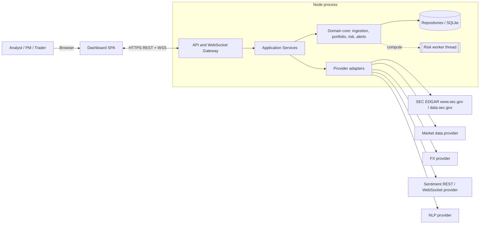
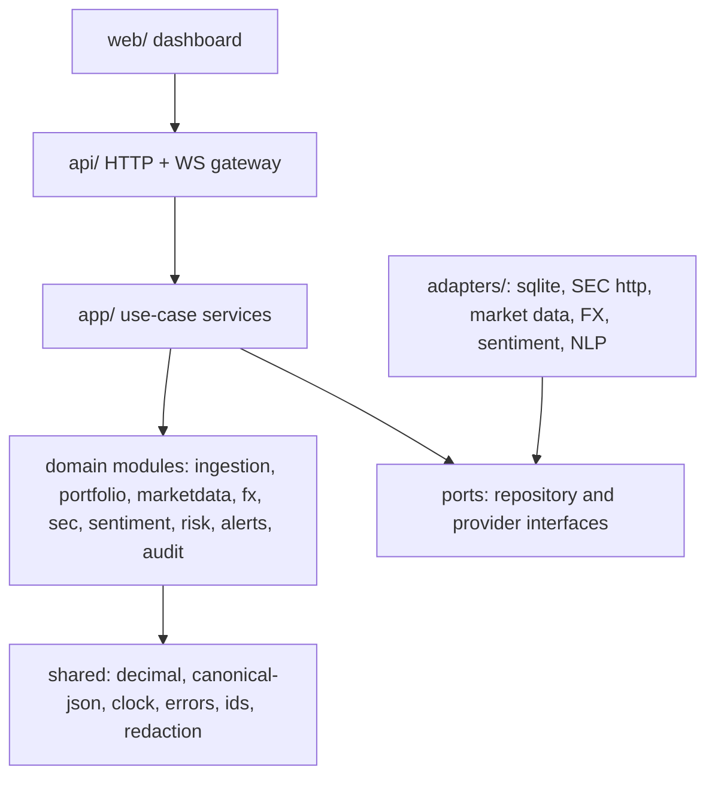
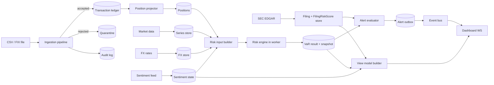
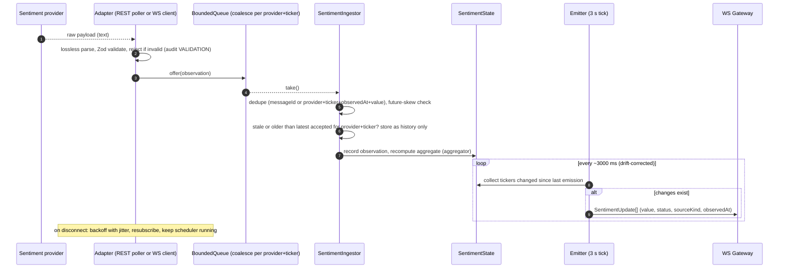
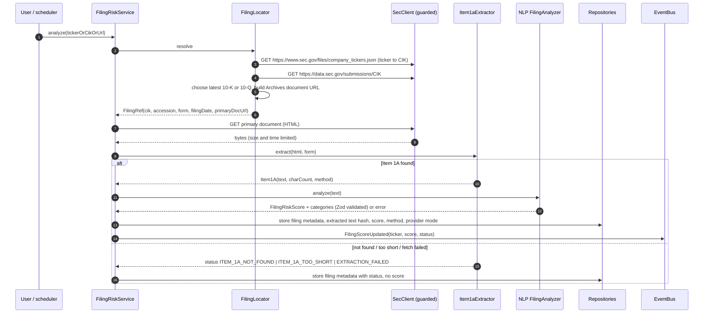
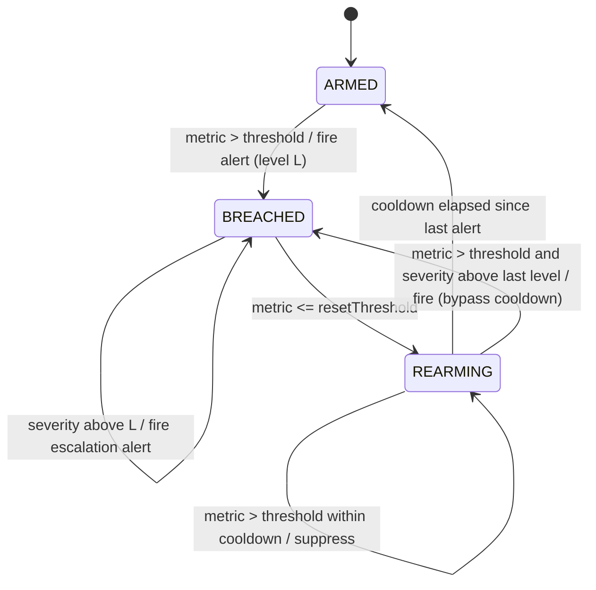
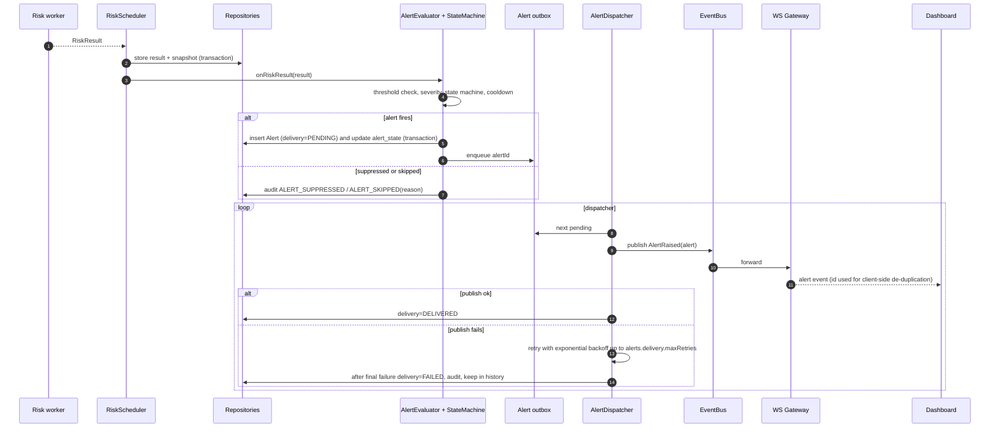
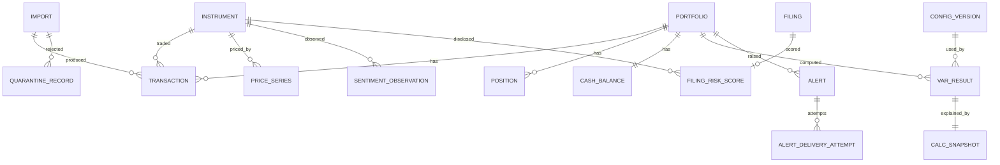

# Design Document

## Overview

Spectral Risk Chimera is a portfolio risk monitoring application. It ingests transactions (CSV and FIX), builds netted positions, retrieves market prices and FX rates, analyses SEC 10-K and 10-Q Item 1A risk factors, ingests market sentiment, and computes Historical Simulation Value-at-Risk (VaR) in two forms: `baseVaR` and `sentimentAdjustedVaR`. It raises risk alerts and shows everything in a dashboard. It does not trade.

This document designs the system specified in `.kiro/specs/requirements.md` (R1 to R35, FR-1 to FR-14, NFR-PERF-1, OD-1 to OD-18). Requirement IDs in this document refer to that file. The requirements' Open Decisions table is the single register of decisions; this design does not decide anything listed there as Open.

### Design goals

1. **A modular monolith.** One Node.js process (plus one worker thread for VaR) with strict module boundaries. No microservices. Every external system sits behind an interface so it can be replaced or faked in tests (R26).
2. **TypeScript and ES modules, compiled with `tsc`.** Strict TypeScript, `"type": "module"`, `module` and `moduleResolution` set to `NodeNext`, and `verbatimModuleSyntax: true` (R26.4). Application code is compiled into `dist/` and runs as JavaScript on Node.js 24.22.1, with Node.js 26 checked in CI (R26.7, R26.8, R27.12). The repository's current `"type": "commonjs"` changes in phase 1.
3. **Zod at every external boundary.** HTTP bodies, uploaded rows, FIX fields, provider payloads, NLP output, environment, and configuration are validated with Zod before they reach domain code (R24.6, R29.5).
4. **Decimal.js for all financial arithmetic.** Decimal values are decimal strings at API, persistence, snapshot, and log boundaries. Native numbers appear only in the dashboard's chart adapter (R4).
5. **Two independent signals.** `FilingRiskScore` and `SentimentIndex` live in separate modules, tables, types, and view-model fields. Only sentiment feeds the VaR adjustment, and `FilingRiskScore` is not an input to the risk engine's types at all (R11, R15.14, R35).
6. **Pure risk core.** The risk engine is a pure, deterministic function of an explicit input object. This makes results reproducible and testable (R32).
7. **Incremental delivery.** The build order in [Incremental Delivery Plan](#incremental-delivery-plan) yields a working, tested system after each phase (R26.6).

### Design decisions

Status values: **Approved** (decided), **Provisional** (approved for now, to be confirmed), **Proposed** (a recommendation for an open decision; the design is built so it can change). Only Approved and Provisional entries may be relied on as final.

| ID | Status | Decision | Rationale | Requirements |
|---|---|---|---|---|
| D-1 | Approved | Single process modular monolith, risk engine in a `worker_threads` worker started from the compiled entry `dist/risk/riskWorker.js` | Keeps deployment simple while keeping VaR off the event loop and UI path | R23.4, R26, R26.8, R33.9 |
| D-2 | Approved | TypeScript `strict: true`; ES modules (`"type": "module"`, `NodeNext`, `verbatimModuleSyntax`); `tsc` builds to `dist/`; ESLint rules ban `parseFloat`, `Number()`, and unary `+` in financial modules | Enforces R4.2 statically and matches the approved stack (OD-11) | R4.2, R26.4, R26.8 |
| D-3 | Approved | Zod 4 schemas are the single source of truth for external shapes; TypeScript types are inferred from them (`z.infer`) | Prevents drift between validation and types | R24.6, R29.5 |
| D-4 | Approved | `DecimalString` Zod type accepts decimal text only (never a JSON number) and converts to `Decimal` in domain code through one helper | Enforces R4.3 and R4.6 | R4 |
| D-5 | Approved (library Open, OD-16) | Provider JSON is parsed with a lossless JSON parser (numeric tokens kept as text), then validated by Zod | `JSON.parse` turns `0.1` into a binary float, which would violate R4.2 for provider prices | R4.2, R12 |
| D-6 | Proposed (OD-12) | Repository interfaces in the domain are Approved. The SQLite (`better-sqlite3`) adapter is only a proposal | Synchronous transactions would give simple atomic imports (R28.15) | R28, R22 |
| D-7 | Approved | In-process typed event bus and an alert outbox table | At-least-once alert delivery without a message broker | R19, R34 |
| D-8 | Approved / Provisional | React with Vite for the dashboard (Approved); Fastify for the HTTP API and WebSocket gateway (Provisional, OD-17) | Mainstream, small, testable | R17, R23, R26.9, R35 |
| D-9 | Approved | Positions are a projection of the transaction ledger, rebuilt deterministically | Position updates happen only after commit and are idempotent | R28.17, R5 |
| D-10 | Approved | Market series are stored content-addressed (SHA-256 of the canonical series), and snapshots reference hashes | Allows exact recomputation from a snapshot without copying large series | R32, R22.5 |
| D-11 | Approved interface; formula Proposed (OD-1) | Sentiment aggregation is a pluggable, versioned function. The `windowed-mean-v1` formula is only a proposal | Lets the formula be approved or replaced without touching callers | R10.1 |
| D-12 | Approved | Virtual clock (`Clock` interface) and monotonic timer used everywhere time matters | Deterministic tests for cadence, staleness, cooldown | R10.5, R34, R31 |
| D-13 | Approved | Node.js 24.22.1 for development (`engines` and `.nvmrc`); CI matrix of Node.js 24.22.1 and Node.js 26 | Pins the initial environment and checks the next LTS | R26.7, R27.12 |
| D-14 | Approved | Toolchain: Zod 4, Decimal.js, Vitest, fast-check, ESLint with typescript-eslint (flat config), Prettier, dependency-cruiser, Playwright; exact versions and a committed lockfile | Single, pinned toolchain | R26.5, R26.7, R27.5, R27.13 |
| D-15 | Approved | Configuration policy: financially significant settings have no code defaults and must be supplied; a committed template supplies approved baselines and leaves open values as placeholders | Prevents silent financial defaults | Configuration, R14.2, R15.1 |

### Decision register

Each design-level identifier maps to one requirements decision. The requirements table is authoritative for status and recommendation; this table records only design-specific detail.

| ID | Requirements ID | Status | Design-specific detail |
|---|---|---|---|
| U-1 | OD-12 | Open | Persistence sits behind `UnitOfWork` and repository ports. Until OD-12 is approved, phase 2 tests use an in-memory unit of work, and the SQLite adapter is not built. |
| U-2 | OD-1 | Open | `SentimentAggregator` interface with a version string. `windowed-mean-v1` is the proposed implementation, using `sentiment.windowSeconds`. |
| U-3 | OD-11 | Resolved | React with Vite, Vitest with fast-check, Playwright for end-to-end tests. |
| U-4 | OD-9 | Open | The FIX parser is written against a mapping table, so the supported version and tags can be set once OD-9 is decided. The table in [FIX Parser](#fix-parser) is a proposal. |
| U-5 | OD-15 | Open | `FilingAnalyzer` chunks at `nlp.maxInputChars` and records the combination method version. The maximum-severity combination is a proposal. |
| U-6 | OD-7 | Open | `AuthGuard` interface. Local single-user mode binds to `127.0.0.1` only (A-15). |
| U-7 | OD-5, OD-13 | Open | Provider interfaces plus recorded-fixture providers for tests; no vendor chosen. |
| U-8 | OD-10 | Open | Not calculated; view model field `riskContribution` is `null`. |
| U-9 | OD-3 | Open | Weekends only behind a `TradingCalendar` interface. |
| U-10 | OD-2 | Open | Benchmarks record the environment; budgets are not enforced in CI until set. |
| U-11 | OD-16 | Open | The lossless parser is wrapped in `shared/losslessJson.ts`, so the library choice affects one module. |
| U-12 | R6.5 | Resolved | `ITEM_1A_TOO_SHORT` is a requirement status. The `sec.item1a.minChars` value (500) is a provisional operational default (OD-6). |
| U-13 | OD-17 | Provisional | Fastify for HTTP and WebSocket. Confirm before the phase 2 gateway work starts. |
| U-14 | OD-6 | Open | Every financially significant value listed in OD-6 is a required key in `ConfigSchema` with no default. Provisional operational defaults are flagged in the start-up configuration summary. |
| U-15 | OD-18 | Resolved | Exponent notation is rejected by the fixed `DecimalText` grammar (R4.6). There is no exponent-limit setting. |

## Architecture

### System context



### Layers and dependency rule

Dependencies point inward only. Domain modules never import adapters, the API, or the UI.



### Source layout

```
src/
  shared/        decimal.ts, canonical.ts, clock.ts, errors.ts, result.ts, redact.ts, ids.ts, boundedQueue.ts
  config/        schema.ts (Zod), loader.ts, configVersion.ts
  ingestion/     csv/, fix/, normalize.ts, dedupe.ts, quarantine.ts, importService.ts
  portfolio/     ledger.ts, positionProjector.ts, allocation.ts, exposure.ts
  marketdata/    ports.ts, seriesCleaner.ts, returns.ts, alignment.ts, seriesStore.ts
  fx/            ports.ts, fxService.ts
  sec/           urlGuard.ts, secClient.ts, filingLocator.ts, item1aExtractor.ts, filingRiskService.ts
  nlp/           ports.ts, fallbackProvider.ts, filingAnalyzer.ts
  sentiment/     ports.ts, ingestor.ts, aggregator.ts, emitter.ts, sentimentState.ts
  risk/          riskEngine.ts, quantile.ts, scenarios.ts, adjustment.ts, snapshot.ts, riskWorker.ts, riskScheduler.ts
  alerts/        evaluator.ts, stateMachine.ts, dispatcher.ts, eventBus.ts
  audit/         auditLog.ts
  persistence/   ports.ts (repositories), sqlite/ (adapter), migrations/
  adapters/      providers (market data, FX, sentiment REST/WS, NLP), http/
  api/           server.ts, routes/, auth/, wsGateway.ts, viewModels.ts
  web/           dashboard SPA
test/            unit/, property/, integration/, e2e/ (Playwright), fixtures/, bench/
config/          config.template.jsonc (approved baselines; empty placeholders for OD-6 values)
dist/            tsc output (not committed; already ignored by .gitignore)
```

Test fixtures live in `test/fixtures/`, which is not excluded by `.gitignore` or `.kiroignore` (R27.11). `src/shared/losslessJson.ts` wraps the provider JSON parser (OD-16). `src/web/` is a separate Vite build with its own `tsconfig`; it imports only the shared API contract types and `toChartNumber`.

### Runtime topology

- **Main thread:** HTTP API, WebSocket gateway, importers, provider adapters, schedulers, alert evaluation, persistence.
- **Risk worker (one `worker_threads` thread):** executes `RiskEngine.compute`. The worker is started from the compiled ES module `dist/risk/riskWorker.js`, resolved with `new URL('./riskWorker.js', import.meta.url)` from the compiled scheduler, so no TypeScript loader is needed at runtime (R26.8). Unit tests call `RiskEngine.compute` in-process; an integration test starts the compiled worker (AT-ARC-03). Input and output cross the thread boundary as plain JSON with decimal strings (no `Decimal` instances, no native numbers for money). A slow VaR run therefore cannot block I/O or the dashboard feed (R23.4, R33.9).
- **Schedulers (main thread):** sentiment emission tick (3,000 ms target), risk recalculation scheduler, market data and FX refresh, SEC refresh, alert dispatcher retry loop.

### Data-flow overview



The edge from the filing store goes to the alert evaluator and the view model only. There is no edge from the filing store to the risk input builder. This is the structural enforcement of R11.5.

### Incremental Delivery Plan

Each phase ends with passing tests and a runnable application. A requirement is listed in the first phase that needs it; cross-cutting requirements are also listed in the table after this one. Nothing is removed because it is scheduled later.

| Phase | Scope | Requirements first delivered | Acceptance tests | Blocked by |
|---|---|---|---|---|
| 1 | **Foundations.** ESM and strict `tsconfig` (`NodeNext`, `verbatimModuleSyntax`), `tsc` to `dist/`, Node.js 24.22.1 pin, exact dependency pins and lockfile; ESLint (financial rules), Prettier, dependency-cruiser boundaries, Vitest, fast-check; CI on Node.js 24.22.1 and 26; `shared/` utilities (Decimal helper, canonical JSON, `Clock`, `Result`, `BoundedQueue`, `redact`); Zod primitives and score schemas; config loader with the configuration policy and template; `EnvSchema` and `.env.example` | R4, R21.1–R21.3, R24.1–R24.4, R24.7, R26.4–R26.8, R26.10, R27.10–R27.13, R29.12, R32.3, Configuration | AT-DEC-01–07, AT-CFG-01–07, AT-ARC-01–07, AT-SEC-19, AT-SEC-24, AT-REP-05, AT-SEN-16, AT-SEN-26 | None |
| 2 | **HTTP API gateway and transaction import.** Fastify gateway bound to 127.0.0.1 with Zod-validated routes, generic error bodies, rate limiting, upload limits, and filename sanitization; persistence ports with an in-memory unit of work; CSV import, quarantine, audit, ledger, and position projection (quantities and average price) | R1, R3, R5.1, R5.3–R5.5, R22.1, R22.6, R24.5, R24.6, R26.9, R28, R29.4–R29.6, R29.13 | AT-CSV-01–20, AT-CSV-22–24, AT-POS-01–04, AT-AUD-01, AT-AUD-05, AT-SEC-21, AT-SEC-25–27 | OD-17 (confirm Fastify); OD-12 (SQLite adapter and AT-CSV-12) |
| 3 | **Market data, FX, valuation, and Base VaR.** Provider resilience layer (timeouts, retries, status, stale labelling) and lossless JSON; market data and FX services; position valuation; allocation and exposure; quantile and Base VaR; compiled risk worker; risk scheduler for position and price triggers; snapshots and `LAST_VALID` results | R5.2, R12, R13, R14, R16.1–R16.3, R16.6, R16.7, R20, R22.3–R22.5, R24.8, R25, R30, R32, R33.3, R33.9, R33.10 | AT-VAR-01–18, AT-MD-01–14, AT-MD-16–18, AT-FX-01–09, AT-ALC-01–10, AT-REP-01–04, AT-REP-06–08, AT-REP-10, AT-PRV-01–03, AT-PRV-08, AT-PRV-10, AT-PRV-11, AT-AUD-03, AT-AUD-04, AT-DSH-07, AT-DSH-08, AT-SEC-23, AT-BEN-01 (record) | OD-16 (parser library); OD-6 values before real use; OD-5 (fixtures suffice) |
| 4 | **Sentiment, adjustment, and WebSocket gateway.** REST and WSS sentiment clients with reconnect, deduplication, bounded queue, and freshness; aggregator interface and emitter; adjustment and Adjusted VaR; WebSocket gateway streaming sentiment and risk updates; filing-independence checks using the phase 1 filing type | R9, R10, R11.1–R11.5, R15, R16.4, R33.4, R33.5 | AT-SEN-01–15, AT-SEN-17–25, AT-SEN-27–29, AT-CAD-01–06, AT-PRV-04–07, AT-FIL-01–03, AT-REP-09, AT-VAL-01, AT-BEN-02 (record) | OD-1 (formula; AT-SEN-21); OD-13 (fixtures suffice) |
| 5 | **Dashboard and VaR alerts.** React and Vite dashboard; view models with signal separation; VaR alert evaluation, state machine, outbox, and dispatcher; Playwright end-to-end test | R11.6, R11.7, R17.1–R17.4, R17.6–R17.9, R18, R19, R23, R27.5, R34.1, R34.2, R34.5–R34.8, R35 | AT-DSH-01–03, AT-DSH-05, AT-DSH-09–15, AT-ALR-01–05, AT-ALR-07–15, AT-ALR-17–18, AT-FIL-04, AT-ALC-11 | OD-2 (AT-DSH-04 enforcement only) |
| 6 | **FIX import** | R2, R28 (FIX parts), R33.2 | AT-FIX-01–06 | OD-9 |
| 7 | **SEC filing risk.** SEC URL guard and client (User-Agent, rate limit, timeouts, size limits, redirects); filing locator; Item 1A extraction; NLP port and fallback; filing scores and freshness; filing-risk alerts; filing panel in the dashboard | R6, R7, R8, R16.5, R17.5, R22.2, R29.8–R29.11, R31, R33.6, R33.7, R34.3, R34.4, R34.6 (filing reset) | AT-FIL-05–20, AT-SEC-01–18, AT-PRV-09, AT-DSH-06, AT-AUD-02, AT-ALR-06, AT-ALR-16 | OD-15 (chunking); `sec.userAgent` supplied by the operator |
| 8 | **Hardening.** Authentication and authorization; CSV export with formula neutralization (when an export is added); performance budget enforcement on the reference environment; soak tests | R29.1–R29.3, R29.7, R33.1, R23.1 (enforcement), NFR-PERF-1 (enforcement) | AT-SEC-20, AT-SEC-22, AT-CSV-21, AT-FIX-07, AT-DSH-04, AT-CAD-07 | OD-7; OD-2 |

All 35 requirements appear in at least one phase. Every acceptance test in the requirements matrix is assigned to exactly one phase above, except AT-MD-15, which is blocked by OD-3 and not scheduled in version 1.

#### Cross-cutting requirements

| Requirement | First phase | Also applies in |
|---|---|---|
| R4 Financial precision | 1 | Every phase |
| R11 Signal separation | 1 (boundary rule) | 4 (risk side), 5 (display), 7 (filing pipeline) |
| R16 Recalculation | 3 | 4 (sentiment triggers), 7 (filing updates do not recalculate) |
| R17 and R34 Dashboard and alerts | 5 | 7 (filing values and filing alerts) |
| R21 Score validation | 1 (schemas) | 4 (sentiment), 7 (filing) |
| R22 Provenance and audit | 2 | 3, 4, 7 |
| R24 Credentials and security | 1 (secrets, redaction) | 2 (API responses), 3 and 4 (TLS to providers), 7 (SEC) |
| R25 Provider reliability | 3 | 4, 7 |
| R26 Architecture | 1 | Every phase |
| R27 Testing | 1 (`npm test`, CI) | Every phase; R27.5 in phase 5 |
| R29 Access control and input safety | 2 (input, uploads, errors) | 7 (SSRF), 8 (authentication, export) |
| R33 Performance and resilience | 2 (CSV timing recorded) | 3 (VaR, isolation), 4 (queue, sentiment), 6 (FIX), 7 (SEC, NLP), 8 (enforcement) |
| Configuration policy | 1 | Every phase that adds settings |

#### Correctness properties by phase

The technique column replaces the earlier blanket "property-based unless noted" statement. "fast-check" tests compare against an independent rational-arithmetic or model reference where noted in [Testing Strategy](#testing-strategy).

| Property | Phase | Technique |
|---|---|---|
| Property 1: Decimal exactness | 1 | fast-check with rational reference |
| Property 2: Canonical decimal round trip | 1 | fast-check |
| Property 3: Quantile correctness and bounds | 3 | fast-check with rational reference |
| Property 4: VaR is a quantile of losses | 3 | fast-check |
| Property 5: Portfolio P&L is the sum of position P&L | 3 | fast-check with rational reference |
| Property 6: Adjustment locality and monotonicity | 4 | fast-check |
| Property 7: Strict trigger threshold | 4 | fast-check plus boundary examples |
| Property 8: Direction awareness | 4 | fast-check |
| Property 9: Ineligible sentiment never adjusts | 4 | fast-check with fake clock |
| Property 10: Base VaR is independent of sentiment | 4 | fast-check |
| Property 11: Filing independence | 4 (risk side), 7 (full pipeline) | Static type and dependency-cruiser checks plus fast-check |
| Property 12: No combined score | 5 | Static type check plus example tests |
| Property 13: Data sufficiency and status | 3 | fast-check |
| Property 14: No fabricated market data | 3 | fast-check |
| Property 15: Allocation sums to exactly 100.00 and is deterministic | 3 | fast-check |
| Property 16: Ineligible allocation is not forced | 3 | fast-check |
| Property 17: Score range validation | 1 (schemas), applied in 4 and 7 | fast-check |
| Property 18: Import idempotency | 2 (CSV), 6 (FIX) | fast-check over generated files |
| Property 19: Import classification completeness | 2, 6 | fast-check over generated files |
| Property 20: Valid rows survive invalid rows | 2, 6 | fast-check over generated files |
| Property 21: Import atomicity | 2 (in-memory unit of work); real adapter after OD-12 | Fault injection, not fast-check |
| Property 22: No silent short positions | 2 | fast-check over transaction sequences |
| Property 23: Position replay determinism | 2 | fast-check |
| Property 24: Reproducibility | 3 (base), 4 (adjusted) | fast-check plus stored-snapshot examples |
| Property 25: Stale, demo, and unavailable data are never treated as current | 3 (FX), 4 (sentiment), 7 (filing) | fast-check with fake clock |
| Property 26: FX conversion | 3 | fast-check with rational reference |
| Property 27: SSRF safety | 7 | fast-check with a stubbed DNS resolver and local servers |
| Property 28: No fabricated filing content | 7 | fast-check over generated HTML plus recorded filings |
| Property 29: Bounded memory under load | 4 | fast-check over arrival patterns |
| Property 30: Sentiment ingestion robustness | 4 | fast-check |
| Property 31: Emission cadence | 4 | Fake-clock simulation, fast-check for arrival jitter |
| Property 32: Alert fires once per episode | 5 | Model-based fast-check over metric sequences |
| Property 33: Alert delivery isolation | 5 | Fault injection with fake clock |
| Property 34: Alert preconditions | 5 | fast-check plus examples |
| Property 35: Secret and PII redaction | 1 | fast-check over generated payloads |
| Property 36: Provider failure keeps last valid data | 3 | Fault injection with fake providers |

## Components and Interfaces

### Component to requirement map

| Component | Module | Implements |
|---|---|---|
| Config Service and template | `config/`, `config/config.template.jsonc` | R15.1, R14.2–R14.4, R18.2, R24.2, R32.7, Configuration policy and table |
| Decimal and Canonical Utilities | `shared/` | R4, R32.3, R32.4 |
| CSV Parser | `ingestion/csv` | R1, R3, R28.1–R28.8 |
| FIX Parser | `ingestion/fix` | R2, R3, R28.10 |
| Normalizer and Deduper | `ingestion/normalize`, `dedupe` | R28.11–R28.14, R28.22, R30.2 |
| Quarantine and Audit Log | `ingestion/quarantine`, `audit/` | R3.3, R22.6, R28.9, R28.10 |
| Import Service | `ingestion/importService` | R1.4, R3, R28.9, R28.15–R28.17 |
| Ledger and Position Projector | `portfolio/` | R5, R28.17–R28.21 |
| Allocation and Exposure Calculator | `portfolio/allocation`, `exposure` | R20, FR-10 to FR-13 |
| Market Data Service | `marketdata/` | R12, R13, FR-2, FR-3 |
| FX Service | `fx/` | R30 |
| SEC URL Guard and Client | `sec/urlGuard`, `secClient` | R6.6, R6.7, R6.8, R29.8–R29.11, R33.6 |
| Filing Locator and Item 1A Extractor | `sec/` | R6.1–R6.5 |
| NLP Port and Filing Analyzer | `nlp/` | R7, R8, R21.1, R33.7 |
| FilingRisk Service | `sec/filingRiskService` | R7, R31 |
| Sentiment Ingestor | `sentiment/ingestor` | R9, R21.2, R33.5 |
| Sentiment Aggregator and Emitter | `sentiment/aggregator`, `emitter` | R10 |
| Risk Engine | `risk/riskEngine` | R14, R15, FR-4 to FR-7, FR-9 |
| Risk Scheduler, Input Builder, and compiled worker | `risk/riskScheduler`, `risk/riskWorker` | R16, R13.5, R26.8, R33.3 |
| Snapshot Service | `risk/snapshot` | R22.4, R22.5, R32 |
| Alert Evaluator, State Machine, Dispatcher | `alerts/` | R18, R19, R34 |
| API and WebSocket Gateway (Fastify, provisional) | `api/` | R17, R23, R24.5, R24.6, R26.9, R29.1–R29.7, R29.13 |
| View Model Builder | `api/viewModels` | R11.4, R17, R35 |
| Dashboard | `web/` | R17, R23, R35 |
| Provider Resilience Layer | `adapters/resilience` | R25, R33.9, R33.10 |
| Repositories | `persistence/` | R22, R28.15, R32 |
| Redaction and Logging | `shared/redact` | R24.7, R29.12, R29.13 |

Coverage by requirement: R1 (CSV Parser, Import Service), R2 (FIX Parser), R3 (Quarantine, Import Service), R4 (Decimal Utilities), R5 (Projector), R6 (SEC components), R7 (Filing Analyzer), R8 (NLP Port), R9 (Sentiment Ingestor), R10 (Aggregator and Emitter), R11 (Risk Engine input types and View Model Builder), R12 and R13 (Market Data Service), R14 and R15 (Risk Engine), R16 (Risk Scheduler), R17 and R35 (View Model and Dashboard), R18, R19, R34 (Alerts), R20 (Allocation), R21 (validation schemas), R22 (Audit, Repositories), R23 (Dashboard, Worker), R24 and R29 (API, Config, Redaction, URL Guard), R25 (Resilience Layer), R26 (module layout), R27 (Testing Strategy), R28 (Ingestion), R30 (FX), R31 (FilingRisk Service), R32 (Snapshot), R33 (Resilience Layer, BoundedQueue, benchmarks).

### Shared utilities (`shared/`)

```ts
// decimal.ts - the only module that constructs Decimal
export type DecimalString = string & { readonly __brand: 'DecimalString' };
export const DEC: typeof Decimal;                 // Decimal.clone({ precision: 40, rounding: Decimal.ROUND_HALF_UP })
export function d(value: string | Decimal): Decimal;      // rejects non-finite, rejects JS numbers (type-level and runtime)
export function toCanonical(x: Decimal): DecimalString;   // no exponent, no trailing zeros, no "-0"
export function roundMoney(x: Decimal, minorUnits: number): Decimal;   // ROUND_HALF_UP, display only
export function toChartNumber(x: DecimalString): number;  // sole native-number conversion, used by web/ chart adapter

// canonical.ts
export function canonicalJson(value: unknown): string;     // sorted keys, no whitespace, decimals already strings
export function sha256Hex(bytes: string | Uint8Array): string;

// clock.ts
export interface Clock { nowUtc(): Date; monotonicMs(): number; }

// result.ts
export type Result<T, E extends AppError> = { ok: true; value: T } | { ok: false; error: E };

// boundedQueue.ts
export class BoundedQueue<K, V> {   // see Sentiment Ingestor, R33.5
  constructor(maxSize: number, keyOf: (v: V) => K);
  offer(v: V): 'ACCEPTED' | 'COALESCED' | 'DROPPED_OLDEST';
  take(): V | undefined;
  readonly droppedCount: number;
}
```

`d()` accepts only strings. The ESLint config forbids `new Decimal(` and `Decimal.clone` outside `decimal.ts`, and forbids `parseFloat`, `Number(`, unary `+`, and `Math.*` in `risk/`, `portfolio/`, `fx/`, and `ingestion/` (R4.2).

### Config Service (`config/`)

```ts
// Zod 4. Financially significant keys (class F) have no .default(); operational keys (class O) may.
export const ConfigSchema = z.strictObject({ /* every parameter in the Configuration table */ });
export type AppConfig = z.infer<typeof ConfigSchema>;

export interface ConfigService {
  current(): { config: AppConfig; version: ConfigVersion };
  update(patch: unknown, actor: ActorId): Result<ConfigVersion, ConfigError>;
}
export interface ConfigVersion { seq: number; hash: string /* SHA-256 of canonicalJson(config) */; }
```

- Secrets and personal data (API keys, the SEC contact in `SEC_USER_AGENT`) come from environment variables validated by a separate `EnvSchema` and are never part of `AppConfig` or the committed template, so they never appear in snapshots (R6.6, R24.2, R32).
- The requirements' configuration policy is applied as follows. Financially significant settings (class F) are declared without `.default()`. The loader parses feature by feature: a missing or invalid F key is reported by name, no value is substituted, and only the dependent feature is disabled with a specific status (for example `ALERT_CONFIG_MISSING`, R18.2). Operational settings (class O) declare their documented defaults; provisional defaults are listed in the configuration summary logged at start (AT-CFG-06).
- **Template and runtime file.** `config/config.template.jsonc` (created in phase 1) is documentation for operators, never a runtime source. The loader reads only the runtime file named by the `SRC_CONFIG_FILE` environment variable and never merges template values. It refuses a `SRC_CONFIG_FILE` path that resolves to the template: the template path itself is refused before anything is opened; otherwise the candidate is opened once, the identity of the opened file is compared with the template's, and the content is read from that same handle, so a symbolic or hard link to the template is refused without its content being read. Where a file system reports no file identity, the comparison falls back to real paths.
- **When no runtime configuration is loaded.** The file status records why: `NOT_CONFIGURED` (`SRC_CONFIG_FILE` unset), `NOT_FOUND`, `TEMPLATE_REFUSED`, `UNREADABLE`, or `PARSE_ERROR` (including nesting deeper than the parser limit). In every case no value is read from any file and none is substituted: every class F key counts as missing, class O keys take their documented defaults, and the loader returns and logs the status instead of throwing. Each feature is then available only if none of its own class F dependencies is missing (Configuration policy 1 and 6, AT-CFG-05, AT-CFG-07):
  - Features without missing class F dependencies, such as the API gateway and position display, remain available.
  - Import is disabled while `import.oversellPolicy` is missing, because transactions are not imported without an explicit oversell policy (R28.20).
  - A missing `import.defaultTimezone` does not disable import. It restricts it: date-only CSV timestamps are rejected with `INVALID_DATE`, while timestamps with an explicit offset are still accepted (R28.1). An invalid value disables import.
- **Accepted `import.defaultTimezone` values.** Exactly `UTC` or one of the 312 primary identifiers in the TZ column of IANA tzdb release 2026e `zone1970.tab`, embedded in `src/config/timeZones.ts` and checked against an unmodified fixture copy by SHA-256. Validation does not consult the runtime's ICU data, so Node.js 24.22.1 and Node.js 26 accept the same values. The identifiers follow IANA's `zone1970.tab` naming convention: places whose clocks have agreed since 1970 share one primary identifier, and operators must use that shared identifier rather than a city's former alias (for example `Europe/Berlin` for Oslo and Stockholm, `Europe/Brussels` for Amsterdam, `Asia/Riyadh` for Kuwait). Every other `backward` link (such as `Europe/Oslo`, `Asia/Calcutta`, `US/Eastern`, `Etc/UTC`, `GMT`), numeric offsets, and incorrectly capitalised names are rejected. `UTC` is the sole explicit exception: in tzdb it is a link to `Etc/UTC`, but it is the identifier ECMA-402 treats as canonical for Coordinated Universal Time. Changing the tzdb release is a deliberate change to the fixture, the embedded list, and the recorded hashes.
- **Template layout.** The template uses the same nested layout as `ConfigSchema`: one object per group (`var`, `adjustment`, `sentiment`, `marketData`, `fx`, `filing`, `alerts`, `import`, `recalc`), with dotted names in this document mapping to nesting (`alerts.var.thresholdPct` is `alerts` → `var` → `thresholdPct`). Decimal values are JSON strings; counts are JSON integers (R4.7).
- **Template contents.** The template holds exactly these approved values: `var.confidence` `"0.95"`, `var.horizonDays` `1`, `var.lookbackReturns` `250`, `var.minObservations` `200`, `adjustment.bearishThreshold` `"-0.60"`, `adjustment.multiplier` `"1.15"`, `alerts.var.metric` `"ADJUSTED"`. There is no `adjustment.enabled` key; the adjustment cannot be switched off (R15.1). Every other class F key is an empty placeholder (`null`) with the OD-6 or OD-1 proposal in a comment (for example `"maxAgeSeconds": null, // proposed 900, OD-6` inside `sentiment`). Keys with no proposal (`alerts.var.thresholdPct`, `alerts.filing.threshold`, `fx.baseCurrency`, `fx.supportedCurrencies`, `import.defaultTimezone`) are `null` placeholders too, and the optional `alerts.filing.criticalThreshold` is `null`, which disables the critical level. The loader treats `null` exactly like an absent key. Class O keys are omitted because their documented defaults apply; the class O keys that have no default (`sentiment.rest.pollSeconds`, `nlp.maxInputChars`) are listed only in comments. `sec.userAgent` is not in the template; it comes from `SEC_USER_AGENT`.
- Calculation-relevant changes create a new `ConfigVersion` (R32.7). Unknown fields are rejected by `z.strictObject` (R29.5).
- `var.horizonDays` is `z.literal(1)` (R14.3).

### Ingestion

#### Import pipeline

```mermaid
sequenceDiagram
    autonumber
    participant U as User / API
    participant IS as ImportService
    participant P as Parser (CSV or FIX)
    participant N as Normalizer + Deduper
    participant Q as Quarantine + Audit
    participant R as Repositories (one DB transaction)
    participant PP as PositionProjector
    participant B as EventBus
    U->>IS: importFile(bytes, portfolioId, source, mapping)
    IS->>IS: size check, SHA-256 of file, UTF-8 + BOM check
    alt file-level failure (encoding, size, header)
        IS->>Q: audit FILE_REJECTED(reason)
        IS-->>U: ImportSummary(status=FAILED, reason)
    else
        IS->>P: stream records
        loop each record
            P->>N: RawRecord(rowNo, fields)
            N->>N: Zod row schema, field validation, FX/currency check
            alt invalid
                N->>Q: quarantine(record, reasonCode, message)
            else valid
                N->>N: transactionKey, dedupe lookup, chronological oversell check
                N-->>IS: accepted | duplicate | rejected
            end
        end
        IS->>R: BEGIN; insert transactions, import summary, quarantine rows, audit rows; COMMIT
        alt commit fails
            R-->>IS: error (rolled back)
            IS->>Q: audit IMPORT_FAILED (separate write)
            IS-->>U: ImportSummary(status=FAILED)
        else commit ok
            IS->>PP: rebuild affected positions
            PP->>B: PositionsChanged(portfolioId, tickers)
            IS-->>U: ImportSummary(COMMITTED or COMMITTED_WITH_REJECTIONS)
        end
    end
```

Rules that follow from the sequence:

- Rows are classified exactly once: `accepted`, `rejected`, `duplicate`, or `skipped` (empty row). The counts always sum to `totalRows` (R3.5, R28.9).
- Accepted rows, the import summary, quarantine rows, and audit entries for that import are written in one repository transaction (R28.15). If the commit fails, nothing from the import persists and the status is `FAILED` (R28.16). The failure itself is recorded afterwards in a separate audit write.
- Positions are projected only after the commit succeeds (R28.17).
- The streaming parser keeps memory proportional to a batch, not to the file (R28.4, R33).

#### CSV Parser

```ts
// Zod 4: an enum-keyed z.record requires every key, so optional mappings use z.partialRecord.
// Records have no .strict(); keys outside CanonicalField are rejected by the enum key schema.
// Presence of the required canonical fields is checked against the header (INVALID_HEADER, R28.5).
export const CsvColumnMappingSchema = z.partialRecord(CanonicalField, z.string().min(1));  // canonical field -> source header
export type CsvColumnMapping = z.infer<typeof CsvColumnMappingSchema>;

export interface CsvParser {
  parse(input: Uint8Array, mapping: CsvColumnMapping, opts: CsvOptions): AsyncIterable<RawRecord | FileError>;
}
export interface RawRecord { sourceKind: 'CSV' | 'FIX'; sequence: number; fields: Record<string, string>; rawExcerpt: string; }
```

- Pre-checks before streaming: byte length <= `import.maxFileBytes`; UTF-8 validation with a fatal `TextDecoder` (invalid input gives `INVALID_ENCODING`); BOM stripped; header row must have unique names and contain every mapped required column (`INVALID_HEADER`); data rows <= `import.maxRows` (`TOO_MANY_ROWS`) (R28.3–R28.5).
- Parsing uses a well-tested streaming CSV library with `relax_quotes` disabled. Every field is text; a field longer than `import.maxFieldLength` rejects the row (R28.8). No field is ever evaluated or interpreted as a formula.
- Entirely empty rows become `skipped` (R28.6).
- Rows are validated against `CsvRowSchema` (Zod):

```ts
const CsvRowSchema = z.object({
  external_id: z.string().max(maxFieldLength).optional(),
  trade_timestamp: IsoTimestampOrDate,                 // date-only values use import.defaultTimezone
  ticker: z.string().regex(tickerPattern),
  type: z.enum(['BUY', 'SELL']),                       // other values -> UNSUPPORTED_TRANSACTION_TYPE
  quantity: PositiveDecimalString,
  price: PositiveDecimalString,
  currency: Iso4217Code,
  portfolio_id: z.string().optional(),
});                                                   // z.object strips unknown columns by default in Zod 4 (R28.1)
```

- `PositiveDecimalString` parses with `d()`, rejecting `NaN`, `Infinity`, exponent notation (fixed rule), and values `<= 0` (R4.6, R28.7).
- Performance (NFR-PERF-1): decoding, parsing, mapping, Zod validation, Decimal construction, and normalization are all inside the timed scope. The row schema is compiled once per import, and per-row work avoids regular-expression backtracking and intermediate copies.

#### FIX Parser

```ts
export interface FixParser {
  parse(input: Uint8Array, opts: FixOptions): AsyncIterable<RawRecord | FileError>;
}
```

- Messages are split on SOH (`\x01`) and also tolerate `|` as a delimiter in logs when `fix.delimiter` is configured. Each message is parsed into `tag -> value`.
- Structural checks per message: `8` (BeginString), `9` (BodyLength), `35` (MsgType), `10` (CheckSum). BodyLength and CheckSum failures are `FIX_MALFORMED` rejections.
- Proposed supported set (U-4, OD-9 still open): MsgType `8` (ExecutionReport) only. The trade-signalling `ExecType` (150) values differ between FIX 4.2 and FIX 4.4, so the accepted BeginString and `ExecType` values are taken from a mapping table that is filled in once OD-9 is decided from real sample logs. Any other MsgType is rejected as `FIX_UNSUPPORTED_MSG_TYPE` and audited (R2.3).
- Field mapping to the canonical Transaction (proposed, documented in `docs/fix-mapping.md` per R2.5):

| FIX tag | Canonical field | Validation |
|---|---|---|
| 17 ExecID | `external_id` | required, non-empty |
| 55 Symbol | `ticker` | ticker pattern |
| 54 Side | `type` | `1` to `BUY`, `2` to `SELL`; others rejected |
| 32 LastQty | `quantity` | positive decimal |
| 31 LastPx | `price` | positive decimal |
| 15 Currency | `currency` | ISO 4217 |
| 60 TransactTime | `trade_timestamp` | FIX UTC timestamp |
| 1 Account | not stored; redacted in logs | R29.12 |

- Missing required tags give `FIX_MISSING_TAG(tag)`. Invalid values give `FIX_INVALID_VALUE(tag)`. A repeated `ExecID` is a duplicate by `transactionKey` (R28.11).
- A rejected message never stops the file (R2.4).

#### Normalizer and Deduper

```ts
export interface Transaction {
  id: string; portfolioId: string; transactionKey: string; externalId?: string;
  source: SourceRef; tradeTimestamp: IsoUtc; ticker: string; type: 'BUY' | 'SELL';
  quantity: DecimalString; price: DecimalString; currency: string; importId: string; createdAt: IsoUtc;
}

export interface Deduper {
  keyFor(t: NormalizedFields, occurrence: number): string;   // R28.11, SHA-256
  isKnown(portfolioId: string, key: string): boolean;        // lookup in the ledger and in the current batch
}
```

- `transactionKey` follows R28.11 exactly. `occurrence` is counted per identical canonical-field group within the file, so two identical rows in one file are both kept (R28.14).
- Re-importing a file hashes to the same keys, so every row is a duplicate (R28.13).
- The oversell check replays the portfolio's ledger for the affected instrument merged with the batch in `(tradeTimestamp, sourceSequence)` order (R28.18). Under `REJECT`, a SELL that would make the net quantity negative at its point in time is rejected as `OVERSELL`. Under `ALLOW_SHORT`, it is accepted and the resulting position is marked short (R28.20, R28.21).
- Currency checks: `UNSUPPORTED_CURRENCY` (R30.2) and `CURRENCY_MISMATCH` against the instrument's established currency (R28.22).

#### Quarantine and Audit Log

```ts
export interface QuarantineRecord {
  id: string; importId: string; sourceKind: 'CSV' | 'FIX'; sequence: number;
  reasonCode: RejectReason; message: string; column?: string;
  rawExcerpt: string;          // truncated to 512 chars, secrets and account tags redacted
  createdAt: IsoUtc;
}

export interface AuditLog {
  append(event: AuditEvent): void;     // append-only; no update or delete API exists
}
export interface AuditEvent {
  id: string; at: IsoUtc; category: 'IMPORT' | 'VALIDATION' | 'PROVIDER' | 'CALCULATION' | 'ALERT' | 'CONFIG' | 'SECURITY';
  type: string; subject?: string; actor?: string; details: Record<string, string | boolean>;  // no native-number money
}
```

- The audit log is append-only at the interface level and in SQLite (triggers block `UPDATE` and `DELETE`).
- Audited events include rejected records (R3.3), import summaries, validation failures, provider failures, calculation errors, configuration changes, and alert lifecycle events (R22.6).
- Quarantined rows are readable through the API (`GET /imports/:id/rejections`) so an analyst can correct and re-import. A corrected file is a new file with new hash, and its unchanged valid rows are duplicates, which makes correction safe and idempotent.

#### Import summary

```ts
export interface ImportSummary {
  importId: string; fileName: string; fileSha256: string; importedAt: IsoUtc;
  totalRows: number; accepted: number; rejected: number; duplicates: number; skipped: number;
  status: 'COMMITTED' | 'COMMITTED_WITH_REJECTIONS' | 'FAILED'; failureReason?: string;
}
```

### Portfolio

```ts
export interface PositionProjector {
  rebuild(portfolioId: string, tickers?: string[]): Promise<PositionChange[]>;  // deterministic replay of the ledger (D-9)
}
export interface Position {
  id: string; portfolioId: string; ticker: string; currency: string;
  signedQuantity: DecimalString; averagePrice: DecimalString; isShort: boolean; updatedAt: IsoUtc; source: string;
}
export interface AllocationCalculator {
  allocate(input: AllocationInput): AllocationResult;     // FR-10, FR-11
}
```

- `rebuild` replays all transactions for the instrument in `(tradeTimestamp, sequence)` order: `BUY` adds, `SELL` subtracts, average price follows FR-13. Because it is a pure replay, running it twice gives the same result.
- `AllocationCalculator` implements FR-10 and FR-11 with Decimal.js and returns either `ALLOCATION_UNAVAILABLE`, an exact-100.00 eligible result (largest remainder, ascending ticker tie-break, `CASH` last), or an ineligible result listing long, short, cash, gross, net, and NAV without forcing a 100% total (R20).
- Cash is a required portfolio attribute (A-7, FR-10), stored as a decimal string in base currency. The portfolio creation schema requires it (`PortfolioCreateSchema` has `cash: DecimalStringSchema` with no default and no `.optional()`); `"0"` and negative values are valid, and a request without cash is rejected with `VALIDATION_FAILED` (AT-ALC-10). No code path substitutes zero for missing cash.

### Market Data and FX

```ts
export interface MarketDataProvider {
  getDailySeries(ticker: string, range: DateRange): Promise<Result<ProviderSeries, ProviderError>>;
  getLatestPrice(ticker: string): Promise<Result<ProviderQuote, ProviderError>>;
}
export interface FxProvider {
  getRate(from: string, to: string, asOf?: IsoDate): Promise<Result<ProviderFxRate, ProviderError>>;
}
export interface TradingCalendar { isTradingDay(date: IsoDate): boolean; }   // weekends only for now (U-9)
```

Provider payloads are parsed with the lossless JSON parser and validated with Zod (D-5). The adapters then convert them to internal series types with decimal strings.

```ts
export interface PriceSeries {
  ticker: string; currency: string; source: string; retrievedAt: IsoUtc; status: DataStatus;
  observations: ReadonlyArray<{ date: IsoDate; adjustedClose: DecimalString }>;   // sorted ascending by date
  contentHash: string;      // SHA-256 of canonicalJson(observations + ticker + currency)
}
```

Services:

```ts
export interface SeriesCleaner {   // FR-3.1 to FR-3.3
  clean(raw: ProviderSeries): { series: PriceSeries; discarded: DiscardCounts; conflict: boolean };
}
export interface ReturnsBuilder {  // FR-2, FR-3.4 to FR-3.8
  build(series: PriceSeries[], opts: { lookbackReturns: number; minObservations: number; maxReturnGapDays: number }):
    Result<ReturnMatrix, MarketDataError>;
}
export interface ReturnMatrix {
  asOfDate: IsoDate; dates: IsoDate[];                           // ascending, length n
  returns: Record<string, DecimalString[]>;                       // ticker -> n simple returns
  n: number; status: 'COMPLETE' | 'REDUCED_LOOKBACK';
  limitingTicker: string; multiDayReturnCount: number; seriesHashes: Record<string, string>;
}
```

`ReturnsBuilder.build` algorithm:

1. For each asset with non-zero net quantity, take its cleaned series. A series with `conflict = true` returns `DATA_CONFLICT(ticker)`.
2. Compute the intersection of observation dates across all assets (FR-3.4). No fill is performed.
3. Walk consecutive common dates. Where the calendar gap exceeds `marketData.maxReturnGapDays`, skip that return. Count returns that span more than one trading day of any asset (`multiDayReturnCount`).
4. For each remaining pair compute `Adj[t] / Adj[t-1] - 1` with Decimal.js (FR-2).
5. Keep the newest `lookbackReturns` returns (explicitly configured; approved baseline 250). If the count is below `minObservations` (explicitly configured; approved baseline 200) return `INSUFFICIENT_DATA` with the count and the limiting ticker (the asset with the shortest valid history) (R13.1, R13.2). Status is `REDUCED_LOOKBACK` for 200–249 and `COMPLETE` for 250 (R13.6).
6. `asOfDate` is the last common valid date (FR-3.6). `MARKET_DATA_STALE` is set later by the risk input builder when the as-of date is older than `marketData.maxStalenessDays` (R13.4).

`SeriesStore` persists series immutably, keyed by `contentHash`, so a snapshot can point at the exact data it used (D-10).

`FxService`:

```ts
export interface FxService {
  rateToBase(currency: string, asOf: IsoDate): Promise<Result<FxRateUsed, FxError>>;   // FX_UNAVAILABLE | FX_STALE
}
export interface FxRateUsed { pair: string /* "EURUSD" meaning base per 1 unit of EUR */; rate: DecimalString; observedAt: IsoUtc; source: string; status: DataStatus; }
```

- The direction convention is `Rate(X/B)` = base units per one unit of X (R30.4). An inverse quote is converted with `1 / quote` in Decimal.js. The base currency returns exactly `"1"`.
- A missing or too-old rate (`> fx.maxRateAgeSeconds`) returns an error, and VaR for the portfolio becomes unavailable with the affected currencies listed (R30.8). No substitution occurs.

### Risk Engine

The risk engine has no I/O. Its input type has no field for `FilingRiskScore`.

```ts
export interface RiskInput {
  portfolioId: string;
  baseCurrency: string;
  positions: ReadonlyArray<RiskPosition>;      // sorted by ticker
  cash: DecimalString;
  returns: ReturnMatrix;                        // sorted keys
  sentiment: ReadonlyArray<SentimentForRisk>;   // per ticker: value, status, source kind, observedAt
  params: RiskParams;                           // confidence, lookbackReturns, minObservations; adjustment: { threshold, multiplier } | null
  adjustmentConfigMissing: string[];            // keys from R15.1 that are missing or invalid; non-empty means Adjusted VaR is not calculated
  evaluatedAt: IsoUtc;
}
export interface RiskPosition {
  ticker: string; signedQuantity: DecimalString; marketPrice: DecimalString; currency: string;
  fx: FxRateUsed;                                // already resolved; a missing rate means the engine is never called
}
export interface SentimentForRisk {
  ticker: string; value: DecimalString | null; status: 'CURRENT' | 'STALE' | 'UNAVAILABLE'; sourceKind: 'REAL' | 'DEMO'; observedAt?: IsoUtc;
}

export interface RiskResult {
  portfolioId: string; status: CalcStatus;                    // OK | INSUFFICIENT_DATA | NO_POSITIONS | INVALID_INPUT
  flags: CalcFlag[];                                          // REDUCED_LOOKBACK, MARKET_DATA_STALE, NO_LOSS_AT_CONFIDENCE, NAV_NOT_POSITIVE
  nav: DecimalString; currency: string; asOfDate: IsoDate; observations: number;
  confidence: DecimalString; horizonDays: 1; quantileMethod: 'HYNDMAN_FAN_TYPE_7';
  baseVaR: VarFigure | null;                                  // null unless status is OK
  sentimentAdjustedVaR: VarFigure | null;                     // null unless adjustmentOutcome.status is APPLIED or NONE_TRIGGERED; never a copy of baseVaR
  triggeredAssets: TriggeredAsset[];
  adjustmentOutcome: AdjustmentOutcome;                       // named to avoid confusion with the adjustment.* config group
  snapshotHash: string;
}
export type AdjustedStatus =
  | 'APPLIED'                       // calculated; at least one position triggered
  | 'NONE_TRIGGERED'                // calculated; every position had eligible sentiment and none triggered
  | 'ADJUSTMENT_CONFIG_MISSING'     // a setting in R15.1 is missing or invalid
  | 'SENTIMENT_NOT_CURRENT'         // a position's sentiment is stale, unavailable, invalid, demo, or absent
  | 'BASE_UNAVAILABLE';             // Base VaR is not available, so Adjusted VaR cannot be
export interface AdjustmentOutcome {
  status: AdjustedStatus;
  missingConfigKeys: string[];                                // for ADJUSTMENT_CONFIG_MISSING
  ineligible: { ticker: string; sentimentStatus: 'STALE' | 'UNAVAILABLE' | 'INVALID' | 'DEMO' | 'ABSENT' }[];   // for SENTIMENT_NOT_CURRENT
}
export interface VarFigure {
  absolute: DecimalString;            // reported, floored at zero
  rawQuantile: DecimalString;         // may be negative
  percentOfNav: DecimalString | null; // null when NAV <= 0
}
export interface TriggeredAsset {
  ticker: string; direction: 'LONG' | 'SHORT'; rawSentiment: DecimalString; effectiveSentiment: DecimalString; multiplier: DecimalString;
}
export interface RiskEngine { compute(input: RiskInput): RiskResult; }
```

Computation steps (all Decimal.js; pseudocode):

```
validate input (confidence in (0,1), n >= 2, params valid)          // R14.2, INVALID_INPUT
for each position k:
    E[k] = signedQuantity * marketPrice * fx.rate                      // FR-1, FR-4
    PnL[k][i] = E[k] * returns[k][i]                                   // FR-5
baseLoss[i] = -( sum_k PnL[k][i] )                                     // FR-5
baseVaR = reportedVar( Type7Quantile( sortAscending(baseLoss), confidence ) )

// Adjusted VaR gate (R15.8). There is no enable/disable switch (R15.1).
if adjustmentConfigMissing is non-empty:
    sentimentAdjustedVaR = null; adjustmentOutcome = { status: ADJUSTMENT_CONFIG_MISSING, missingConfigKeys }
    stop
for each position k:
    eligible[k] = sentiment exists for k and status == CURRENT and sourceKind == REAL
                  and value is a finite decimal in [-1, 1]             // R15.2
if any eligible[k] is false:
    sentimentAdjustedVaR = null; adjustmentOutcome = { status: SENTIMENT_NOT_CURRENT, ineligible: [tickers and statuses] }
    stop                                                               // Base VaR is kept as calculated
for each position k:
    eff = (signedQuantity > 0) ? value : -value                        // FR-9
    triggered[k] = eff < params.adjustment.threshold                   // strict, R15.4; m = params.adjustment.multiplier
    adjPnL[k][i] = triggered[k] and PnL[k][i] < 0 ? PnL[k][i] * m : PnL[k][i]     // FR-6
adjLoss[i] = -( sum_k adjPnL[k][i] )
sentimentAdjustedVaR = reportedVar( Type7Quantile( sortAscending(adjLoss), confidence ) )
adjustmentOutcome.status = any triggered ? APPLIED : NONE_TRIGGERED
```

If the Base VaR preconditions fail (the scheduler never calls the engine), the stored result has `baseVaR = null`, `sentimentAdjustedVaR = null`, and `adjustmentOutcome.status = BASE_UNAVAILABLE`.

- `Type7Quantile(sortedAsc, p)` implements FR-7: `h = 1 + (n-1)p`, `j = floor(h)`, `gamma = h - j`. If `gamma = 0` it returns `x[j]`. Otherwise `(1-gamma)*x[j] + gamma*x[j+1]`. A guard returns `x[n]` if `j >= n`. `j` is an integer derived from `h.floor().toNumber()` as an index only (R4.7). Sorting uses `Decimal.cmp`.
- `reportedVar` floors a negative quantile at zero and sets `NO_LOSS_AT_CONFIDENCE`, keeping `rawQuantile` (R14.8).
- `percentOfNav = absolute / NAV * 100` when `NAV > 0`, otherwise `null` with flag `NAV_NOT_POSITIVE` (R14.9).
- Because every adjusted loss is greater than or equal to the base loss at the same index, `sentimentAdjustedVaR >= baseVaR` whenever Adjusted VaR is available (see Correctness Properties).
- When Adjusted VaR is calculated and no position triggers, the adjusted losses equal the base losses, both figures are numerically equal, and the status is `NONE_TRIGGERED` (R15.8). This is a real adjusted result: every position's sentiment was eligible and none was below the threshold.
- Base VaR is computed whenever its own preconditions hold, independently of sentiment. Adjusted VaR is either computed by the steps above or is `null` with a reason; the engine never assigns `baseVaR` to `sentimentAdjustedVaR` (R15.8, R15.9). A sentiment change can only produce a new `RiskResult`; it cannot overwrite the stored base figure of an earlier result.
- Net positions (R5.3) mean each ticker appears once with one signed quantity, so long and short exposure of one instrument are never mixed (R15.12). Zero net quantity positions are excluded from the input.

#### Risk Worker and Scheduler

```ts
export interface RiskScheduler {
  requestRecalculation(portfolioId: string, reason: RecalcReason): void;   // coalesced: one running + one queued per portfolio (R16.6)
}
export interface RiskInputBuilder {
  build(portfolioId: string): Promise<Result<RiskInput, RiskPreconditionError>>;
}
```

`RiskInputBuilder` collects positions, latest prices, `ReturnMatrix`, resolved FX rates, and the current sentiment states with statuses computed by `FreshnessPolicy` (FR-8). It returns a precondition error and the engine is not called when:
- A Base VaR class F setting is missing or invalid (`CONFIG_MISSING`, with the keys listed; R14.14). This is checked first, before any data is loaded. Missing adjustment or sentiment settings (R15.1) are not a precondition: the builder passes them in `adjustmentConfigMissing`, Base VaR is still computed, and only Adjusted VaR is `null` (`ADJUSTMENT_CONFIG_MISSING`).
- FX is unavailable or stale (`FX_UNAVAILABLE`, `FX_STALE`).
- Market data is `INSUFFICIENT_DATA` or `DATA_CONFLICT`.
- There are no positions (`NO_POSITIONS`).

In those cases the scheduler stores a result row with that status and no figures, and retains the previous valid result marked `LAST_VALID` (R13.5). A `ResultValidityPolicy` derives two validities per result (R13.7), never one combined value:
- `baseValidity`: `CURRENT` only for status `OK` from current inputs without `MARKET_DATA_STALE`; `STALE` when that flag is set; `LAST_VALID` for a retained earlier result; `UNAVAILABLE` for every other status.
- `adjustedValidity`: `UNAVAILABLE` when `adjustmentOutcome.status` is `ADJUSTMENT_CONFIG_MISSING`, `SENTIMENT_NOT_CURRENT`, or `BASE_UNAVAILABLE`; otherwise equal to `baseValidity`.

The view model builder and the alert evaluator both use this one policy.

Recalculation triggers (R16):

| Event | Action |
|---|---|
| `PositionsChanged` | Full recalculation |
| `PriceUpdated` with exposure change of at least `recalc.minValueChangePct` of NAV | Recalculation. Smaller changes update valuation only |
| New historical series | Recalculation at next scheduled run |
| `SentimentEligibilityChanged` (a ticker's triggered state flips, or becomes stale/current) | Recalculate adjusted VaR (the worker recomputes both, base is unchanged if inputs are unchanged) |
| `FilingScoreUpdated` | No recalculation. View model and filing alert evaluation only (R16.5) |

The worker is created once. Requests carry `RiskInput` as JSON; responses carry `RiskResult`. A worker crash is caught, audited (`CALCULATION_ERROR`), and the worker is restarted.

#### Snapshot Service

```ts
export interface CalculationSnapshot {
  schemaVersion: 1; algorithmVersion: string;
  portfolioId: string; asOfDate: IsoDate; configVersion: ConfigVersion;
  params: { confidence: DecimalString; lookbackReturns: number; observations: number; horizonDays: 1; quantileMethod: 'HYNDMAN_FAN_TYPE_7';
            adjustment: { threshold: DecimalString; multiplier: DecimalString } | null };   // null when ADJUSTMENT_CONFIG_MISSING
  adjustmentOutcome: AdjustmentOutcome;           // adjusted status, missing keys, ineligible tickers
  positions: RiskPosition[];                      // sorted by ticker
  seriesHashes: Record<string, string>;           // ticker -> series contentHash
  returnsHash: string;
  fxRates: FxRateUsed[];                          // sorted by pair
  sentiment: SentimentForRisk[];                  // sorted by ticker, includes source kind and status
  triggeredAssets: TriggeredAsset[];              // sorted by ticker
  displayOnly: { filingScores: FilingScoreView[] };   // flagged as not used in calculation (R32.1)
}
export interface SnapshotService {
  create(input: RiskInput, result: RiskResult, display: DisplayOnly): {
    snapshot: CalculationSnapshot;      // full snapshot, persisted unchanged
    inputsCanonical: string;            // canonical JSON of the snapshot without displayOnly
    hash: string;                       // SHA-256(inputsCanonical)
  };
  recompute(snapshotId: string): Promise<RiskResult>;     // reload series by hash and run RiskEngine again
}
```

- `inputsCanonical = canonicalJson(snapshot without displayOnly)`: sorted keys, ordered arrays, decimal strings, UTC ISO timestamps with milliseconds, no whitespace (R32.3).
- `hash = SHA-256(inputsCanonical)` (R32.4). The calculation timestamp and generated IDs are not part of the snapshot body, and `displayOnly` is removed before hashing.
- `displayOnly.filingScores` is never part of `RiskInput`. The snapshot service adds it to the stored snapshot only for display traceability. Because it is excluded from the hash, a change in filing data cannot change the hash, which keeps "filing does not affect results" checkable (R11.5, Property 11, AT-REP-09). The full snapshot, including `displayOnly`, is persisted in `calc_snapshots` (R32.1).
- Byte-identical claims apply to `inputsCanonical` only (R32.6).

### Sentiment

```ts
export interface SentimentProvider {
  readonly name: string; readonly kind: 'REAL' | 'DEMO';
  fetchLatest?(tickers: string[]): Promise<Result<RawSentimentMessage[], ProviderError>>;     // REST
  subscribe?(tickers: string[], handler: (m: RawSentimentMessage) => void, signal: AbortSignal): Promise<void>;  // WebSocket
}
export const SentimentObservationSchema = z.strictObject({
  messageId: z.string().optional(),
  ticker: z.string().regex(tickerPattern),
  value: SignedUnitDecimalString,                  // decimal text in [-1, 1]; out of range is a validation error, never clamped
  observedAt: IsoTimestamp,
});
```

#### REST and WebSocket ingestion flow



- **REST poller:** polls `sentiment.rest.pollSeconds`, uses the resilience layer (timeout, retries on 429/5xx with `Retry-After`, no retry on other 4xx) (R25.2).
- **WebSocket client:** `wss://` only with certificate validation (R24.8). Reconnect follows `sentiment.reconnect` (exponential backoff with jitter, max delay, max attempts). During disconnection, the emission scheduler keeps running and states age toward `STALE`. After reconnect, duplicates are filtered by the dedupe key (R9.4, R10.8).
- **Backpressure (R33.5):** the queue is bounded by `ws.maxQueueSize`. When full, it first coalesces by keeping only the newest observation per `(provider, ticker)`. If still full it drops the oldest, increments `droppedCount`, and logs at most once per minute.
- **Source kind:** adapters tag every observation `REAL` or `DEMO`. A demo provider can never emit `REAL` (R9.7).
- **Aggregator (U-2):**

```ts
export interface SentimentAggregator {
  readonly version: string;     // "windowed-mean-v1"
  aggregate(observations: ReadonlyArray<Obs>, now: IsoUtc): DecimalString | null;
}
```

Proposed formula, pending approval of OD-1 (AT-SEN-21 stays blocked until then). `windowed-mean-v1`: the mean of `REAL` observations with `observedAt` within `sentiment.windowSeconds` of `now`, computed in Decimal.js. A mean of values in `[-1, 1]` is always in `[-1, 1]`, so no clamping is needed. No observation in the window gives `null` and the previous value is retained and aged. The aggregate is validated again with `SentimentIndexSchema` before storage (R21.2).

- **Emitter:** a drift-corrected scheduler targets 3,000 ms between emissions using the monotonic clock: `next = start + k * 3000`. It emits only tickers that changed. Cadence is measured on emission timestamps and excludes provider arrival jitter (R10.5).
- **Freshness (FR-8):** `FreshnessPolicy.status(observedAt, now)` returns `CURRENT` when `now - observedAt <= sentiment.maxAgeSeconds`, otherwise `STALE`. Never-received or invalid returns `UNAVAILABLE`. The last valid value is retained for display with its timestamp (R10.6) and is never used for the adjustment unless `CURRENT` and `REAL`.

### SEC EDGAR

#### URL Guard and Client

```ts
export interface SecUrlGuard {
  validate(url: string): Result<ValidatedSecUrl, SecUrlRejected>;                         // syntactic checks
  resolveAndCheck(host: string): Promise<Result<ResolvedAddress, SecUrlRejected>>;        // DNS + address-range checks
}
export interface SecClient {
  getText(url: string, opts?: { maxBytes?: number; timeoutMs?: number }): Promise<Result<SecResponse, SecError>>;
  getJson<T>(url: string, schema: z.ZodType<T>): Promise<Result<T, SecError>>;   // Zod 4 ZodType<Output, Input>; body parsed losslessly first
}
```

`validate` accepts a URL only if: scheme `https`; hostname exactly `www.sec.gov` or `data.sec.gov` (exact string comparison after lowercase and IDNA normalization, so `www.sec.gov.example.com` fails); port absent or `443`; no username or password; not an IP literal (R29.8, R29.9).

`SecClient.getText` request pipeline (each hop repeats steps 1 to 5):

1. `validate(url)`.
2. Resolve all A and AAAA records. Reject if any address is loopback, private (RFC 1918), link-local (including `169.254.169.254`), unique-local IPv6, CGNAT, multicast, unspecified, or an IPv4-mapped form of those.
3. Connect to the validated address (custom connect/lookup in the HTTP agent) while keeping the original `Host` header and TLS server name, so a second DNS lookup cannot rebind to another address.
4. Send with `User-Agent` from `sec.userAgent` (SEC fair access). Refuse to start if unset (R6.6).
5. Pass through a token-bucket limiter at `sec.maxRequestsPerSecond` (default 5, maximum 10) shared by all SEC calls (R6.7).
6. Redirects are handled manually: a `3xx` response's `Location` is resolved against the current URL and re-enters at step 1. A rejected destination aborts with `SEC_URL_REJECTED`. Redirect count above `sec.maxRedirects` aborts (R29.10).
7. The response body is streamed with a byte counter. Exceeding `sec.maxResponseBytes` aborts with `SEC_RESPONSE_TOO_LARGE`. The overall time is bounded by `sec.timeoutMs` (`SEC_TIMEOUT`) (R33.6).
8. `429` and `5xx` responses are retried with exponential backoff and jitter honouring `Retry-After`, up to `provider.maxRetries`. Other `4xx` responses are not retried (R25.2).

The user's input never becomes a request destination directly. A user may supply a ticker, CIK, or an SEC URL. A URL is validated by the guard; a ticker or CIK is resolved to URLs the application constructs itself (R29.11).

#### Filing location and extraction flow



- Ticker to CIK uses the SEC company ticker file. The submissions JSON on `data.sec.gov` lists recent filings with `accessionNumber`, `form`, `filingDate`, `primaryDocument`. The document URL is built as `https://www.sec.gov/Archives/edgar/data/{cik}/{accession-without-dashes}/{primaryDocument}` (R6.1, R6.2). Both JSON payloads are validated with Zod.
- Stored metadata: CIK, ticker, form type, filing date, accession number, source URL, retrieval timestamp (R6.2).

#### Item 1A extraction

```ts
export interface Item1aExtractor {
  extract(html: string, form: '10-K' | '10-Q'): Item1aResult;
}
export type Item1aResult =
  | { status: 'OK'; text: string; charCount: number; startOffset: number; endOffset: number }
  | { status: 'ITEM_1A_NOT_FOUND' | 'ITEM_1A_TOO_SHORT' | 'EXTRACTION_FAILED'; detail: string };
```

Algorithm:

1. **Normalize HTML to text.** Parse with an HTML parser (not regular expressions on markup). Drop `script`, `style`, and hidden elements. Convert `<br>`, `<p>`, `<div>`, `<tr>` boundaries to newlines, decode entities, replace non-breaking spaces, collapse whitespace, and keep an offset map. This is the "clean text" required by R6.4.
2. **Find start candidates.** Case-insensitive pattern for a heading: `item` + optional whitespace + `1a` + optional punctuation + `risk factors`, anchored at a line start. For the 10-Q the heading appears in Part II.
3. **Find end candidates.** For 10-K: `item 1b` (Unresolved Staff Comments), falling back to `item 1c` (Cybersecurity), or `item 2` (Properties). For 10-Q: `item 2` (Unregistered Sales of Equity Securities) or `item 3`/`item 4`.
4. **Select the section.** For each start candidate take the nearest following end candidate. The table of contents produces very short spans; choose the candidate with the longest span. This distinguishes the real section from the table of contents and from in-text cross-references such as "see Item 1A".
5. **Validate.** The span must be at least `sec.item1a.minChars` (operational; provisional default 500, OD-6). Shorter spans return `ITEM_1A_TOO_SHORT` and produce no score (R6.5). No start candidate returns `ITEM_1A_NOT_FOUND`. A parse exception returns `EXTRACTION_FAILED`.
6. **Output.** The extracted text is a substring of the normalized document. The extractor never synthesizes or completes text (R6.5). The service stores the SHA-256 of the extracted text and the offsets so the extraction can be audited.

The extractor is pure and is tested on recorded filing fixtures.

#### NLP port and FilingRiskScore

```ts
export interface NlpProvider {
  readonly name: string; readonly mode: 'REAL' | 'FALLBACK';
  analyzeFiling(text: string): Promise<Result<FilingAnalysis, NlpError>>;
  analyzeSentimentText?(text: string): Promise<Result<SentimentTextAnalysis, NlpError>>;
}
export const FilingAnalysisSchema = z.strictObject({
  score: UnitIntervalDecimalString,                     // "0.00".."1.00"
  categories: z.array(z.enum(['MARKET','LIQUIDITY','CREDIT','OPERATIONAL','REGULATORY','LEGAL','CYBERSECURITY','BUSINESS'])),
  method: z.string(), methodVersion: z.string(),
});
export interface FilingRiskScore {
  ticker: string; cik: string; accession: string; form: '10-K' | '10-Q'; filingDate: IsoDate;
  score: DecimalString; categories: RiskCategory[]; scoringMethod: string; scoringMethodVersion: string;
  provider: string; mode: 'REAL' | 'FALLBACK'; analyzedAt: IsoUtc; sourceUrl: string;
  status: 'CURRENT' | 'STALE' | 'SUPERSEDED'; sourceKind: 'REAL' | 'DEMO';
}
```

- `FilingAnalyzer` validates the provider output with `FilingAnalysisSchema`, applies `nlp.timeoutMs` and `nlp.maxRetries`, and splits text longer than `nlp.maxInputChars` into chunks. How chunk scores combine is open (OD-15, U-5); the proposal is maximum severity. The chosen method name and version are recorded with every score.
- Provider failure: `NLP_FAILED`, no score, audit entry (R7.7, R33.7).
- Fallback mode: when no NLP provider is configured, `FallbackNlpProvider` is used and results are stamped `mode: 'FALLBACK'`, `sourceKind: 'DEMO'`. They are displayed as demo and are not eligible for filing-risk alerts (R8.3–R8.5).
- Separation (R8.6): the sentiment pipeline never receives SEC text, and the filing analyzer never receives sentiment text. The two use different NLP methods on the port and different modules.
- Freshness: `FilingFreshnessPolicy` marks a score `STALE` when `now - filingDate > filing.maxAgeDays`. A newer filing marks the previous score `SUPERSEDED` and retains it (R31).

### Alerts

```ts
export type AlertType = 'VAR' | 'FILING_RISK';
export interface Alert {
  id: string; type: AlertType; source: string; portfolioId: string; ticker?: string;
  severity: 'WARNING' | 'HIGH' | 'CRITICAL'; metric: string;
  observed: DecimalString; threshold: DecimalString; triggeredAssets?: string[];
  createdAt: IsoUtc; description: string;
  state: 'OPEN' | 'DISMISSED' | 'RESOLVED'; delivery: 'PENDING' | 'DELIVERED' | 'FAILED'; deliveryAttempts: number;
}
export interface AlertEvaluator {
  onRiskResult(r: RiskResult, cfg: AlertConfig): Alert[];                  // VAR alerts
  onFilingScore(s: FilingRiskScore, cfg: AlertConfig): Alert[];            // FILING_RISK alerts
}
```

Evaluation rules:

- **VAR alert:** the evaluator first selects the figure named by `alerts.var.metric` (`ADJUSTED` → `sentimentAdjustedVaR` with `adjustedValidity`; `BASE` → `baseVaR` with `baseValidity`). It evaluates only when that figure's validity is `CURRENT`. For a `STALE`, `LAST_VALID`, or `UNAVAILABLE` figure (including `CONFIG_MISSING`, `ADJUSTMENT_CONFIG_MISSING`, `SENTIMENT_NOT_CURRENT`, and `BASE_UNAVAILABLE`) the evaluation is skipped, the alert state machine is not advanced (no fire, escalation, or re-arm), and the reason is audited (R18.7). With `ADJUSTED`, an unavailable Adjusted VaR is never replaced by Base VaR (AT-ALR-18). If `NAV <= 0`, the status `NAV_NOT_POSITIVE` is recorded and no alert is produced (R18.5). The condition is `figure.percentOfNav > alerts.var.thresholdPct` (strict), with `figure` selected by the explicitly configured `alerts.var.metric` (`ADJUSTED` selects `sentimentAdjustedVaR`, `BASE` selects `baseVaR`; no code default) (R18.1). If the threshold or metric is unset, the status is `ALERT_CONFIG_MISSING` (R18.2).
- **Severity:** `ratio = percentOfNav / thresholdPct`. `WARNING` for `1 < ratio < highRatio`, `HIGH` for `highRatio <= ratio < criticalRatio`, `CRITICAL` for `ratio >= criticalRatio` (R34.2).
- **FILING_RISK alert:** only for a `CURRENT`, `REAL` (not fallback) score with `score >= alerts.filing.threshold` (R34.3, R31.7). It reads filing state only and has no code path into the risk engine (R34.4).
- Each alert type keeps its own state, cooldown, and history (R34.1).

#### Alert state machine

Key: `(type, portfolioId, ticker?)`.



- While `BREACHED` and the severity does not increase, no further alert fires (R34.5).
- A reset requires `metric <= alerts.resetPct` for VaR alerts, or `score <= alerts.filing.resetThreshold` for filing alerts. Both are explicitly configured with no default (OD-6). Re-arming additionally requires `alerts.cooldownSeconds` (operational, provisional default 900) to have passed since the last fired alert (R34.6).
- State is persisted (`alert_state`) so restarts do not re-fire open breaches.

#### Risk alert event flow



- The alert is persisted before it is published (R19.5). Publication failures are isolated in the dispatcher and never propagate into the scheduler or the risk engine (R19.5, R34.7).
- Retries reuse the same `alert.id`, and the gateway and dashboard de-duplicate by id (R34.8).
- Dismissal and resolution change `state` but never delete the alert (R19.4).

### API, WebSocket Gateway, and View Models

| Route | Purpose | Requirements |
|---|---|---|
| `POST /portfolios/:id/imports` (multipart) | CSV or FIX upload | R1, R2, R28, R29.4 |
| `GET /imports/:id`, `GET /imports/:id/rejections` | Summary and quarantine | R3, R28.9 |
| `GET /portfolios/:id/positions`, `/allocation` | Positions and allocation | R5, R20 |
| `GET /portfolios/:id/risk` | Latest `RiskView` | R14, R17, R35 |
| `GET /portfolios/:id/snapshots/:hash` | Calculation snapshot | R22.5, R32 |
| `POST /filings/analyze` | Analyze by ticker, CIK, or SEC URL | R6, R7, R29.8 |
| `GET/PUT /config` | Configuration (admin) | R15.1, R29.2 |
| `GET /alerts`, `POST /alerts/:id/dismiss` | Alert history | R19 |
| `GET /providers/status` | Provider status | R25.1 |
| `WS /stream` | Pushes `SentimentUpdate`, `RiskUpdate`, `AlertRaised`, `FilingScoreUpdate`, `ProviderStatus` | R10, R16, R19, R23 |

- Every request body, query, and parameter is validated with Zod; unknown fields are rejected on configuration updates. Responses contain decimal strings. Internal errors return a generic message and a correlation id; stack traces stay in redacted logs (R29.13).
- The gateway is built on Fastify (provisional, OD-17) and serves both HTTP routes and the `/stream` WebSocket. The HTTP routes are delivered in phase 2 and the WebSocket stream in phase 4.
- `AuthGuard` is a pre-handler hook (U-6, OD-7 still open). In local single-user mode the server binds to `127.0.0.1` and the guard permits all requests; the mode is logged at start. A network-accessible mode refuses to start without a configured `AuthGuard` implementation (R29.1).
- Rate limiting uses a per-client token bucket (`api.rateLimitPerMinute`, `api.uploadRateLimitPerMinute`) returning HTTP 429 (R29.4).
- Uploads are streamed to memory up to `import.maxFileBytes`, filenames are sanitized and never used as paths (R29.6). CSV exports prefix cells starting with `=`, `+`, `-`, or `@` with a single quote (R29.7).
- The API never returns secrets; provider credentials exist only in the server environment (R24.5).

#### View models (signal separation)

```ts
export interface AssetRiskRow {
  ticker: string;
  marketValueBase: DecimalString; allocationPct: DecimalString | null;
  sentiment: { value: DecimalString | null; status: DataStatus; sourceKind: 'REAL' | 'DEMO'; observedAt?: IsoUtc } ;
  filing:    { score: DecimalString | null; status: FilingStatus; filingDate?: IsoDate; sourceKind: 'REAL' | 'DEMO' };
  adjustment: { triggered: boolean; effectiveSentiment?: DecimalString; direction?: 'LONG' | 'SHORT' };
  riskContribution: null;                       // U-8
}
export interface PortfolioRiskView {
  nav: DecimalString; long: DecimalString; short: DecimalString; gross: DecimalString; net: DecimalString; cash: DecimalString;
  baseVaR: VarEntry;                            // separate entries, separate validity (R13.7, R17.10)
  sentimentAdjustedVaR: VarEntry;               // value is null when unavailable; never the Base figure
  varDifference: DecimalString | null;          // adjusted - base; null unless both values are present
  adjustmentExplanation: string;                // R35.6: APPLIED / NONE_TRIGGERED, or why Adjusted VaR is unavailable
  assets: AssetRiskRow[];
  calculation: {
    status: CalcStatus; flags: CalcFlag[];
    missingConfigKeys: string[];                // non-empty for CONFIG_MISSING (R14.14)
    asOfDate: IsoDate | null; calculatedAt: IsoUtc | null;
  };
}
export type Validity = 'CURRENT' | 'STALE' | 'LAST_VALID' | 'UNAVAILABLE';
export interface VarEntry {
  validity: Validity;
  value: VarView | null;                        // null whenever validity is UNAVAILABLE
  status: CalcStatus | AdjustedStatus;          // CalcStatus for Base VaR, AdjustedStatus for Adjusted VaR
  reason: { missingConfigKeys: string[]; ineligibleTickers: { ticker: string; sentimentStatus: string }[] };
  lastValid: { value: VarView; calculatedAt: IsoUtc } | null;   // shown only labelled LAST_VALID
}
```

There is intentionally no field combining `sentiment` and `filing`, and the type has no "overall" or "composite" member (R11.6, R35.2). Each data point carries status text, never color alone.

### Dashboard (`web/`)

- A single-page app with four visually separate panels: Sentiment, SEC Filing Risk, Base VaR, Sentiment-Adjusted VaR, plus a positions/allocation table and an alert list (R35.1).
- The Base VaR and Adjusted VaR panels each render their own `VarEntry`. When Adjusted VaR is `UNAVAILABLE`, its panel shows "Unavailable" and the reason (missing keys, or tickers whose sentiment is not current). It never shows the Base figure, a number, or zero, and shows a last valid figure only when labelled `LAST_VALID` with its timestamp (R17.10, R35.6, AT-DSH-15).
- Status badges with text labels (`Current`, `Stale`, `Unavailable`, `Demo`) (R35.4). Scale captions: filing 0 (low) to 1 (high risk); sentiment -1 (bearish) to +1 (bullish) (R35.7).
- The WebSocket client coalesces messages and renders at most once per animation frame. Components subscribe to per-ticker slices so a single-asset update does not re-render the dashboard (R23.2, R23.3).
- Native numbers appear only inside `chartAdapter.ts`, which calls `toChartNumber` for plotting. Displayed monetary text is produced from decimal strings with `roundMoney` (R4.4).

### Persistence (`persistence/`)

Repository ports (one per aggregate) hide the database:

```ts
export interface UnitOfWork { run<T>(work: (tx: Repositories) => T): T; }   // single transaction, synchronous in SQLite
export interface Repositories {
  transactions: TransactionRepo; imports: ImportRepo; quarantine: QuarantineRepo; positions: PositionRepo;
  series: SeriesRepo; fxRates: FxRepo; sentiment: SentimentRepo; filings: FilingRepo;
  results: RiskResultRepo; snapshots: SnapshotRepo; alerts: AlertRepo; alertState: AlertStateRepo;
  audit: AuditRepo; configs: ConfigRepo; providerStatus: ProviderStatusRepo;
}
```

All financial columns are `TEXT` holding canonical decimal strings, never `REAL` (R4.3). Timestamps are UTC ISO strings. The database file extension must not be committed (`*.db`, `*.sqlite` are ignored).

### Provider Resilience Layer (`adapters/resilience`)

```ts
export interface ResilientCall {
  run<T>(provider: string, op: string, fn: (signal: AbortSignal) => Promise<T>, opts?: Partial<RetryPolicy>): Promise<Result<T, ProviderError>>;
}
```

- Applies timeout, retry with exponential backoff and jitter (retryable: network errors, timeouts, 429, 5xx; non-retryable: other 4xx), `Retry-After`, and a circuit-breaker state surfaced as `ProviderStatus` (R25.1, R25.2).
- On failure the caller keeps the previously stored valid data. The `DataStatus` rule (`CURRENT`, `STALE`, `CACHED`, `UNAVAILABLE`, `DEMO`) is applied by one `DataStatusPolicy` (R25.3, R25.4, R33.10).
- Every call is asynchronous with its own timeout, so a slow provider cannot block unrelated work (R33.9).

## Data Models

### Primitive Zod types

```ts
// Fixed decimal grammar (R4.6): optional '-', digits, optional '.' and digits. JSON numbers are rejected,
// and exponent notation (for example 1e-5) never matches, so it is rejected as MALFORMED_NUMBER. No exponent-limit setting exists.
const DecimalText = z.string().regex(/^-?(0|[1-9]\d*)(\.\d+)?$/);
export const DecimalStringSchema = DecimalText.refine(isFiniteDecimalWithinLimits);
export const PositiveDecimalString = DecimalStringSchema.refine(isGreaterThanZero);
export const UnitIntervalDecimalString = DecimalStringSchema.refine(inRange('0', '1'));            // FilingRiskScore
export const SignedUnitDecimalString = DecimalStringSchema.refine(inRange('-1', '1'));              // SentimentIndex
export const IsoDate = z.string().regex(/^\d{4}-\d{2}-\d{2}$/);
export const IsoTimestamp = z.iso.datetime({ offset: true });                     // Zod 4 top-level format (z.string().datetime() is deprecated)
export const Iso4217Code = z.string().regex(/^[A-Z]{3}$/).refine(isKnownCurrency);
export type DataStatus = 'CURRENT' | 'STALE' | 'CACHED' | 'UNAVAILABLE' | 'DEMO' | 'LAST_VALID';
```

`SentimentIndex` and `FilingRiskScore` are distinct branded types and are not assignable to one another:

```ts
export type SentimentIndex   = DecimalString & { readonly __kind: 'SentimentIndex' };
export type FilingRiskScoreV = DecimalString & { readonly __kind: 'FilingRiskScore' };
```

### Entity model



`SENTIMENT_OBSERVATION` and `FILING_RISK_SCORE` have no relationship with each other.

### Persisted tables (all money/score columns are canonical decimal TEXT)

| Table | Key columns | Notes |
|---|---|---|
| `portfolios` | `id`, `base_currency`, `cash` | `cash` is `NOT NULL` with no default; it must be supplied explicitly and may be `"0"` (A-7) |
| `imports` | `id`, `file_name`, `file_sha256`, `imported_at`, `total`, `accepted`, `rejected`, `duplicates`, `skipped`, `status`, `failure_reason` | R28.9 |
| `transactions` | `id`, `portfolio_id`, `transaction_key` (unique per portfolio), `external_id`, `source`, `trade_timestamp`, `ticker`, `type`, `quantity`, `price`, `currency`, `import_id` | Unique `(portfolio_id, transaction_key)` enforces R28.12 |
| `quarantine_records` | `id`, `import_id`, `source_kind`, `sequence`, `reason_code`, `message`, `column_name`, `raw_excerpt` | R3.3 |
| `positions` | `id`, `portfolio_id`, `ticker`, `currency`, `signed_quantity`, `average_price`, `is_short`, `updated_at` | Projection (D-9) |
| `price_series` | `content_hash` (PK), `ticker`, `currency`, `source`, `retrieved_at`, `observations_json` | Immutable (D-10) |
| `fx_rates` | `id`, `pair`, `rate`, `observed_at`, `source`, `source_kind` | R30.5 |
| `sentiment_observations` | `id`, `provider`, `message_id`, `ticker`, `value`, `observed_at`, `received_at`, `source_kind`, `accepted_as_current` | R9.6 |
| `sentiment_state` | `ticker`, `value`, `observed_at`, `aggregator_version`, `source_kind` | Current aggregate |
| `filings` | `accession` (PK), `cik`, `ticker`, `form`, `filing_date`, `source_url`, `retrieved_at`, `extraction_status`, `item1a_sha256`, `item1a_start`, `item1a_end` | R6.2 |
| `filing_risk_scores` | `id`, `accession`, `score`, `categories_json`, `method`, `method_version`, `provider`, `mode`, `analyzed_at`, `status` | R7.5, R31 |
| `var_results` | `id`, `portfolio_id`, `calculated_at`, `status`, `flags`, `as_of_date`, `observations`, `confidence`, `base_var`, `base_raw`, `base_pct`, `adj_var`, `adj_raw`, `adj_pct`, `adj_status`, `adj_reason_json`, `nav`, `currency`, `config_version`, `snapshot_hash`, `is_last_valid` | R14.12, R15.8, R15.9. `base_*` columns are null unless `status` is `OK`; `adj_*` figure columns are null unless `adj_status` is `APPLIED` or `NONE_TRIGGERED` |
| `calc_snapshots` | `id` (PK), `var_result_id`, `snapshot_hash` (indexed, not unique), `inputs_canonical_json`, `display_only_json`, `algorithm_version` | R32.1, R32.4. The hash covers `inputs_canonical_json` only, so two results with identical inputs share a hash while each keeps its own `displayOnly` content |
| `alerts` | `id`, `type`, `source`, `portfolio_id`, `ticker`, `severity`, `metric`, `observed`, `threshold`, `created_at`, `description`, `state`, `delivery`, `delivery_attempts` | R19.2 |
| `alert_state` | `key`, `state`, `last_level`, `last_fired_at` | R34.5, R34.6 |
| `audit_log` | `id`, `at`, `category`, `type`, `subject`, `actor`, `details_json` | Append-only |
| `config_versions` | `seq`, `hash`, `config_json`, `created_at`, `actor` | R32.7 |
| `provider_status` | `provider`, `status`, `since`, `last_error` | R25.1 |

### Core TypeScript models

```ts
type CalcStatus = 'OK' | 'INSUFFICIENT_DATA' | 'NO_POSITIONS' | 'INVALID_INPUT' | 'FX_UNAVAILABLE' | 'FX_STALE' | 'DATA_CONFLICT' | 'CONFIG_MISSING';
type CalcFlag   = 'REDUCED_LOOKBACK' | 'MARKET_DATA_STALE' | 'NO_LOSS_AT_CONFIDENCE' | 'NAV_NOT_POSITIVE' | 'LAST_VALID';
type RejectReason =
  | 'INVALID_ENCODING' | 'FILE_TOO_LARGE' | 'TOO_MANY_ROWS' | 'INVALID_HEADER'
  | 'MISSING_REQUIRED_FIELD' | 'MALFORMED_NUMBER' | 'INVALID_DATE' | 'INVALID_TICKER' | 'UNSUPPORTED_TRANSACTION_TYPE'
  | 'UNSUPPORTED_CURRENCY' | 'CURRENCY_MISMATCH' | 'OVERSELL' | 'FIELD_TOO_LONG'
  | 'FIX_MALFORMED' | 'FIX_UNSUPPORTED_MSG_TYPE' | 'FIX_MISSING_TAG' | 'FIX_INVALID_VALUE';
```

### Configuration model

`AppConfig` mirrors the Configuration table of the requirements: `var`, `adjustment`, `sentiment`, `marketData`, `fx`, `filing`, `alerts`, `import`, `recalc`, `fix`, `sec`, `nlp`, `provider`, `ws`, `api`. The fixed Decimal settings (`precision` 40, `ROUND_HALF_UP`) are constants in `shared/decimal.ts`, not configuration. Classes from the requirements map to Zod as follows: class F keys have no `.default()`; class O keys declare their documented default. Examples (Zod 4):

```ts
// Class F: no defaults. Approved baselines (confidence 0.95, horizon 1, lookback 250, minimum 200,
// threshold -0.60, multiplier 1.15, alert metric ADJUSTED) are documented in config/config.template.jsonc, which is never loaded.
// There is no adjustment.enabled key: z.strictObject rejects it as unknown (R15.1, AT-SEN-15).
var: z.strictObject({
  confidence: DecimalStringSchema.refine(strictlyBetween('0', '1')),
  horizonDays: z.literal(1),
  lookbackReturns: z.int().min(2),
  minObservations: z.int().min(2),
}).refine(c => c.minObservations <= c.lookbackReturns),
adjustment: z.strictObject({
  bearishThreshold: SignedUnitDecimalString,
  multiplier: DecimalStringSchema.refine(gte('1')),
}),
// Class O: documented operational defaults; provisional ones are reported at start.
alerts: z.strictObject({
  cooldownSeconds: z.int().min(0).default(900),           // provisional (OD-6)
  severity: z.strictObject({
    highRatio: DecimalStringSchema.default('1.25'),      // provisional (OD-6)
    criticalRatio: DecimalStringSchema.default('1.50'),  // provisional (OD-6)
  }),
  /* class F alert keys (var.thresholdPct, var.metric, resetPct, filing.*) have no defaults */
}),
```

Integer counts are native integers; they are not financial values (R4.7).

## Correctness Properties

Each property is a statement that must hold for all valid inputs. The test technique and delivery phase for each property are listed in [Correctness properties by phase](#correctness-properties-by-phase); most are fast-check property tests, and the exceptions (static checks and fault injection) are named there. The example-based acceptance tests (`AT-*`) from the requirements are concrete instances.

### Property 1: Decimal exactness

For any list of decimal strings, the sum computed by the financial utilities equals the exact rational sum of the inputs, and adding `"0.1"` ten thousand times yields exactly `"1000"`.
**Validates: Requirements 4.1, 4.2, 4.5, 30.4**
Traceability: AT-DEC-01, AT-DEC-02, AT-DEC-03

### Property 2: Canonical decimal round trip

For any finite decimal value `x`, `toCanonical(d(toCanonical(x)))` equals `toCanonical(x)`, the canonical form contains no exponent, no trailing fractional zero, and no negative zero, and serializing then parsing a JSON payload preserves the string exactly.
**Validates: Requirements 4.3, 4.6, 32.3**
Traceability: AT-DEC-04, AT-DEC-07

### Property 3: Quantile correctness and bounds

For any non-empty sorted list `x` and any `p` strictly between 0 and 1: `x[1] <= Q(p) <= x[n]`; `Q` is non-decreasing in `p`; when `h` is an integer `Q(p) = x[h]`; and the implementation equals a reference computation of `(1-gamma)*x[j] + gamma*x[j+1]` using rational arithmetic. For `n = 250` and `p = 0.95`, the result is `0.45*x[237] + 0.55*x[238]`.
**Validates: Requirements 14.2, 14.7**
Traceability: FR-7; AT-VAR-01, AT-VAR-02, AT-VAR-05, AT-VAR-06

### Property 4: VaR is a quantile of losses

For any exposures and returns, negating all returns for a long-only portfolio changes VaR in the way a loss quantile (not a return quantile) predicts. For a portfolio whose scenario P&L is non-negative in every scenario, the reported VaR is `"0"`, `rawQuantile <= 0`, and the flag `NO_LOSS_AT_CONFIDENCE` is set.
**Validates: Requirements 14.5, 14.7, 14.8**
Traceability: AT-VAR-07, AT-VAR-13

### Property 5: Portfolio P&L is the sum of position P&L

For every scenario `i`, `PortfolioPnL[i]` equals the exact sum over positions of `E[k] * Return[k][i]`, and `Loss[i] = -PortfolioPnL[i]`.
**Validates: Requirements 14.5, 14.6**
Traceability: AT-VAR-18

### Property 6: Adjustment locality and monotonicity

For any inputs, (a) positive and zero scenario contributions are unchanged by the adjustment; (b) non-triggered positions' contributions are unchanged; (c) a triggered position's negative contributions equal the base contribution times the multiplier exactly; (d) for every scenario `adjLoss[i] >= baseLoss[i]`; therefore, whenever Adjusted VaR is available, `sentimentAdjustedVaR >= baseVaR`; and (e) `sentimentAdjustedVaR` is generally not equal to `multiplier * baseVaR`.
**Validates: Requirements 15.5, 15.6, 15.7**
Traceability: AT-SEN-04, AT-SEN-05, AT-SEN-06, AT-SEN-07

### Property 7: Strict trigger threshold

For threshold `t`, effective sentiment `s` triggers if and only if `s < t`. With `t = -0.60`: `-0.60` does not trigger and `-0.6001` triggers.
**Validates: Requirements 15.4, 27.7**
Traceability: AT-SEN-01, AT-SEN-02, AT-SEN-03

### Property 8: Direction awareness

For any raw sentiment `s` and threshold, a short position with raw `s` triggers if and only if a long position with raw `-s` triggers. Effective sentiment is `s` for long and `-s` for short, and a netted position of zero quantity never triggers.
**Validates: Requirements 15.3, 15.12**
Traceability: FR-9; AT-SEN-12, AT-SEN-13, AT-SEN-14

### Property 9: Ineligible sentiment never adjusts

If the sentiment of any position with non-zero net quantity is stale, unavailable, invalid, absent, or from a `DEMO` source, or if a setting in R15.1 is missing, then `sentimentAdjustedVaR` is `null` with validity `UNAVAILABLE` and adjusted status `SENTIMENT_NOT_CURRENT` or `ADJUSTMENT_CONFIG_MISSING`; `triggeredAssets` is empty; `baseVaR` is identical to the value computed without sentiment; and `sentimentAdjustedVaR` never holds a copy of `baseVaR`. Ineligible sentiment never triggers an adjustment, and no input can switch the adjustment off.
**Validates: Requirements 15.2, 15.8, 15.13**
Traceability: AT-SEN-08, AT-SEN-09, AT-SEN-10, AT-SEN-11, AT-SEN-15, AT-SEN-27, AT-SEN-28, AT-SEN-29

### Property 10: Base VaR is independent of sentiment

For any two inputs that differ only in sentiment values, statuses, or source kinds, `baseVaR` is identical.
**Validates: Requirements 15.9**
Traceability: AT-SEN-17

### Property 11: Filing independence

`RiskInput` has no filing field, and for any two system states that differ only in `FilingRiskScore` values, statuses, or presence, the `RiskResult` (including `baseVaR`, `sentimentAdjustedVaR`, and `triggeredAssets`) and its `snapshotHash` are identical. A `FILING_RISK` alert never changes any stored `RiskResult`.
**Validates: Requirements 11.5, 15.14, 31.8, 34.4**
Traceability: AT-FIL-01, AT-FIL-02, AT-FIL-03, AT-FIL-05

### Property 12: No combined score

The `PortfolioRiskView` and `AssetRiskRow` types contain no field derived from both sentiment and filing risk, and the view builder, given any pair of values (for example high filing risk with bullish sentiment), outputs both unchanged.
**Validates: Requirements 11.3, 11.6, 17.8, 35.2, 35.3**
Traceability: AT-FIL-04, AT-DSH-01

### Property 13: Data sufficiency and status

For `n` valid common returns: `n < 200` gives `INSUFFICIENT_DATA` with no VaR figures; `200 <= n <= 249` gives `REDUCED_LOOKBACK`; `n >= 250` gives `COMPLETE` using exactly the newest 250 returns.
**Validates: Requirements 13.1, 13.6, 14.4**
Traceability: FR-3.7; AT-VAR-08, AT-VAR-09, AT-VAR-10, AT-VAR-11, AT-VAR-12

### Property 14: No fabricated market data

For any set of input series, every output return equals `Adj[t]/Adj[t-1]-1` for two real observations on consecutive common dates; the set of output dates is a subset of the intersection of input dates; and removing an observation from one asset removes that date for all assets rather than creating a filled value.
**Validates: Requirements 12.8, 13.3**
Traceability: FR-3; AT-MD-01, AT-MD-03, AT-MD-07, AT-MD-08, AT-MD-09, AT-MD-10

### Property 15: Allocation sums to exactly 100.00 and is deterministic

For any eligible portfolio (long-only, cash >= 0, positive denominator), the allocation percentages are multiples of 0.01, sum to exactly `100.00`, differ from the exact percentage by less than 0.01, and are identical for every permutation of the input order. Ties resolve by ascending ticker with `CASH` last.
**Validates: Requirements 20.3, 20.5**
Traceability: FR-11; AT-ALC-01, AT-ALC-02, AT-ALC-07, AT-ALC-08

### Property 16: Ineligible allocation is not forced

For portfolios with shorts, negative cash, or a non-positive denominator, the system never forces a 100% total and reports `ALLOCATION_UNAVAILABLE` when the denominator is not positive.
**Validates: Requirements 20.2, 20.6**
Traceability: AT-ALC-04, AT-ALC-05, AT-ALC-06

### Property 17: Score range validation

For any value outside its range or not a finite decimal, `FilingRiskScore` validation (0 to 1) and `SentimentIndex` validation (-1 to +1) reject it; rejected values never appear in `RiskInput`, alerts, or views as valid values; in-range values are accepted unchanged (no clamping).
**Validates: Requirements 10.7, 21.1, 21.2, 21.3, 21.4**
Traceability: AT-FIL-06, AT-VAL-01, AT-SEN-10

### Property 18: Import idempotency

Importing the same file any number of times yields the same ledger as importing it once; the second import reports every non-rejected row as a duplicate. Two identical rows within one file both persist.
**Validates: Requirements 28.11, 28.12, 28.13, 28.14**
Traceability: AT-CSV-04, AT-CSV-13, AT-CSV-14

### Property 19: Import classification completeness

For any file, every data row is classified exactly once as accepted, rejected, duplicate, or skipped, and `accepted + rejected + duplicates + skipped = totalRows`. Every rejected row has exactly one quarantine record and one audit entry with a reason code.
**Validates: Requirements 1.4, 3.1, 3.3, 3.5, 28.9, 28.10**
Traceability: AT-CSV-05, AT-CSV-16

### Property 20: Valid rows survive invalid rows

For any file, the set of accepted transactions equals the accepted transactions of the same file with all invalid rows removed. Rejected rows never reach positions or risk calculations.
**Validates: Requirements 3.2, 3.4, 2.4**
Traceability: AT-CSV-05, AT-FIX-06

### Property 21: Import atomicity

If the persistence commit fails at any point, the ledger, positions, and summaries are exactly as before the import (no partial commit), and the import status is `FAILED`. Positions change only after a successful commit.
**Validates: Requirements 28.15, 28.16, 28.17**
Traceability: AT-CSV-12

### Property 22: No silent short positions

Under `oversellPolicy = REJECT`, for any transaction sequence the net quantity of every position is never negative, and a SELL that exceeds the available quantity is rejected with `OVERSELL`. Under `ALLOW_SHORT` negative quantities are flagged short.
**Validates: Requirements 28.18, 28.20, 28.21**
Traceability: AT-CSV-10, AT-CSV-11, AT-CSV-19

### Property 23: Position replay determinism

`rebuild` over the same ledger always returns identical positions regardless of the order in which batches were imported, because ordering is by `(tradeTimestamp, sequence)`.
**Validates: Requirements 5.1, 5.3, 28.18, 28.19**

### Property 24: Reproducibility

For any stored snapshot, `recompute(snapshot)` returns the same `baseVaR` and `sentimentAdjustedVaR` strings. The canonical serialization is identical for any ordering of input keys and arrays, the hash excludes the calculation timestamp, and any change to an input or to the configuration changes the snapshot hash or configuration version.
**Validates: Requirements 22.5, 32.2, 32.3, 32.4, 32.5, 32.7**
Traceability: AT-REP-01 to AT-REP-08

### Property 25: Stale, demo, and unavailable data are never treated as current

For any status other than `CURRENT` and source kind other than `REAL`, sentiment cannot trigger the adjustment; a stale or unavailable FX rate makes VaR unavailable (no substitute rate); a stale filing score is labelled stale and cannot produce a filing alert; fallback NLP results cannot produce a filing alert.
**Validates: Requirements 8.5, 15.2, 25.4, 25.5, 30.8, 31.3, 31.7**
Traceability: AT-FX-03, AT-FX-04, AT-FIL-07, AT-FIL-11, AT-PRV-02

### Property 26: FX conversion

A position in the base currency uses rate exactly `1`; converting with an inverse quote uses `1 / quote` and round-trips exactly to the configured precision; all base-currency values equal local value times `Rate(X/B)`.
**Validates: Requirements 30.4, 30.6, 30.9**
Traceability: AT-FX-01, AT-FX-02, AT-FX-07

### Property 27: SSRF safety

For any URL string and any redirect chain, the client performs a network request only to HTTPS targets on `www.sec.gov` or `data.sec.gov`, port 443, with no credentials, whose resolved addresses are all outside the prohibited ranges; every redirect hop is validated independently; any violation aborts with `SEC_URL_REJECTED` and no request is sent to the offending target.
**Validates: Requirements 29.8, 29.9, 29.10, 29.11**
Traceability: AT-SEC-01 to AT-SEC-12

### Property 28: No fabricated filing content

For any HTML input, the extracted Item 1A text is a substring of the normalized document text; when no valid section exists the result is `ITEM_1A_NOT_FOUND`, `ITEM_1A_TOO_SHORT`, or `EXTRACTION_FAILED` with no score; and on NLP failure no score is stored.
**Validates: Requirements 6.4, 6.5, 7.7**
Traceability: AT-FIL-12, AT-SEC-18

### Property 29: Bounded memory under load

For any message arrival pattern, the WebSocket ingestion queue never exceeds `ws.maxQueueSize`; when full, newer observations per `(provider, ticker)` replace older ones first, and the dropped counter equals the number of messages discarded.
**Validates: Requirements 33.5**
Traceability: AT-PRV-07

### Property 30: Sentiment ingestion robustness

Duplicate messages do not change state twice; observations older than the latest accepted for the same provider and ticker never overwrite the current state; observations beyond the future-skew limit are rejected; the aggregate for any set of valid observations lies in `[-1, 1]`.
**Validates: Requirements 9.5, 9.8, 9.9, 10.1, 10.2**
Traceability: AT-SEN-19, AT-SEN-20, AT-PRV-05, AT-PRV-06

### Property 31: Emission cadence

With continuous input over a five-minute window under a controlled clock, the p95 of `|interval - 3000 ms|` between consecutive emissions is at most 500 ms, no emission occurs when nothing changed, and provider arrival jitter does not change the emission schedule.
**Validates: Requirements 10.5, 10.6, 10.8**
Traceability: AT-CAD-01 to AT-CAD-06

### Property 32: Alert fires once per episode

For any sequence of metric values, each breach episode produces at most one alert per severity level; no alert fires while the state is `BREACHED` unless severity increases; after reset a new alert fires only after the cooldown elapsed (or on severity escalation); equality with the threshold never alerts.
**Validates: Requirements 18.1, 34.5, 34.6**
Traceability: AT-ALR-01, AT-ALR-02, AT-ALR-03, AT-ALR-04, AT-ALR-07

### Property 33: Alert delivery isolation

An exception or timeout in alert publication never prevents the risk result from being stored, never changes any VaR figure, and never loses the alert: the alert persists with its delivery status, retries reuse the same id, and the dashboard shows it once.
**Validates: Requirements 19.5, 34.7, 34.8**
Traceability: AT-ALR-05, AT-ALR-12

### Property 34: Alert preconditions

VaR alerts are not evaluated when the figure selected by `alerts.var.metric` has a validity other than `CURRENT` (including `INSUFFICIENT_DATA`, `FX_UNAVAILABLE`, `FX_STALE`, `DATA_CONFLICT`, `CONFIG_MISSING`, `MARKET_DATA_STALE`, `LAST_VALID`, and, for `ADJUSTED`, `ADJUSTMENT_CONFIG_MISSING`, `SENTIMENT_NOT_CURRENT`, and `BASE_UNAVAILABLE`), for missing threshold or metric configuration, or when `NAV <= 0`. With `ADJUSTED`, the evaluator never substitutes Base VaR. Such evaluations never advance the alert state machine, and each skip is audited with its reason.
**Validates: Requirements 18.2, 18.5, 18.7**
Traceability: AT-ALR-08, AT-ALR-09, AT-ALR-13, AT-ALR-18

### Property 35: Secret and PII redaction

For any log or error payload, configured secrets, `Authorization` headers, API keys, and FIX `Account` values never appear in the output.
**Validates: Requirements 24.7, 29.12, 29.13**
Traceability: AT-SEC-19

### Property 36: Provider failure keeps last valid data

After any provider failure sequence, previously stored valid data remains unchanged and is labelled stale or cached; no synthetic values are created; unrelated risk calculations still complete.
**Validates: Requirements 25.3, 25.5, 33.9, 33.10**
Traceability: AT-PRV-01, AT-PRV-03, AT-PRV-08

## Error Handling

### Principles

1. **Errors are values at module boundaries.** Domain and adapter functions return `Result<T, E>` with a typed error code. Exceptions are reserved for programmer errors and are caught at the process edges (HTTP handler, worker message handler, scheduler tick) which log, audit, and keep the process alive (R1.5, R25.1).
2. **No fabricated fallbacks.** When data is missing, the result carries a status such as `INSUFFICIENT_DATA` or `FX_UNAVAILABLE` and no number (R13.3, R25.5, R30.8).
3. **Fail closed on validation.** A value that fails Zod validation is rejected, recorded, and never clamped, defaulted, or forwarded (R10.7, R21).
4. **Isolation.** Failures in file rows, alerts, a provider, or one portfolio calculation do not affect other work (R3.2, R19.5, R33.9).
5. **No secrets in errors.** Error messages and logs are passed through `redact()` (R24.7, R29.12). Clients receive a stable error code, a short message, and a correlation id; internal detail stays in logs (R29.13).

### Error taxonomy

| Area | Code | Condition | Behaviour | Requirements |
|---|---|---|---|---|
| Import (file) | `INVALID_ENCODING` | File not valid UTF-8 | Reject file, audit, `FAILED` summary | R28.3 |
| Import (file) | `FILE_TOO_LARGE`, `TOO_MANY_ROWS` | Over limits | Reject before processing | R28.4 |
| Import (file) | `INVALID_HEADER` | Missing, duplicate, or empty header | Reject file, name columns | R28.5 |
| Import (row) | `MISSING_REQUIRED_FIELD`, `MALFORMED_NUMBER`, `INVALID_DATE`, `INVALID_TICKER`, `FIELD_TOO_LONG` | Row fails Zod | Quarantine row, continue | R3.1, R28.7, R28.8 |
| Import (row) | `UNSUPPORTED_TRANSACTION_TYPE`, `UNSUPPORTED_CURRENCY`, `CURRENCY_MISMATCH`, `OVERSELL` | Domain rule | Quarantine row, continue | R28.2, R28.20, R28.22, R30.2 |
| Import (FIX) | `FIX_MALFORMED`, `FIX_UNSUPPORTED_MSG_TYPE`, `FIX_MISSING_TAG`, `FIX_INVALID_VALUE` | FIX message fails | Quarantine message, continue | R2.3 |
| Import (persist) | `IMPORT_COMMIT_FAILED` | DB failure | Roll back all, `FAILED`, audit | R28.16 |
| Market data | `INSUFFICIENT_DATA`, `DATA_CONFLICT`, `MARKET_DATA_STALE` | Fewer than 200 returns; conflicting duplicates; old as-of date | Status, affected tickers, no VaR (or flag for stale) | R13 |
| FX | `FX_UNAVAILABLE`, `FX_STALE` | Missing or old rate | VaR unavailable, list currencies | R30.8 |
| Risk | `NO_POSITIONS`, `INVALID_INPUT`, `NAV_NOT_POSITIVE`, `NO_LOSS_AT_CONFIDENCE` | Calculation preconditions or flags | Status or flag, no misleading percentage | R14.8, R14.9, R14.11 |
| Risk | `CONFIG_MISSING` | A Base VaR class F setting is missing or invalid | No Base or Adjusted VaR; keys listed; both validities `UNAVAILABLE`; earlier result kept as `LAST_VALID`; no VaR alert evaluation; other features keep running | R14.14, R13.7, R17.10, R18.7 |
| Risk (adjusted) | `ADJUSTMENT_CONFIG_MISSING` | A setting in R15.1 is missing or invalid | Base VaR calculated as normal; Adjusted VaR `null`, validity `UNAVAILABLE`, keys listed; no `ADJUSTED` alert evaluation and no fallback to Base VaR | R15.8, R13.7, R18.7 |
| Risk (adjusted) | `SENTIMENT_NOT_CURRENT` | A position's sentiment is stale, unavailable, invalid, demo, or absent | Base VaR calculated as normal; Adjusted VaR `null`, validity `UNAVAILABLE`, tickers and sentiment statuses listed; no `ADJUSTED` alert evaluation | R15.8, R13.7, R18.7 |
| Risk (adjusted) | `BASE_UNAVAILABLE` | Base VaR is unavailable | Adjusted VaR `null`, validity `UNAVAILABLE` | R13.7 |
| Risk | `WORKER_CRASH` | Worker thread error | Audit, restart worker, keep `LAST_VALID` result | R13.5 |
| SEC | `SEC_URL_REJECTED` | Guard violation (URL, IP, redirect) | Abort, audit `SECURITY`, no request sent | R29.8–R29.11 |
| SEC | `SEC_TIMEOUT`, `SEC_RESPONSE_TOO_LARGE`, `SEC_RATE_LIMITED`, `SEC_CONFIG_MISSING`, `FILING_UNAVAILABLE` | Network or config condition | Retry per policy or report status | R6.6–R6.8, R33.6 |
| SEC | `ITEM_1A_NOT_FOUND`, `ITEM_1A_TOO_SHORT`, `EXTRACTION_FAILED` | Extraction outcome | Store filing with status, no score | R6.5 |
| NLP | `NLP_FAILED`, `NLP_TIMEOUT`, `NLP_INVALID_OUTPUT` | Provider failure or Zod failure | No score, audit | R7.7, R33.7 |
| Sentiment | `SENTIMENT_INVALID`, `SENTIMENT_FUTURE_TIMESTAMP`, `SENTIMENT_DUPLICATE` | Message validation | Drop and audit (duplicates counted only) | R9.5, R9.9, R10.7 |
| Sentiment | `WS_DISCONNECTED`, `WS_QUEUE_OVERFLOW` | Connection or load | Reconnect with backoff; coalesce and drop oldest with counter | R9.4, R33.5 |
| Alerts | `ALERT_CONFIG_MISSING`, `ALERT_SKIPPED`, `ALERT_DELIVERY_FAILED` | Config or delivery | Skip with audit; retry then mark `FAILED` | R18.2, R18.7, R34.7 |
| API | `UNAUTHENTICATED`, `FORBIDDEN`, `RATE_LIMITED`, `VALIDATION_FAILED`, `INTERNAL` | Request issues | 401, 403, 429, 400, 500 with generic body | R29 |
| Config | `CONFIG_INVALID` | Zod config failure | Reject update; disable dependent feature at start | Configuration |

### Retry policy

- Retryable: network errors, timeouts, HTTP 429, HTTP 5xx. Non-retryable: other 4xx, validation failures.
- Exponential backoff with jitter, honouring `Retry-After`, bounded by `provider.maxRetries` (default 3). SEC requests also stay under the rate limiter during retries (R6.7, R25.2).
- WebSocket reconnect uses `sentiment.reconnect` (initial 1 s, max 60 s, max 10 attempts by default). After the last attempt the provider is marked `UNAVAILABLE` and the status is shown on the dashboard.

### Degradation rules

| Failure | What stays available | What changes |
|---|---|---|
| Sentiment provider down | Positions, Base VaR (may stay `CURRENT`), filing risk; the last valid Adjusted VaR, labelled `LAST_VALID` | Sentiment shown `Stale` then `Unavailable`; once any position's sentiment is no longer current, Adjusted VaR is `UNAVAILABLE` (`SENTIMENT_NOT_CURRENT`); `ADJUSTED` VaR alerts are not evaluated |
| Market data provider down | Last stored series and last valid VaR (`LAST_VALID`) | New VaR only if cached data suffices; `MARKET_DATA_STALE` flag |
| FX provider down | Last valid result | New VaR unavailable for positions needing the rate |
| SEC or NLP down | Everything except new filing scores | Existing scores age to `Stale` |
| Alert publishing down | Calculations and persisted alerts | Delivery retried; status shown |
| Persistence failure on import | Existing data | Import `FAILED`, nothing committed |

### Logging and auditing

- Structured JSON logs with correlation ids. A single `redact()` function removes API keys, tokens, `Authorization` and cookie headers, SEC contact details where configured as secret, and FIX `Account` values.
- Audit events are written for every rejection, provider failure, calculation error, configuration change, security rejection, and alert lifecycle event (R22.6).

## Testing Strategy

### Tooling

- **Unit and property tests:** Vitest with fast-check (D-14). Vitest transforms TypeScript itself, so tests do not need a build step; runtime code is still built with `tsc`. `npm test` runs unit, property, and integration suites and exits non-zero on failure. It replaces the placeholder script in `package.json` (R27.10).
- **End-to-end tests:** Playwright drives the built dashboard against a locally started API with fixture providers (R27.5, AT-DSH-05).
- **Formatting and linting:** Prettier (format check in CI) and ESLint flat config with typescript-eslint (R27.13).
- **CI:** a matrix of Node.js 24.22.1 and Node.js 26 runs type-check, lint, format check, dependency-cruiser, and tests; both must pass (R27.12, AT-ARC-06, AT-ARC-07).
- **HTTP and WebSocket fakes:** local test servers and recorded fixtures (a mock HTTP agent for `undici`), so no test needs live network access. Live-provider checks are a separate opt-in script (R27.3).
- **Time:** all time-dependent code uses `Clock`. Tests use a fake clock for cadence, freshness, cooldown, and retry tests.
- **Static checks:** ESLint rules ban `parseFloat`, `Number(`, unary `+`, `Math.*`, and `new Decimal(` outside `shared/decimal.ts` in financial modules (AT-DEC-05). dependency-cruiser fails the build if `risk/` imports `sec/` or `nlp/`, if any domain module imports `adapters/`, persistence implementations, `api/`, or `web/`, or if `web/` imports a domain module (R11.5, R26.10, AT-ARC-01, AT-ARC-02).
- **Fixtures:** `test/fixtures/` holds the 10,000-row benchmark CSV, FIX logs, recorded SEC JSON and filing HTML (10-K and 10-Q samples including a table of contents, a cross-reference, and a missing Item 1A), market series with known returns, and a known-answer VaR dataset.

### Test pyramid and mapping

| Layer | Scope | Properties and acceptance tests |
|---|---|---|
| Unit (example-based) | Quantile, returns, alignment, adjustment, allocation, FX, severity, extractor, URL guard, aggregator | AT-VAR-*, AT-MD-*, AT-SEN-*, AT-ALC-*, AT-FX-*, AT-SEC-01 to 12 |
| Property | Property 1 to Property 36, using the technique listed in [Correctness properties by phase](#correctness-properties-by-phase) | Each property test file names the property and the requirement IDs it validates in its header |
| Static | Type checks, ESLint financial rules, dependency-cruiser boundaries, secret scan | AT-DEC-05, AT-ARC-01, AT-ARC-02, AT-SEC-24, Property 11, Property 12 |
| Integration | CSV/FIX import with an in-memory or temp SQLite database, SEC client against a local server, sentiment REST/WS against a local server, API with `inject()` | AT-CSV-*, AT-FIX-*, AT-SEC-*, AT-PRV-* |
| End to end (Playwright) | Import positions, supply market data and sentiment, receive dashboard update and alert | AT-DSH-05, R27.5 |
| Benchmark | CSV fixture timing per NFR-PERF-1; VaR and sentiment timing; recorded environment | AT-CSV-01 to 03, AT-BEN-01, AT-BEN-02, R33 |
| Soak (scheduled, not in the default suite) | Five-minute real-time cadence run; WebSocket flood | AT-CAD-07, AT-PRV-07 |

### Known-answer tests (hand-calculated)

- **VaR 95% and 99% (AT-VAR-01, AT-VAR-02):** a 250-return, single-asset dataset with a unit exposure where the sorted losses are known. Expected `0.45*x[237] + 0.55*x[238]` and `0.49*x[247] + 0.51*x[248]`, computed independently with a rational-arithmetic reference in the test code.
- **Boundaries:** `n = 199` (unavailable), `n = 200` (`h = 190.05`), `n = 249` (`h = 236.6`), `n = 250`, and `n = 300` (newest 250 used).
- **Adjustment:** two assets, one with sentiment `-0.75` (triggers), one with `-0.60` (no trigger). The expected adjusted P&L is computed by hand for a five-scenario toy dataset, plus the 250-scenario dataset. A short position test uses raw `+0.80`.
- **Allocation:** three equal assets yield `{33.34, 33.33, 33.33}` with `33.34` on the lexicographically first ticker.
- **Decimal:** 0.1 added 10,000 times equals `1000`.

### Property-test conventions

- Generators produce valid and deliberately invalid decimal strings, unordered series with gaps and duplicates, random transaction sequences, random URL strings including look-alike hosts and IP literals, random redirect chains, and random metric sequences for the alert state machine.
- Reference implementations in tests use rational arithmetic (BigInt fractions) independent of Decimal.js, so the Decimal implementation is checked against a different mechanism.
- Each property test file begins with a comment naming the property (for example `// Property 3: Quantile correctness and bounds`) followed by `// Validates: Requirements ...` copied from this document, and the matrix in the requirements is kept in sync.

### Requirement coverage check

A script (`test/tools/coverage-matrix`) parses the requirement IDs cited in test file headers and in the Acceptance Test Matrix and fails when a requirement from R1 to R35 has no referencing test, ignoring tests the matrix marks `Blocked`.

### Blocked and deferred tests

| Test | Blocked by |
|---|---|
| AT-SEN-21 numeric aggregation | OD-1 (U-2): approval of the aggregation formula |
| AT-FIX-01 to AT-FIX-06 | OD-9 (U-4): supported FIX set |
| AT-CSV-12 persistence failure | OD-12 (U-1): becomes ready when an approved persistence adapter exists |
| AT-SEC-20 authentication | OD-7 (U-6) |
| AT-MD-15 exchange holidays | OD-3 (U-9) |
| AT-DSH-04 frame rate; AT-CSV-21 and AT-FIX-07 reference hardware; enforcement of AT-BEN-01 and AT-BEN-02 | OD-2 (U-10) |

### Quality gates

1. Type-check (`tsc --noEmit`) and ESLint pass, including the financial-module restrictions.
2. Prettier format check passes.
3. Unit, property, and integration suites pass; the Playwright suite passes from phase 5 onward.
4. dependency-cruiser boundary check passes.
5. Requirement coverage script passes.
6. All of the above pass on Node.js 24.22.1 and Node.js 26 (R27.12).
7. Benchmarks run and record the environment (not a gate until OD-2 is resolved).
8. Dependencies are pinned to exact versions, the lockfile is committed, and `npm audit` is run on each change (R26.5).
